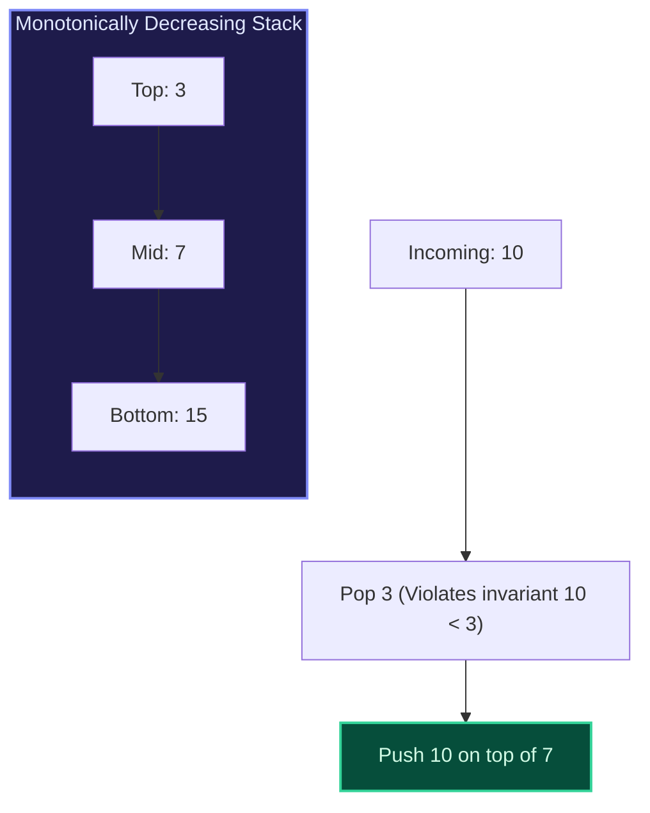
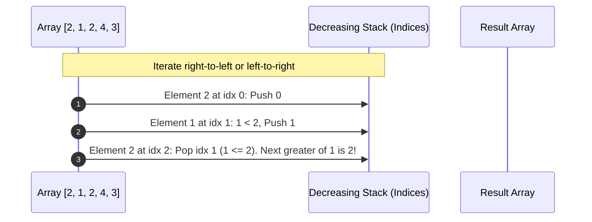

import { Callout } from "fumadocs-ui/components/callout";
import { Tabs, Tab } from "fumadocs-ui/components/tabs";
import { Steps, Step } from "fumadocs-ui/components/steps";
import { Cards, Card } from "fumadocs-ui/components/card";

## The Monotonic Invariant

A **Monotonic Stack** is a stack data structure whose elements are maintained in strictly increasing or strictly decreasing order.

- **Monotonically Increasing Stack**: Elements increase from bottom to top ($s_0 < s_1 < s_2$). Used to find the **Nearest Smaller Element**.
- **Monotonically Decreasing Stack**: Elements decrease from bottom to top ($s_0 > s_1 > s_2$). Used to find the **Nearest Greater Element**.



### Amortized $\mathcal{O}(N)$ Analysis

Even though an individual element might trigger multiple pops in a single step, **every element is pushed onto the stack exactly once and popped at most once**. The total number of stack operations across the entire array of size $N$ is strictly bounded by $2N = \mathcal{O}(N)$ amortized time.

---

## Canonical Archetype: Next Greater Element

For every element in array $A$, find the first element to its right that is strictly larger. If none exists, output $-1$.



---

## Canonical Archetype: Largest Rectangle in Histogram

Given $N$ bar heights, find the area of the largest rectangle that fits entirely within the histogram.

**The Invariant Insight**:
For bar $i$ of height $h_i$, the maximum rectangle with height $h_i$ extends leftward until the **first bar smaller than $h_i$** (`left_bound`) and rightward until the **first bar smaller than $h_i$** (`right_bound`).
$$\text{Area}(i) = h_i \cdot (\text{right\_bound}[i] - \text{left\_bound}[i] - 1)$$
A monotonic increasing stack computes both bounds in a single linear pass in $\mathcal{O}(N)$ time!

---

## Multi-Language Implementations

<Tabs items={["Python", "TypeScript", "C++"]}>
<Tab value="Python">
```python
from typing import List

def next_greater_element(nums: List[int]) -> List[int]:
"""Finds next greater element for each index in O(N) time."""
n = len(nums)
result = [-1] \* n
stack = [] # Monotonic decreasing stack storing indices

    for i in range(n):
        while stack and nums[i] > nums[stack[-1]]:
            prev_idx = stack.pop()
            result[prev_idx] = nums[i]
        stack.append(i)

    return result

def largest_rectangle_area(heights: List[int]) -> int:
"""Computes largest rectangle area in histogram in O(N) time."""
stack = [] # Monotonic increasing stack storing indices
max_area = 0 # Append 0 height sentinel to flush stack at the end
extended_heights = heights + [0]

    for i, h in enumerate(extended_heights):
        while stack and extended_heights[stack[-1]] > h:
            height = extended_heights[stack.pop()]
            width = i if not stack else (i - stack[-1] - 1)
            max_area = max(max_area, height * width)
        stack.append(i)

    return max_area

````
</Tab>
<Tab value="TypeScript">
```typescript
export function nextGreaterElement(nums: number[]): number[] {
  const n = nums.length;
  const result: number[] = new Array(n).fill(-1);
  const stack: number[] = [];

  for (let i = 0; i < n; i++) {
    while (stack.length > 0 && nums[i] > nums[stack[stack.length - 1]]) {
      const prevIdx = stack.pop()!;
      result[prevIdx] = nums[i];
    }
    stack.push(i);
  }

  return result;
}

export function largestRectangleArea(heights: number[]): number {
  const stack: number[] = [];
  let maxArea = 0;
  const h = [...heights, 0];

  for (let i = 0; i < h.length; i++) {
    while (stack.length > 0 && h[stack[stack.length - 1]] > h[i]) {
      const height = h[stack.pop()!];
      const width = stack.length === 0 ? i : i - stack[stack.length - 1] - 1;
      maxArea = Math.max(maxArea, height * width);
    }
    stack.push(i);
  }

  return maxArea;
}
````

</Tab>
<Tab value="C++">
```cpp
#include <vector>
#include <stack>
#include <algorithm>

std::vector<int> nextGreaterElement(const std::vector<int>& nums) {
int n = nums.size();
std::vector<int> result(n, -1);
std::stack<int> st;

    for (int i = 0; i < n; ++i) {
        while (!st.empty() && nums[i] > nums[st.top()]) {
            int prevIdx = st.top();
            st.pop();
            result[prevIdx] = nums[i];
        }
        st.push(i);
    }

    return result;

}

int largestRectangleArea(std::vector<int>& heights) {
heights.push_back(0); // Sentinel
std::stack<int> st;
int maxArea = 0;

    for (int i = 0; i < heights.size(); ++i) {
        while (!st.empty() && heights[st.top()] > heights[i]) {
            int h = heights[st.top()];
            st.pop();
            int w = st.empty() ? i : (i - st.top() - 1);
            maxArea = std::max(maxArea, h * w);
        }
        st.push(i);
    }

    heights.pop_back(); // Restore original vector
    return maxArea;

}

```
</Tab>
</Tabs>
```
