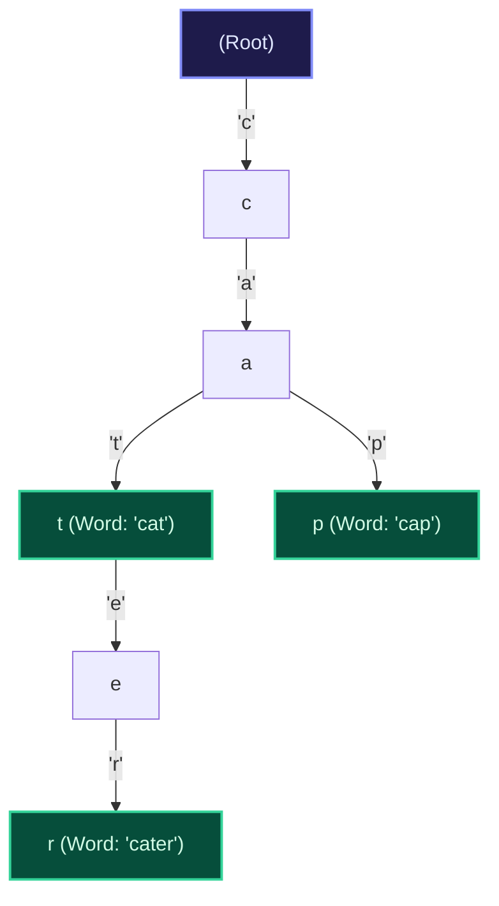

import { Callout } from "fumadocs-ui/components/callout";
import { Tabs, Tab } from "fumadocs-ui/components/tabs";
import { Steps, Step } from "fumadocs-ui/components/steps";
import { Cards, Card } from "fumadocs-ui/components/card";

## The Architectural Flaw of Hash Tables for String Prefixes

When building autocompletion systems, spell-checkers, or IP routing tables, hash tables exhibit a severe limitation: **they destroy prefix relationships**. A hash function uniformly scatters `cat`, `cater`, and `caterpillar` into disjoint buckets. To find all words starting with `cat`, a hash table must perform an exhaustive $\mathcal{O}(N)$ scan over all keys.

A **Prefix Tree (Trie)** structures strings hierarchically such that words sharing common prefixes share the same ancestor nodes. Looking up whether any word starts with prefix $P$ of length $L$ executes in strictly $\mathcal{O}(L)$ time, regardless of whether the dictionary contains 10 words or 10,000,000 words.



---

## Trie Node Architecture

Each Trie node consists of:

1. **Child Pointers**: An array `children[26]` for lowercase English alphabet, or a dynamic hash map for Unicode character spaces.
2. **End-of-Word Flag (`is_end_of_word`)**: A boolean flag indicating whether the path from the root to this node constitutes a complete dictionary word.

### Core Operations ($\mathcal{O}(L)$ Time)

1. **`insert(word)`**: Walk character by character. If a child link does not exist, instantiate a new node. Mark the terminal node as `is_end_of_word = True`.
2. **`search(word)`**: Walk character links. If any child link is missing, return `False`. At the end of the word, return `is_end_of_word`.
3. **`starts_with(prefix)`**: Walk character links. If all characters exist, return `True` (it is not necessary for the terminal node to have `is_end_of_word = True`).

---

## Multi-Language Implementations

<Tabs items={["Python", "TypeScript", "C++"]}>
<Tab value="Python">
```python
from typing import Dict

class TrieNode:
def **init**(self):
self.children: Dict[str, 'TrieNode'] = {}
self.is_end_of_word: bool = False

class Trie:
def **init**(self):
self.root = TrieNode()

    def insert(self, word: str) -> None:
        curr = self.root
        for char in word:
            if char not in curr.children:
                curr.children[char] = TrieNode()
            curr = curr.children[char]
        curr.is_end_of_word = True

    def search(self, word: str) -> bool:
        curr = self.root
        for char in word:
            if char not in curr.children:
                return False
            curr = curr.children[char]
        return curr.is_end_of_word

    def starts_with(self, prefix: str) -> bool:
        curr = self.root
        for char in prefix:
            if char not in curr.children:
                return False
            curr = curr.children[char]
        return True

````
</Tab>
<Tab value="TypeScript">
```typescript
export class TrieNode {
  children: Map<string, TrieNode> = new Map();
  isEndOfWord: boolean = false;
}

export class Trie {
  root: TrieNode = new TrieNode();

  insert(word: string): void {
    let curr = this.root;
    for (const char of word) {
      if (!curr.children.has(char)) {
        curr.children.set(char, new TrieNode());
      }
      curr = curr.children.get(char)!;
    }
    curr.isEndOfWord = true;
  }

  search(word: string): boolean {
    let curr = this.root;
    for (const char of word) {
      if (!curr.children.has(char)) return false;
      curr = curr.children.get(char)!;
    }
    return curr.isEndOfWord;
  }

  startsWith(prefix: string): boolean {
    let curr = this.root;
    for (const char of prefix) {
      if (!curr.children.has(char)) return false;
      curr = curr.children.get(char)!;
    }
    return true;
  }
}
````

</Tab>
<Tab value="C++">
```cpp
#include <string>
#include <vector>

class TrieNode {
public:
TrieNode\* children[26];
bool isEndOfWord;

    TrieNode() : isEndOfWord(false) {
        for (int i = 0; i < 26; ++i) children[i] = nullptr;
    }

};

class Trie {
private:
TrieNode\* root;

public:
Trie() : root(new TrieNode()) {}

    void insert(const std::string& word) {
        TrieNode* curr = root;
        for (char c : word) {
            int idx = c - 'a';
            if (!curr->children[idx]) {
                curr->children[idx] = new TrieNode();
            }
            curr = curr->children[idx];
        }
        curr->isEndOfWord = true;
    }

    bool search(const std::string& word) const {
        TrieNode* curr = root;
        for (char c : word) {
            int idx = c - 'a';
            if (!curr->children[idx]) return false;
            curr = curr->children[idx];
        }
        return curr->isEndOfWord;
    }

    bool startsWith(const std::string& prefix) const {
        TrieNode* curr = root;
        for (char c : prefix) {
            int idx = c - 'a';
            if (!curr->children[idx]) return false;
            curr = curr->children[idx];
        }
        return true;
    }

};

```
</Tab>
</Tabs>
```
