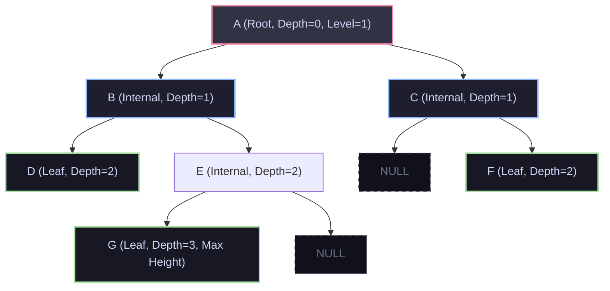
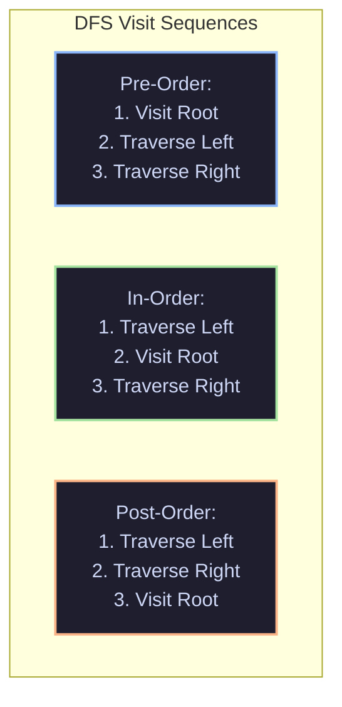
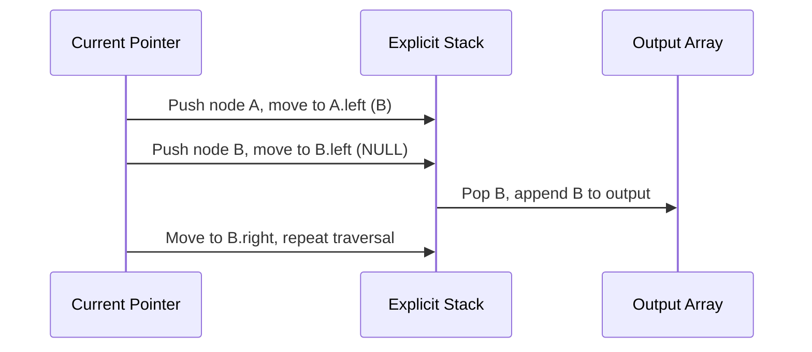
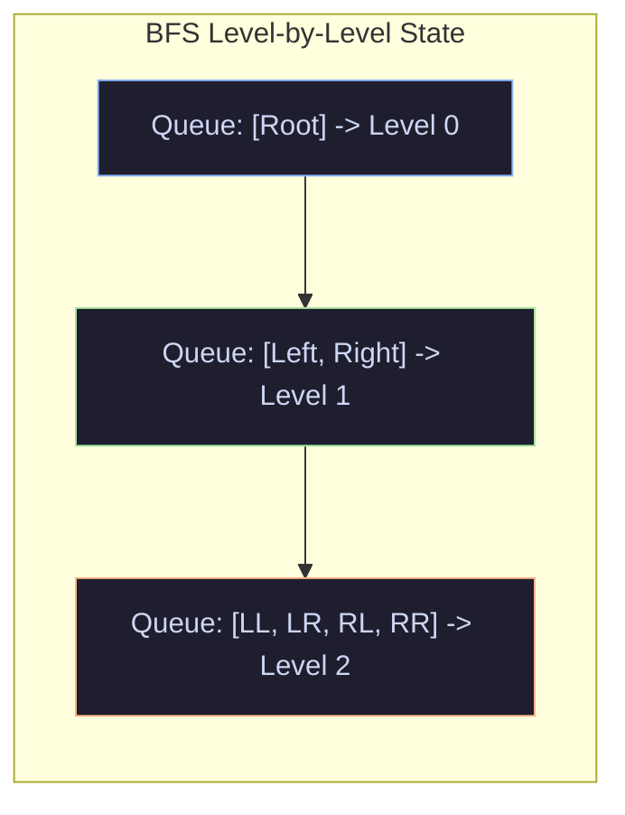
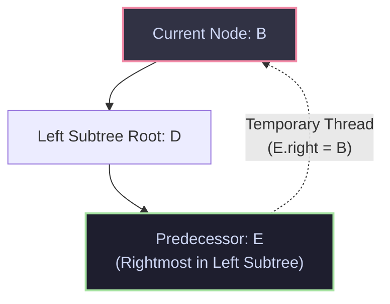

import { Callout } from "fumadocs-ui/components/callout";
import { Tabs, Tab } from "fumadocs-ui/components/tabs";
import { Steps, Step } from "fumadocs-ui/components/steps";
import { Cards, Card } from "fumadocs-ui/components/card";

## The Hierarchical Paradigm

Linear structures model sequences: lines of code, network packet queues, or chronological logs. However, the physical and conceptual world is overwhelmingly hierarchical:

- Filesystems nest directories inside parent folders.
- Web browsers represent HTML documents as Document Object Model (DOM) node trees.
- Compilers translate source code into Abstract Syntax Trees (ASTs) before generating machine code.
- Databases structure indexes as balanced multi-way trees.

A **Binary Tree** is a non-linear data structure where each node has at most two children, traditionally designated as the **left child** and the **right child**. This branching factor of two introduces the logarithmic halving potential that underpins fast search, balanced partitioning, and priority dispatch.

---

## 1. Anatomy and Memory Topology

### Core Terminology



- **Root**: The unique node without a parent (node `A`).
- **Leaf (External Node)**: A node with zero children (nodes `D`, `F`, `G`).
- **Internal Node**: A node with at least one non-null child.
- **Depth of Node $u$**: The number of edges on the path from the root to $u$. $\text{depth}(\text{root}) = 0$.
- **Height of Node $u$**: The number of edges on the longest downward path from $u$ to a leaf. The height of a leaf is $0$. The height of the tree is the height of its root.
- **Full Binary Tree**: Every node has either $0$ or $2$ children (no node has exactly $1$ child).
- **Complete Binary Tree**: Every level is completely filled, except possibly the last level, which is populated strictly from left to right.
- **Perfect Binary Tree**: All internal nodes have $2$ children and all leaves reside at the identical depth. For height $h$, it has exactly $2^{h+1} - 1$ nodes.
- **Degenerate (Pathological) Tree**: Every internal node has exactly one child. The tree structurally degrades into a singly linked list with height $\mathcal{O}(N)$.

### Physical Node Memory Layout (64-bit Architecture)

On modern 64-bit platforms, a heap-allocated tree node suffers from substantial pointer overhead:

```
+-------------------+--------------------+--------------------+
|   int64_t val     |   TreeNode* left   |  TreeNode* right   |
|     (8 bytes)     |     (8 bytes)      |     (8 bytes)      |
+-------------------+--------------------+--------------------+
Total Payload = 24 bytes (+ 8 or 16 bytes malloc allocator header)
```

In languages with object headers like Java or Python:

- A Python `TreeNode` object occupies roughly **56 bytes** due to object dictionary and type pointer overhead.
- A C++ node consumes **24 bytes** of direct payload plus allocator metadata.
- Because nodes are allocated independently on the free store (heap), they do not sit contiguously in memory. Visiting child nodes incurs pointer chases that trigger **CPU L1/L2 cache misses**.

---

## 2. Depth-First Traversals (DFS)

Depth-First Search explores as deep as possible along each branch before backtracking. The three classic DFS orders differ solely in **when** the current node's value is processed relative to its subtrees:



### Recursive DFS Mechanics

When executing recursive traversals, the operating system's thread execution call stack implicitly tracks our backtracking path:

```python
def in_order_recursive(node: Optional[TreeNode]) -> None:
    if not node:
        return
    in_order_recursive(node.left)   # Push stack frame
    process(node.val)               # Process
    in_order_recursive(node.right)  # Push stack frame
```

<Callout type="warn">
  **Call Stack Exhaustion**: If the tree degenerates into a linked list of $N =
  100,000$ nodes, recursive traversal creates $100,000$ stack frames. In Python
  (default recursion limit $1,000$) or C++ (default thread stack $1\text{MB}$ to
  $8\text{MB}$), this immediately triggers a fatal `RecursionError` or
  segmentation fault (`SIGSEGV`). Production systems require **iterative
  traversals with heap-allocated explicit stacks** or **Morris traversal**.
</Callout>

### Iterative DFS With Explicit Heap Stack

By allocating our own stack on the heap, our memory ceiling is bounded only by total RAM, preventing thread stack overflows.

#### 1. Iterative In-Order Traversal

We simulate the call stack by traveling down the left spine of the tree, pushing every node onto the stack until we hit `None`. We then pop the top node, process it, and shift the current pointer to its right child.



#### 2. Iterative Post-Order Traversal (Single Stack + Last-Visited Tracking)

Post-order is the trickiest because a parent node must be visited **after** its right child has been completely processed. We track a `last_visited` pointer to differentiate between returning from the left subtree (where we still need to visit the right child) versus returning from the right subtree (where we can now process the root node). When peeking at the stack top, if the right child exists and was not just visited, we traverse into the right child. Otherwise, both subtrees are done; we pop and visit the node.

---

## 3. Breadth-First Search (BFS) / Level-Order Traversal

Breadth-First Search visits nodes level-by-level, from left to right. It relies on a First-In, First-Out (**FIFO**) queue.



To group nodes by level:

1. Record `level_size = len(queue)` before processing each level.
2. Dequeue exactly `level_size` nodes, append their values to the current level array, and push their non-null children into the queue.
3. This guarantees clean level demarcation without sentinel marker objects.

---

## 4. Morris In-Order Traversal: $\mathcal{O}(1)$ Auxiliary Space

Standard traversals require $\mathcal{O}(h)$ auxiliary space for call stacks or queues. In $1979$, J. H. Morris discovered an algorithm that achieves in-order traversal in $\mathcal{O}(N)$ time using **strictly $\mathcal{O}(1)$ auxiliary space** without modifying the tree structure upon completion.

### The Mechanism: Threaded Links

Morris exploits the unused `null` right pointers of leaf nodes. In an in-order sequence, the node visited directly before current $u$ is the **in-order predecessor** (the rightmost node in $u$'s left subtree).



<Steps>
  <Step>
    #### Check Left Child If `current.left == null`: visit `current`, then move
    `current = current.right`.
  </Step>
  <Step>
    #### Find In-Order Predecessor If `current.left != null`: find the rightmost
    node in the left subtree such that `pred.right != null` and `pred.right !=
    current`.
  </Step>
  <Step>
    #### Create Temporary Thread If `pred.right == null`: establish a temporary
    thread back to current (`pred.right = current`) and move to the left child
    (`current = current.left`).
  </Step>
  <Step>
    #### Dismantle Thread and Visit If `pred.right == current`: the left subtree
    has already been traversed. Dismantle the thread (`pred.right = null`),
    visit `current`, and move to the right child (`current = current.right`).
  </Step>
</Steps>

<Callout type="info">
  **Why is Morris Traversal $\mathcal{O}(N)$ Time?** Each edge in the tree is
  traversed at most $3$ times: once to find the predecessor and establish the
  thread, once when walking the left subtree, and once to locate the predecessor
  again to remove the thread. Therefore, the total edge traversals are bounded
  by $3(N - 1) = \mathcal{O}(N)$.
</Callout>

---

## 5. Tree Serialization & Deserialization

In distributed systems, tree structures must be marshaled into byte strings for network transmission or disk storage and reconstructed faithfully on other nodes.

### Codec Approaches

1. **Pre-Order DFS with Sentinels**: Pre-order visits the root first. By inserting a sentinel symbol (such as `#`) for every `null` pointer, the serialized sequence uniquely defines a binary tree.
2. **BFS Level-Order (LeetCode Style)**: Serializes level-by-level with comma-delimited strings and `null` tokens.

```
       1
      / \
     2   3
        / \
       4   5

Pre-Order Serialized:  "1,2,#,#,3,4,#,#,5,#,#"
BFS Serialized:        "1,2,3,null,null,4,5,null,null,null,null"
```

---

## Algorithmic Complexity Matrix

| Traversal Strategy          | Time Complexity  | Auxiliary Space (Avg)               | Auxiliary Space (Worst)         | Tree Mutation During Run   |
| :-------------------------- | :--------------- | :---------------------------------- | :------------------------------ | :------------------------- |
| **Recursive DFS**           | $\mathcal{O}(N)$ | $\mathcal{O}(\log N)$               | $\mathcal{O}(N)$ (Degenerate)   | None                       |
| **Iterative DFS (Stack)**   | $\mathcal{O}(N)$ | $\mathcal{O}(\log N)$               | $\mathcal{O}(N)$ (Heap Stack)   | None                       |
| **BFS Level-Order (Queue)** | $\mathcal{O}(N)$ | $\mathcal{O}(W) = \mathcal{O}(N/2)$ | $\mathcal{O}(N)$ (Perfect Tree) | None                       |
| **Morris Traversal**        | $\mathcal{O}(N)$ | $\mathcal{O}(1)$                    | $\mathcal{O}(1)$                | Temporary (Self-Restoring) |

---

## Production Multi-Language Implementation

Here are the complete, production-grade implementations of the traversals and the Pre-order DFS Serialization Codec.

<Tabs items={['Python', 'TypeScript', 'C++']}>
  <Tab value="Python">
```python
from collections import deque
from typing import Optional, List

class TreeNode:
def **init**(self, val: int = 0, left: Optional['TreeNode'] = None, right: Optional['TreeNode'] = None):
self.val = val
self.left = left
self.right = right

class TreeTraversals:
@staticmethod
def in_order_iterative(root: Optional[TreeNode]) -> List[int]:
"""Iterative In-order traversal using an explicit stack."""
result: List[int] = []
stack: List[TreeNode] = []
curr = root

        while curr or stack:
            # Traverse all the way to the leftmost leaf
            while curr:
                stack.append(curr)
                curr = curr.left

            curr = stack.pop()
            result.append(curr.val)
            curr = curr.right

        return result

    @staticmethod
    def post_order_iterative(root: Optional[TreeNode]) -> List[int]:
        """Iterative Post-order traversal using a single explicit stack and last_visited pointer."""
        result: List[int] = []
        stack: List[TreeNode] = []
        curr = root
        last_visited: Optional[TreeNode] = None

        while curr or stack:
            if curr:
                stack.append(curr)
                curr = curr.left
            else:
                peek_node = stack[-1]
                # If right child exists and hasn't been visited yet, move right
                if peek_node.right and last_visited != peek_node.right:
                    curr = peek_node.right
                else:
                    result.append(peek_node.val)
                    last_visited = stack.pop()

        return result

    @staticmethod
    def level_order_bfs(root: Optional[TreeNode]) -> List[List[int]]:
        """Level-by-level BFS traversal."""
        if not root:
            return []

        levels: List[List[int]] = []
        queue = deque([root])

        while queue:
            level_size = len(queue)
            current_level: List[int] = []

            for _ in range(level_size):
                node = queue.popleft()
                current_level.append(node.val)
                if node.left:
                    queue.append(node.left)
                if node.right:
                    queue.append(node.right)

            levels.append(current_level)

        return levels

    @staticmethod
    def morris_in_order(root: Optional[TreeNode]) -> List[int]:
        """Morris In-Order Traversal with strictly O(1) auxiliary memory."""
        result: List[int] = []
        curr = root

        while curr:
            if not curr.left:
                result.append(curr.val)
                curr = curr.right
            else:
                # Find in-order predecessor (rightmost node in left subtree)
                pred = curr.left
                while pred.right and pred.right != curr:
                    pred = pred.right

                if not pred.right:
                    # Establish temporary thread
                    pred.right = curr
                    curr = curr.left
                else:
                    # Dismantle temporary thread and process current
                    pred.right = None
                    result.append(curr.val)
                    curr = curr.right

        return result

class TreeCodec:
"""Production Serialization/Deserialization using Pre-Order DFS with sentinels."""
DELIMITER = ","
NULL_MARKER = "#"

    def serialize(self, root: Optional[TreeNode]) -> str:
        tokens: List[str] = []

        def _dfs(node: Optional[TreeNode]) -> None:
            if not node:
                tokens.append(self.NULL_MARKER)
                return
            tokens.append(str(node.val))
            _dfs(node.left)
            _dfs(node.right)

        _dfs(root)
        return self.DELIMITER.join(tokens)

    def deserialize(self, data: str) -> Optional[TreeNode]:
        if not data:
            return None
        tokens = deque(data.split(self.DELIMITER))

        def _build() -> Optional[TreeNode]:
            if not tokens:
                return None
            val_str = tokens.popleft()
            if val_str == self.NULL_MARKER:
                return None

            node = TreeNode(int(val_str))
            node.left = _build()
            node.right = _build()
            return node

        return _build()

````
  </Tab>
  <Tab value="TypeScript">
```typescript
export class TreeNode {
  val: number;
  left: TreeNode | null;
  right: TreeNode | null;

  constructor(val: number = 0, left: TreeNode | null = null, right: TreeNode | null = null) {
    this.val = val;
    this.left = left;
    this.right = right;
  }
}

export class TreeTraversals {
  /**
   * Iterative In-order Traversal using explicit stack.
   */
  static inOrderIterative(root: TreeNode | null): number[] {
    const result: number[] = [];
    const stack: TreeNode[] = [];
    let curr: TreeNode | null = root;

    while (curr !== null || stack.length > 0) {
      while (curr !== null) {
        stack.push(curr);
        curr = curr.left;
      }

      curr = stack.pop()!;
      result.push(curr.val);
      curr = curr.right;
    }

    return result;
  }

  /**
   * Morris In-Order Traversal with O(1) auxiliary space.
   */
  static morrisInOrder(root: TreeNode | null): number[] {
    const result: number[] = [];
    let curr: TreeNode | null = root;

    while (curr !== null) {
      if (curr.left === null) {
        result.push(curr.val);
        curr = curr.right;
      } else {
        let pred: TreeNode = curr.left;
        while (pred.right !== null && pred.right !== curr) {
          pred = pred.right;
        }

        if (pred.right === null) {
          pred.right = curr; // Create thread
          curr = curr.left;
        } else {
          pred.right = null; // Remove thread
          result.push(curr.val);
          curr = curr.right;
        }
      }
    }

    return result;
  }

  /**
   * Level-order BFS Traversal.
   */
  static levelOrderBFS(root: TreeNode | null): number[][] {
    if (!root) return [];
    const levels: number[][] = [];
    const queue: TreeNode[] = [root];

    while (queue.length > 0) {
      const levelSize = queue.length;
      const currentLevel: number[] = [];

      for (let i = 0; i < levelSize; i++) {
        const node = queue.shift()!;
        currentLevel.push(node.val);
        if (node.left) queue.push(node.left);
        if (node.right) queue.push(node.right);
      }
      levels.push(currentLevel);
    }

    return levels;
  }
}

export class TreeCodec {
  private static readonly DELIMITER = ",";
  private static readonly NULL_MARKER = "#";

  static serialize(root: TreeNode | null): string {
    const tokens: string[] = [];
    const dfs = (node: TreeNode | null) => {
      if (node === null) {
        tokens.push(TreeCodec.NULL_MARKER);
        return;
      }
      tokens.push(node.val.toString());
      dfs(node.left);
      dfs(node.right);
    };
    dfs(root);
    return tokens.join(TreeCodec.DELIMITER);
  }

  static deserialize(data: string): TreeNode | null {
    if (!data) return null;
    const tokens = data.split(TreeCodec.DELIMITER);
    let index = 0;

    const build = (): TreeNode | null => {
      if (index >= tokens.length) return null;
      const token = tokens[index++];
      if (token === TreeCodec.NULL_MARKER) return null;

      const node = new TreeNode(Number(token));
      node.left = build();
      node.right = build();
      return node;
    };

    return build();
  }
}
````

  </Tab>
  <Tab value="C++">
```cpp
#include <iostream>
#include <vector>
#include <string>
#include <sstream>
#include <stack>
#include <queue>
#include <memory>

struct TreeNode {
int val;
TreeNode* left;
TreeNode* right;
TreeNode(int x) : val(x), left(nullptr), right(nullptr) {}
};

class TreeTraversals {
public:
static std::vector<int> inOrderIterative(TreeNode* root) {
std::vector<int> result;
std::stack<TreeNode*> st;
TreeNode\* curr = root;

        while (curr != nullptr || !st.empty()) {
            while (curr != nullptr) {
                st.push(curr);
                curr = curr->left;
            }
            curr = st.top();
            st.pop();
            result.push_back(curr->val);
            curr = curr->right;
        }
        return result;
    }

    static std::vector<int> morrisInOrder(TreeNode* root) {
        std::vector<int> result;
        TreeNode* curr = root;

        while (curr != nullptr) {
            if (curr->left == nullptr) {
                result.push_back(curr->val);
                curr = curr->right;
            } else {
                TreeNode* pred = curr->left;
                while (pred->right != nullptr && pred->right != curr) {
                    pred = pred->right;
                }

                if (pred->right == nullptr) {
                    pred->right = curr; // Establish threaded link
                    curr = curr->left;
                } else {
                    pred->right = nullptr; // Tear down thread
                    result.push_back(curr->val);
                    curr = curr->right;
                }
            }
        }
        return result;
    }

    static std::vector<std::vector<int>> levelOrderBFS(TreeNode* root) {
        if (!root) return {};
        std::vector<std::vector<int>> levels;
        std::queue<TreeNode*> q;
        q.push(root);

        while (!q.empty()) {
            size_t levelSize = q.size();
            std::vector<int> currentLevel;
            currentLevel.reserve(levelSize);

            for (size_t i = 0; i < levelSize; ++i) {
                TreeNode* node = q.front();
                q.pop();
                currentLevel.push_back(node->val);
                if (node->left) q.push(node->left);
                if (node->right) q.push(node->right);
            }
            levels.push_back(currentLevel);
        }
        return levels;
    }

};

class TreeCodec {
public:
static std::string serialize(TreeNode\* root) {
std::ostringstream out;
serializeHelper(root, out);
return out.str();
}

    static TreeNode* deserialize(const std::string& data) {
        std::istringstream in(data);
        return deserializeHelper(in);
    }

private:
static void serializeHelper(TreeNode\* node, std::ostringstream& out) {
if (!node) {
out << "# ";
return;
}
out << node->val << " ";
serializeHelper(node->left, out);
serializeHelper(node->right, out);
}

    static TreeNode* deserializeHelper(std::istringstream& in) {
        std::string val;
        if (!(in >> val) || val == "#") {
            return nullptr;
        }
        TreeNode* node = new TreeNode(std::stoi(val));
        node->left = deserializeHelper(in);
        node->right = deserializeHelper(in);
        return node;
    }

};

````
  </Tab>
</Tabs>

---

## Production Systems Case Study: V8 AST & Blink DOM

### 1. V8 Abstract Syntax Trees & Bytecode Generation
Inside Google Chrome's **V8 JavaScript Engine**, source code is tokenized by the scanner and converted into an Abstract Syntax Tree by the parser.

```mermaid
flowchart LR
    Source["JS Source Code"] --> Scanner["Scanner (Lexer)"]
    Scanner --> Parser["Recursive Descent Parser"]
    Parser --> AST["Abstract Syntax Tree (AST)"]
    AST --> Ignition["Ignition Bytecode Generator\n(Post-Order Traversal)"]
    Ignition --> Bytecode["V8 Bytecode Stream"]
````

The V8 bytecode compiler (**Ignition**) executes a **post-order AST traversal**:

1. To evaluate an expression like `const x = a + b * c;`, Ignition traverses the right subtree (`b * c`) first to compute the product into an accumulator register.
2. It then backtracks to the parent addition operator (`+`), adding identifier `a`.
3. Finally, it executes the root assignment statement (`= x`).
   Post-order traversal is mathematically required because operator operands must be evaluated before the operator can emit its compute bytecode instruction.

### 2. Chromium Blink DOM & Layout Tree Generation

In Chromium's rendering engine (**Blink**), web pages are represented by an in-memory C++ `Node` tree.
During the layout and render pipeline:

- Style resolution traverses the DOM tree to attach CSS computed styles.
- The Layout tree is constructed. Geometry calculation (width, height, coordinates) requires a **two-pass traversal**:
  - Downward pre-order pass: Parent constraints (available width) propagate downward to children.
  - Upward post-order pass: Child intrinsic sizes (text dimensions, image bounds) propagate upward to determine parent height.

---

## Technical Interview Patterns & Pitfalls

### Pattern: Lowest Common Ancestor (LCA)

The Lowest Common Ancestor of two nodes $p$ and $q$ is the deepest node in the tree that has both $p$ and $q$ as descendants (where a node can be a descendant of itself).

```python
def lowest_common_ancestor(root: TreeNode, p: TreeNode, q: TreeNode) -> Optional[TreeNode]:
    if not root or root == p or root == q:
        return root

    left = lowest_common_ancestor(root.left, p, q)
    right = lowest_common_ancestor(root.right, p, q)

    # If both left and right return non-null, current node is the LCA split point
    if left and right:
        return root
    return left if left else right
```

### Pitfall Checklist

1. **Never Assume Balanced Trees**: In interview problems, unless explicitly stated that the tree is balanced, always assume the tree can be degenerate ($h = N$). State clearly that recursive solutions risk call-stack overflow.
2. **Missing the Base Case**: A missing `if not root: return` causes `AttributeError: 'NoneType' object has no attribute 'val'`.
3. **Double Counting in Path Sum**: When computing diameters or maximum path sums, differentiate between:
   - What a node **returns to its parent** (at most one branch: $\max(\text{left}, \text{right}) + \text{val}$).
   - The **complete path curve** passing through the node ($\text{left} + \text{right} + \text{val}$).

---

## Hands-On Verification Challenge

### Problem: Construct Binary Tree from Preorder & Inorder Arrays

Given two integer arrays `preorder` and `inorder` where `preorder` is the preorder traversal of a binary tree and `inorder` is the inorder traversal of the same tree (with distinct values), reconstruct and return the binary tree. Then verify that running `morris_in_order(root)` outputs the original `inorder` array.

```python
def build_tree(preorder: List[int], inorder: List[int]) -> Optional[TreeNode]:
    inorder_index_map = {val: idx for idx, val in enumerate(inorder)}
    pre_iter = iter(preorder)

    def _helper(left_bound: int, right_bound: int) -> Optional[TreeNode]:
        if left_bound > right_bound:
            return None

        root_val = next(pre_iter)
        root = TreeNode(root_val)
        mid = inorder_index_map[root_val]

        root.left = _helper(left_bound, mid - 1)
        root.right = _helper(mid + 1, right_bound)
        return root

    return _helper(0, len(inorder) - 1)

# Verification
pre = [3, 9, 20, 15, 7]
ino = [9, 3, 15, 20, 7]
reconstructed_root = build_tree(pre, ino)
assert TreeTraversals.morris_in_order(reconstructed_root) == ino
print("Verification Succeeded: Morris Traversal matches in-order input!")
```
