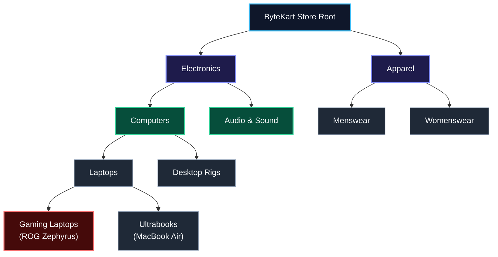
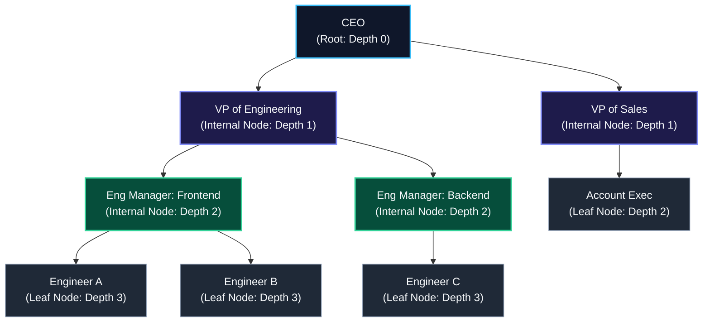
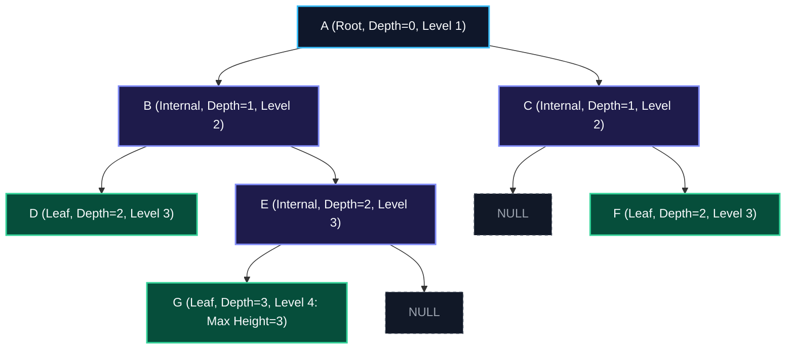
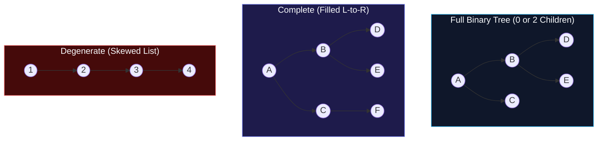
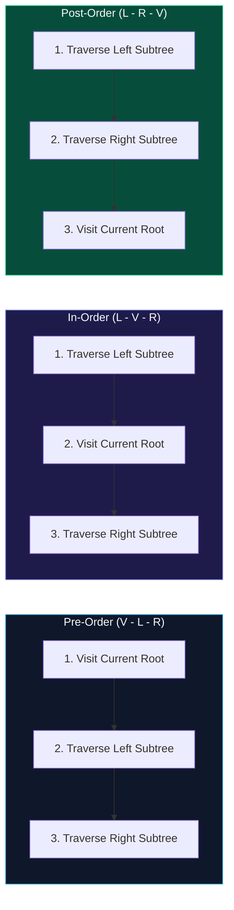
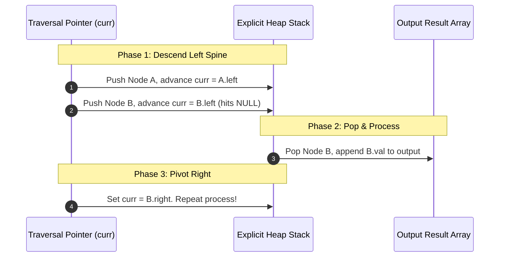
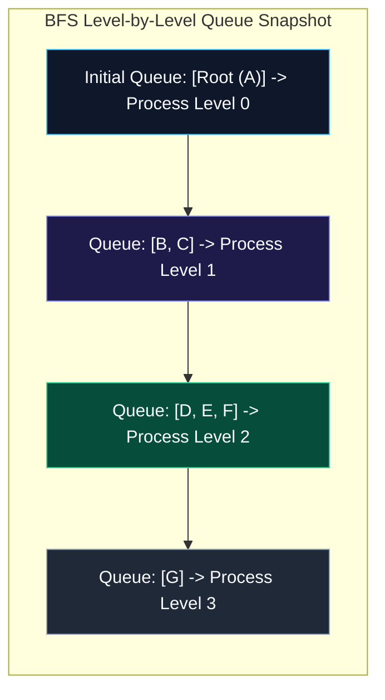
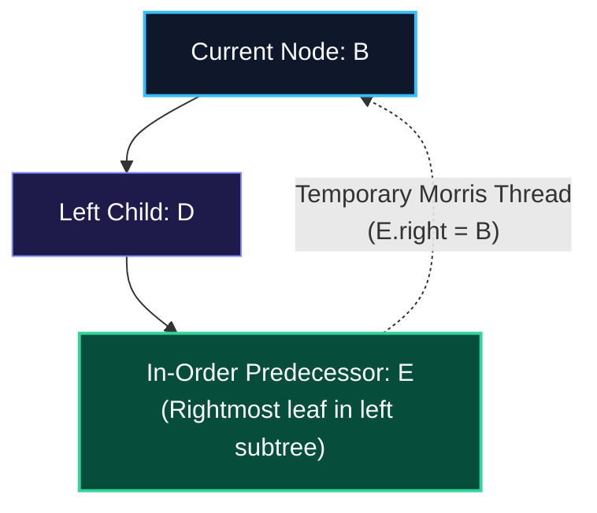
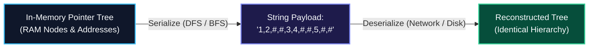

import { Callout } from "fumadocs-ui/components/callout";
import { Tabs, Tab } from "fumadocs-ui/components/tabs";
import { Steps, Step } from "fumadocs-ui/components/steps";
import { Cards, Card } from "fumadocs-ui/components/card";

## The ByteKart Story Begins: The Category Taxonomy Dilemma

Imagine you are the principal architect at **ByteKart**, a rapidly scaling global e-commerce marketplace. When ByteKart launched, the entire product catalog fit on a single promotional page. The catalog categories were stored in a simple, flat database table:

```
["Electronics", "Computers", "Gaming Laptops", "Clothing", "Menswear", "Outerwear", "Winter Jackets"]
```

Everything was quiet until Black Friday, when ByteKart introduced $500,000$ new stock keeping units (SKUs). Suddenly, the frontend engineering team escalated an urgent performance defect:

1. **The Navigation Breadcrumb Bug**: When a customer clicks on a _"ROG Zephyrus G16"_, the user interface must render the navigation breadcrumb trail:
   $$\text{Electronics} \longrightarrow \text{Computers} \longrightarrow \text{Laptops} \longrightarrow \text{Gaming Laptops}$$
   In a flat array, finding the parent or ancestors of any category required scanning hundreds of rows with recursive table joins—grinding database read replicas to a halt ($\mathcal{O}(N)$ per lookup).
2. **The "Show All Subcategories" Collapse**: When a shopper filters by _"Electronics"_, ByteKart must aggregate all items nested under every subcategory (audio equipment, phones, laptops, and desktop towers). In a linear list, determining which items belong under _"Electronics"_ required full catalog scans.



The database lead proposed a fundamental realization:

> _"The physical universe is not a flat ribbon of memory. Real-world relationships are inherently hierarchical. File systems nest folders inside directories, browser HTML documents nest tags inside containers, corporate leadership cascades from the executive suite down to team leads, and product catalogs bifurcate into specialized taxonomies. We do not need a longer list—we need a **Tree**."_

---

## Everyday Physical Analogies: Trees and Organizations

Before writing pointer arithmetic, ground the concept in everyday physical systems:

### 1. The Corporate Organizational Chart

A corporate hierarchy begins with exactly one **Chief Executive Officer (CEO)** at the top. The CEO reports to no one in the company (the **Root**).

The CEO manages Vice Presidents (internal nodes), who oversee Department Directors, who lead Engineering Managers. At the very bottom sit Individual Contributors (Software Engineers, Designers, Accountants) who have zero direct reports. In tree terminology, these leaf team members are **Leaves (External Nodes)**.



### 2. The Power of the Binary Branching Factor

Why do computer scientists obsess over **Binary** trees (where each node has at most **two** children: `left` and `right`)?

Because a branching factor of two introduces the superpower of **logarithmic halving** ($\mathcal{O}(\log_2 N)$).

- Level $0$: $2^0 = 1$ node
- Level $1$: $2^1 = 2$ nodes
- Level $2$: $2^2 = 4$ nodes
- Level $20$: $2^{20} = 1,048,576$ nodes!

In a balanced binary tree containing **one million products**, you can reach any single product or determine its category ancestry by traversing at most **$20$ edges**. A linear scan would examine all $1,000,000$ records!

---

## 1. Anatomy and Memory Topology

### Core Terminology

To communicate clearly in system architecture and technical interviews, master the exact spatial terminology of trees:



- **Root**: The unique origin node without a parent (node `A`). Every tree has exactly one root.
- **Leaf (External Node)**: A terminal node with zero children (nodes `D`, `F`, `G`).
- **Internal Node**: Any node that possesses at least one non-null child (nodes `Root`, `B`, `C`, `E`).
- **Depth of Node $u$**: The number of edges on the path from the root down to $u$. Think of this as _how many flights of stairs you descend from the penthouse suite_. $\text{depth}(\text{root}) = 0$.
- **Height of Node $u$**: The number of edges on the longest downward path from $u$ to any leaf in its subtree. The height of any leaf is $0$. The height of the tree is defined as the height of its root ($\text{height}(A) = 3$).
- **Subtree**: The tree formed by any node and all of its descendants.

### The Four Structural Variations



1. **Full Binary Tree**: Every node has either $0$ or $2$ children. No node ever has a single child.
2. **Complete Binary Tree**: Every level is completely filled, except possibly the final level, where all nodes are packed as far to the **left** as possible without gaps. _(This property is the foundation of Heaps in Lesson 03!)_
3. **Perfect Binary Tree**: All internal nodes have exactly $2$ children, and all leaves reside at the identical bottom level. For height $h$, it contains exactly $2^{h+1} - 1$ nodes.
4. **Degenerate (Pathological or Skewed) Tree**: Every internal node has exactly one child. The tree structurally degenerates into a singly linked list where height becomes $\mathcal{O}(N)$, collapsing search performance from $\mathcal{O}(\log N)$ to $\mathcal{O}(N)$.

---

### Physical Node Memory Layout (64-Bit Architecture)

How is a tree node physically stored in silicon? On modern 64-bit hardware, a traditional heap-allocated tree node incurs substantial pointer overhead:

```
+-----------------------------+-----------------------------+-----------------------------+
|    int64_t val / payload    |       TreeNode* left        |       TreeNode* right       |
|          (8 bytes)          |          (8 bytes)          |          (8 bytes)          |
+-----------------------------+-----------------------------+-----------------------------+
Direct Node Payload = 24 bytes
+ Dynamic Heap Allocator Overhead (ptmalloc / jemalloc header) = 8 to 16 bytes
Total Memory Footprint = 32 to 40 bytes per node!
```

In managed runtime languages:

- **Python**: A custom `TreeNode` object occupies approximately **$56$ bytes** due to the Python object header (`PyObject_HEAD`), type pointer, and instance reference dictionary pointer.
- **C++**: A standard struct consumes **$24$ bytes** plus the allocator metadata chunk.

<Callout type="warn" title="The Pointer-Jumping Cache Penalty">
Because nodes are created dynamically with `new` or `malloc()`, they are scattered unpredictably across heap memory addresses.

When your CPU traverses from a parent to its child, it cannot take advantage of contiguous memory spatial locality. The hardware prefetcher fails, and the CPU stalls waiting for data to arrive from main RAM—incurring severe **L1/L2 data cache misses**. (In Lesson 03, you will see how Heaps eliminate this penalty entirely by packing trees into flat arrays!)

</Callout>

---

## 2. Depth-First Traversals (DFS): Three Perspectives on Hierarchy

Depth-First Search (DFS) explores along each branch as deep as possible before backtracking. The three classic DFS strategies visit the exact same nodes, but differ solely in **when the current node's value is processed relative to its left and right subtrees**:



### Everyday Analogies for the Three Traversals

1. **Pre-Order (Visit $\to$ Left $\to$ Right)**: **The CEO Company-Wide Announcement**
   - The CEO makes the announcement to the company first, and then delegates task execution down to the Vice Presidents, who delegate down to their teams.
   - _Primary Use Cases_: Cloning or duplicating a tree structure, serializing a hierarchy to disk or network byte streams, rendering table-of-contents navigation menus.
2. **In-Order (Left $\to$ Visit $\to$ Right)**: **Reading a Bookshelf from Left to Right**
   - You read the left side first, pause at the center divider, and continue through the right side.
   - _Primary Use Case_: In a **Binary Search Tree (BST)**, where smaller keys sit on the left and larger keys on the right, in-order traversal yields values in **strictly sorted, ascending numerical order**!
3. **Post-Order (Left $\to$ Right $\to$ Visit)**: **Calculating Disk Space or Roof-First House Demolition**
   - You cannot determine the total disk storage occupied by `/users` until you first calculate the sizes of all files in its subfolders.
   - Similarly, you cannot demolish the foundation of a building while the roof and walls are still standing on top of it; you demolish the roof first, then the walls, and finally the foundation.
   - _Primary Use Cases_: Bottom-up resource deallocation (freeing memory in C++ without dangling pointers), evaluating mathematical expressions in compiler ASTs (e.g. Chrome's V8 engine), computing subtree heights.

---

## 3. The Call Stack Trap & Explicit Iterative Traversal

Here is the standard recursive implementation of In-Order traversal taught in introductory computer science:

```python
def in_order_recursive(node: Optional[TreeNode]) -> None:
    if not node:
        return
    in_order_recursive(node.left)   # Step 1: Push left frame onto stack
    process(node.val)               # Step 2: Process value
    in_order_recursive(node.right)  # Step 3: Push right frame onto stack
```

<Callout type="warn" title="Why Recursion Call Stacks Crash on Pathological Trees">
Every recursive invocation creates a new **Stack Frame** on the operating system thread execution stack. A typical stack frame stores local variables, parameters, and the CPU return instruction pointer (consuming roughly $48$ to $64$ bytes per call).

If ByteKart's product catalog degenerates into a skewed tree of $N = 100,000$ categories (e.g., each subcategory has only one child):

- The thread stack demands $100,000 \times 64 \text{ bytes} \approx 6.4 \text{ MB}$.
- In Python, the default recursion limit is rigidly set to **$1,000$ calls**—raising an immediate fatal `RecursionError`.
- In C++ or Rust, where default thread stack limits typically range between **$1 \text{ MB}$ and $8 \text{ MB}$**, this instantly triggers a fatal **Stack Overflow Segmentation Fault (`SIGSEGV`)** that crashes the application server!

Production systems handle large trees using **iterative traversals with explicit heap-allocated stacks** (bounded only by total system RAM) or **Morris Traversal** ($\mathcal{O}(1)$ space).

</Callout>

### Iterative In-Order Traversal (Explicit Heap Stack)

To convert recursion into an iterative algorithm, we explicitly simulate the OS call stack. We march down the leftmost spine of the tree, pushing every node onto our heap stack. When we hit a `null` leaf pointer, we pop the top node, process its value, and pivot our traversal pointer to its right child:



### Iterative Post-Order Traversal (Single Stack + Last-Visited Tracking)

Post-Order traversal is notoriously tricky to implement iteratively because a parent node must be visited **after** both its left and right subtrees have been completely exhausted.

If we simply peek at the stack top, how do we distinguish between:

1. Returning upward from the left subtree (meaning we still have to explore the right child)?
2. Returning upward from the right subtree (meaning both children are complete, and we must now process the parent)?

We resolve this ambiguity with a `last_visited` pointer. When inspecting `stack.peek()`, if a right child exists and was not just visited (`peek.right != last_visited`), we dive down into the right subtree. Otherwise, all descendants are processed: we pop the node and output its value.

---

## 4. Breadth-First Search (BFS) / Level-Order Traversal

While DFS plunges deep along branches, Breadth-First Search (BFS) explores the tree **horizontally**, visiting every node at depth $d$ before touching any node at depth $d+1$.

### The Everyday Analogy: The Pond Ripple & Company Bonus Distribution

Drop a stone into a still pond: the ripple expands outward in concentric, perfectly circular rings (Level 0, Level 1, Level 2).

Similarly, imagine ByteKart distributing annual bonuses strictly by management tier: first all C-suite executives receive their letter (Level 0), then all Vice Presidents receive theirs (Level 1), then all Directors (Level 2), and finally all Engineers (Level 3).



### The Invariant Level-Size Snapshot Pattern

Beginners frequently wonder: _"How do we separate nodes into distinct sub-arrays per level when using a single flat FIFO queue?"_

The solution is the **Level-Size Snapshot**:

1. At the beginning of each level loop, capture `level_size = len(queue)`.
2. Execute a loop exactly `level_size` times. Dequeue each node, record its value, and enqueue its valid children.
3. Because all newly enqueued children sit _behind_ the current level's nodes in the queue, the level boundary remains mathematically crisp without sentinel marker objects!

---

## 5. Morris In-Order Traversal: $\mathcal{O}(1)$ Auxiliary Space

Standard DFS traversals demand $\mathcal{O}(H)$ memory for call stacks, which degenerates to $\mathcal{O}(N)$ on skewed trees. BFS demands $\mathcal{O}(W)$ memory for its queue, which reaches $\mathcal{O}(N/2) = \mathcal{O}(N)$ on perfect trees.

In $1979$, J. H. Morris published an algorithm that performs complete in-order traversal in $\mathcal{O}(N)$ time using **strictly $\mathcal{O}(1)$ auxiliary space**, without permanently altering the tree structure!

### The Everyday Analogy: Hansel & Gretel's Breadcrumb Trail

In the classic fairy tale, Hansel and Gretel venture deep into a dense forest. To return home without getting lost (and without carrying an enormous map or heavy backpack), they leave a trail of breadcrumbs behind them.

In a binary tree, leaf nodes have unused `null` right pointers! Morris realized that before descending into a left subtree, you can locate the **in-order predecessor** (the node that will be visited immediately before you) and create a **temporary thread link** from that predecessor's null right pointer pointing directly back to yourself!

When you eventually reach that leaf, you follow the thread straight back up to the parent—eliminating the need for any call stack or backpack!



### The 4-Step Morris Protocol

<Steps>
  <Step title="Check for Left Child">
    If `current.left == null`: visit `current.val`, and move pointer rightward
    (`current = current.right`).
  </Step>
  <Step title="Find In-Order Predecessor">
    If `current.left != null`: locate the rightmost node in the left subtree
    such that `pred.right != null` and `pred.right != current`.
  </Step>
  <Step title="Establish Temporary Thread">
    If `pred.right == null`: the left subtree has not yet been explored.
    Establish the thread (`pred.right = current`) and step left (`current =
    current.left`).
  </Step>
  <Step title="Dismantle Thread and Visit">
    If `pred.right == current`: we have returned via our temporary thread! The
    entire left subtree is finished. Restore the tree by severing the thread
    (`pred.right = null`), visit `current.val`, and step right (`current =
    current.right`).
  </Step>
</Steps>

<Callout type="info" title="Why is Morris Traversal Strictly O(N) Time?">
At first glance, repeatedly finding the predecessor looks like it might incur quadratic $\mathcal{O}(N^2)$ time.

However, notice that every edge in the tree is traversed **at most 3 times**:

1. Once while finding the predecessor to create the temporary thread.
2. Once during the actual downward traversal through the subtree.
3. Once while finding the predecessor a second time to sever the thread.

Total edge traversals are bounded by $3 \times (N - 1) = \mathcal{O}(N)$ operations!

</Callout>

---

## 6. Tree Serialization & Deserialization: Storing ByteKart's Taxonomy

In distributed systems, in-memory pointer trees cannot be sent over network sockets or written directly to Redis caches. They must be flattened into byte streams (**Serialization**) and reconstructed into identical pointer topologies on remote servers (**Deserialization**).



### The Pre-Order Sentinel Codec

A pre-order traversal without null markers is ambiguous (multiple distinct tree shapes can produce the identical traversal). However, by appending an explicit sentinel marker (`#` or `null`) for every empty child pointer, the serialized sequence **uniquely identifies exactly one binary tree**:

```
        1
       / \
      2   3
         / \
        4   5

Pre-Order Serialized String: "1,2,#,#,3,4,#,#,5,#,#"
```

---

## Algorithmic Complexity Matrix

| Traversal Strategy          | Time Complexity  | Auxiliary Space (Average)           | Auxiliary Space (Worst Case)                | Tree Mutation During Execution |
| :-------------------------- | :--------------- | :---------------------------------- | :------------------------------------------ | :----------------------------- |
| **Recursive DFS**           | $\mathcal{O}(N)$ | $\mathcal{O}(\log N)$               | $\mathcal{O}(N)$ (Degenerate skewed tree)   | None                           |
| **Iterative DFS (Stack)**   | $\mathcal{O}(N)$ | $\mathcal{O}(\log N)$               | $\mathcal{O}(N)$ (Heap-allocated stack)     | None                           |
| **BFS Level-Order (Queue)** | $\mathcal{O}(N)$ | $\mathcal{O}(W) = \mathcal{O}(N/2)$ | $\mathcal{O}(N)$ (Perfect binary tree base) | None                           |
| **Morris Traversal**        | $\mathcal{O}(N)$ | $\mathbf{\mathcal{O}(1)}$           | $\mathbf{\mathcal{O}(1)}$                   | Temporary (Self-Restoring)     |

---

## Production Multi-Language Implementation

Here are the complete, production-grade implementations of the tree traversals, Morris $\mathcal{O}(1)$ space traversal, and the Pre-Order Serialization Codec.

<Tabs items={['Python', 'TypeScript', 'C++']}>
  <Tab value="Python">
```python
from collections import deque
from typing import Optional, List

class TreeNode:
"""Production Binary Tree Node."""
def **init**(self, val: int = 0, left: Optional['TreeNode'] = None, right: Optional['TreeNode'] = None):
self.val = val
self.left = left
self.right = right

class TreeTraversals:
@staticmethod
def in_order_iterative(root: Optional[TreeNode]) -> List[int]:
"""
Iterative In-Order traversal using an explicit heap stack.
Avoids thread call stack overflow on deep/skewed trees.
"""
result: List[int] = []
stack: List[TreeNode] = []
curr = root

        while curr or stack:
            # Descend left spine to the bottom
            while curr:
                stack.append(curr)
                curr = curr.left

            curr = stack.pop()
            result.append(curr.val)
            curr = curr.right

        return result

    @staticmethod
    def post_order_iterative(root: Optional[TreeNode]) -> List[int]:
        """
        Iterative Post-Order traversal using a single explicit stack
        and a last_visited pointer to disambiguate returning from right subtree.
        """
        result: List[int] = []
        stack: List[TreeNode] = []
        curr = root
        last_visited: Optional[TreeNode] = None

        while curr or stack:
            if curr:
                stack.append(curr)
                curr = curr.left
            else:
                peek_node = stack[-1]
                # If right child exists and hasn't been visited yet, explore right
                if peek_node.right and last_visited != peek_node.right:
                    curr = peek_node.right
                else:
                    result.append(peek_node.val)
                    last_visited = stack.pop()

        return result

    @staticmethod
    def level_order_bfs(root: Optional[TreeNode]) -> List[List[int]]:
        """
        Level-order BFS traversal using a FIFO queue.
        Groups values by tree depth level.
        """
        if not root:
            return []

        levels: List[List[int]] = []
        queue = deque([root])

        while queue:
            level_size = len(queue)
            current_level: List[int] = []

            for _ in range(level_size):
                node = queue.popleft()
                current_level.append(node.val)
                if node.left:
                    queue.append(node.left)
                if node.right:
                    queue.append(node.right)

            levels.append(current_level)

        return levels

    @staticmethod
    def morris_in_order(root: Optional[TreeNode]) -> List[int]:
        """
        Morris In-Order Traversal with strictly O(1) auxiliary space.
        Temporarily threads leaf predecessor pointers back to the parent.
        """
        result: List[int] = []
        curr = root

        while curr:
            if not curr.left:
                result.append(curr.val)
                curr = curr.right
            else:
                # Find in-order predecessor (rightmost node in left subtree)
                pred = curr.left
                while pred.right and pred.right != curr:
                    pred = pred.right

                if not pred.right:
                    # Establish temporary thread link
                    pred.right = curr
                    curr = curr.left
                else:
                    # Thread already exists: left subtree is complete! Sever thread.
                    pred.right = None
                    result.append(curr.val)
                    curr = curr.right

        return result

class TreeCodec:
"""
Production Tree Serialization/Deserialization using Pre-Order DFS with sentinels.
"""
DELIMITER = ","
NULL_MARKER = "#"

    def serialize(self, root: Optional[TreeNode]) -> str:
        tokens: List[str] = []

        def _dfs(node: Optional[TreeNode]) -> None:
            if not node:
                tokens.append(self.NULL_MARKER)
                return
            tokens.append(str(node.val))
            _dfs(node.left)
            _dfs(node.right)

        _dfs(root)
        return self.DELIMITER.join(tokens)

    def deserialize(self, data: str) -> Optional[TreeNode]:
        if not data:
            return None
        tokens = deque(data.split(self.DELIMITER))

        def _build() -> Optional[TreeNode]:
            if not tokens:
                return None
            val_str = tokens.popleft()
            if val_str == self.NULL_MARKER:
                return None

            node = TreeNode(int(val_str))
            node.left = _build()
            node.right = _build()
            return node

        return _build()

````
  </Tab>
  <Tab value="TypeScript">
```typescript
export class TreeNode {
  val: number;
  left: TreeNode | null;
  right: TreeNode | null;

  constructor(val: number = 0, left: TreeNode | null = null, right: TreeNode | null = null) {
    this.val = val;
    this.left = left;
    this.right = right;
  }
}

export class TreeTraversals {
  /**
   * Iterative In-order Traversal using an explicit stack.
   */
  static inOrderIterative(root: TreeNode | null): number[] {
    const result: number[] = [];
    const stack: TreeNode[] = [];
    let curr: TreeNode | null = root;

    while (curr !== null || stack.length > 0) {
      while (curr !== null) {
        stack.push(curr);
        curr = curr.left;
      }

      curr = stack.pop()!;
      result.push(curr.val);
      curr = curr.right;
    }

    return result;
  }

  /**
   * Morris In-Order Traversal with strictly O(1) auxiliary space.
   */
  static morrisInOrder(root: TreeNode | null): number[] {
    const result: number[] = [];
    let curr: TreeNode | null = root;

    while (curr !== null) {
      if (curr.left === null) {
        result.push(curr.val);
        curr = curr.right;
      } else {
        let pred: TreeNode = curr.left;
        while (pred.right !== null && pred.right !== curr) {
          pred = pred.right;
        }

        if (pred.right === null) {
          pred.right = curr; // Establish thread
          curr = curr.left;
        } else {
          pred.right = null; // Sever thread
          result.push(curr.val);
          curr = curr.right;
        }
      }
    }

    return result;
  }

  /**
   * Level-order BFS Traversal using a FIFO queue.
   */
  static levelOrderBFS(root: TreeNode | null): number[][] {
    if (!root) return [];
    const levels: number[][] = [];
    const queue: TreeNode[] = [root];

    while (queue.length > 0) {
      const levelSize = queue.length;
      const currentLevel: number[] = [];

      for (let i = 0; i < levelSize; i++) {
        const node = queue.shift()!;
        currentLevel.push(node.val);
        if (node.left) queue.push(node.left);
        if (node.right) queue.push(node.right);
      }
      levels.push(currentLevel);
    }

    return levels;
  }
}

export class TreeCodec {
  private static readonly DELIMITER = ",";
  private static readonly NULL_MARKER = "#";

  static serialize(root: TreeNode | null): string {
    const tokens: string[] = [];
    const dfs = (node: TreeNode | null) => {
      if (node === null) {
        tokens.push(TreeCodec.NULL_MARKER);
        return;
      }
      tokens.push(node.val.toString());
      dfs(node.left);
      dfs(node.right);
    };
    dfs(root);
    return tokens.join(TreeCodec.DELIMITER);
  }

  static deserialize(data: string): TreeNode | null {
    if (!data) return null;
    const tokens = data.split(TreeCodec.DELIMITER);
    let index = 0;

    const build = (): TreeNode | null => {
      if (index >= tokens.length) return null;
      const token = tokens[index++];
      if (token === TreeCodec.NULL_MARKER) return null;

      const node = new TreeNode(Number(token));
      node.left = build();
      node.right = build();
      return node;
    };

    return build();
  }
}
````

  </Tab>
  <Tab value="C++">
```cpp
#include <iostream>
#include <vector>
#include <string>
#include <sstream>
#include <stack>
#include <queue>

struct TreeNode {
int val;
TreeNode* left;
TreeNode* right;
TreeNode(int x) : val(x), left(nullptr), right(nullptr) {}
};

class TreeTraversals {
public:
static std::vector<int> inOrderIterative(TreeNode* root) {
std::vector<int> result;
std::stack<TreeNode*> st;
TreeNode\* curr = root;

        while (curr != nullptr || !st.empty()) {
            while (curr != nullptr) {
                st.push(curr);
                curr = curr->left;
            }
            curr = st.top();
            st.pop();
            result.push_back(curr->val);
            curr = curr->right;
        }
        return result;
    }

    static std::vector<int> morrisInOrder(TreeNode* root) {
        std::vector<int> result;
        TreeNode* curr = root;

        while (curr != nullptr) {
            if (curr->left == nullptr) {
                result.push_back(curr->val);
                curr = curr->right;
            } else {
                TreeNode* pred = curr->left;
                while (pred->right != nullptr && pred->right != curr) {
                    pred = pred->right;
                }

                if (pred->right == nullptr) {
                    pred->right = curr; // Establish thread
                    curr = curr->left;
                } else {
                    pred->right = nullptr; // Sever thread
                    result.push_back(curr->val);
                    curr = curr->right;
                }
            }
        }
        return result;
    }

    static std::vector<std::vector<int>> levelOrderBFS(TreeNode* root) {
        if (!root) return {};
        std::vector<std::vector<int>> levels;
        std::queue<TreeNode*> q;
        q.push(root);

        while (!q.empty()) {
            size_t levelSize = q.size();
            std::vector<int> currentLevel;
            currentLevel.reserve(levelSize);

            for (size_t i = 0; i < levelSize; ++i) {
                TreeNode* node = q.front();
                q.pop();
                currentLevel.push_back(node->val);
                if (node->left) q.push(node->left);
                if (node->right) q.push(node->right);
            }
            levels.push_back(currentLevel);
        }
        return levels;
    }

};

class TreeCodec {
public:
static std::string serialize(TreeNode\* root) {
std::ostringstream out;
serializeHelper(root, out);
return out.str();
}

    static TreeNode* deserialize(const std::string& data) {
        std::istringstream in(data);
        return deserializeHelper(in);
    }

private:
static void serializeHelper(TreeNode\* node, std::ostringstream& out) {
if (!node) {
out << "# ";
return;
}
out << node->val << " ";
serializeHelper(node->left, out);
serializeHelper(node->right, out);
}

    static TreeNode* deserializeHelper(std::istringstream& in) {
        std::string val;
        if (!(in >> val) || val == "#") {
            return nullptr;
        }
        TreeNode* node = new TreeNode(std::stoi(val));
        node->left = deserializeHelper(in);
        node->right = deserializeHelper(in);
        return node;
    }

};

````
  </Tab>
</Tabs>

---

## Production Systems Case Study: V8 AST & Chromium Blink DOM

### 1. Google Chrome V8: Abstract Syntax Trees & Ignition Bytecode
Inside Google Chrome's **V8 JavaScript Engine**, your source code is parsed into an Abstract Syntax Tree (AST).

```mermaid
flowchart LR
    Source["JS Source Code"] --> Scanner["Scanner (Lexer)"]
    Scanner --> Parser["Recursive Descent Parser"]
    Parser --> AST["Abstract Syntax Tree (AST)"]
    AST --> Ignition["Ignition Bytecode Generator<br/>(Post-Order Traversal)"]
    Ignition --> Bytecode["V8 Bytecode Stream"]

    style Source fill:#0f172a,stroke:#38bdf8,stroke-width:1px,color:#f8fafc
    style Scanner fill:#1e1b4b,stroke:#818cf8,stroke-width:1px,color:#f8fafc
    style Parser fill:#1e1b4b,stroke:#818cf8,stroke-width:1px,color:#f8fafc
    style AST fill:#064e3b,stroke:#34d399,stroke-width:2px,color:#f8fafc
    style Ignition fill:#0f172a,stroke:#38bdf8,stroke-width:1px,color:#f8fafc
    style Bytecode fill:#1e1b4b,stroke:#818cf8,stroke-width:1px,color:#f8fafc
````

The V8 bytecode interpreter (**Ignition**) traverses the AST using **Post-Order Traversal**:

- Consider the expression: `const x = a + b * c;`
- Ignition cannot emit the bytecode for addition `+` until it has first evaluated the multiplication `b * c` into a CPU accumulator register.
- Operands (children) must be resolved before operators (parents) can execute. Post-order traversal is mathematically mandatory for compiler code generation.

### 2. Chromium Blink: Two-Pass DOM Layout Calculation

In Chromium's rendering engine (**Blink**), web pages exist as a C++ `Node` DOM tree. Calculating pixel coordinates (geometry) requires a **two-pass tree traversal**:

1. **Downward Pre-Order Pass**: Parent constraints (such as the viewport width of $1200\text{px}$) cascade downward from root to child nodes.
2. **Upward Post-Order Pass**: Child intrinsic dimensions (text length, rendered image bounds) bubble upward so the parent `<div>` knows its final computed height!

---

## Technical Interview Patterns & Pitfalls

### Pattern: Lowest Common Ancestor (LCA)

The Lowest Common Ancestor of two nodes $p$ and $q$ represents the deepest category where their taxonomies split (e.g., the shared ancestor between _"Gaming Laptops"_ and _"Ultrabooks"_ is _"Laptops"_).

```python
def lowest_common_ancestor(root: TreeNode, p: TreeNode, q: TreeNode) -> Optional[TreeNode]:
    # Base Case: Empty node or match found
    if not root or root == p or root == q:
        return root

    left = lowest_common_ancestor(root.left, p, q)
    right = lowest_common_ancestor(root.right, p, q)

    # If both subtrees return non-null, current node is the LCA fork!
    if left and right:
        return root
    return left if left else right
```

### Pitfall Checklist

1. **Never Assume Balanced Trees**: In interviews, unless explicitly stated that the tree is an AVL tree or Red-Black tree, always assume the tree can be degenerate ($H = N$). Always mention that recursive traversals risk thread stack exhaustion.
2. **Missing the Base Case**: Forgetting `if not root: return` causes runtime null pointer dereferences (`AttributeError: 'NoneType' object has no attribute 'val'`).
3. **Double Counting in Path Sum**: When computing tree diameters or maximum path sums, distinguish between:
   - What a node returns to its parent (at most one branch: $\max(\text{left}, \text{right}) + \text{val}$).
   - The full path curve passing through the node ($\text{left} + \text{right} + \text{val}$).

---

## Hands-On Verification Challenge

### Problem: Reconstruct Tree from Preorder & Inorder Arrays

Given two integer arrays `preorder` and `inorder` representing distinct node values of a binary tree, reconstruct the tree and verify that executing `morris_in_order(root)` reproduces the exact original `inorder` sequence:

```python
from typing import List, Optional

def build_tree(preorder: List[int], inorder: List[int]) -> Optional[TreeNode]:
    inorder_index_map = {val: idx for idx, val in enumerate(inorder)}
    pre_iter = iter(preorder)

    def _helper(left_bound: int, right_bound: int) -> Optional[TreeNode]:
        if left_bound > right_bound:
            return None

        root_val = next(pre_iter)
        root = TreeNode(root_val)
        mid = inorder_index_map[root_val]

        # In-order split: elements left of mid belong to left subtree
        root.left = _helper(left_bound, mid - 1)
        root.right = _helper(mid + 1, right_bound)
        return root

    return _helper(0, len(inorder) - 1)

# Verification Test
pre = [3, 9, 20, 15, 7]
ino = [9, 3, 15, 20, 7]
reconstructed_root = build_tree(pre, ino)

assert TreeTraversals.morris_in_order(reconstructed_root) == ino
print("Verification Succeeded: Morris Traversal perfectly matches in-order input with O(1) space!")
```
