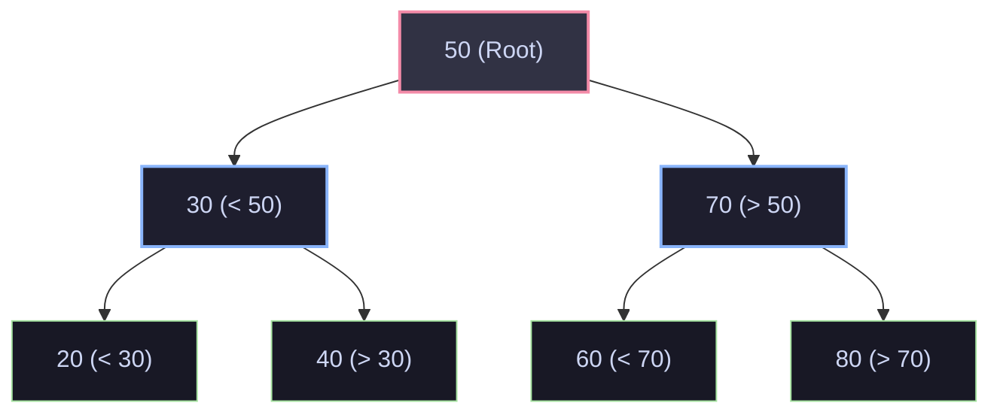
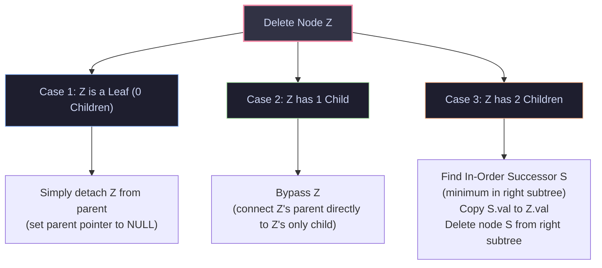
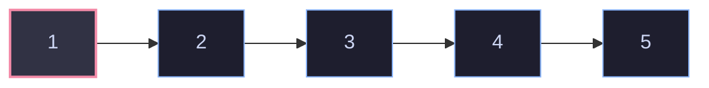
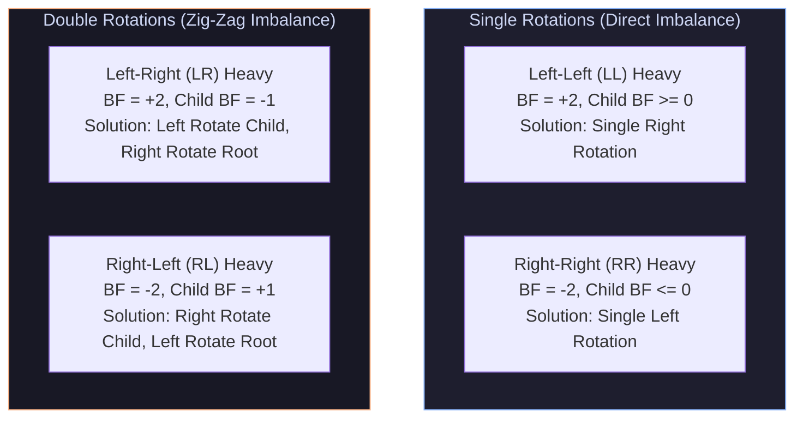
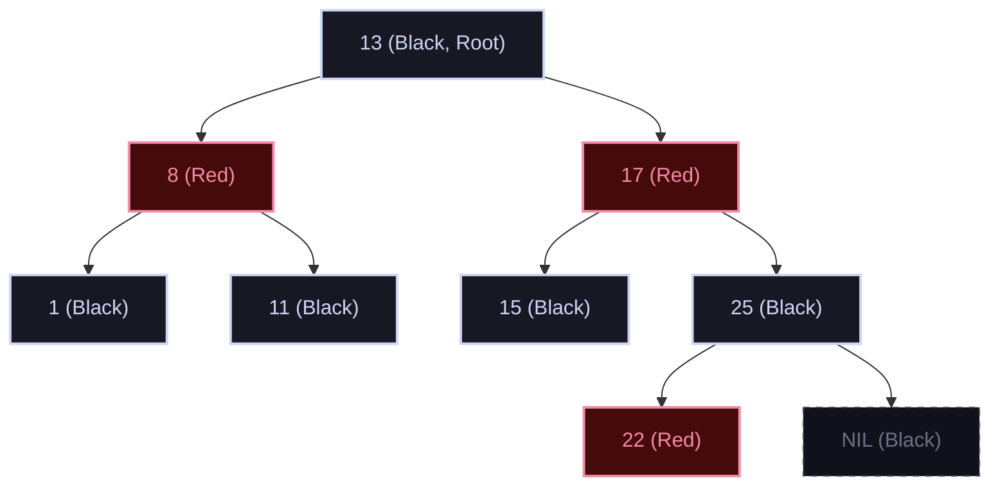

import { Callout } from "fumadocs-ui/components/callout";
import { Tabs, Tab } from "fumadocs-ui/components/tabs";
import { Steps, Step } from "fumadocs-ui/components/steps";
import { Cards, Card } from "fumadocs-ui/components/card";

## The Ordered Search Dilemma

While hash tables achieve $\mathcal{O}(1)$ average lookup, they destroy **ordering**. A hash table cannot efficiently answer:

- _"What is the smallest element strictly greater than $K$?"_ (Successor query)
- _"Find all customer IDs between $10,000$ and $20,000$ in sorted order."_ (Range query)
- _"What is the minimum or maximum element currently in the set?"_ ($\mathcal{O}(1)$ / $\mathcal{O}(\log N)$ extreme queries)

A **Binary Search Tree (BST)** organizes keys hierarchically to provide fast search, insertion, deletion, and ordered range scans. However, an unmanaged BST can degenerate into a sluggish linked list. To guarantee worst-case $\mathcal{O}(\log N)$ performance, modern production engines employ **self-balancing binary search trees**—primarily **AVL Trees** and **Red-Black Trees**.

---

## 1. The Binary Search Tree Invariant

A binary tree is a Binary Search Tree if and only if for every node $u$:

1. All keys in the **left subtree** are strictly less than $u.\text{key}$:
   $$
   \forall x \in \text{left\_subtree}(u), \quad x.\text{key} < u.\text{key}
   $$
2. All keys in the **right subtree** are strictly greater than $u.\text{key}$:
   $$
   \forall y \in \text{right\_subtree}(u), \quad y.\text{key} > u.\text{key}
   $$
3. Both left and right subtrees must also be valid Binary Search Trees.



<Callout type="info">
  **Fundamental Invariant Property**: An **in-order traversal** of any valid BST
  visits nodes in strictly increasing, monotonically sorted order: `[20, 30, 40,
  50, 60, 70, 80]`.
</Callout>

---

## 2. Core BST Operations

### Search & Insertion ($\mathcal{O}(h)$)

Searching and inserting in a BST follows the same trajectory: start at the root, compare the target key with the current node, and branch left if smaller or right if larger. Insertion terminates at a `null` leaf slot, attaching the new node.

### Deletion: The Three Cases

Deleting a node $Z$ requires maintaining the BST invariant. The procedure splits into three structural cases:



#### Detailed Look at Case 3 (Two Children):

Why the **in-order successor**?
The smallest node in $Z$'s right subtree is larger than all elements in $Z$'s left subtree and smaller than or equal to all elements in $Z$'s right subtree. Replacing $Z$'s key with its successor's key perfectly preserves the BST invariant. Crucially, because the successor is the minimum node of the right subtree, it is guaranteed to have **no left child**, reducing its eventual deletion to Case 1 or Case 2!

---

## 3. The Degenerate Tree Collapse

The performance of all BST operations is bounded by tree height: $\mathcal{O}(h)$. In the best case (a balanced tree), $h = \lfloor \log_2 N \rfloor$.

However, if keys are inserted in sequential order (`[1, 2, 3, 4, 5]`), the tree degenerates into a linear linked list:



- Tree height degrades from $\log_2(5) \approx 2$ to $h = 5$.
- Search time degrades from $\mathcal{O}(\log N)$ to $\mathcal{O}(N)$.
- System failure: A database table with millions of monotonically increasing auto-increment IDs would stall completely without **self-balancing mechanisms**.

---

## 4. AVL Trees: Strict Balance via Rotations

Invented in $1962$ by Georgy Adelson-Velsky and Evgenii Landis, the **AVL Tree** was the first self-balancing binary search tree.

### The Balance Factor (BF)

For every node $u$, define the Balance Factor as the height difference between its left and right subtrees:

$$
\text{BF}(u) = \text{height}(\text{left}(u)) - \text{height}(\text{right}(u))
$$

**The AVL Invariant**: For every node $u$ in the tree, $\text{BF}(u) \in \{-1, 0, +1\}$.

If an insertion or deletion causes $|\text{BF}(u)| > 1$, the tree is rebalanced at the lowest unbalanced ancestor using **rotations**.

### The Four Rebalancing Rotations



#### Step-by-Step Anatomy of a Right Rotation

Consider an unbalanced node $Y$ with left child $X$ and subtrees $A, B, C$:

```
        Y (BF = +2)                   X (BF = 0)
       / \                           /   \
      X   C      == Right Rot ==>   A     Y
     / \                                 / \
    A   B                               B   C
```

**Pointer Reassignments**:

1. Let $X = Y.\text{left}$.
2. Subtree $B = X.\text{right}$.
3. Set $X.\text{right} = Y$.
4. Set $Y.\text{left} = B$.
5. Recalculate heights: $\text{height}(Y) = 1 + \max(h(B), h(C))$, then $\text{height}(X) = 1 + \max(h(A), h(Y))$.

Rotations take strictly $\mathcal{O}(1)$ time, updating only three pointer links.

---

## 5. Red-Black Trees: Relaxed Balance in Production

While AVL trees maintain near-perfect balance (height $\le 1.44 \log_2 N$), this rigidity incurs frequent rebalancing rotations during insertions and deletions. **Red-Black Trees** relax the height invariant (height $\le 2 \log_2(N + 1)$), trading slightly deeper lookups for vastly cheaper mutations.



### The Five Invariants

1. Every node is either **RED** or **BLACK**.
2. The root node is always **BLACK**.
3. Every leaf (`NIL` sentinel) is **BLACK**.
4. If a node is **RED**, both of its children must be **BLACK** (no two consecutive RED nodes on any path).
5. For every node, every simple path from the node to descendant leaves contains the identical count of **BLACK** nodes (the **Black-Height** invariant).

### Mathematical Guarantee

Because no path can contain two consecutive red nodes, the longest possible path from root to leaf has alternating red and black nodes ($2 \times \text{black\_height}$). The shortest possible path contains only black nodes ($\text{black\_height}$). Thus, the longest path is at most twice the length of the shortest path. This guarantees:

$$
\text{Height} \le 2 \log_2(N + 1) = \mathcal{O}(\log N)
$$

---

## 6. The Engineering Showdown: AVL vs. Red-Black

Why do systems programmers almost universally prefer Red-Black trees over AVL trees?

| Dimension              | AVL Tree                                  | Red-Black Tree                      | Production Winner                 |
| :--------------------- | :---------------------------------------- | :---------------------------------- | :-------------------------------- |
| **Max Tree Height**    | $\approx 1.44 \log_2 N$                   | $\le 2.0 \log_2 N$                  | **AVL** (Shorter, faster lookups) |
| **Search Performance** | $\sim 5-10\%$ faster                      | Slightly slower                     | **AVL**                           |
| **Insert Rotations**   | At most $2$ rotations                     | At most $2$ rotations               | **Tie**                           |
| **Delete Rotations**   | **Up to $\mathcal{O}(\log N)$ rotations** | **At most $3$ rotations**           | **Red-Black Tree**                |
| **Metadata Memory**    | Integer `int` balance factor              | Single `bool` or $1$-bit color flag | **Red-Black Tree**                |
| **Use Case Fit**       | Read-intensive databases                  | Write-intensive OS kernels, maps    | **Red-Black Tree**                |

<Callout type="warn">
  **The Pointer Stealing Optimization in C++ and Linux**: Because memory
  allocators align heap structs to $4$ or $8$-byte boundaries, the least
  significant bit (LSB) of any pointer address is always `0`. The Linux kernel
  and C++ standard libraries store the Red-Black color bit directly in the LSB
  of the parent pointer (`parent | color`), consuming **0 extra bytes of memory
  overhead** for balancing metadata!
</Callout>

---

## Algorithmic Complexity Table

| Structure          | Search (Avg / Worst)                        | Insert (Avg / Worst)                        | Delete (Avg / Worst)                        | Space Overhead Per Node  |
| :----------------- | :------------------------------------------ | :------------------------------------------ | :------------------------------------------ | :----------------------- |
| **Unbalanced BST** | $\mathcal{O}(\log N) / \mathcal{O}(N)$      | $\mathcal{O}(\log N) / \mathcal{O}(N)$      | $\mathcal{O}(\log N) / \mathcal{O}(N)$      | 2 pointers (left, right) |
| **AVL Tree**       | $\mathcal{O}(\log N) / \mathcal{O}(\log N)$ | $\mathcal{O}(\log N) / \mathcal{O}(\log N)$ | $\mathcal{O}(\log N) / \mathcal{O}(\log N)$ | 2 pointers + height int  |
| **Red-Black Tree** | $\mathcal{O}(\log N) / \mathcal{O}(\log N)$ | $\mathcal{O}(\log N) / \mathcal{O}(\log N)$ | $\mathcal{O}(\log N) / \mathcal{O}(\log N)$ | 2 pointers + 1 bit color |

---

## Production Multi-Language Implementation

Here is an industrial-strength implementation of a BST with iterative Search, Insert, in-order predecessor/successor Deletion, and an AVL Tree balancing engine.

<Tabs items={['Python', 'TypeScript', 'C++']}>
  <Tab value="Python">
```python
from typing import Optional

class BSTNode:
def **init**(self, key: int):
self.key = key
self.left: Optional['BSTNode'] = None
self.right: Optional['BSTNode'] = None

class BinarySearchTree:
"""Production iterative BST implementation."""
def **init**(self):
self.root: Optional[BSTNode] = None

    def search(self, key: int) -> Optional[BSTNode]:
        curr = self.root
        while curr:
            if key == curr.key:
                return curr
            curr = curr.left if key < curr.key else curr.right
        return None

    def insert(self, key: int) -> bool:
        if not self.root:
            self.root = BSTNode(key)
            return True

        curr = self.root
        while True:
            if key == curr.key:
                return False  # Duplicate keys disallowed
            elif key < curr.key:
                if not curr.left:
                    curr.left = BSTNode(key)
                    return True
                curr = curr.left
            else:
                if not curr.right:
                    curr.right = BSTNode(key)
                    return True
                curr = curr.right

    def delete(self, key: int) -> bool:
        def _delete_node(node: Optional[BSTNode], target: int) -> Optional[BSTNode]:
            if not node:
                return None

            if target < node.key:
                node.left = _delete_node(node.left, target)
            elif target > node.key:
                node.right = _delete_node(node.right, target)
            else:
                # Target found. Case 1 & 2: 0 or 1 child
                if not node.left:
                    return node.right
                elif not node.right:
                    return node.left

                # Case 3: 2 children. Find in-order successor (min in right subtree)
                successor = node.right
                while successor.left:
                    successor = successor.left

                node.key = successor.key
                node.right = _delete_node(node.right, successor.key)

            return node

        if not self.search(key):
            return False
        self.root = _delete_node(self.root, key)
        return True

class AVLNode:
def **init**(self, key: int):
self.key = key
self.height: int = 1
self.left: Optional['AVLNode'] = None
self.right: Optional['AVLNode'] = None

class AVLTree:
"""AVL Tree with self-balancing rotations."""
@staticmethod
def get_height(node: Optional[AVLNode]) -> int:
return node.height if node else 0

    @classmethod
    def get_balance(cls, node: Optional[AVLNode]) -> int:
        return cls.get_height(node.left) - cls.get_height(node.right) if node else 0

    @classmethod
    def rotate_right(cls, y: AVLNode) -> AVLNode:
        x = y.left
        b = x.right
        x.right = y
        y.left = b
        y.height = 1 + max(cls.get_height(y.left), cls.get_height(y.right))
        x.height = 1 + max(cls.get_height(x.left), cls.get_height(x.right))
        return x

    @classmethod
    def rotate_left(cls, x: AVLNode) -> AVLNode:
        y = x.right
        b = y.left
        y.left = x
        x.right = b
        x.height = 1 + max(cls.get_height(x.left), cls.get_height(x.right))
        y.height = 1 + max(cls.get_height(y.left), cls.get_height(y.right))
        return y

    @classmethod
    def insert(cls, root: Optional[AVLNode], key: int) -> AVLNode:
        if not root:
            return AVLNode(key)

        if key < root.key:
            root.left = cls.insert(root.left, key)
        elif key > root.key:
            root.right = cls.insert(root.right, key)
        else:
            return root

        root.height = 1 + max(cls.get_height(root.left), cls.get_height(root.right))
        bf = cls.get_balance(root)

        # Left-Left
        # Note: While key comparison works for unique keys, production implementations
        # typically use the balance factor of the child (e.g., get_balance(root.left) >= 0)
        # for greater robustness with duplicate keys.
        if bf > 1 and key < root.left.key:
            return cls.rotate_right(root)
        # Right-Right
        if bf < -1 and key > root.right.key:
            return cls.rotate_left(root)
        # Left-Right
        if bf > 1 and key > root.left.key:
            root.left = cls.rotate_left(root.left)
            return cls.rotate_right(root)
        # Right-Left
        if bf < -1 and key < root.right.key:
            root.right = cls.rotate_right(root.right)
            return cls.rotate_left(root)

        return root

````
  </Tab>
  <Tab value="TypeScript">
```typescript
export class BSTNode {
  key: number;
  left: BSTNode | null = null;
  right: BSTNode | null = null;

  constructor(key: number) {
    this.key = key;
  }
}

export class BinarySearchTree {
  root: BSTNode | null = null;

  search(key: number): BSTNode | null {
    let curr = this.root;
    while (curr !== null) {
      if (key === curr.key) return curr;
      curr = key < curr.key ? curr.left : curr.right;
    }
    return null;
  }

  insert(key: number): boolean {
    if (!this.root) {
      this.root = new BSTNode(key);
      return true;
    }
    let curr = this.root;
    while (true) {
      if (key === curr.key) return false;
      if (key < curr.key) {
        if (!curr.left) {
          curr.left = new BSTNode(key);
          return true;
        }
        curr = curr.left;
      } else {
        if (!curr.right) {
          curr.right = new BSTNode(key);
          return true;
        }
        curr = curr.right;
      }
    }
  }

  delete(key: number): boolean {
    const deleteRecursive = (node: BSTNode | null, target: number): BSTNode | null => {
      if (!node) return null;
      if (target < node.key) {
        node.left = deleteRecursive(node.left, target);
      } else if (target > node.key) {
        node.right = deleteRecursive(node.right, target);
      } else {
        if (!node.left) return node.right;
        if (!node.right) return node.left;

        let succ = node.right;
        while (succ.left) succ = succ.left;
        node.key = succ.key;
        node.right = deleteRecursive(node.right, succ.key);
      }
      return node;
    };

    if (!this.search(key)) return false;
    this.root = deleteRecursive(this.root, key);
    return true;
  }
}
````

  </Tab>
  <Tab value="C++">
```cpp
#include <iostream>
#include <algorithm>

struct AVLNode {
int key;
int height;
AVLNode* left;
AVLNode* right;
AVLNode(int k) : key(k), height(1), left(nullptr), right(nullptr) {}
};

class AVLTree {
public:
static int getHeight(AVLNode\* n) {
return n ? n->height : 0;
}

    static int getBalance(AVLNode* n) {
        return n ? getHeight(n->left) - getHeight(n->right) : 0;
    }

    static AVLNode* rotateRight(AVLNode* y) {
        AVLNode* x = y->left;
        AVLNode* b = x->right;
        x->right = y;
        y->left = b;
        y->height = 1 + std::max(getHeight(y->left), getHeight(y->right));
        x->height = 1 + std::max(getHeight(x->left), getHeight(x->right));
        return x;
    }

    static AVLNode* rotateLeft(AVLNode* x) {
        AVLNode* y = x->right;
        AVLNode* b = y->left;
        y->left = x;
        x->right = b;
        x->height = 1 + std::max(getHeight(x->left), getHeight(x->right));
        y->height = 1 + std::max(getHeight(y->left), getHeight(y->right));
        return y;
    }

    static AVLNode* insert(AVLNode* node, int key) {
        if (!node) return new AVLNode(key);
        if (key < node->key) {
            node->left = insert(node->left, key);
        } else if (key > node->key) {
            node->right = insert(node->right, key);
        } else {
            return node;
        }

        node->height = 1 + std::max(getHeight(node->left), getHeight(node->right));
        int bf = getBalance(node);

        // LL Case
        if (bf > 1 && key < node->left->key) return rotateRight(node);
        // RR Case
        if (bf < -1 && key > node->right->key) return rotateLeft(node);
        // LR Case
        if (bf > 1 && key > node->left->key) {
            node->left = rotateLeft(node->left);
            return rotateRight(node);
        }
        // RL Case
        if (bf < -1 && key < node->right->key) {
            node->right = rotateRight(node->right);
            return rotateLeft(node);
        }

        return node;
    }

};

````
  </Tab>
</Tabs>

---

## Production Systems Case Study: Linux Kernel CFS Scheduler

Inside the Linux kernel (`kernel/sched/fair.c`), the **Completely Fair Scheduler (CFS)** decides which operating system task to assign to a CPU core next.

```mermaid
flowchart LR
    subgraph CFS["Linux CFS Runqueue (Red-Black Tree)"]
        direction LR
        Leftmost["Leftmost Node\n(Smallest vruntime)\nCached Pointer -> O(1) Fetch"]
        RBTree["Red-Black Tree Index\nKeys = vruntime (Virtual Runtime)\nOrdered O(log N) Updates"]
        Leftmost -.-> RBTree
    end
    CPU["CPU Core"] -->|"Picks Next Task O(1)"| Leftmost
    CPU -->|"Re-inserts with updated vruntime O(log N)"| RBTree
````

### Why CFS Uses a Red-Black Tree

1. **The Invariant**: Every runnable thread has a `vruntime` (virtual runtime—how much CPU time it has consumed). CFS must always run the thread that has had the **least** CPU time (minimum `vruntime`).
2. **Leftmost Cache Optimization**: CFS maintains a direct pointer (`rb_leftmost`) pointing to the minimum node. Picking the next task takes **$\mathcal{O}(1)$ time**.
3. **Write Heavy Amortization**: Every time a process finishes its time slice, its `vruntime` increases, and it is removed and re-inserted into the tree. Since process context switching happens thousands of times per second per core, Red-Black trees—which guarantee at most $2$ rotations per insert and $3$ rotations per delete—avoid the expensive multi-level rotation cascades of AVL trees.

---

## Technical Interview Patterns & Pitfalls

### Pattern: Validating a BST

A ubiquitous interview trap is checking only immediate child nodes:

```python
# BUG: Local check fails global invariant!
if node.left and node.left.val >= node.val: return False
if node.right and node.right.val <= node.val: return False
```

This passes for a tree where `50 -> 30 -> 60`, but `60` in the left subtree violates the root's invariant!
**The Correct Technique**: Pass valid open ranges $(-\infty, +\infty)$ recursively down the call chain:

```python
def is_valid_bst(root: Optional[BSTNode], low=float('-inf'), high=float('inf')) -> bool:
    if not root:
        return True
    if not (low < root.key < high):
        return False
    return is_valid_bst(root.left, low, root.key) and is_valid_bst(root.right, root.key, high)
```

---

## Hands-On Verification Challenge

### Problem: Range Sum of BST

Given the root of a binary search tree and two integers `low` and `high`, return the sum of values of all nodes with a value in the inclusive range `[low, high]`. Exploit the BST invariant to **prune branches** that cannot contain valid keys.

```python
def range_sum_bst(root: Optional[BSTNode], low: int, high: int) -> int:
    if not root:
        return 0

    # Prune right subtree if current key exceeds high
    if root.key > high:
        return range_sum_bst(root.left, low, high)

    # Prune left subtree if current key is below low
    if root.key < low:
        return range_sum_bst(root.right, low, high)

    # Current key is within [low, high]; accumulate both sides
    return root.key + range_sum_bst(root.left, low, high) + range_sum_bst(root.right, low, high)

# Verification
tree = BinarySearchTree()
for val in [10, 5, 15, 3, 7, 18]:
    tree.insert(val)

assert range_sum_bst(tree.root, 7, 15) == 32  # 7 + 10 + 15 = 32
print("Verification Succeeded: BST Range Sum pruned correctly!")
```
