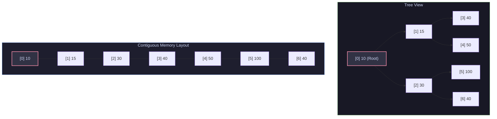
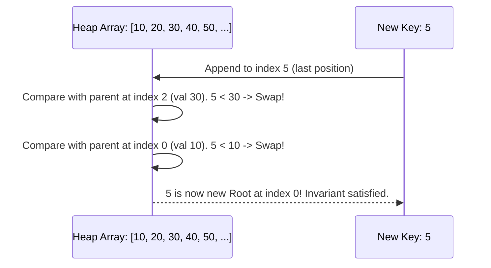
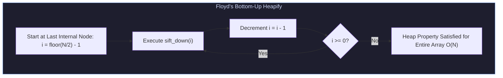
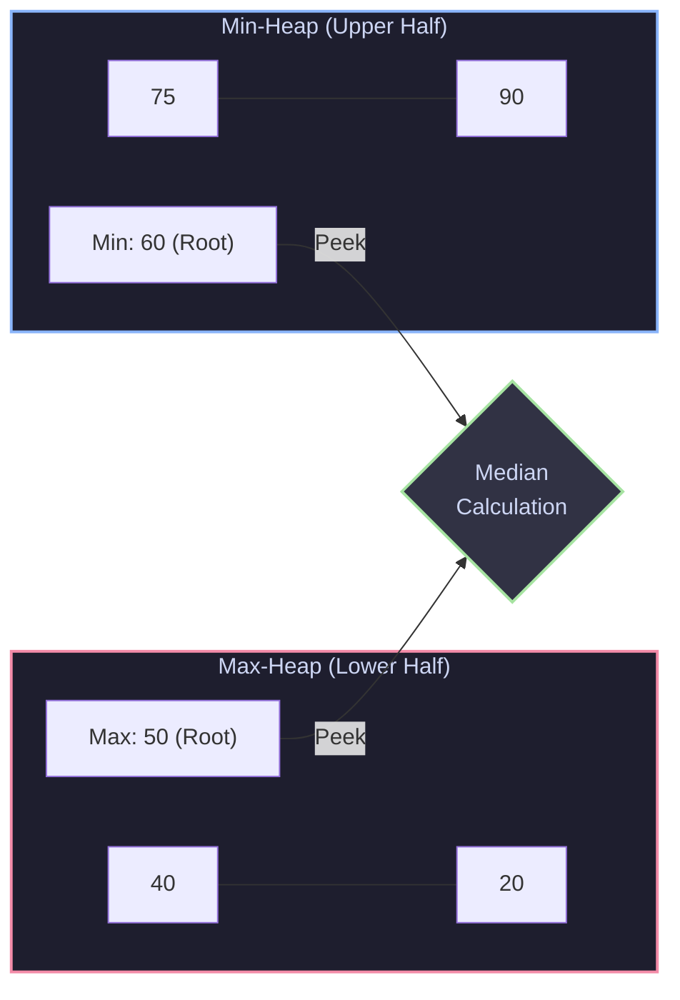

import { Callout } from "fumadocs-ui/components/callout";
import { Tabs, Tab } from "fumadocs-ui/components/tabs";
import { Steps, Step } from "fumadocs-ui/components/steps";
import { Cards, Card } from "fumadocs-ui/components/card";

## The Priority Dispatch Problem

In an emergency department, patients are not treated on a First-In, First-Out (FIFO) basis. A patient arriving with severe trauma must be attended to before a patient with a minor sprain who arrived an hour earlier.

Similarly, operating systems schedule critical real-time threads before background indexing tasks, and network routers drop low-priority packets before dropping voice-over-IP control frames.

A **Priority Queue** is an abstract data type where each element has an associated priority. Elements with higher priority are dequeued before lower-priority elements. While balanced binary search trees could implement this, the **Binary Heap** provides a far superior physical architecture: it implements priority queues using **flat contiguous arrays with zero pointer overhead**.

---

## 1. Array Representation of a Complete Binary Tree

A **Complete Binary Tree** is a binary tree where every level is completely filled, except possibly the final level, which is packed tightly from left to right.

Because there are never "holes" in a complete binary tree, it can be mapped into a contiguous array without storing a single child or parent pointer.



### The Index Arithmetic (Zero-Indexed Arrays)

Given a node at array index $i$:

$$
\text{parent}(i) = \left\lfloor \frac{i - 1}{2} \right\rfloor
$$

$$
\text{left\_child}(i) = 2i + 1
$$

$$
\text{right\_child}(i) = 2i + 2
$$

<Callout type="info">
  **CPU Cache Efficiency**: Because heap nodes reside in contiguous memory,
  traversing parent-child relationships triggers hardware prefetchers and
  maximizes L1/L2 data cache hits. Pointer-based trees, by contrast, bounce
  unpredictably across memory addresses.
</Callout>

---

## 2. Heap Invariants and Mutations

### Min-Heap vs. Max-Heap

- **Min-Heap Invariant**: For every node $i$ other than the root:
  $$
  A[\text{parent}(i)] \le A[i]
  $$
  The minimum element is unconditionally positioned at the root (`A[0]`).
- **Max-Heap Invariant**: For every node $i$ other than the root:
  $$
  A[\text{parent}(i)] \ge A[i]
  $$
  The maximum element is unconditionally positioned at the root (`A[0]`).

### Sift-Up (Insertion: $\mathcal{O}(\log N)$)

When inserting an element $X$:

1. Append $X$ to the end of the array (preserving the complete tree shape).
2. Compare $X$ with its parent. If $X < \text{parent}$ (in a min-heap), swap them.
3. Repeat step 2 until the invariant holds or $X$ reaches the root index $0$.



### Sift-Down (Extract-Min: $\mathcal{O}(\log N)$)

When removing the root element:

1. Replace the root `A[0]` with the last element of the array `A[N-1]`.
2. Shrink array size by $1$.
3. Compare the new root with its children. Swap with the **smaller** child (in a min-heap).
4. Repeat downwards until both children are greater than or equal to the node or a leaf is reached.

---

## 3. Floyd's Linear Heapify Algorithm ($\mathcal{O}(N)$)

A common intuition is that building a heap from an unsorted array of size $N$ requires $N$ consecutive `push()` operations, yielding $\mathcal{O}(N \log N)$.

In $1964$, Robert W. Floyd published an algorithm that constructs a valid heap in **strictly $\mathcal{O}(N)$ time**.



### The Mathematical Proof of $\mathcal{O}(N)$ Heapify

Consider a complete binary tree of height $H = \lfloor \log_2 N \rfloor$.

- Leaves are at height $0$. There are $\approx \frac{N}{2}$ leaves. They require **$0$ swaps** (they are already trivial heaps).
- Nodes at height $1$ can sift down at most $1$ step. There are $\approx \frac{N}{4}$ such nodes.
- In general, at height $h$, there are at most $\left\lceil \frac{N}{2^{h+1}} \right\rceil$ nodes, each capable of sifting down at most $h$ levels.

The total work $S$ across all heights is:

$$
S = \sum_{h=0}^{\lfloor \log_2 N \rfloor} \left\lceil \frac{N}{2^{h+1}} \right\rceil \cdot h \le \frac{N}{2} \sum_{h=1}^{\infty} \frac{h}{2^h}
$$

Let the infinite summation be $K = \sum_{h=1}^{\infty} \frac{h}{2^h}$:

$$
K = \frac{1}{2} + \frac{2}{4} + \frac{3}{8} + \frac{4}{16} + \dots
$$

$$
\frac{1}{2}K = \frac{1}{4} + \frac{2}{8} + \frac{3}{16} + \dots
$$

Subtracting the two series:

$$
K - \frac{1}{2}K = \frac{1}{2} + \left( \frac{1}{4} + \frac{1}{8} + \frac{1}{16} + \dots \right)
$$

$$
\frac{1}{2}K = \frac{1}{2} + \frac{1/4}{1 - 1/2} = \frac{1}{2} + \frac{1}{2} = 1 \implies K = 2
$$

Substituting $K = 2$ back into our equation for total work:

$$
S \le \frac{N}{2} \cdot 2 = N = \mathcal{O}(N)
$$

Floyd's algorithm runs in **linear time** because the vast majority of nodes reside near the bottom of the tree, where their maximum sift-down distance is trivial ($0$ or $1$).

---

## 4. Core Algorithmic Patterns

### Pattern 1: Dual-Heap Running Median

To compute the running median of an incoming numerical stream in $\mathcal{O}(1)$ time:

1. Divide data into two halves:
   - `small`: A **Max-Heap** holding the smaller half of values.
   - `large`: A **Min-Heap** holding the larger half of values.
2. **Invariants**:
   - `len(small) == len(large)` OR `len(small) == len(large) + 1`.
   - Every element in `small` $\le$ every element in `large`.
3. If lengths are equal: Median is `(small.peek() + large.peek()) / 2.0`.
4. If `small` has one extra element: Median is `small.peek()`.



### Pattern 2: Top-K Streaming Elements

To extract the $K$ largest elements from an infinite data stream:

- Maintain a **Min-Heap of capacity $K$**.
- For each new item $X$:
  - If heap size $< K$: push $X$.
  - If $X > \text{heap.peek()}$: pop the smallest element and push $X$.
  - If $X \le \text{heap.peek()}$: discard $X$ (it cannot belong to the top $K$).
- **Complexity**: Auxiliary space is bounded to $\mathcal{O}(K)$, and processing time is $\mathcal{O}(N \log K)$.

---

## Complexity Matrix

| Operation                 | Array (Unsorted) | Array (Sorted)          | Binary Heap                    | Fibonacci Heap (Amortized) |
| :------------------------ | :--------------- | :---------------------- | :----------------------------- | :------------------------- |
| **Peek (Find Min/Max)**   | $\mathcal{O}(N)$ | $\mathcal{O}(1)$        | $\mathbf{\mathcal{O}(1)}$      | $\mathcal{O}(1)$           |
| **Push (Insert)**         | $\mathcal{O}(1)$ | $\mathcal{O}(N)$        | $\mathbf{\mathcal{O}(\log N)}$ | $\mathcal{O}(1)$           |
| **Pop (Extract Min/Max)** | $\mathcal{O}(N)$ | $\mathcal{O}(1)$        | $\mathbf{\mathcal{O}(\log N)}$ | $\mathcal{O}(\log N)$      |
| **Build-Heap (Floyd)**    | N/A              | $\mathcal{O}(N \log N)$ | $\mathbf{\mathcal{O}(N)}$      | $\mathcal{O}(N)$           |
| **Auxiliary Space**       | $\mathcal{O}(1)$ | $\mathcal{O}(1)$        | $\mathbf{\mathcal{O}(1)}$      | $\mathcal{O}(N)$           |

---

## Production Multi-Language Implementation

<Tabs items={['Python', 'TypeScript', 'C++']}>
  <Tab value="Python">
```python
import heapq
from typing import List, Optional

class MinHeap:
"""Production MinHeap built from scratch with array backing and Floyd's heapify."""
def **init**(self, items: Optional[List[int]] = None):
self.data: List[int] = list(items) if items else []
if self.data:
self.\_heapify()

    def _heapify(self) -> None:
        """Floyd's O(N) build-heap algorithm."""
        last_internal_idx = (len(self.data) // 2) - 1
        for i in range(last_internal_idx, -1, -1):
            self._sift_down(i)

    def _sift_up(self, idx: int) -> None:
        curr = idx
        while curr > 0:
            parent = (curr - 1) // 2
            if self.data[curr] < self.data[parent]:
                self.data[curr], self.data[parent] = self.data[parent], self.data[curr]
                curr = parent
            else:
                break

    def _sift_down(self, idx: int) -> None:
        n = len(self.data)
        curr = idx
        while True:
            left = 2 * curr + 1
            right = 2 * curr + 2
            smallest = curr

            if left < n and self.data[left] < self.data[smallest]:
                smallest = left
            if right < n and self.data[right] < self.data[smallest]:
                smallest = right

            if smallest != curr:
                self.data[curr], self.data[smallest] = self.data[smallest], self.data[curr]
                curr = smallest
            else:
                break

    def push(self, val: int) -> None:
        self.data.append(val)
        self._sift_up(len(self.data) - 1)

    def pop(self) -> int:
        if not self.data:
            raise IndexError("pop from empty heap")
        min_val = self.data[0]
        last_val = self.data.pop()
        if self.data:
            self.data[0] = last_val
            self._sift_down(0)
        return min_val

    def peek(self) -> int:
        if not self.data:
            raise IndexError("peek from empty heap")
        return self.data[0]

    def __len__(self) -> int:
        return len(self.data)

class MedianFinder:
"""Continuous Running Median using Dual-Heap Pattern."""
def **init**(self): # Python's heapq is a min-heap. We invert values to create a max-heap.
self.small = [] # Max-Heap (stores negative numbers)
self.large = [] # Min-Heap

    def add_num(self, num: int) -> None:
        # Step 1: Push to max-heap
        heapq.heappush(self.small, -num)

        # Step 2: Invariant check - small.max <= large.min
        if self.small and self.large and (-self.small[0] > self.large[0]):
            val = -heapq.heappop(self.small)
            heapq.heappush(self.large, val)

        # Step 3: Size invariant check - len(small) can exceed len(large) by at most 1
        if len(self.small) > len(self.large) + 1:
            val = -heapq.heappop(self.small)
            heapq.heappush(self.large, val)
        elif len(self.large) > len(self.small):
            val = heapq.heappop(self.large)
            heapq.heappush(self.small, -val)

    def find_median(self) -> float:
        if len(self.small) > len(self.large):
            return float(-self.small[0])
        return (-self.small[0] + self.large[0]) / 2.0

````
  </Tab>
  <Tab value="TypeScript">
```typescript
export class MinHeap {
  private data: number[];

  constructor(items?: number[]) {
    this.data = items ? [...items] : [];
    if (this.data.length > 0) {
      this.heapify();
    }
  }

  private heapify(): void {
    const lastInternal = Math.floor(this.data.length / 2) - 1;
    for (let i = lastInternal; i >= 0; i--) {
      this.siftDown(i);
    }
  }

  private siftUp(idx: number): void {
    let curr = idx;
    while (curr > 0) {
      const parent = Math.floor((curr - 1) / 2);
      if (this.data[curr] < this.data[parent]) {
        [this.data[curr], this.data[parent]] = [this.data[parent], this.data[curr]];
        curr = parent;
      } else {
        break;
      }
    }
  }

  private siftDown(idx: number): void {
    const n = this.data.length;
    let curr = idx;
    while (true) {
      const left = 2 * curr + 1;
      const right = 2 * curr + 2;
      let smallest = curr;

      if (left < n && this.data[left] < this.data[smallest]) {
        smallest = left;
      }
      if (right < n && this.data[right] < this.data[smallest]) {
        smallest = right;
      }

      if (smallest !== curr) {
        [this.data[curr], this.data[smallest]] = [this.data[smallest], this.data[curr]];
        curr = smallest;
      } else {
        break;
      }
    }
  }

  push(val: number): void {
    this.data.push(val);
    this.siftUp(this.data.length - 1);
  }

  pop(): number {
    if (this.data.length === 0) throw new Error("Heap underflow");
    const minVal = this.data[0];
    const last = this.data.pop()!;
    if (this.data.length > 0) {
      this.data[0] = last;
      this.siftDown(0);
    }
    return minVal;
  }

  peek(): number {
    if (this.data.length === 0) throw new Error("Heap is empty");
    return this.data[0];
  }

  get size(): number {
    return this.data.length;
  }
}
````

  </Tab>
  <Tab value="C++">
```cpp
#include <iostream>
#include <vector>
#include <queue>
#include <stdexcept>
#include <algorithm>

class MinHeap {
private:
std::vector<int> data;

    void siftUp(size_t idx) {
        while (idx > 0) {
            size_t parent = (idx - 1) / 2;
            if (data[idx] < data[parent]) {
                std::swap(data[idx], data[parent]);
                idx = parent;
            } else {
                break;
            }
        }
    }

    void siftDown(size_t idx) {
        size_t n = data.size();
        while (true) {
            size_t left = 2 * idx + 1;
            size_t right = 2 * idx + 2;
            size_t smallest = idx;

            if (left < n && data[left] < data[smallest]) smallest = left;
            if (right < n && data[right] < data[smallest]) smallest = right;

            if (smallest != idx) {
                std::swap(data[idx], data[smallest]);
                idx = smallest;
            } else {
                break;
            }
        }
    }

public:
MinHeap() = default;

    explicit MinHeap(const std::vector<int>& items) : data(items) {
        if (!data.empty()) {
            // Floyd's O(N) heapify
            for (int i = static_cast<int>(data.size() / 2) - 1; i >= 0; --i) {
                siftDown(static_cast<size_t>(i));
            }
        }
    }

    void push(int val) {
        data.push_back(val);
        siftUp(data.size() - 1);
    }

    int pop() {
        if (data.empty()) throw std::underflow_error("Heap is empty");
        int minVal = data.front();
        data.front() = data.back();
        data.pop_back();
        if (!data.empty()) {
            siftDown(0);
        }
        return minVal;
    }

    int peek() const {
        if (data.empty()) throw std::underflow_error("Heap is empty");
        return data.front();
    }

    size_t size() const { return data.size(); }

};

````
  </Tab>
</Tabs>

---

## Production Systems Case Study: Event Loop Timers

### 1. Node.js & libuv Timer Wheel / Min-Heap
In Node.js, thousands of timers are spawned via `setTimeout(callback, delay)`. The underlying asynchronous I/O engine, **libuv**, uses a **Min-Heap of timers** keyed on absolute timestamp expiry (`timeout_ms`).
- In each iteration of the event loop, libuv examines the root of the timer heap (`heap.peek()`).
- If `root.timeout > current_time`: libuv calculates the remaining milliseconds and passes this duration as the timeout to the OS kernel polling mechanism (`epoll_wait` or `kqueue`). The thread safely sleeps!
- When time elapses, it repeatedly pops expired timers from the root in $\mathcal{O}(\log K)$ and dispatches their callbacks.

### 2. Go Runtime Timer Heap (`runtime/time.go`)
In Go, every `time.Sleep` or channel deadline attaches to a timer structure. Go uses a **4-ary (quad) min-heap** per P (processor context):
- In a 4-ary heap, each node has $4$ children: $\text{child}(i, k) = 4i + k + 1$ for $k \in \{0, 1, 2, 3\}$.
- **Why 4-ary instead of binary?** A 4-ary heap halves tree height ($\log_4 N = \frac{1}{2} \log_2 N$), reducing sift-up pointer steps. Furthermore, four contiguous 64-bit child pointers span exactly $32$ bytes, fitting cleanly into a single CPU $64$-byte cache line alongside metadata!

---

## Technical Interview Patterns & Pitfalls

<Callout type="warn">
**Python's `heapq` Max-Heap Trap**:
Python's standard library `heapq` module **only** implements a Min-Heap. To implement a Max-Heap:
1. Invert numeric values (`-val`).
2. If elements are objects or strings, wrap them in a tuple or helper class implementing inverted `__lt__` comparison: `(-priority, item)`.
3. Never forget to negate the value back when popping from the heap!
</Callout>

### Pitfall: In-Place Mutation Without Re-Heapifying
If you store an object in a heap and mutate its priority in-place (e.g., `task.priority = 5`), the heap array is unaware of the change. The heap invariant is broken, causing subsequent pops to return corrupt orders. You must either re-heapify the entire array ($\mathcal{O}(N)$) or sift the specific modified index.

---

## Hands-On Verification Challenge

### Problem: K Closest Points to Origin
Given an array of `points` where `points[i] = [xi, yi]` and an integer `k`, return the `k` closest points to the origin `(0, 0)` using a **bounded Max-Heap of size $k$**.

```python
import heapq
from typing import List

def k_closest(points: List[List[int]], k: int) -> List[List[int]]:
    # Max-heap based on squared Euclidean distance: -(x^2 + y^2)
    max_heap = []

    for x, y in points:
        dist_sq = -(x * x + y * y)
        if len(max_heap) < k:
            heapq.heappush(max_heap, (dist_sq, [x, y]))
        elif dist_sq > max_heap[0][0]:
            # dist_sq is closer (less negative) than the farthest point currently in our top-k
            heapq.heapreplace(max_heap, (dist_sq, [x, y]))

    return [point for (_, point) in max_heap]

# Verification
pts = [[3, 3], [5, -1], [-2, 4], [1, 2]]
res = k_closest(pts, 2)
assert sorted(res) == sorted([[1, 2], [3, 3]])
print("Verification Succeeded: Top-K Closest correctly extracted in O(N log K)!")
````
