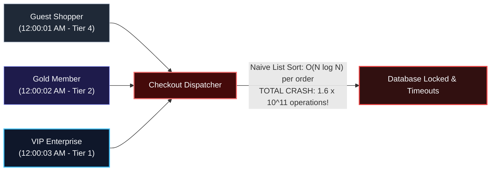
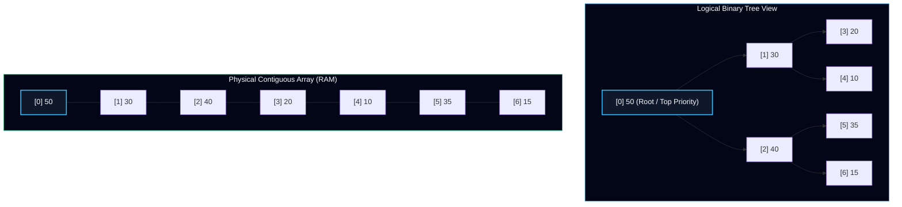
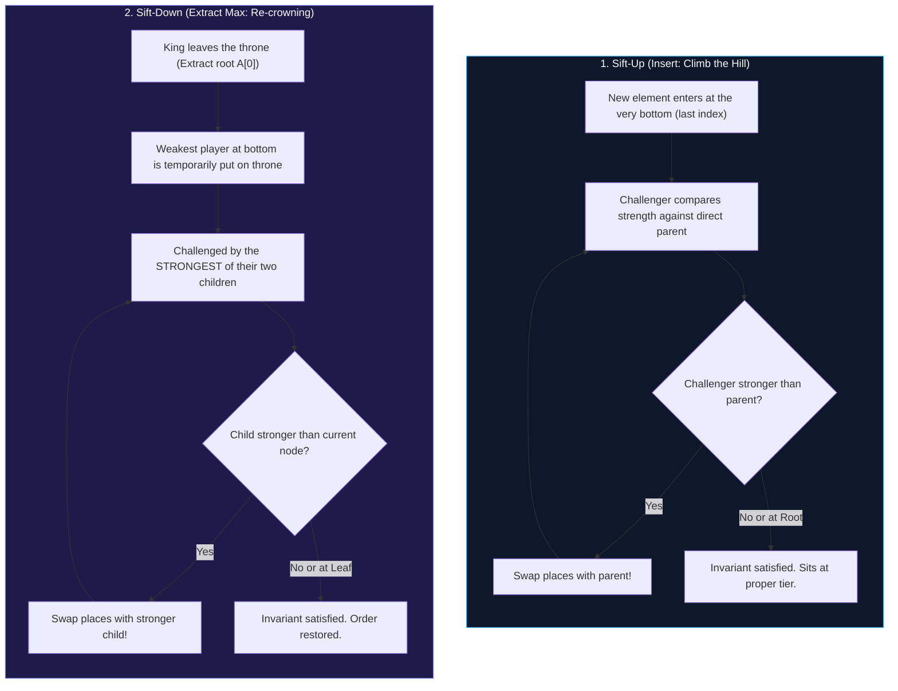
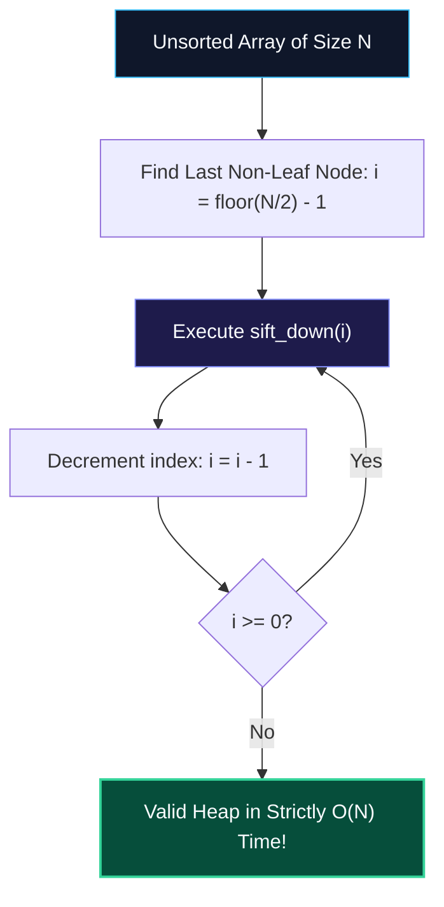

import { Callout } from "fumadocs-ui/components/callout";
import { Tabs, Tab } from "fumadocs-ui/components/tabs";
import { Steps, Step } from "fumadocs-ui/components/steps";
import { Cards, Card } from "fumadocs-ui/components/card";

## The ByteKart Story Continues: The VIP Flash-Sale & Emergency Room Problem

It is 11:59:59 PM on Thanksgiving night at **ByteKart**. A flash-sale for $500$ limited-edition gaming consoles is about to go live.

At the stroke of midnight, **$100,000$ concurrent shoppers** slam the checkout microservice. Each order payload arrives with an assigned customer priority tier:

- **Tier 1 (Enterprise VIPs & Wholesalers)**: Multi-thousand dollar enterprise accounts.
- **Tier 2 (ByteKart Gold Subscribers)**: High-loyalty paying members.
- **Tier 3 (Standard Verified Accounts)**: Everyday consumers.
- **Tier 4 (Guest Checkouts)**: Unregistered guest users.



The junior engineer on call implemented the order queue using a dynamic list: every time a new order arrived, the service called `orders.sort()` so that the highest-priority customer would be at the front.

The outcome was catastrophic:

- Inserting an order and sorting an array of size $N$ takes $\mathcal{O}(N \log N)$.
- For $100,000$ incoming orders, cumulative operations equal:
  $$\sum_{i=1}^{100,000} i \log_2 i \approx \mathcal{O}(N^2 \log N) \approx 1.6 \times 10^{11} \text{ CPU operations!}$$
- CPU cores pegged at $100\%$, checkout API latencies exploded to $45$ seconds, and the service dropped offline.

The infrastructure lead asked a pointed question:

> _"Why are we sorting all $100,000$ orders when we only have $500$ consoles to fulfill? At any given millisecond, we do not care whether the 40,000th order is sorted relative to the 40,001st order. We only need to know: **who has the highest priority right now?**"_

### The Everyday Physical Analogy: The Emergency Room Triage

Consider an **Emergency Room (ER)** at a major hospital:

- If a patient arrives with a minor paper cut at 8:00 AM, and another patient arrives with severe cardiac arrest at 8:15 AM, the hospital **never** operates on a First-In, First-Out (FIFO) basis.
- The cardiac patient is rushed into surgery immediately.
- Nor does the hospital line up all $300$ waiting-room patients and sort them by medical severity score from scratch whenever an ambulance pulls up.
- Instead, the triage nurse maintains an **Emergency Triage Queue**: the highest-urgency patient is always ready for the next open operating theater, while new arrivals quickly slot into their approximate priority bracket.

In computer science, this abstract data type is a **Priority Queue**, and its most efficient physical implementation is the **Binary Heap**.

---

## 1. The Architectural Breakthrough: Trees in Flat Arrays

In Lesson 01, we saw that traditional binary trees require pointer nodes:

```
[Payload (8B)] + [Left Pointer (8B)] + [Right Pointer (8B)] + [Heap Header (16B)] = 40 Bytes!
```

Furthermore, pointer jumping across scattered heap addresses triggers frequent **CPU L1/L2 cache misses**.

The Binary Heap solves this with an architectural stroke of genius: **it maps a complete binary tree into a single contiguous array with zero pointer overhead!**

### Array Representation of Complete Binary Trees

A **Complete Binary Tree** has every level completely filled, except possibly the bottom level, which is populated tightly from **left to right** without any gaps:



Because there are never missing nodes or holes, we can calculate the exact memory address of any node's parent or children using **instant arithmetic**:

### The Zero-Indexed Formula Matrix

For any element at index $i$:

$$
\text{parent}(i) = \left\lfloor \frac{i - 1}{2} \right\rfloor
$$

$$
\text{left\_child}(i) = 2i + 1
$$

$$
\text{right\_child}(i) = 2i + 2
$$

<Callout type="info" title="Hardware Sympathy: Why Flat Arrays Destroy Pointer Trees in Practice">
In a flat array, traversing from a node to its child does not chase virtual memory pointers through RAM.

Instead, contiguous array elements reside inside the CPU's **64-byte L1 Data Cache Lines**. When the CPU reads index `i`, the hardware prefetcher automatically pulls indices `i+1`, `i+2`, and beyond into ultrafast cache registers ($< 1\text{ ns}$ latency), delivering unmatched real-world performance!

</Callout>

---

## 2. Interactive Simulator: Experience Sift-Up & Sift-Down

Use the interactive simulator below to watch how a binary heap preserves its structural invariants during mutations:

<HeapStructureSimulator />

### Step-by-Step Observation Guide:

1. **Examine the Baseline State**: Notice the initial Max-Heap array `[50, 30, 40, 20, 10]`. Notice how index `0` holds the maximum value (`50`), and every parent index satisfies $A[\text{parent}] \ge A[\text{child}]$.
2. **Observe Insertion & Sift-Up**: Click through to observe a new element (value `45`) inserted at the very end of the array (index `5`). Notice how `45` temporarily violates the heap property against its parent `40` at index `2`. The algorithm executes a **swap**, bubbling `45` up to index `2`.
3. **Observe Extraction & Sift-Down**: Watch the root element `50` get extracted. The last leaf `10` is moved to index `0`, and then sifts downward by swapping with its largest child until balance is restored.

---

## 3. Heap Invariants: The King-of-the-Hill Analogy

A binary heap comes in two flavors:

1. **Max-Heap Invariant**: For every node $i > 0$:
   $$A[\text{parent}(i)] \ge A[i]$$
   The **maximum** element is guaranteed to sit at index `0`.
2. **Min-Heap Invariant**: For every node $i > 0$:
   $$A[\text{parent}(i)] \le A[i]$$
   The **minimum** element is guaranteed to sit at index `0`.

### The "King-of-the-Hill" Everyday Analogy

Imagine a childhood game of **King-of-the-Hill** played on a pyramid:

- The reigning champion sits at the summit (Index `0`).
- Every player on an upper step must be stronger than both players directly below them on the next step down.
- There are **no rules** about who is stronger between left and right peers on the same level—all that matters is the vertical chain of authority!



### The Sift-Up Protocol (Insertion: $\mathcal{O}(\log N)$)

1. Append the new key $X$ to the end of the array (preserving the Complete Binary Tree shape).
2. Compare $X$ with its parent at $\lfloor (i - 1) / 2 \rfloor$.
3. If $X > \text{parent}$ (in a Max-Heap), swap them.
4. Repeat upward until the invariant holds or $X$ reaches the summit (index `0`).
5. Since a complete tree has height $\lfloor \log_2 N \rfloor$, this takes at most $\mathbf{\mathcal{O}(\log N)}$ comparisons.

### The Sift-Down Protocol (Extract-Max: $\mathcal{O}(\log N)$)

1. Capture the root value $A[0]$ to return to the caller.
2. Overwrite $A[0]$ with the last leaf element in the array ($A[N-1]$), and shrink the array size by $1$.
3. Compare the node with its two children ($2i+1$ and $2i+2$).
4. Swap with the **larger** child (in a Max-Heap).
5. Repeat downward until both children are smaller or the node becomes a leaf.
6. Maximum downward steps: $\mathbf{\mathcal{O}(\log N)}$.

---

## 4. Misconception / Myth Buster

<Callout type="info" title="Common Misconception: Can You Search a Heap in O(log N)?">
A shockingly common interview blunder is assuming that because a Binary Heap is a binary tree with height $\mathcal{O}(\log N)$, searching for an arbitrary value $X$ takes $\mathcal{O}(\log N)$ time.

**This is completely false.**

In a **Binary Search Tree (BST)**, nodes are ordered horizontally: all left descendants are smaller, all right descendants are larger. This allows binary search pruning.

In a **Binary Heap**, the invariant is **strictly vertical** ($A[\text{parent}] \ge A[\text{child}]$). There is zero ordering relationship between left and right siblings!

- Left child could be `30`, and right child could be `40`.
- An arbitrary search target `35` could hide in either subtree.
- Finding an arbitrary key requires checking every element in the array: **$\mathcal{O}(N)$ linear time!**

If your system requires fast arbitrary lookups ($\mathcal{O}(1)$) _and_ fast priority extraction ($\mathcal{O}(\log N)$), you combine a Heap with an internal Hash Map that tracks node array indices (known as an **Indexed Priority Queue** or **Hash-Heap**, essential for Dijkstra's shortest-path algorithm and LFU cache eviction).

</Callout>

---

## 5. Floyd's Linear Heapify Algorithm: $\mathcal{O}(N)$ Proof

Suppose ByteKart has an initial unsorted catalog batch of $N = 100,000$ items. How quickly can we convert this raw array into a valid heap?

The naive approach is to start with an empty heap and call `insert()` $N$ times. Each insertion takes $\mathcal{O}(\log N)$, resulting in $\mathcal{O}(N \log N)$ total time.

In $1964$, Robert W. Floyd published an algorithm that constructs a valid heap in **strictly $\mathcal{O}(N)$ linear time**!



### Why Floyd's Algorithm Sifts DOWN Instead of UP

Why does bottom-up `sift_down` beat top-down `sift_up`?

- In a tree of size $N$, roughly **$50\%$ of all nodes are leaves** (at height $0$).
- When you sift DOWN from the bottom, the $N/2$ leaf nodes do **$0$ work** because they have no children!
- The $N/4$ nodes at height $1$ sift down at most $1$ step.
- Only **one single node** (the root) can sift down the full height $H$.
- By contrast, top-down `sift_up` forces the $N/2$ leaf nodes to do the maximum climb of $\log N$ steps!

### The Step-by-Step Mathematical Proof

Let $H = \lfloor \log_2 N \rfloor$ be the height of the tree. The maximum number of nodes at height $h$ is $\lceil N / 2^{h+1} \rceil$.

The total work summation $S$ across all heights is:

$$
S = \sum_{h=0}^{\lfloor \log_2 N \rfloor} \left\lceil \frac{N}{2^{h+1}} \right\rceil \cdot h \le \frac{N}{2} \sum_{h=1}^{\infty} \frac{h}{2^h}
$$

Let the infinite sum be $K = \sum_{h=1}^{\infty} \frac{h}{2^h}$:

$$
K = \frac{1}{2} + \frac{2}{4} + \frac{3}{8} + \frac{4}{16} + \frac{5}{32} + \dots
$$

Multiply both sides by $\frac{1}{2}$:

$$
\frac{1}{2}K = \frac{1}{4} + \frac{2}{8} + \frac{3}{16} + \frac{4}{32} + \dots
$$

Subtract the second equation from the first:

$$
K - \frac{1}{2}K = \frac{1}{2} + \left( \frac{2-1}{4} + \frac{3-2}{8} + \frac{4-3}{16} + \dots \right)
$$

$$
\frac{1}{2}K = \frac{1}{2} + \left( \frac{1}{4} + \frac{1}{8} + \frac{1}{16} + \dots \right)
$$

The bracketed term is a standard geometric series with first term $a = \frac{1}{4}$ and ratio $r = \frac{1}{2}$:

$$
\text{Sum} = \frac{a}{1 - r} = \frac{1/4}{1 - 1/2} = \frac{1/4}{1/2} = \frac{1}{2}
$$

Substitute this back into the formula:

$$
\frac{1}{2}K = \frac{1}{2} + \frac{1}{2} = 1 \implies K = 2
$$

Now substitute $K = 2$ back into our total work formula:

$$
S \le \frac{N}{2} \cdot K = \frac{N}{2} \cdot 2 = N = \mathbf{\mathcal{O}(N)}
$$

Floyd's bottom-up heap construction is mathematically proven to run in **linear time**!

---

## 6. Core Production Patterns

### Pattern 1: Dual-Heap Running Median

Imagine ByteKart's financial operations dashboard tracking the **median transaction value** across an incoming live stream of millions of orders.

Sorting the stream on each order takes $\mathcal{O}(N \log N)$. Instead, we use two balancing heaps:

1. `small`: A **Max-Heap** storing the lower $50\%$ of values.
2. `large`: A **Min-Heap** storing the upper $50\%$ of values.

```mermaid
flowchart LR
    subgraph Small["Max-Heap (Lower 50% of Orders)"]
        direction TB
        SMax["Max Element: $45 (Root)"]
        S1["$30"] --- S2["$20"]
    end

    Median{"Instant Median Calculation<br/>O(1) Access!"}

    subgraph Large["Min-Heap (Upper 50% of Orders)"]
        direction TB
        LMin["Min Element: $55 (Root)"]
        L1["$70"] --- L2["$120"]
    end

    SMax -->|small.peek()| Median
    LMin -->|large.peek()| Median

    style Small fill:#0f172a,stroke:#38bdf8,stroke-width:2px,color:#f8fafc
    style Large fill:#1e1b4b,stroke:#818cf8,stroke-width:2px,color:#f8fafc
    style Median fill:#064e3b,stroke:#34d399,stroke-width:2px,color:#f8fafc
```

- **Invariant 1**: Every item in `small` $\le$ every item in `large`.
- **Invariant 2**: `len(small) == len(large)` OR `len(small) == len(large) + 1`.
- **Result**: If sizes are equal, median is `(small.peek() + large.peek()) / 2.0`. If `small` has one extra item, median is `small.peek()`. Read time is strictly **$\mathcal{O}(1)$**!

### Pattern 2: Top-K Streaming Elements

ByteKart's live recommendation engine must display the **$K = 10$ most popular trending items** from an infinite incoming stream of $N$ user clicks.

Instead of keeping all $N$ items in memory:

- Maintain a **Min-Heap of capacity $K$**.
- For each incoming element $X$:
  - If heap size $< K$: push $X$.
  - If $X > \text{heap.peek()}$: the root is eliminated (`heap.pop()`) and $X$ enters (`heap.push(X)`).
  - If $X \le \text{heap.peek()}$: discard $X$ immediately in $\mathcal{O}(1)$ time.
- Space complexity is bounded to **$\mathcal{O}(K)$**, and total time is **$\mathcal{O}(N \log K)$**.

---

## Complexity Matrix

| Operation                 | Unsorted Array   | Sorted Array            | Binary Heap (Flat Array)       | Fibonacci Heap (Amortized) |
| :------------------------ | :--------------- | :---------------------- | :----------------------------- | :------------------------- |
| **Peek (Find Min/Max)**   | $\mathcal{O}(N)$ | $\mathcal{O}(1)$        | $\mathbf{\mathcal{O}(1)}$      | $\mathcal{O}(1)$           |
| **Push (Insert)**         | $\mathcal{O}(1)$ | $\mathcal{O}(N)$        | $\mathbf{\mathcal{O}(\log N)}$ | $\mathcal{O}(1)$           |
| **Pop (Extract Min/Max)** | $\mathcal{O}(N)$ | $\mathcal{O}(1)$        | $\mathbf{\mathcal{O}(\log N)}$ | $\mathcal{O}(\log N)$      |
| **Build Heap (Floyd)**    | $\mathcal{O}(1)$ | $\mathcal{O}(N \log N)$ | $\mathbf{\mathcal{O}(N)}$      | $\mathcal{O}(N)$           |
| **Search Arbitrary Item** | $\mathcal{O}(N)$ | $\mathcal{O}(\log N)$   | $\mathbf{\mathcal{O}(N)}$      | $\mathcal{O}(N)$           |
| **Space Overhead**        | None             | None                    | **Zero Pointers**              | High Pointer Overhead      |

---

## Production Multi-Language Implementation

<Tabs items={['Python', 'TypeScript', 'C++']}>
  <Tab value="Python">
```python
import heapq
from typing import List, Optional

class MinHeap:
"""
Production Min-Heap built from scratch using a flat array
with zero pointer overhead and Floyd's linear build-heap algorithm.
"""
def **init**(self, items: Optional[List[int]] = None):
self.data: List[int] = list(items) if items else []
if self.data:
self.\_heapify()

    def _heapify(self) -> None:
        """Floyd's O(N) bottom-up heap construction."""
        last_non_leaf = (len(self.data) // 2) - 1
        for i in range(last_non_leaf, -1, -1):
            self._sift_down(i)

    def push(self, val: int) -> None:
        """Insert element in O(log N) time."""
        self.data.append(val)
        self._sift_up(len(self.data) - 1)

    def pop(self) -> int:
        """Extract minimum element in O(log N) time."""
        if not self.data:
            raise IndexError("pop from empty heap")
        if len(self.data) == 1:
            return self.data.pop()

        root_val = self.data[0]
        self.data[0] = self.data.pop()  # Move last leaf to root
        self._sift_down(0)
        return root_val

    def peek(self) -> int:
        """View minimum element in O(1) time."""
        if not self.data:
            raise IndexError("peek from empty heap")
        return self.data[0]

    def _sift_up(self, idx: int) -> None:
        curr = idx
        while curr > 0:
            parent = (curr - 1) // 2
            if self.data[curr] < self.data[parent]:
                self.data[curr], self.data[parent] = self.data[parent], self.data[curr]
                curr = parent
            else:
                break

    def _sift_down(self, idx: int) -> None:
        n = len(self.data)
        curr = idx
        while True:
            left = 2 * curr + 1
            right = 2 * curr + 2
            smallest = curr

            if left < n and self.data[left] < self.data[smallest]:
                smallest = left
            if right < n and self.data[right] < self.data[smallest]:
                smallest = right

            if smallest != curr:
                self.data[curr], self.data[smallest] = self.data[smallest], self.data[curr]
                curr = smallest
            else:
                break

class MedianFinder:
"""Live Running Median using Dual-Heap Pattern."""
def **init**(self):
self.small = [] # Max-Heap (simulated with negative values)
self.large = [] # Min-Heap

    def add_num(self, num: int) -> None:
        # Step 1: Push to max-heap, balance to min-heap
        heapq.heappush(self.small, -num)
        val = -heapq.heappop(self.small)
        heapq.heappush(self.large, val)

        # Step 2: Maintain size invariant: len(small) >= len(large)
        if len(self.large) > len(self.small):
            heapq.heappush(self.small, -heapq.heappop(self.large))

    def find_median(self) -> float:
        if len(self.small) > len(self.large):
            return float(-self.small[0])
        return (-self.small[0] + self.large[0]) / 2.0

````
  </Tab>
  <Tab value="TypeScript">
```typescript
export class MinHeap {
  private data: number[];

  constructor(items?: number[]) {
    this.data = items ? [...items] : [];
    if (this.data.length > 0) {
      this.heapify();
    }
  }

  private heapify(): void {
    const lastNonLeaf = Math.floor(this.data.length / 2) - 1;
    for (let i = lastNonLeaf; i >= 0; i--) {
      this.siftDown(i);
    }
  }

  push(val: number): void {
    this.data.push(val);
    this.siftUp(this.data.length - 1);
  }

  pop(): number {
    if (this.data.length === 0) throw new Error("Heap underflow");
    if (this.data.length === 1) return this.data.pop()!;

    const rootVal = this.data[0];
    this.data[0] = this.data.pop()!;
    this.siftDown(0);
    return rootVal;
  }

  peek(): number {
    if (this.data.length === 0) throw new Error("Heap is empty");
    return this.data[0];
  }

  get size(): number {
    return this.data.length;
  }

  private siftUp(idx: number): void {
    let curr = idx;
    while (curr > 0) {
      const parent = Math.floor((curr - 1) / 2);
      if (this.data[curr] < this.data[parent]) {
        [this.data[curr], this.data[parent]] = [this.data[parent], this.data[curr]];
        curr = parent;
      } else {
        break;
      }
    }
  }

  private siftDown(idx: number): void {
    const n = this.data.length;
    let curr = idx;

    while (true) {
      const left = 2 * curr + 1;
      const right = 2 * curr + 2;
      let smallest = curr;

      if (left < n && this.data[left] < this.data[smallest]) smallest = left;
      if (right < n && this.data[right] < this.data[smallest]) smallest = right;

      if (smallest !== curr) {
        [this.data[curr], this.data[smallest]] = [this.data[smallest], this.data[curr]];
        curr = smallest;
      } else {
        break;
      }
    }
  }
}
````

  </Tab>
  <Tab value="C++">
```cpp
#include <iostream>
#include <vector>
#include <stdexcept>
#include <algorithm>
#include <queue>

class MinHeap {
private:
std::vector<int> data;

    void siftUp(int idx) {
        int curr = idx;
        while (curr > 0) {
            int parent = (curr - 1) / 2;
            if (data[curr] < data[parent]) {
                std::swap(data[curr], data[parent]);
                curr = parent;
            } else {
                break;
            }
        }
    }

    void siftDown(int idx) {
        int n = data.size();
        int curr = idx;
        while (true) {
            int left = 2 * curr + 1;
            int right = 2 * curr + 2;
            int smallest = curr;

            if (left < n && data[left] < data[smallest]) smallest = left;
            if (right < n && data[right] < data[smallest]) smallest = right;

            if (smallest != curr) {
                std::swap(data[curr], data[smallest]);
                curr = smallest;
            } else {
                break;
            }
        }
    }

public:
MinHeap() = default;

    // Floyd's O(N) constructor
    explicit MinHeap(const std::vector<int>& items) : data(items) {
        int lastNonLeaf = (data.size() / 2) - 1;
        for (int i = lastNonLeaf; i >= 0; --i) {
            siftDown(i);
        }
    }

    void push(int val) {
        data.push_back(val);
        siftUp(data.size() - 1);
    }

    int pop() {
        if (data.empty()) throw std::runtime_error("Heap underflow");
        int rootVal = data.front();
        data.front() = data.back();
        data.pop_back();
        if (!data.empty()) {
            siftDown(0);
        }
        return rootVal;
    }

    int peek() const {
        if (data.empty()) throw std::runtime_error("Heap is empty");
        return data.front();
    }

    size_t size() const { return data.size(); }

};

````
  </Tab>
</Tabs>

---

## Production Systems Case Study: Linux CFS & Epoll Timers

### 1. Linux Kernel Completely Fair Scheduler (CFS)
Inside the Linux kernel scheduler (`kernel/sched/fair.c`), the operating system must decide which thread to execute next on each CPU core.
- The scheduler assigns each thread a metric called `vruntime` (virtual runtime).
- Threads with smaller `vruntime` have received less CPU time and hold higher priority.
- The CFS scheduler historically leveraged Red-Black trees and priority queues so the CPU can pick the highest-priority runnable thread in $\mathcal{O}(1)$ or $\mathcal{O}(\log N)$ time.

### 2. High-Performance Timer Wheels & Epoll Event Loops
In Node.js (`libuv`) and Go network runtimes, thousands of concurrent network connections set timeouts (e.g., `setTimeout(cb, 5000)`).
- Storing timeouts in an unsorted list would require scanning thousands of timers on every clock tick ($\mathcal{O}(N)$).
- Instead, timers are stored in a **Min-Heap sorted by expiration timestamp**.
- The event loop simply inspects `heap.peek()` in $\mathcal{O}(1)$ time. If the earliest timer has not expired, the runtime sleeps until that exact timestamp—eliminating wasteful polling!

---

## Technical Interview Patterns & Pitfalls

<Callout type="warn" title="Python's heapq is Strictly Min-Heap!">
In Python, the built-in `heapq` module only implements a **Min-Heap**.

If an interview problem requires a **Max-Heap**, you must negate your numbers upon insertion and negate them again upon extraction:
```python
# To insert 42 into a Max-Heap in Python:
heapq.heappush(max_heap, -42)

# To retrieve the maximum:
max_val = -heapq.heappop(max_heap)
````

</Callout>

### Pitfall Checklist

1. **In-Place Mutation Bug**: Never modify an element's value while it is sitting inside a heap. Changing `heap[2] = 999` breaks the invariant without triggering `sift_down()`. You must either delete and re-insert, or re-run `heapify()`.
2. **Kth Largest vs Kth Smallest**:
   - Finding the **$K$th Largest** element requires a **Min-Heap** of size $K$ (so the root holds the smallest of the top $K$).
   - Finding the **$K$th Smallest** element requires a **Max-Heap** of size $K$.

---

## Hands-On Verification Challenge

### Problem: Merge $K$ Sorted Order Streams

ByteKart has $K$ regional fulfillment warehouses. Each warehouse emits a sorted stream of completed orders. Merge all $K$ streams into a single sorted global order manifest using a Min-Heap:

```python
import heapq
from typing import List

def merge_k_sorted_streams(streams: List[List[int]]) -> List[int]:
    """
    Merge K sorted arrays in O(N log K) time using a Min-Heap.
    Each heap element stores: (value, stream_index, element_index).
    """
    min_heap = []
    result = []

    # Initialize heap with the first element of each non-empty stream
    for stream_idx, stream in enumerate(streams):
        if stream:
            heapq.heappush(min_heap, (stream[0], stream_idx, 0))

    while min_heap:
        val, stream_idx, elem_idx = heapq.heappop(min_heap)
        result.append(val)

        # If current stream has more elements, push the next one
        if elem_idx + 1 < len(streams[stream_idx]):
            next_val = streams[stream_idx][elem_idx + 1]
            heapq.heappush(min_heap, (next_val, stream_idx, elem_idx + 1))

    return result

# Verification Test
warehouse_a = [10, 40, 70]
warehouse_b = [20, 50, 80]
warehouse_c = [30, 60, 90]

merged = merge_k_sorted_streams([warehouse_a, warehouse_b, warehouse_c])
assert merged == [10, 20, 30, 40, 50, 60, 70, 80, 90]
print("Verification Succeeded: K-way merge completed in O(N log K)!")
```
