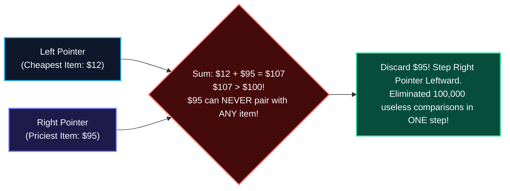
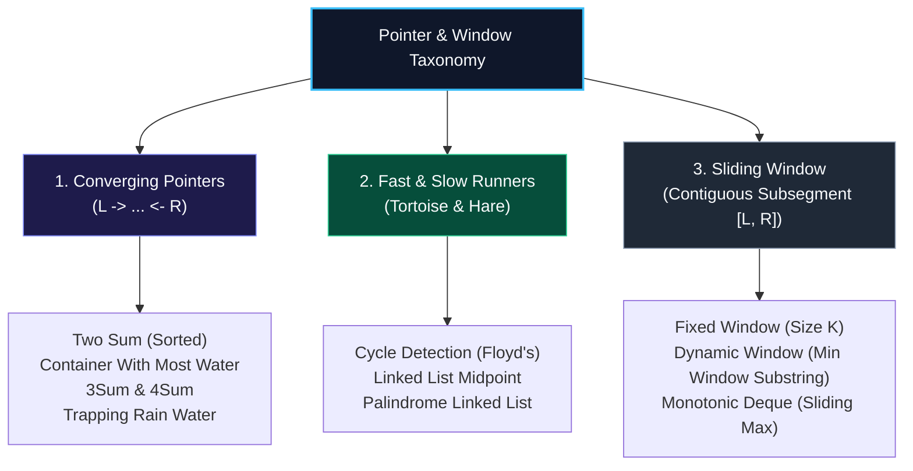
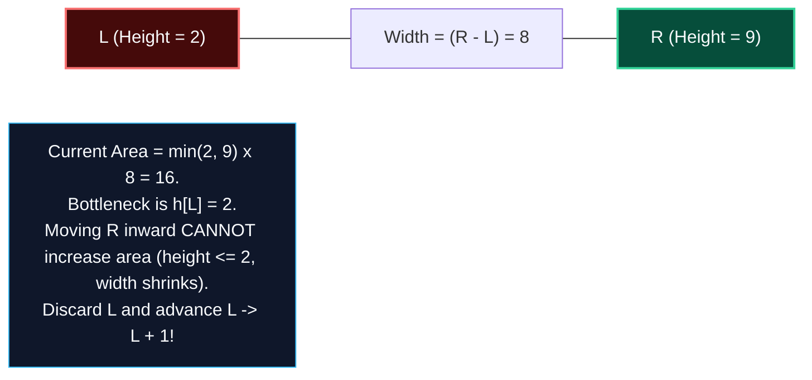
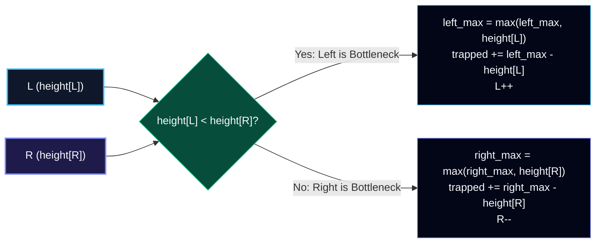
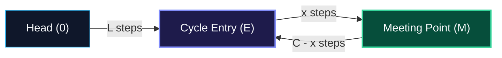
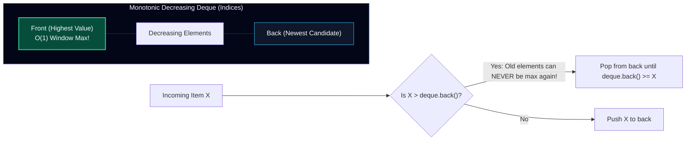
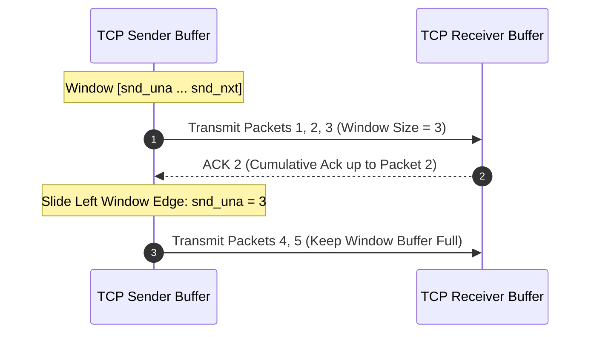

import { Callout } from "fumadocs-ui/components/callout";
import { Tabs, Tab } from "fumadocs-ui/components/tabs";
import { Steps, Step } from "fumadocs-ui/components/steps";
import { Cards, Card } from "fumadocs-ui/components/card";

## The ByteKart Story Continues: The $100 Gift Card Match & The 7-Day Rolling Revenue Window

ByteKart's marketing and finance departments have just launched two critical product initiatives that pushed the engineering team's algorithms to the brink:

### Scene 1: The Exact $100 Gift Card Match

To celebrate ByteKart's anniversary, every customer received a **\$100 promotional gift card**. The promotion had one condition:

> _"You must redeem your \$100 card on **exactly two products** that sum to exactly \$100 with zero leftover balance."_

The product catalog contained $N = 100,000$ items, pre-sorted by price:

```
[12, 18, 25, 30, 34, ..., 70, 75, 82, 88, 95]
```

A junior developer implemented the pair-matching query with a nested loop:

```python
# Naive O(N^2) brute-force pair search
for i in range(len(prices)):
    for j in range(i + 1, len(prices)):
        if prices[i] + prices[j] == 100:
            return (prices[i], prices[j])
```

The mathematical result was disastrous:

- Checking all pairs required $\binom{N}{2} \approx \frac{100,000^2}{2} = \mathbf{5 \times 10^9 \text{ operations}}$.
- Even in optimized C++, five billion operations takes several seconds; in Python or Node.js microservices, the request timed out and locked the API gateway.



The senior staff engineer immediately stopped the deployment:

> _"Notice that the prices are **already sorted**! If we place one inspector at the cheapest item (\$12) and another at the priciest item (\$95), their sum is \$107—which is too expensive. Could \$95 ever pair with any other item in the entire store to make \$100? No! Even paired with the cheapest possible item (\$12), it is already too large. In one single comparison, we can permanently eliminate \$95 and step inward. We do not need $5,000,000,000$ operations; we need at most **$100,000$ operations**—a $50,000\times$ speedup!"_

### Scene 2: The 7-Day Rolling Revenue Window

Meanwhile, ByteKart's executive revenue dashboard required computing the **maximum revenue generated in any consecutive 7-day period** across the last $10$ years of daily transactions ($N = 3,650$ days).

A brute-force script recalculated the sum of $7$ consecutive days from scratch for every single day:
$$7 \times 3,650 \approx 25,550 \text{ operations}$$

By using a **Sliding Window**, when moving from Day 7 to Day 8, the algorithm simply:
$$\text{new\_sum} = \text{previous\_sum} + \text{Day 8} - \text{Day 1}$$
One addition, one subtraction—**$\mathcal{O}(1)$ time** per day, completely independent of window size!

---

## Everyday Physical Analogies: Walking the Bridge & The Camera Zoom Lens

Before diving into mathematical proofs, visualize the two core physical metaphors:

### 1. Two Pointers: Two Bridge Inspectors

Imagine a two-mile suspension bridge that needs safety certification:

- **Inspector West** starts at the western tower (index `0`), walking east.
- **Inspector East** starts at the eastern tower (index `N-1`), walking west.
- Based on stress readings, they communicate over radio: if the eastern side is under heavier load, Inspector East advances forward; otherwise Inspector West advances.
- They **never backtrack** or re-inspect steps they have already passed.
- When they meet in the middle, the entire bridge has been inspected in exactly $\mathcal{O}(N)$ time!

```mermaid
flowchart LR
    West["West Inspector (L = 0)<br/>Walks East ->"] --> Bridge["=== The Suspension Bridge (Sorted Array) ==="] <-- East["<- Walks West<br/>East Inspector (R = N-1)"]

    style West fill:#0f172a,stroke:#38bdf8,stroke-width:2px,color:#f8fafc
    style East fill:#1e1b4b,stroke:#818cf8,stroke-width:2px,color:#f8fafc
    style Bridge fill:#064e3b,stroke:#34d399,stroke-width:2px,color:#f8fafc
```

### 2. Sliding Window: The Camera Zoom Lens

Imagine filming a wide scenic panorama with a mechanical cinema zoom lens:

- The **Right Lens Blade** expands to the right to capture more of the panoramic landscape (expanding the window to include new elements).
- When the viewfinder becomes too cluttered or captures unwanted tourists, the **Left Lens Blade** contracts rightward to crop out the noise (shrinking the window to restore validity).
- The camera frame always maintains a continuous, contiguous slice of the scene without having to re-film the panorama from scratch!

---

## 1. Taxonomy of Pointer Mechanics



---

## 2. Converging Pointers & Greedy Calipers

### Pattern 1: Container With Most Water

Given $n$ vertical lines of height $h_0, h_1, \dots, h_{n-1}$, find two lines that together with the x-axis form a container holding the maximum water:

$$
\text{Area}(L, R) = \min(h[L], h[R]) \times (R - L)
$$



#### The Greedy Caliper Invariant Proof

Why can we safely discard the shorter line without checking all its intermediate combinations?

1. Suppose $h[L] < h[R]$. The height of the water is strictly limited by $h[L]$.
2. If we move the right pointer inward to any $k < R$, the new width $(k - L)$ is strictly smaller than $(R - L)$.
3. The new height can never exceed $h[L]$:
   $$\min(h[L], h[k]) \le h[L]$$
4. Therefore, for **any** $k < R$:
   $$\text{Area}(L, k) = \min(h[L], h[k]) \times (k - L) < h[L] \times (R - L) = \text{Area}(L, R)$$
5. Line $L$ can **never** form a larger container with any remaining line! We can permanently discard index $L$ by incrementing $L \gets L + 1$ with zero risk of missing the optimal solution.

---

### Pattern 2: Trapping Rain Water ($\mathcal{O}(1)$ Auxiliary Space)

Water trapped above index $i$ depends on the tallest barriers to its left and right:

$$
\text{Water}[i] = \max\left(0, \min(\text{left\_max}[i], \text{right\_max}[i]) - \text{height}[i]\right)
$$

Instead of allocating two auxiliary prefix/suffix arrays of size $N$ ($\mathcal{O}(N)$ memory), we solve it with two converging pointers in **strictly $\mathcal{O}(1)$ auxiliary space**:



- **Invariant**: If `height[L] < height[R]`, we know with mathematical certainty that `left_max < height[R] <= right_max`.
- Therefore, the global bottleneck determining water height at $L$ is strictly `left_max`—regardless of whether an even taller wall exists further to the right! We process index $L$ and advance inward.

---

## 3. Fast & Slow Pointers (Floyd's Tortoise & Hare)

When navigating singly linked lists, how can we detect cycles or locate the middle node without allocating a hash set of visited memory addresses?

We dispatch two runners from the head:

- **The Tortoise (`slow`)**: advances **$1$ step** per tick (`slow = slow.next`).
- **The Hare (`fast`)**: advances **$2$ steps** per tick (`fast = fast.next.next`).



### Mathematical Derivation of the Cycle Entrance

1. Let $L$ be the distance from `Head` to `Cycle Entry` ($E$).
2. Let $C$ be the circumference of the cycle.
3. Let $x$ be the distance from `Cycle Entry` to the collision point ($M$).
4. Distance traveled by `slow`:
   $$d_{\text{slow}} = L + x$$
5. Distance traveled by `fast` (which completed $k$ full loops inside the cycle):
   $$d_{\text{fast}} = L + x + k \cdot C$$
6. Because `fast` moves at exactly twice the speed of `slow`:
   $$2 \cdot d_{\text{slow}} = d_{\text{fast}}$$
   $$2(L + x) = L + x + k \cdot C \implies L + x = k \cdot C$$
   $$L = k \cdot C - x = (k - 1)C + (C - x)$$

<Callout type="info" title="The Cycle Entry Takeaway">
Notice what $L = (k-1)C + (C - x)$ proves!

The distance from the `Head` to the `Cycle Entry` ($L$) is mathematically equal to the distance from the collision point to the `Cycle Entry` ($C - x$).

**The Algorithm to Find Cycle Entry**:
After `slow` and `fast` collide, leave `slow` at the meeting point $M$, but reset `fast` back to `Head`. Now advance both pointers at the **same speed** ($1$ step each). Their next collision point will be the **exact Cycle Entrance**!

</Callout>

---

## 4. The Sliding Window Paradigm: Fixed vs. Dynamic

A sliding window maintains a contiguous interval $[L, R]$ over a sequential buffer:

```
Index:    0    1    2    3    4    5    6    7
Array:  [ 1,   3,  -1,  -3,   5,   3,   6,   7 ]
               L              R
               [==============]   Current Window of Size 4
```

| Window Type           | Boundary Rules                     | Expansion Action                                      | Contraction Action                                  | Archetypal Problems                                |
| :-------------------- | :--------------------------------- | :---------------------------------------------------- | :-------------------------------------------------- | :------------------------------------------------- |
| **Fixed-Size Window** | Width is constant: $R - L + 1 = K$ | Advance $R \gets R + 1$                               | Advance $L \gets L + 1$ unconditionally             | Rolling 7-Day Revenue, Sliding Window Maximum      |
| **Dynamic Window**    | Width expands & contracts          | Advance $R \gets R + 1$ (expand to satisfy condition) | Advance $L \gets L + 1$ while invalid or optimizing | Minimum Window Substring, Longest Unique Substring |

### The Amortized $\mathcal{O}(N)$ Proof

Beginners often look at dynamic sliding window templates with an inner `while` loop and mistakenly classify them as $\mathcal{O}(N^2)$:

```python
# Is this O(N^2)? NO! It is strictly O(N)!
for r in range(len(nums)):
    add_to_window(nums[r])
    while window_is_invalid():
        remove_from_window(nums[l])
        l += 1
```

Let's count pointer movements across the **entire program execution**:

1. The right pointer $R$ starts at $0$ and increments by $1$ on each step of the outer loop. Total $R$ movements $= N$.
2. The left pointer $L$ starts at $0$ and only ever increments; **it never moves backward**.
3. Therefore, $L$ can increment at most $N$ times across the entire lifetime of the program!
4. Total operations $= N \text{ (right increments)} + N \text{ (left increments)} = 2N = \mathbf{\mathcal{O}(N)}$ total amortized time!

---

## 5. Advanced Technical Depth: Sliding Window Maximum via Monotonic Deque

Suppose ByteKart's pricing system must determine the **maximum price surge** in every sliding window of size $K$ across an incoming price stream of $N$ updates.

- Finding the maximum by scanning all $K$ elements in each window takes $\mathcal{O}(N \cdot K)$ time.
- A balanced BST or Heap takes $\mathcal{O}(N \log K)$ time.
- Can we compute the maximum in **strictly $\mathcal{O}(N)$ linear time**?

Yes, by using a **Monotonic Decreasing Deque** (Double-Ended Queue):



### The Monotonic Invariant Intuition

Why can we throw away elements smaller than an incoming value?

> If candidate $B$ arrives **after** candidate $A$, and $B \ge A$, candidate $A$ will **never again be the maximum** in any future sliding window! $A$ is both older (will expire sooner) and smaller than $B$. We pop $A$ from the back of the deque immediately!

Because every element enters the deque once and leaves the deque at most once, total runtime across all $N$ windows is strictly **$\mathcal{O}(N)$**!

---

## 6. Misconceptions & Myth Busters

<Callout type="info" title="When Does Two-Pointer Optimization Fail?">
The two-pointer and sliding window optimizations rely entirely on **monotonicity** (e.g., sorted arrays or non-negative numbers where expanding the window strictly increases the sum and shrinking strictly decreases it).

**When it fails:**
If an array contains **negative numbers** (for example, in the classic problem _Subarray Sum Equals K_ with positive and negative integers):

- Expanding $R$ might _decrease_ the sum.
- Shrinking $L$ might _increase_ the sum.
- The greedy decision of whether to advance $L$ or $R$ becomes impossible, and Two Pointers fails!

In that scenario, you must switch to a **Prefix Sum + Hash Map** pattern ($\mathcal{O}(N)$ time and space) or Dynamic Programming!

</Callout>

<Callout type="warn" title="The Duplicate Skipping Trap in 3Sum">
When implementing **3Sum** using converging two pointers, candidates frequently encounter duplicate triplet bugs:
```python
# CORRECT duplicate skipping sequence:
left += 1
right -= 1
while left < right and nums[left] == nums[left - 1]:
    left += 1
while left < right and nums[right] == nums[right + 1]:
    right -= 1
```
Notice the order: you must step the pointers **first**, and then skip adjacent elements matching the previous value! Checking equality before stepping creates infinite loops or skips valid unique triplets.
</Callout>

---

## 7. Production Systems Case Study: TCP Flow & Congestion Control

The sliding window is not merely an algorithmic pattern—it is the foundational mechanism powering the modern Internet under the **Transmission Control Protocol (TCP)** (RFC 793 / RFC 5681).



Inside the Linux kernel networking stack (`net/ipv4/tcp_input.c`):

- `snd_una` (send unacknowledged) acts as the **left window pointer** ($L$).
- `snd_nxt` (next sequence byte to transmit) acts as the **right window pointer** ($R$).
- `snd_wnd` (advertised receiver window) defines the **maximum allowable window width** ($R - L \le \text{snd\_wnd}$).
- When an ACK packet arrives from the client, the kernel slides `snd_una` forward, freeing socket memory and allowing `snd_nxt` to expand rightward without overwhelming intermediate network routers!

---

## Algorithmic Complexity Table

| Pattern                 | Problem Archetype            | Time Complexity           | Auxiliary Space                  | Monotonic Requirement             |
| :---------------------- | :--------------------------- | :------------------------ | :------------------------------- | :-------------------------------- |
| **Converging Pointers** | Two Sum (Sorted)             | $\mathcal{O}(N)$          | $\mathcal{O}(1)$                 | Array must be sorted              |
| **Greedy Calipers**     | Container With Most Water    | $\mathcal{O}(N)$          | $\mathcal{O}(1)$                 | Area bounded by minimum height    |
| **Converging Pointers** | 3Sum (Sorted)                | $\mathcal{O}(N^2)$        | $\mathcal{O}(1)$ (in-place sort) | Requires sorted sequence          |
| **Two Pointers**        | Trapping Rain Water          | $\mathcal{O}(N)$          | $\mathbf{\mathcal{O}(1)}$        | Bounded by left/right peak height |
| **Fast & Slow**         | Floyd's Cycle Detection      | $\mathcal{O}(N)$          | $\mathbf{\mathcal{O}(1)}$        | Deterministic state transitions   |
| **Fixed Window**        | Maximum Subarray of Size $K$ | $\mathcal{O}(N)$          | $\mathcal{O}(1)$                 | Fixed width $K$                   |
| **Dynamic Window**      | Minimum Window Substring     | $\mathcal{O}(N + M)$      | $\mathcal{O}(\|\Sigma\|)$        | Monotonic character counts        |
| **Monotonic Deque**     | Sliding Window Maximum       | $\mathbf{\mathcal{O}(N)}$ | $\mathcal{O}(K)$                 | Monotonic decreasing order        |

---

## Production Multi-Language Implementation

<Tabs items={['Python', 'TypeScript', 'C++']}>
  <Tab value="Python">
```python
from collections import deque, Counter
from typing import List

class TwoPointerPatterns:
@staticmethod
def three_sum(nums: List[int]) -> List[List[int]]:
"""3Sum using sorted converging pointers with duplicate skipping."""
nums.sort()
res: List[List[int]] = []
n = len(nums)

        for i in range(n - 2):
            # Skip duplicate first elements
            if i > 0 and nums[i] == nums[i - 1]:
                continue

            # Early pruning
            if nums[i] + nums[i + 1] + nums[i + 2] > 0:
                break
            if nums[i] + nums[n - 2] + nums[n - 1] < 0:
                continue

            left, right = i + 1, n - 1
            while left < right:
                total = nums[i] + nums[left] + nums[right]
                if total < 0:
                    left += 1
                elif total > 0:
                    right -= 1
                else:
                    res.append([nums[i], nums[left], nums[right]])
                    left += 1
                    right -= 1
                    # Skip duplicate inner elements
                    while left < right and nums[left] == nums[left - 1]:
                        left += 1
                    while left < right and nums[right] == nums[right + 1]:
                        right -= 1

        return res

    @staticmethod
    def trap_rain_water(height: List[int]) -> int:
        """Trapping Rain Water with O(1) auxiliary space."""
        if not height:
            return 0

        left, right = 0, len(height) - 1
        left_max, right_max = height[left], height[right]
        trapped = 0

        while left < right:
            if height[left] < height[right]:
                left += 1
                left_max = max(left_max, height[left])
                trapped += left_max - height[left]
            else:
                right -= 1
                right_max = max(right_max, height[right])
                trapped += right_max - height[right]

        return trapped

    @staticmethod
    def max_sliding_window(nums: List[int], k: int) -> List[int]:
        """Sliding Window Maximum in strictly O(N) time using Monotonic Deque."""
        dq: deque[int] = deque()  # Stores indices
        result: List[int] = []

        for i, val in enumerate(nums):
            # 1. Evict elements outside current window [i - k + 1, i]
            if dq and dq[0] < i - k + 1:
                dq.popleft()

            # 2. Maintain monotonic decreasing property
            while dq and nums[dq[-1]] < val:
                dq.pop()

            dq.append(i)

            # 3. Append max (front of deque) once first window is formed
            if i >= k - 1:
                result.append(nums[dq[0]])

        return result

    @staticmethod
    def min_window_substring(s: str, t: str) -> str:
        """Minimum Window Substring using dynamic expanding/contracting window."""
        if not s or not t or len(s) < len(t):
            return ""

        target_counts = Counter(t)
        window_counts = Counter()
        required_unique = len(target_counts)
        matched_unique = 0

        best_len = float('inf')
        best_window = (0, 0)
        left = 0

        for right, char in enumerate(s):
            window_counts[char] += 1
            if char in target_counts and window_counts[char] == target_counts[char]:
                matched_unique += 1

            # Contract from left while window remains completely valid
            while left <= right and matched_unique == required_unique:
                current_len = right - left + 1
                if current_len < best_len:
                    best_len = current_len
                    best_window = (left, right)

                left_char = s[left]
                window_counts[left_char] -= 1
                if left_char in target_counts and window_counts[left_char] < target_counts[left_char]:
                    matched_unique -= 1
                left += 1

        return "" if best_len == float('inf') else s[best_window[0]:best_window[1] + 1]

````
  </Tab>
  <Tab value="TypeScript">
```typescript
export class TwoPointerPatterns {
  static threeSum(nums: number[]): number[][] {
    nums.sort((a, b) => a - b);
    const result: number[][] = [];
    const n = nums.length;

    for (let i = 0; i < n - 2; i++) {
      if (i > 0 && nums[i] === nums[i - 1]) continue;
      if (nums[i] + nums[i + 1] + nums[i + 2] > 0) break;
      if (nums[i] + nums[n - 2] + nums[n - 1] < 0) continue;

      let left = i + 1;
      let right = n - 1;

      while (left < right) {
        const sum = nums[i] + nums[left] + nums[right];
        if (sum < 0) {
          left++;
        } else if (sum > 0) {
          right--;
        } else {
          result.push([nums[i], nums[left], nums[right]]);
          left++;
          right--;
          while (left < right && nums[left] === nums[left - 1]) left++;
          while (left < right && nums[right] === nums[right + 1]) right--;
        }
      }
    }
    return result;
  }

  static trapRainWater(height: number[]): number {
    let left = 0;
    let right = height.length - 1;
    let leftMax = height[left];
    let rightMax = height[right];
    let trapped = 0;

    while (left < right) {
      if (height[left] < height[right]) {
        left++;
        leftMax = Math.max(leftMax, height[left]);
        trapped += leftMax - height[left];
      } else {
        right--;
        rightMax = Math.max(rightMax, height[right]);
        trapped += rightMax - height[right];
      }
    }
    return trapped;
  }

  static maxSlidingWindow(nums: number[], k: number): number[] {
    const deque: number[] = []; // Stores indices
    const result: number[] = [];

    for (let i = 0; i < nums.length; i++) {
      // 1. Evict indices outside current window
      if (deque.length > 0 && deque[0] < i - k + 1) {
        deque.shift();
      }

      // 2. Maintain monotonic decreasing order
      while (deque.length > 0 && nums[deque[deque.length - 1]] < nums[i]) {
        deque.pop();
      }

      deque.push(i);

      // 3. Record maximum once first window is formed
      if (i >= k - 1) {
        result.push(nums[deque[0]]);
      }
    }

    return result;
  }
}
````

  </Tab>
  <Tab value="C++">
```cpp
#include <iostream>
#include <vector>
#include <string>
#include <algorithm>
#include <deque>

class TwoPointerPatterns {
public:
static std::vector<std::vector<int>> threeSum(std::vector<int>& nums) {
std::sort(nums.begin(), nums.end());
std::vector<std::vector<int>> res;
int n = nums.size();

        for (int i = 0; i < n - 2; ++i) {
            if (i > 0 && nums[i] == nums[i - 1]) continue;
            if (nums[i] + nums[i + 1] + nums[i + 2] > 0) break;
            if (nums[i] + nums[n - 2] + nums[n - 1] < 0) continue;

            int left = i + 1;
            int right = n - 1;

            while (left < right) {
                int sum = nums[i] + nums[left] + nums[right];
                if (sum < 0) {
                    ++left;
                } else if (sum > 0) {
                    --right;
                } else {
                    res.push_back({nums[i], nums[left], nums[right]});
                    ++left;
                    --right;
                    while (left < right && nums[left] == nums[left - 1]) ++left;
                    while (left < right && nums[right] == nums[right + 1]) --right;
                }
            }
        }
        return res;
    }

    static int trapRainWater(const std::vector<int>& height) {
        if (height.empty()) return 0;
        int left = 0, right = height.size() - 1;
        int leftMax = height[left], rightMax = height[right];
        int trapped = 0;

        while (left < right) {
            if (height[left] < height[right]) {
                ++left;
                leftMax = std::max(leftMax, height[left]);
                trapped += leftMax - height[left];
            } else {
                --right;
                rightMax = std::max(rightMax, height[right]);
                trapped += rightMax - height[right];
            }
        }
        return trapped;
    }

    static std::vector<int> maxSlidingWindow(const std::vector<int>& nums, int k) {
        std::deque<int> dq;
        std::vector<int> result;

        for (int i = 0; i < static_cast<int>(nums.size()); ++i) {
            if (!dq.empty() && dq.front() < i - k + 1) {
                dq.pop_front();
            }

            while (!dq.empty() && nums[dq.back()] < nums[i]) {
                dq.pop_back();
            }

            dq.push_back(i);

            if (i >= k - 1) {
                result.push_back(nums[dq.front()]);
            }
        }
        return result;
    }

};

````
  </Tab>
</Tabs>

---

## Technical Interview Patterns & Pitfalls

### Pitfalls Checklist
1. **Unbounded Shrink in Dynamic Windows**: Always verify that the inner contraction loop maintains `left <= right`.
2. **Hash Map Size vs. Counter**: In Minimum Window Substring, maintain a separate `matched_unique` counter to check window satisfaction in $\mathcal{O}(1)$, rather than scanning the entire map on every tick ($\mathcal{O}(|\Sigma|)$).
3. **Monotonic Deque Stores Indices, Not Values**: In Sliding Window Maximum, always store **indices** in the deque rather than raw numbers. Storing indices allows you to instantly detect when the front element has expired outside the current window window range ($i - k + 1$).

---

## Hands-On Verification Challenge

### Problem: Longest Repeating Character Replacement

You are given a string `s` consisting of uppercase English letters and an integer `k`. You can choose any character of the string and change it to any other uppercase English character at most `k` times. Return the length of the longest contiguous substring containing identical letters you can achieve:

```python
def character_replacement(s: str, k: int) -> int:
    """
    Find longest repeating character substring after at most k changes.
    Time Complexity: O(N) | Space Complexity: O(26) = O(1).
    """
    counts = {}
    left = 0
    max_freq = 0
    max_len = 0

    for right in range(len(s)):
        char = s[right]
        counts[char] = counts.get(char, 0) + 1
        max_freq = max(max_freq, counts[char])

        # Current window length = (right - left + 1)
        # Non-matching characters to replace = window_len - max_freq
        while (right - left + 1) - max_freq > k:
            counts[s[left]] -= 1
            left += 1

        max_len = max(max_len, right - left + 1)

    return max_len

# Verification Test
assert character_replacement("AABABBA", 1) == 4
assert character_replacement("ABAB", 2) == 4
print("Verification Succeeded: Longest Repeating Substring computed in strictly O(N) amortized time!")
````
