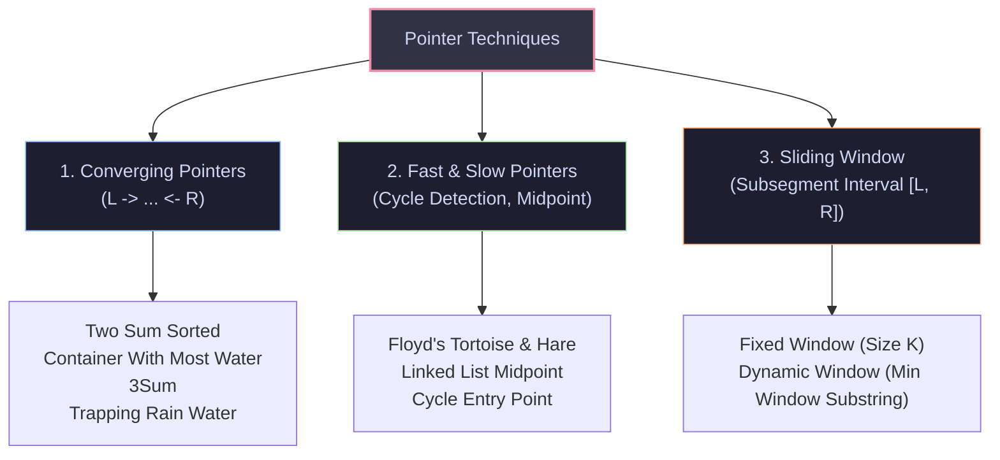
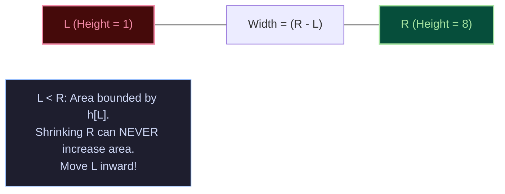
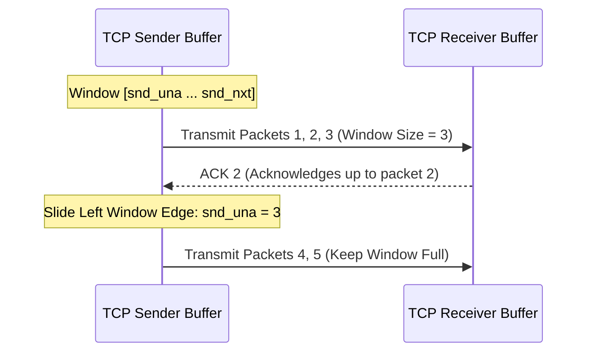

import { Callout } from "fumadocs-ui/components/callout";
import { Tabs, Tab } from "fumadocs-ui/components/tabs";
import { Steps, Step } from "fumadocs-ui/components/steps";
import { Cards, Card } from "fumadocs-ui/components/card";

## The Brute-Force Quadratic Trap

When querying contiguous subarrays or pairs of elements in an array of size $N$, a naive nested loop evaluates all $\binom{N}{2} \approx \frac{N^2}{2}$ pairs:

```python
# Naive O(N^2) search
for i in range(len(nums)):
    for j in range(i, len(nums)):
        evaluate_window(nums[i:j+1])
```

For $N = 100,000$, $N^2 = 10^{10}$ operations—requiring tens of seconds and failing any production SLA or interview time limit.

**Two Pointers** and **Sliding Windows** exploit structural monotonicity (e.g. sorted arrays, positive monotonic sums, or window validity) to advance two index pointers monotonically forward, slashing execution time from **$\mathcal{O}(N^2)$ to strictly $\mathcal{O}(N)$**.

---

## 1. Taxonomy of Pointer Mechanics



---

## 2. Converging Pointers & Greedy Calipers

### Pattern 1: Container With Most Water

Given $n$ vertical lines of height $h_0, h_1, \dots, h_{n-1}$, find two lines that together with the x-axis form a container holding the maximum water:

$$
\text{Area}(L, R) = \min(h[L], h[R]) \times (R - L)
$$



#### The Greedy Caliper Invariant Proof

- Suppose $h[L] < h[R]$. The height bottleneck is $h[L]$.
- If we move $R$ inward to $R - 1$, the width decreases by $1$. The new height is at most $\min(h[L], h[R-1]) \le h[L]$.
- Therefore, every container formed with $L$ and any index $k < R$ will have strictly less area than $\text{Area}(L, R)$.
- We can safely eliminate index $L$ from consideration forever by incrementing $L \to L + 1$. This eliminates $R - L - 1$ states in $\mathcal{O}(1)$ time!

### Pattern 2: Trapping Rain Water ($\mathcal{O}(1)$ Auxiliary Space)

Water trapped above index $i$ is determined by:

$$
\text{Water}[i] = \max\left(0, \min(\text{left\_max}[i], \text{right\_max}[i]) - \text{height}[i]\right)
$$

Instead of allocating two auxiliary prefix/suffix arrays of size $N$, use two converging pointers:

- Maintain running `left_max` and `right_max`.
- If `height[L] < height[R]`: the global bottleneck is guaranteed to be `left_max` (since `height[L] < height[R] \le \text{right\_max}`). We can process index $L$ immediately, accumulate trapped water, and increment $L$.
- Otherwise: the bottleneck is guaranteed to be `right_max`. Accumulate trapped water at $R$ and decrement $R$.

---

## 3. Fast & Slow Pointers (Floyd's Cycle Detection)

To detect a cycle in a linked list or finite state machine:

- Initialize `slow = head`, `fast = head`.
- Advance `slow = slow.next` ($1$ step), and `fast = fast.next.next` ($2$ steps).
- If `fast == null` or `fast.next == null`: no cycle exists.
- If `slow == fast`: a cycle exists!


### Deriving Cycle Entrance

- Let $L$ be the distance from Head to Cycle Entry.
- Let $C$ be the circumference of the cycle.
- Let $x$ be the distance from Cycle Entry to the meeting point.
- Distance traveled by `slow`: $d_{\text{slow}} = L + x$.
- Distance traveled by `fast`: $d_{\text{fast}} = L + x + k \cdot C$.
- Since `fast` moves at twice the speed of `slow`:
  $$
  2(L + x) = L + x + k \cdot C \implies L + x = k \cdot C \implies L = k \cdot C - x = (k - 1)C + (C - x)
  $$
- **The Takeaway**: The distance from the `head` to the cycle entry ($L$) equals the distance from the meeting point to the cycle entry ($C - x$).
- **Algorithm**: Reset `slow = head`. Advance both pointers by $1$ step simultaneously. Their collision point is the **exact cycle entry**!

---

## 4. The Sliding Window Paradigm

A sliding window maintains a contiguous subsegment $[L, R]$ over a sequential buffer.

```
          L               R
          |               |
[ 1,  3, -1, -3,  5,  3,  6,  7 ]
         [==============>]  Window State
```

### Fixed vs. Dynamic Windows

| Characteristic       | Fixed-Size Window                        | Dynamic-Size Window                                |
| :------------------- | :--------------------------------------- | :------------------------------------------------- |
| **Window Boundary**  | $R - L + 1 = K$ (Constant)               | $R - L + 1$ expands and contracts                  |
| **Expansion Step**   | $R \gets R + 1$                          | $R \gets R + 1$ (expand until condition met)       |
| **Contraction Step** | $L \gets L + 1$ unconditionally          | $L \gets L + 1$ while invalid / optimizing         |
| **Classic Problem**  | Sliding Window Maximum, Max Sum Subarray | Minimum Window Substring, Longest Unique Substring |

### The Amortized $\mathcal{O}(N)$ Proof

A dynamic sliding window contains an inner `while` loop:

```python
for r in range(len(nums)):
    add_to_window(nums[r])
    while window_is_invalid():
        remove_from_window(nums[l])
        l += 1
```

Beginners often misjudge this as $\mathcal{O}(N^2)$. However:

- The pointer $R$ moves from $0$ to $N - 1$: exactly $N$ increments.
- The pointer $L$ starts at $0$ and only ever increments; it never retreats. Thus $L$ increments at most $N$ times across the **entire execution**.
- Total pointer movements $= N + N = 2N \implies \mathbf{\mathcal{O}(N)}$ total runtime!

---

## 5. Production Systems Case Study: TCP Flow & Congestion Control

The sliding window is not merely an interview technique—it is the foundational algorithm powering the entire Internet under the **Transmission Control Protocol (TCP)** (RFC 793 / RFC 5681).



In the Linux kernel networking stack (`net/ipv4/tcp_input.c`):

- `snd_una` (send unacknowledged) acts as the **left window pointer** ($L$).
- `snd_nxt` (next sequence to send) acts as the **right window pointer** ($R$).
- `snd_wnd` (receive window advertised by remote host) sets the **maximum window width** ($R - L \le \text{snd\_wnd}$).
- When an ACK arrives, the kernel slides `snd_una` forward, freeing buffer slots and permitting `snd_nxt` to expand rightward without overwhelming intermediate network routers.

---

## Algorithmic Complexity Table

| Pattern                 | Problem Archetype         | Time Complexity      | Auxiliary Space                  |
| :---------------------- | :------------------------ | :------------------- | :------------------------------- | ------ | ---------------- |
| **Converging Pointers** | Container With Most Water | $\mathcal{O}(N)$     | $\mathcal{O}(1)$                 |
| **Converging Pointers** | 3Sum (Sorted)             | $\mathcal{O}(N^2)$   | $\mathcal{O}(1)$ (in-place sort) |
| **Two Pointers**        | Trapping Rain Water       | $\mathcal{O}(N)$     | $\mathcal{O}(1)$                 |
| **Fast & Slow**         | Floyd's Cycle Detection   | $\mathcal{O}(N)$     | $\mathcal{O}(1)$                 |
| **Fixed Window**        | Subarray Sum of Size $K$  | $\mathcal{O}(N)$     | $\mathcal{O}(1)$                 |
| **Dynamic Window**      | Minimum Window Substring  | $\mathcal{O}(N + M)$ | $\mathcal{O}(                    | \Sigma | )$ character map |

---

## Production Multi-Language Implementation

<Tabs items={['Python', 'TypeScript', 'C++']}>
  <Tab value="Python">
```python
from collections import Counter
from typing import List

class TwoPointerPatterns:
@staticmethod
def three_sum(nums: List[int]) -> List[List[int]]:
"""3Sum with duplicate skipping guards."""
nums.sort()
res: List[List[int]] = []
n = len(nums)

        for i in range(n - 2):
            # Skip duplicate values for the first element
            if i > 0 and nums[i] == nums[i - 1]:
                continue

            # Pruning optimization: lowest possible triplet > 0
            if nums[i] + nums[i + 1] + nums[i + 2] > 0:
                break
            # Pruning optimization: highest possible triplet < 0
            if nums[i] + nums[n - 2] + nums[n - 1] < 0:
                continue

            left, right = i + 1, n - 1
            while left < right:
                total = nums[i] + nums[left] + nums[right]
                if total < 0:
                    left += 1
                elif total > 0:
                    right -= 1
                else:
                    res.append([nums[i], nums[left], nums[right]])
                    left += 1
                    right -= 1
                    # Skip duplicate values for left and right
                    while left < right and nums[left] == nums[left - 1]:
                        left += 1
                    while left < right and nums[right] == nums[right + 1]:
                        right -= 1

        return res

    @staticmethod
    def trap_rain_water(height: List[int]) -> int:
        """Trapping Rain Water with O(1) auxiliary space."""
        if not height:
            return 0

        left, right = 0, len(height) - 1
        left_max, right_max = height[left], height[right]
        trapped_water = 0

        while left < right:
            if height[left] < height[right]:
                left += 1
                left_max = max(left_max, height[left])
                trapped_water += left_max - height[left]
            else:
                right -= 1
                right_max = max(right_max, height[right])
                trapped_water += right_max - height[right]

        return trapped_water

    @staticmethod
    def min_window_substring(s: str, t: str) -> str:
        """Minimum Window Substring using dynamic sliding window."""
        if not s or not t or len(s) < len(t):
            return ""

        target_counts = Counter(t)
        window_counts = Counter()
        required_unique = len(target_counts)
        matched_unique = 0

        best_len = float('inf')
        best_window = (0, 0)
        left = 0

        for right, char in enumerate(s):
            window_counts[char] += 1
            if char in target_counts and window_counts[char] == target_counts[char]:
                matched_unique += 1

            # Contract window from the left while all characters are satisfied
            while left <= right and matched_unique == required_unique:
                current_len = right - left + 1
                if current_len < best_len:
                    best_len = current_len
                    best_window = (left, right)

                left_char = s[left]
                window_counts[left_char] -= 1
                if left_char in target_counts and window_counts[left_char] < target_counts[left_char]:
                    matched_unique -= 1
                left += 1

        return "" if best_len == float('inf') else s[best_window[0]:best_window[1] + 1]

````
  </Tab>
  <Tab value="TypeScript">
```typescript
export class TwoPointerPatterns {
  static threeSum(nums: number[]): number[][] {
    nums.sort((a, b) => a - b);
    const result: number[][] = [];
    const n = nums.length;

    for (let i = 0; i < n - 2; i++) {
      if (i > 0 && nums[i] === nums[i - 1]) continue;
      if (nums[i] + nums[i + 1] + nums[i + 2] > 0) break;
      if (nums[i] + nums[n - 2] + nums[n - 1] < 0) continue;

      let left = i + 1;
      let right = n - 1;

      while (left < right) {
        const sum = nums[i] + nums[left] + nums[right];
        if (sum < 0) {
          left++;
        } else if (sum > 0) {
          right--;
        } else {
          result.push([nums[i], nums[left], nums[right]]);
          left++;
          right--;
          while (left < right && nums[left] === nums[left - 1]) left++;
          while (left < right && nums[right] === nums[right + 1]) right--;
        }
      }
    }
    return result;
  }

  static trapRainWater(height: number[]): number {
    let left = 0;
    let right = height.length - 1;
    let leftMax = height[left];
    let rightMax = height[right];
    let trapped = 0;

    while (left < right) {
      if (height[left] < height[right]) {
        left++;
        leftMax = Math.max(leftMax, height[left]);
        trapped += leftMax - height[left];
      } else {
        right--;
        rightMax = Math.max(rightMax, height[right]);
        trapped += rightMax - height[right];
      }
    }
    return trapped;
  }
}
````

  </Tab>
  <Tab value="C++">
```cpp
#include <iostream>
#include <vector>
#include <string>
#include <algorithm>
#include <unordered_map>
#include <climits>

class TwoPointerPatterns {
public:
static std::vector<std::vector<int>> threeSum(std::vector<int>& nums) {
std::sort(nums.begin(), nums.end());
std::vector<std::vector<int>> res;
int n = nums.size();

        for (int i = 0; i < n - 2; ++i) {
            if (i > 0 && nums[i] == nums[i - 1]) continue;
            if (nums[i] + nums[i + 1] + nums[i + 2] > 0) break;
            if (nums[i] + nums[n - 2] + nums[n - 1] < 0) continue;

            int left = i + 1;
            int right = n - 1;

            while (left < right) {
                int sum = nums[i] + nums[left] + nums[right];
                if (sum < 0) {
                    ++left;
                } else if (sum > 0) {
                    --right;
                } else {
                    res.push_back({nums[i], nums[left], nums[right]});
                    ++left;
                    --right;
                    while (left < right && nums[left] == nums[left - 1]) ++left;
                    while (left < right && nums[right] == nums[right + 1]) --right;
                }
            }
        }
        return res;
    }

    static int trapRainWater(const std::vector<int>& height) {
        if (height.empty()) return 0;
        int left = 0, right = height.size() - 1;
        int leftMax = height[left], rightMax = height[right];
        int trapped = 0;

        while (left < right) {
            if (height[left] < height[right]) {
                ++left;
                leftMax = std::max(leftMax, height[left]);
                trapped += leftMax - height[left];
            } else {
                --right;
                rightMax = std::max(rightMax, height[right]);
                trapped += rightMax - height[right];
            }
        }
        return trapped;
    }

};

````
  </Tab>
</Tabs>

---

## Technical Interview Patterns & Pitfalls

<Callout type="warn">
**The Duplicate Skipping Trap in 3Sum**:
When matching a target triplet, advancing pointers without skipping identical adjacent elements will generate duplicate triplets in the output:
```python
# CORRECT deduplication sequence
left += 1
right -= 1
while left < right and nums[left] == nums[left - 1]:
    left += 1
while left < right and nums[right] == nums[right + 1]:
    right -= 1
````

Notice we advance pointers **first**, then skip while matching the previous element!

</Callout>

### Common Pitfalls Checklist

1. **Unbounded Shrink in Dynamic Windows**: Always ensure the inner shrink loop maintains `left <= right`.
2. **Hash Map Size vs. Element Count**: In Minimum Window Substring, maintain a separate `matched_characters` counter to avoid scanning entire hash maps ($\mathcal{O}(|\Sigma|)$) on every inner loop step.

---

## Hands-On Verification Challenge

### Problem: Longest Repeating Character Replacement

You are given a string `s` consisting of uppercase English letters and an integer `k`. You can choose any character of the string and change it to any other uppercase English character at most `k` times. Return the length of the longest substring containing the same letter you can achieve.

```python
def character_replacement(s: str, k: int) -> int:
    counts = {}
    left = 0
    max_freq = 0
    max_len = 0

    for right in range(len(s)):
        char = s[right]
        counts[char] = counts.get(char, 0) + 1
        max_freq = max(max_freq, counts[char])

        # Current window length is (right - left + 1)
        # Required replacements = window_len - max_freq
        while (right - left + 1) - max_freq > k:
            counts[s[left]] -= 1
            left += 1

        max_len = max(max_len, right - left + 1)

    return max_len

# Verification
assert character_replacement("AABABBA", 1) == 4
assert character_replacement("ABAB", 2) == 4
print("Verification Succeeded: Longest Repeating Substring computed in O(N)!")
```
