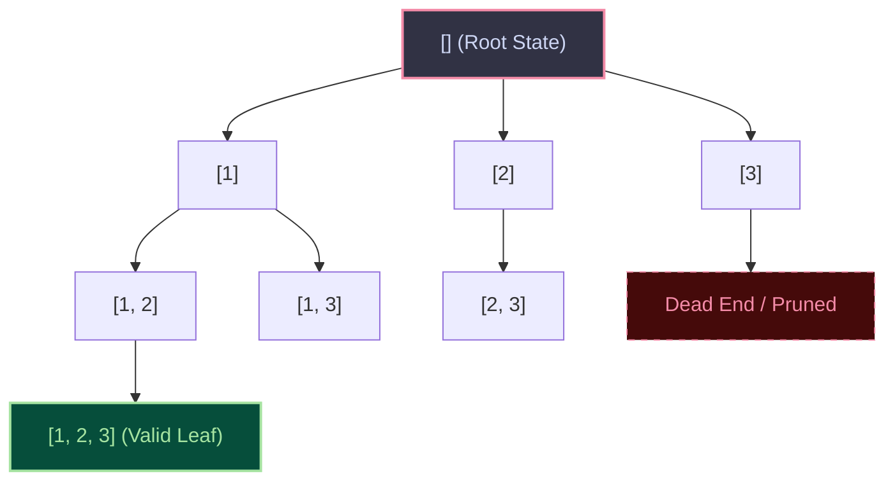
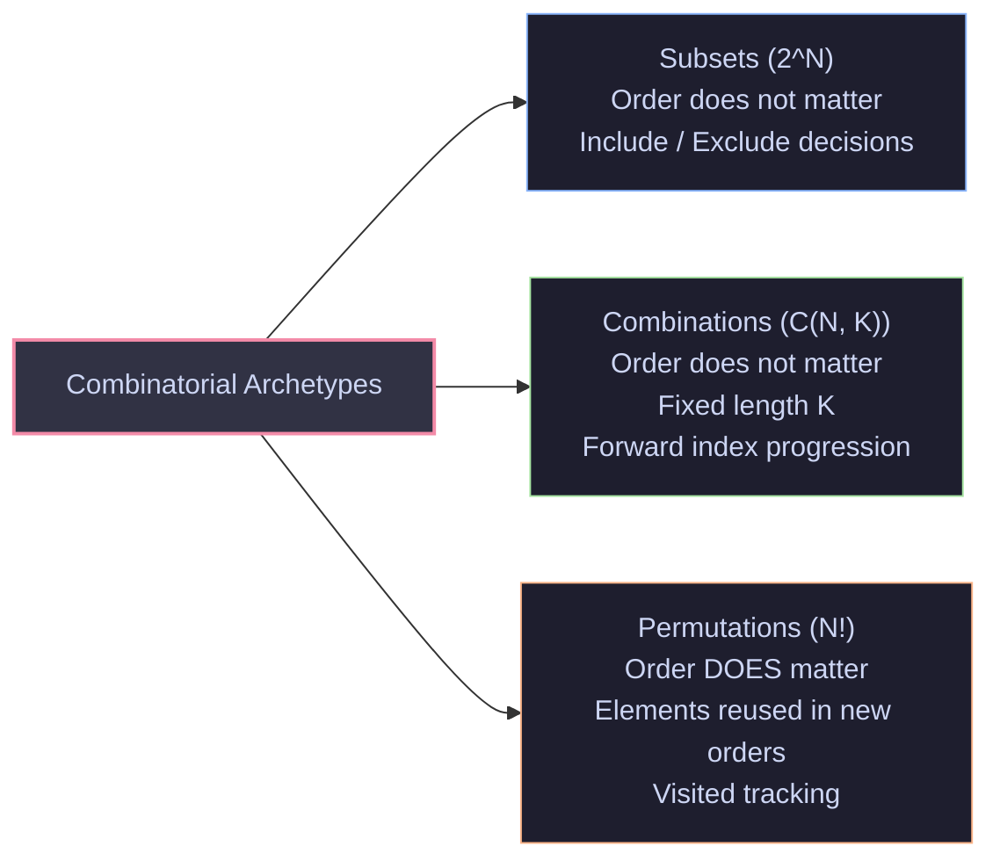
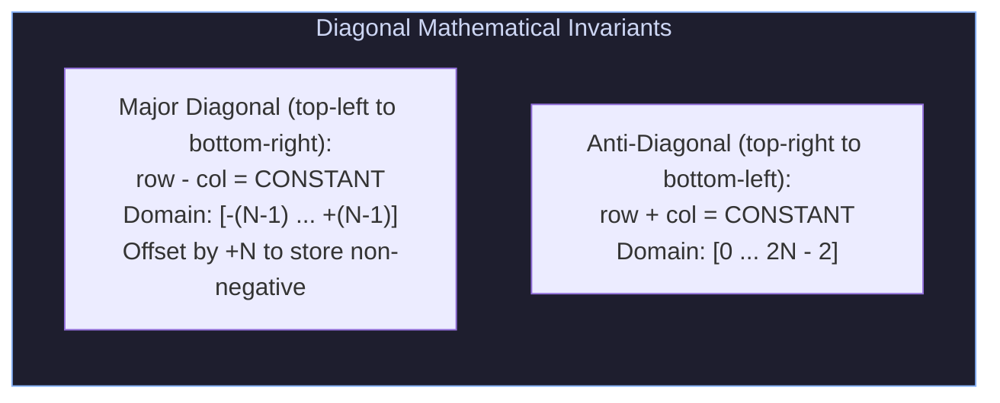

import { Callout } from "fumadocs-ui/components/callout";
import { Tabs, Tab } from "fumadocs-ui/components/tabs";
import { Steps, Step } from "fumadocs-ui/components/steps";
import { Cards, Card } from "fumadocs-ui/components/card";

## The Combinatorial Explosion

Consider generating all possible passwords, solving a Sudoku puzzle, or finding an optimal flight itinerary across $20$ connecting cities. The number of configurations is combinatorial:

- $N$ items have $2^N$ subsets.
- $N$ items have $N!$ permutations.

For $N = 20$, $2^{20} \approx 10^6$ (manageable), but $20! \approx 2.43 \times 10^{18}$ operations—which would take a modern supercomputer decades to brute-force.

**Backtracking** is an algorithmic technique for systematically searching the solution space of a combinatorial problem by building candidates incrementally. Crucially, when an algorithm determines that a partial candidate cannot possibly lead to a valid complete solution, it **prunes** that branch immediately and retreats (**backtracks**) to make alternative choices.

---

## 1. The Mental Model: State-Space Trees

Think of backtracking as exploring an ancient labyrinth with a ball of thread (Theseus in the Minotaur's maze). At each intersection:

1. You make a choice and mark your trail with thread.
2. You explore deeper down that path.
3. If you reach a dead end (a constraint violation), you **rewind the thread**, restore the state of the labyrinth, and try the next path.
4. If you reach the center (the target goal), you record the solution.



---

## 2. The Golden Backtracking Template

Virtually every backtracking problem conforms to a clean, universal three-step cadence: **Choose, Explore, Unchoose**.

```python
def backtrack(state, choices):
    # 1. Base Case: Goal reached
    if is_solution(state):
        results.append(state.copy())  # CRUCIAL: deep copy state!
        return

    # 2. Iterate through available choices
    for choice in choices:
        # 3. Pruning: Guard condition
        if not is_valid(choice, state):
            continue

        # --- CHOOSE ---
        apply_choice(state, choice)

        # --- EXPLORE ---
        backtrack(state, updated_choices)

        # --- UNCHOOSE (Backtrack) ---
        revert_choice(state, choice)
```

<Callout type="warn">
  **The Mutable Reference Trap**: In Python, JavaScript, and Java, arrays/lists
  are passed by reference. If you write `results.append(state)`, you append a
  pointer to a mutable list that will later be emptied by the unchoose steps!
  Always store a snapshot: `results.append(list(state))` or
  `results.push([...state])`.
</Callout>

---

## 3. The Big Three Combinatorial Archetypes

Understanding the structural differences between Subsets, Combinations, and Permutations prevents confusion during implementation.



### 1. Subsets II (Deduplication with Sorting)

When the input list contains duplicate numbers (e.g., `[1, 2, 2]`), naive recursion generates duplicate subsets.

- **The Pruning Guard**:
  1. Sort the input array first: `nums.sort()`.
  2. In the iteration loop over candidates from `start` to `len(nums)`:
     ```python
     if i > start and nums[i] == nums[i - 1]:
         continue  # Skip identical sibling branches
     ```
  3. Why `i > start`? Because `nums[i] == nums[i - 1]` is valid when building **depth** (parent-child relationship, where $i = \text{start}$), but constitutes a duplicate when branching across **siblings** ($i > \text{start}$).

### 2. Permutations II (The `used` Invariant)

To generate unique permutations of an array with duplicate elements:

1. Sort `nums`.
2. Maintain a boolean array `used = [False] * len(nums)`.
3. Pruning condition:
   ```python
   if used[i]:
       continue
   if i > 0 and nums[i] == nums[i - 1] and not used[i - 1]:
       continue
   ```
4. **Why `not used[i - 1]`?** If `used[i - 1]` is `False`, it means that `nums[i - 1]` was already chosen, explored, and **unchosen** in the current recursion frame. Choosing `nums[i]` now would create an identical duplicate subtree!

---

## 4. Constraint Satisfaction: The N-Queens Solver

The N-Queens puzzle places $N$ chess queens on an $N \times N$ chessboard such that no two queens attack each other (no two queens share a row, column, or diagonal).



Instead of scanning the entire board in $\mathcal{O}(N)$ to verify every queen placement, maintain three boolean lookup sets / bitmasks:

- `cols`: Queen occupying column $c$.
- `diag1`: Queen occupying diagonal $r - c$.
- `diag2`: Queen occupying anti-diagonal $r + c$.

Checking validity drops to **$\mathcal{O}(1)$ time per cell**!

---

## Algorithmic Complexity Table

| Archetype        | Decision Branching           | Total Tree Leaves                    | Time Complexity                                | Auxiliary Space              |
| :--------------- | :--------------------------- | :----------------------------------- | :--------------------------------------------- | :--------------------------- |
| **Subsets**      | Binary (Include/Exclude)     | $2^N$                                | $\mathcal{O}(N \cdot 2^N)$                     | $\mathcal{O}(N)$ stack depth |
| **Combinations** | Forward progression          | $\binom{N}{K} = \frac{N!}{K!(N-K)!}$ | $\mathcal{O}\left(K \cdot \binom{N}{K}\right)$ | $\mathcal{O}(K)$             |
| **Permutations** | Unused elements              | $N!$                                 | $\mathcal{O}(N \cdot N!)$                      | $\mathcal{O}(N)$             |
| **N-Queens**     | Non-conflicting columns      | Upper bounded by $N!$                | $\mathcal{O}(N!)$                              | $\mathcal{O}(N)$             |
| **Sudoku 9x9**   | $1 \dots 9$ digit validation | $9^{\text{empty\_cells}}$ (worst)    | $\mathcal{O}(1)$ (bounded $9 \times 9$)        | $\mathcal{O}(1)$             |

---

## Production Multi-Language Implementation

<Tabs items={['Python', 'TypeScript', 'C++']}>
  <Tab value="Python">
```python
from typing import List

class BacktrackingSolvers:
@staticmethod
def subsets_with_dup(nums: List[int]) -> List[List[int]]:
"""Subsets II: Handles duplicates via sorting and sibling skip guard."""
nums.sort()
results: List[List[int]] = []
path: List[int] = []

        def _backtrack(start: int) -> None:
            results.append(list(path))  # Record state snapshot

            for i in range(start, len(nums)):
                # Prune duplicate sibling decisions
                if i > start and nums[i] == nums[i - 1]:
                    continue

                path.append(nums[i])
                _backtrack(i + 1)
                path.pop()  # Backtrack / Unchoose

        _backtrack(0)
        return results

    @staticmethod
    def permute_unique(nums: List[int]) -> List[List[int]]:
        """Permutations II: Handles duplicate elements via used tracking."""
        nums.sort()
        results: List[List[int]] = []
        path: List[int] = []
        used = [False] * len(nums)

        def _backtrack() -> None:
            if len(path) == len(nums):
                results.append(list(path))
                return

            for i in range(len(nums)):
                if used[i]:
                    continue
                # Prune duplicate branches
                if i > 0 and nums[i] == nums[i - 1] and not used[i - 1]:
                    continue

                used[i] = True
                path.append(nums[i])
                _backtrack()
                path.pop()
                used[i] = False

        _backtrack()
        return results

    @staticmethod
    def solve_n_queens(n: int) -> List[List[str]]:
        """N-Queens using O(1) set-based diagonal conflict checks."""
        results: List[List[str]] = []
        cols = set()
        diag1 = set()  # r - c
        diag2 = set()  # r + c
        board = [["."] * n for _ in range(n)]

        def _backtrack(row: int) -> None:
            if row == n:
                results.append(["".join(r) for r in board])
                return

            for col in range(n):
                d1 = row - col
                d2 = row + col

                if col in cols or d1 in diag1 or d2 in diag2:
                    continue  # Prune conflicting positions

                # Choose
                cols.add(col)
                diag1.add(d1)
                diag2.add(d2)
                board[row][col] = "Q"

                # Explore
                _backtrack(row + 1)

                # Unchoose
                board[row][col] = "."
                cols.remove(col)
                diag1.remove(d1)
                diag2.remove(d2)

        _backtrack(0)
        return results

````
  </Tab>
  <Tab value="TypeScript">
```typescript
export class BacktrackingSolvers {
  static subsetsWithDup(nums: number[]): number[][] {
    nums.sort((a, b) => a - b);
    const results: number[][] = [];
    const path: number[] = [];

    const backtrack = (start: number): void => {
      results.push([...path]);

      for (let i = start; i < nums.length; i++) {
        if (i > start && nums[i] === nums[i - 1]) continue;

        path.push(nums[i]);
        backtrack(i + 1);
        path.pop();
      }
    };

    backtrack(0);
    return results;
  }

  static permuteUnique(nums: number[]): number[][] {
    nums.sort((a, b) => a - b);
    const results: number[][] = [];
    const path: number[] = [];
    const used: boolean[] = new Array(nums.length).fill(false);

    const backtrack = (): void => {
      if (path.length === nums.length) {
        results.push([...path]);
        return;
      }

      for (let i = 0; i < nums.length; i++) {
        if (used[i]) continue;
        if (i > 0 && nums[i] === nums[i - 1] && !used[i - 1]) continue;

        used[i] = true;
        path.push(nums[i]);
        backtrack();
        path.pop();
        used[i] = false;
      }
    };

    backtrack();
    return results;
  }
}
````

  </Tab>
  <Tab value="C++">
```cpp
#include <iostream>
#include <vector>
#include <string>
#include <algorithm>
#include <unordered_set>

class BacktrackingSolvers {
public:
static std::vector<std::vector<int>> subsetsWithDup(std::vector<int>& nums) {
std::sort(nums.begin(), nums.end());
std::vector<std::vector<int>> results;
std::vector<int> path;

        std::function<void(int)> backtrack = [&](int start) {
            results.push_back(path);
            for (size_t i = start; i < nums.size(); ++i) {
                if (i > static_cast<size_t>(start) && nums[i] == nums[i - 1]) continue;
                path.push_back(nums[i]);
                backtrack(i + 1);
                path.pop_back();
            }
        };

        backtrack(0);
        return results;
    }

    static std::vector<std::vector<std::string>> solveNQueens(int n) {
        std::vector<std::vector<std::string>> results;
        std::vector<std::string> board(n, std::string(n, '.'));
        std::unordered_set<int> cols, diag1, diag2;

        std::function<void(int)> backtrack = [&](int row) {
            if (row == n) {
                results.push_back(board);
                return;
            }

            for (int col = 0; col < n; ++col) {
                int d1 = row - col;
                int d2 = row + col;
                if (cols.count(col) || diag1.count(d1) || diag2.count(d2)) continue;

                cols.insert(col);
                diag1.insert(d1);
                diag2.insert(d2);
                board[row][col] = 'Q';

                backtrack(row + 1);

                board[row][col] = '.';
                cols.erase(col);
                diag1.erase(d1);
                diag2.erase(d2);
            }
        };

        backtrack(0);
        return results;
    }

};

````
  </Tab>
</Tabs>

---

## Production Systems Case Study: Package Manager Dependency Resolution

When you run `npm install`, `cargo build`, or `pip install`, the package manager must resolve hundreds of interlocking version constraints:
- Package `A` requires `B >= 2.0.0` and `C <= 1.4.0`.
- Package `B 2.1.0` requires `C >= 1.5.0` (Conflict with `A`'s constraint on `C`!).
- Package `D` provides an alternative path.

```mermaid
flowchart TD
    Req["Target Dependencies:\nA, D"] --> PickA["Select A@1.0"]
    PickA --> DepB["Requires B@2.1"]
    DepB --> DepC["B requires C@1.5"]
    DepC --> Conflict{"Conflict Detected!\nA requires C <= 1.4\nConstraint Violation"}
    Conflict -->|Backtrack| RevertB["Unchoose B@2.1\nTry B@2.0"]
    RevertB --> ResolveC["B@2.0 requires C@1.3\nConstraints Satisfied!"]

    style Req fill:#1e1e2e,stroke:#89b4fa,stroke-width:1px,color:#cdd6f4
    style Conflict fill:#450a0a,stroke:#f38ba8,stroke-width:2px,color:#f38ba8
    style ResolveC fill:#064e3b,stroke:#a6e3a1,stroke-width:2px,color:#a6e3a1
````

Package managers map dependency version resolution into a **Boolean Satisfiability (SAT) Problem**. Underneath, modern solvers (like PubGrub in Dart/Rust and libsolv in Linux package managers) use backtracking augmented with **Conflict-Driven Clause Learning (CDCL)**:

1. Make a speculative choice for a package version.
2. Propagate unit constraints.
3. If a version conflict occurs, analyze the conflict graph, generate a learning clause that forbids this impossible combination forever, and **backtrack multiple levels up the search tree** (non-chronological backtracking).

---

## Hands-On Verification Challenge

### Problem: Generate Valid Parentheses

Given $n$ pairs of parentheses, write a function to generate all combinations of well-formed parentheses. Prune branches immediately if the count of closing parentheses exceeds opening parentheses.

```python
def generate_parenthesis(n: int) -> List[str]:
    results = []

    def _backtrack(current: List[str], open_count: int, close_count: int) -> None:
        if len(current) == 2 * n:
            results.append("".join(current))
            return

        if open_count < n:
            current.append("(")
            _backtrack(current, open_count + 1, close_count)
            current.pop()

        if close_count < open_count:
            current.append(")")
            _backtrack(current, open_count, close_count + 1)
            current.pop()

    _backtrack([], 0, 0)
    return results

# Verification
res = generate_parenthesis(3)
expected = ["((()))", "(()())", "(())()", "()(())", "()()()"]
assert sorted(res) == sorted(expected)
print(f"Verification Succeeded: Generated all {len(res)} valid combinations (Catalan C_3 = 5)!")
```
