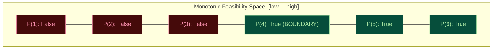
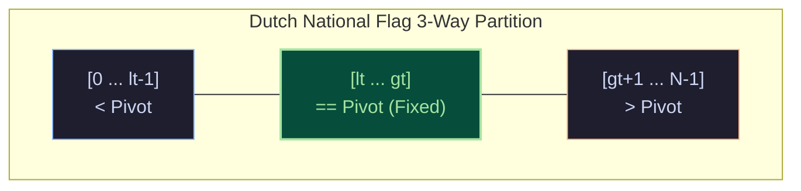
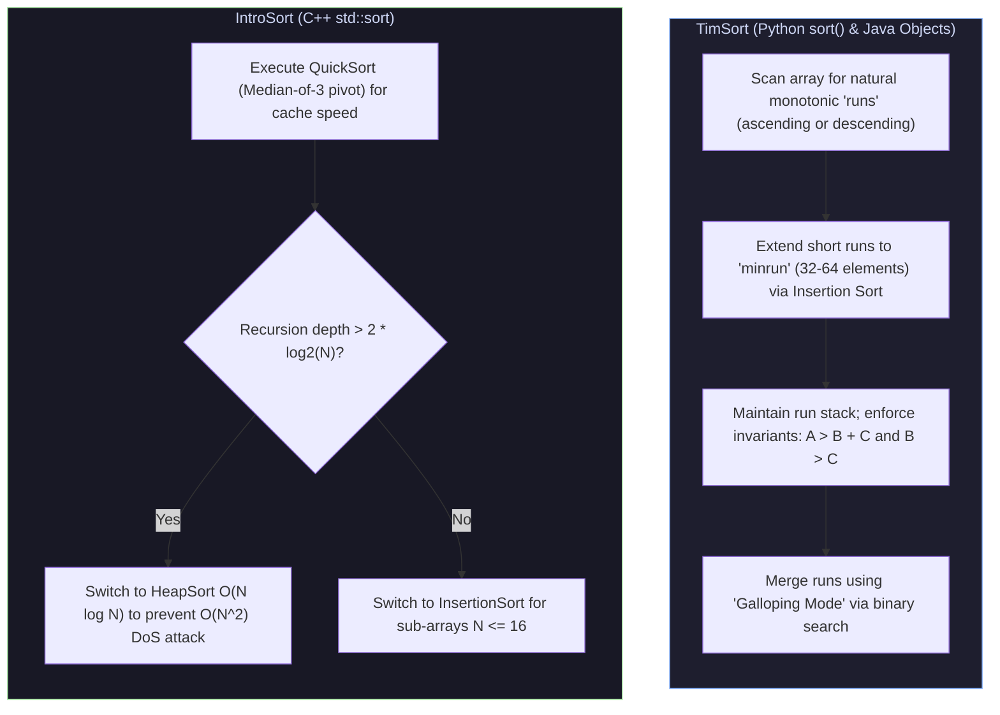

import { Callout } from "fumadocs-ui/components/callout";
import { Tabs, Tab } from "fumadocs-ui/components/tabs";
import { Steps, Step } from "fumadocs-ui/components/steps";
import { Cards, Card } from "fumadocs-ui/components/card";

## The Foundation of Computational Efficiency

Sorting and searching are among the oldest and most extensively studied problems in computer science. They represent over **$25\%$ of all CPU cycles** spent in global datacenters—powering database index updates, search engine query matching, log ingestion pipelines, and network routing tables.

While basic textbooks introduce naive algorithms like Bubble Sort or Selection Sort, production systems demand algorithms engineered for modern hardware: CPU cache hierarchies, branch predictors, stability requirements, and worst-case algorithmic denial-of-service (DoS) protection.

---

## 1. Binary Search: Beyond Sorted Arrays

The greatest misconception about Binary Search is that it can only be applied to search for a value in a sorted array. In production engineering and competitive programming, Binary Search's true power lies in **searching over monotonic answer spaces**.

### The Monotonic Feasibility Predicate

If a decision function $P(x) \to \{\text{True}, \text{False}\}$ is monotonic:

$$
P(x) \implies P(x + 1) \quad \text{or} \quad P(x) \implies P(x - 1)
$$

then the transition boundary where the answer shifts from `False` to `True` can be located in $\mathcal{O}(\log(\text{range})) \times \mathcal{O}(\text{cost of } P)$ time!



### The Universal Zero-Bug Template

```python
def binary_search_first_true(low: int, high: int, predicate) -> int:
    """Finds the smallest integer x in [low, high] such that predicate(x) is True."""
    while low < high:
        mid = low + (high - low) // 2  # Prevents 32-bit integer overflow
        if predicate(mid):
            high = mid         # mid might be the answer; discard right side
        else:
            low = mid + 1      # mid cannot be the answer; discard left side
    return low
```

---

## 2. QuickSort & Dutch National Flag (3-Way Partition)

Standard Hoare or Lomuto partitioning degrades from $\mathcal{O}(N \log N)$ to **$\mathcal{O}(N^2)$** when an array contains many identical keys (e.g. an array of all $5$s).

Edsger Dijkstra solved this with the **Dutch National Flag (3-way partition)** algorithm, dividing the array into three segments:

1. `nums[0 ... lt - 1] < pivot`
2. `nums[lt ... gt] == pivot`
3. `nums[gt + 1 ... N - 1] > pivot`



With 3-way partitioning, arrays with duplicate elements are sorted in **$\mathcal{O}(N)$ linear time**, completely eliminating quadratic degradation on uniform datasets.

---

## 3. Industrial Hybrid Algorithms: TimSort & IntroSort

Modern programming languages do not use textbook QuickSort or MergeSort. They use sophisticated hybrid engines engineered around real-world data patterns and hardware safety.



### TimSort (Tim Peters, 2002)

- **Insight**: Real-world data is almost never random. It contains existing sorted runs (e.g. log entries with timestamps, appending new records).
- **Run Detection**: Scans for natural consecutive increasing ($a \le b$) or strictly decreasing ($a > b$, which it reverses in $\mathcal{O}(K)$).
- **Galloping Mode**: When merging two runs $A$ and $B$, if run $A$ supplies $7$ elements in a row, TimSort switches to "galloping mode," using binary search ($1, 2, 4, 8, 16\dots$) to locate where $B$'s next element belongs, skipping thousands of comparisons in one leap!

### IntroSort (David Musser, 1997)

- **The Problem**: Standard QuickSort has worst-case $\mathcal{O}(N^2)$ time. A malicious attacker could craft input payloads designed to trigger worst-case pivot selection, halting web servers and firewalls (Algorithmic Complexity DoS).
- **The Solution**: IntroSort begins with QuickSort. It tracks the recursion depth. If depth exceeds $2 \lfloor \log_2 N \rfloor$, it abruptly **switches to HeapSort**, mathematically guaranteeing $\mathcal{O}(N \log N)$ worst-case execution. For tiny partitions ($N \le 16$), it switches to InsertionSort to maximize CPU pipeline throughput.

---

## 4. Non-Comparative Sorting: Radix Sort (LSD)

Comparison-based sorting has a mathematical lower bound of $\Omega(N \log N)$. Non-comparison algorithms bypass this by treating keys as numbers or bit patterns.

**Least Significant Digit (LSD) Radix Sort**:

- Sorts numbers digit-by-digit from least significant bit/digit to most significant.
- Requires each sub-pass to be **stable** (typically using Counting Sort).
- Total time: $\mathcal{O}(d \cdot (N + b))$, where $d$ is the number of digits and $b$ is the base (e.g., base $10$ or base $256$).
- For 32-bit integers processed in 8-bit bytes ($b = 256, d = 4$), Radix Sort runs in **strictly $\mathcal{O}(4N) = \mathcal{O}(N)$ linear time**!

---

## Master Sorting Comparison Matrix

| Algorithm             | Best Time                 | Average Time                     | Worst Time                       | Space                 | Stable? | Primary Production Usage                         |
| :-------------------- | :------------------------ | :------------------------------- | :------------------------------- | :-------------------- | :------ | :----------------------------------------------- |
| **Insertion Sort**    | $\mathcal{O}(N)$          | $\mathcal{O}(N^2)$               | $\mathcal{O}(N^2)$               | $\mathcal{O}(1)$      | **Yes** | Small arrays ($N \le 16-32$), nearly sorted      |
| **Merge Sort**        | $\mathcal{O}(N \log N)$   | $\mathcal{O}(N \log N)$          | $\mathcal{O}(N \log N)$          | $\mathcal{O}(N)$      | **Yes** | Linked lists, external out-of-core disk sort     |
| **QuickSort (3-Way)** | $\mathcal{O}(N)$          | $\mathcal{O}(N \log N)$          | $\mathcal{O}(N^2)$               | $\mathcal{O}(\log N)$ | No      | General in-memory cache-friendly arrays          |
| **Heap Sort**         | $\mathcal{O}(N \log N)$   | $\mathcal{O}(N \log N)$          | $\mathcal{O}(N \log N)$          | $\mathcal{O}(1)$      | No      | Embedded real-time systems with hard memory caps |
| **TimSort**           | $\mathbf{\mathcal{O}(N)}$ | $\mathbf{\mathcal{O}(N \log N)}$ | $\mathbf{\mathcal{O}(N \log N)}$ | $\mathcal{O}(N)$      | **Yes** | Python `sort()`, Java `Arrays.sort(Object[])`    |
| **IntroSort**         | $\mathcal{O}(N \log N)$   | $\mathbf{\mathcal{O}(N \log N)}$ | $\mathbf{\mathcal{O}(N \log N)}$ | $\mathcal{O}(\log N)$ | No      | C++ STL `std::sort()`, Go `sort.Slice()`         |
| **Radix Sort (LSD)**  | $\mathcal{O}(d \cdot N)$  | $\mathcal{O}(d \cdot N)$         | $\mathcal{O}(d \cdot N)$         | $\mathcal{O}(N + b)$  | **Yes** | 32/64-bit integer sorting, GPU compute           |

---

## Production Multi-Language Implementation

<Tabs items={['Python', 'TypeScript', 'C++']}>
  <Tab value="Python">
```python
import random
from typing import List

class SearchAndSortAlgorithms:
@staticmethod
def ship_within_days(weights: List[int], days: int) -> int:
"""Binary search on monotonic answer space: minimum ship weight capacity."""
def can_ship(capacity: int) -> bool:
days_needed = 1
current_load = 0
for w in weights:
if current_load + w > capacity:
days_needed += 1
current_load = w
else:
current_load += w
return days_needed <= days

        # Search space bounds: lowest possible capacity is max single item; highest is sum of all items
        low = max(weights)
        high = sum(weights)

        while low < high:
            mid = low + (high - low) // 2
            if can_ship(mid):
                high = mid  # Try smaller capacity
            else:
                low = mid + 1  # Capacity too small
        return low

    @classmethod
    def quicksort_3way(cls, nums: List[int]) -> None:
        """Dutch National Flag 3-Way Partition QuickSort."""
        def _sort(low: int, high: int) -> None:
            if low >= high:
                return

            # Random pivot to defeat quadratic killer inputs
            pivot_idx = random.randint(low, high)
            nums[low], nums[pivot_idx] = nums[pivot_idx], nums[low]
            pivot = nums[low]

            lt = low       # nums[low ... lt-1] < pivot
            gt = high      # nums[gt+1 ... high] > pivot
            i = low + 1    # nums[lt ... i-1] == pivot

            while i <= gt:
                if nums[i] < pivot:
                    nums[lt], nums[i] = nums[i], nums[lt]
                    lt += 1
                    i += 1
                elif nums[i] > pivot:
                    nums[i], nums[gt] = nums[gt], nums[i]
                    gt -= 1
                else:
                    i += 1

            _sort(low, lt - 1)
            _sort(gt + 1, high)

        _sort(0, len(nums) - 1)

    @staticmethod
    def radix_sort_lsd(nums: List[int]) -> List[int]:
        """Radix sort for non-negative integers using base-10 counting sort sub-passes."""
        if not nums:
            return []

        max_val = max(nums)
        exp = 1  # 1, 10, 100, 1000...
        arr = list(nums)
        n = len(arr)

        while max_val // exp > 0:
            output = [0] * n
            count = [0] * 10

            # Count occurrences of current digit
            for num in arr:
                digit = (num // exp) % 10
                count[digit] += 1

            # Cumulative count for stable positioning
            for i in range(1, 10):
                count[i] += count[i - 1]

            # Build output array in reverse to ensure stability
            for i in range(n - 1, -1, -1):
                digit = (arr[i] // exp) % 10
                output[count[digit] - 1] = arr[i]
                count[digit] -= 1

            arr = output
            exp *= 10

        return arr

````
  </Tab>
  <Tab value="TypeScript">
```typescript
export class SearchAndSortAlgorithms {
  static shipWithinDays(weights: number[], days: number): number {
    const canShip = (capacity: number): boolean => {
      let daysNeeded = 1;
      let currentLoad = 0;
      for (const w of weights) {
        if (currentLoad + w > capacity) {
          daysNeeded++;
          currentLoad = w;
        } else {
          currentLoad += w;
        }
      }
      return daysNeeded <= days;
    };

    let low = Math.max(...weights);
    let high = weights.reduce((a, b) => a + b, 0);

    while (low < high) {
      const mid = Math.floor(low + (high - low) / 2);
      if (canShip(mid)) {
        high = mid;
      } else {
        low = mid + 1;
      }
    }
    return low;
  }

  static quicksort3Way(nums: number[]): void {
    const sort = (low: number, high: number): void => {
      if (low >= high) return;

      const pivotIdx = low + Math.floor(Math.random() * (high - low + 1));
      [nums[low], nums[pivotIdx]] = [nums[pivotIdx], nums[low]];
      const pivot = nums[low];

      let lt = low;
      let gt = high;
      let i = low + 1;

      while (i <= gt) {
        if (nums[i] < pivot) {
          [nums[lt], nums[i]] = [nums[i], nums[lt]];
          lt++;
          i++;
        } else if (nums[i] > pivot) {
          [nums[i], nums[gt]] = [nums[gt], nums[i]];
          gt--;
        } else {
          i++;
        }
      }

      sort(low, lt - 1);
      sort(gt + 1, high);
    };

    sort(0, nums.length - 1);
  }

  static mergeSort(nums: number[]): number[] {
    if (nums.length <= 1) return nums;
    const mid = Math.floor(nums.length / 2);
    const left = this.mergeSort(nums.slice(0, mid));
    const right = this.mergeSort(nums.slice(mid));

    const merged: number[] = [];
    let i = 0;
    let j = 0;
    while (i < left.length && j < right.length) {
      if (left[i] <= right[j]) {
        merged.push(left[i++]);
      } else {
        merged.push(right[j++]);
      }
    }
    return merged.concat(left.slice(i)).concat(right.slice(j));
  }

  static countingSort(nums: number[]): number[] {
    if (nums.length <= 1) return nums;
    const min = Math.min(...nums);
    const max = Math.max(...nums);
    const count = new Array(max - min + 1).fill(0);

    for (const num of nums) {
      count[num - min]++;
    }
    for (let i = 1; i < count.length; i++) {
      count[i] += count[i - 1];
    }

    const output = new Array(nums.length);
    for (let i = nums.length - 1; i >= 0; i--) {
      output[--count[nums[i] - min]] = nums[i];
    }
    return output;
  }
}
````

  </Tab>
  <Tab value="C++">
```cpp
#include <iostream>
#include <vector>
#include <numeric>
#include <algorithm>
#include <random>

class SearchAndSortAlgorithms {
public:
static int shipWithinDays(const std::vector<int>& weights, int days) {
auto canShip = [&](int capacity) -> bool {
int daysNeeded = 1;
int currentLoad = 0;
for (int w : weights) {
if (currentLoad + w > capacity) {
daysNeeded++;
currentLoad = w;
} else {
currentLoad += w;
}
}
return daysNeeded <= days;
};

        int low = *std::max_element(weights.begin(), weights.end());
        int high = std::accumulate(weights.begin(), weights.end(), 0);

        while (low < high) {
            int mid = low + (high - low) / 2;
            if (canShip(mid)) {
                high = mid;
            } else {
                low = mid + 1;
            }
        }
        return low;
    }

    static void quicksort3Way(std::vector<int>& nums) {
        static std::mt19937 rng(1337);

        std::function<void(int, int)> sort = [&](int low, int high) {
            if (low >= high) return;

            std::uniform_int_distribution<int> dist(low, high);
            int pivotIdx = dist(rng);
            std::swap(nums[low], nums[pivotIdx]);
            int pivot = nums[low];

            int lt = low;
            int gt = high;
            int i = low + 1;

            while (i <= gt) {
                if (nums[i] < pivot) {
                    std::swap(nums[lt++], nums[i++]);
                } else if (nums[i] > pivot) {
                    std::swap(nums[i], nums[gt--]);
                } else {
                    i++;
                }
            }

            sort(low, lt - 1);
            sort(gt + 1, high);
        };

        if (!nums.empty()) {
            sort(0, static_cast<int>(nums.size()) - 1);
        }
    }

    static void mergeSort(std::vector<int>& nums) {
        if (nums.size() <= 1) return;
        std::vector<int> temp(nums.size());

        std::function<void(int, int)> sort = [&](int left, int right) {
            if (left >= right) return;
            int mid = left + (right - left) / 2;
            sort(left, mid);
            sort(mid + 1, right);

            int i = left, j = mid + 1, k = left;
            while (i <= mid && j <= right) {
                if (nums[i] <= nums[j]) temp[k++] = nums[i++];
                else temp[k++] = nums[j++];
            }
            while (i <= mid) temp[k++] = nums[i++];
            while (j <= right) temp[k++] = nums[j++];
            for (int p = left; p <= right; ++p) nums[p] = temp[p];
        };

        sort(0, static_cast<int>(nums.size()) - 1);
    }

};

````
  </Tab>
</Tabs>

---

## Technical Interview Patterns & Pitfalls

### Pattern: Search in Rotated Sorted Array
In a rotated sorted array like `[4, 5, 6, 7, 0, 1, 2]`, at least one half is always strictly monotonically sorted!
1. Calculate `mid`.
2. If `nums[left] <= nums[mid]`: the **left half is sorted**.
   - Check if target is inside `[nums[left], nums[mid]]`. If so, search left (`right = mid - 1`), else search right (`left = mid + 1`).
3. Otherwise, the **right half is sorted**.
   - Check if target is inside `[nums[mid], nums[right]]`. If so, search right (`left = mid + 1`), else search left (`right = mid - 1`).

<Callout type="warn">
**The Midpoint Overflow Bug**:
Writing `mid = (low + high) / 2` in C++, Java, or Go will cause an **integer overflow** when `low + high > 2,147,483,647`, resulting in a negative number and causing an `ArrayIndexOutOfBoundsException`. Always write:
$$
\text{mid} = \text{low} + \frac{\text{high} - \text{low}}{2}
$$
</Callout>

---

## Hands-On Verification Challenge

### Problem: Search in Rotated Sorted Array
Implement the algorithm to search for a target value in an array rotated at some unknown pivot index. Run verification against rotated arrays.

```python
def search_rotated_array(nums: List[int], target: int) -> int:
    low, high = 0, len(nums) - 1

    while low <= high:
        mid = low + (high - low) // 2
        if nums[mid] == target:
            return mid

        # Check if left half is sorted
        if nums[low] <= nums[mid]:
            if nums[low] <= target < nums[mid]:
                high = mid - 1
            else:
                low = mid + 1
        # Otherwise right half must be sorted
        else:
            if nums[mid] < target <= nums[high]:
                low = mid + 1
            else:
                high = mid - 1

    return -1

# Verification
arr = [4, 5, 6, 7, 0, 1, 2]
assert search_rotated_array(arr, 0) == 4
assert search_rotated_array(arr, 3) == -1
print("Verification Succeeded: Rotated Binary Search operates in O(log N)!")
````
