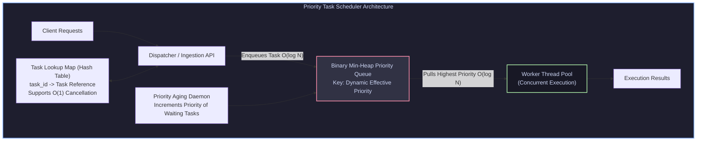
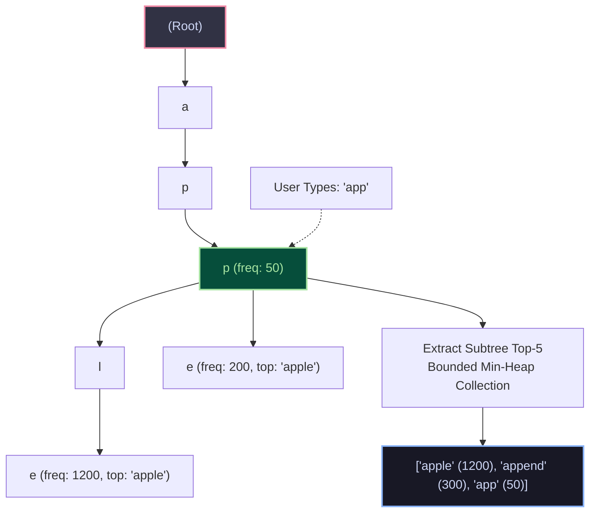

import { Callout } from "fumadocs-ui/components/callout";
import { Tabs, Tab } from "fumadocs-ui/components/tabs";
import { Steps, Step } from "fumadocs-ui/components/steps";
import { Cards, Card } from "fumadocs-ui/components/card";

## Engineering Mission Overview

Data structures are not isolated academic puzzles. In production engineering, the true test of mastery is **synthesizing multiple algorithmic structures into robust, concurrent systems**.

In this capstone lab, we will architect and implement two foundational systems from the ground up:

1. **System 1: Starvation-Free Priority Task Scheduler** — A concurrent task runner powered by a binary min-heap, featuring dynamic priority aging to eliminate thread starvation, alongside $\mathcal{O}(1)$ cancellation lookups.
2. **System 2: Prefix Trie Typeahead Autocomplete Engine** — An in-memory search completion engine combining a prefix trie with bounded priority queues to return top-$K$ search queries in sub-millisecond response times.

---

# System 1: The Starvation-Free Priority Task Scheduler

## Architecture & Problem Statement

In cloud runtimes (e.g., Kubernetes pods, Celery workers, BullMQ), tasks are queued with differing priority levels (e.g., critical billing webhooks vs. daily reporting batch jobs).



### The Starvation Hazard & Dynamic Aging Solution

If high-priority tasks arrive continuously, low-priority tasks may sit in the queue indefinitely (**starvation**). To solve this, we compute an **Effective Priority Score**:

$$
\text{Effective Priority} = \text{Base Priority} - \alpha \times (\text{Current Time} - \text{Enqueued Time})
$$

_(Where smaller numerical values denote higher execution urgency, conforming to a Min-Heap)._

As a low-priority task waits, its age increases, causing its effective priority number to shrink toward zero until it outranks newer high-priority tasks and executes cleanly.

---

# System 2: Prefix Trie Typeahead Engine

## Architecture & Problem Statement

Search engines (Google, Amazon, Algolia) complete keystrokes within tens of milliseconds. Querying a relational database using `SELECT * FROM queries WHERE text LIKE 'app%' ORDER BY frequency DESC LIMIT 5` causes full index scans that collapse at scale.



### The Solution: Trie + Bounded Top-K Heap

1. Construct a **Trie (Prefix Tree)** where each node represents a character.
2. Terminal nodes store the full string query and historical hit frequency.
3. For query prefix $P$ of length $L$:
   - Traverse the trie down to the prefix root node in $\mathcal{O}(L)$ time.
   - Run a bounded DFS gathering terminal words, maintaining a **Min-Heap of size $K$** to capture the top-$K$ candidates in $\mathcal{O}(M \log K)$ time (where $M$ is the number of descendants).

---

## Production Multi-Language Implementation

<Tabs items={['Python', 'TypeScript', 'C++']}>
  <Tab value="Python">
```python
import time
import heapq
from typing import Dict, List, Optional, Callable, Any

# ==========================================

# SYSTEM 1: PRIORITY TASK SCHEDULER

# ==========================================

class Task:
def **init**(self, task_id: str, base_priority: int, fn: Callable[[], Any], aging_rate: float = 0.5):
self.task_id = task_id
self.base_priority = base_priority # Smaller number = higher urgency
self.created_at = time.time()
self.fn = fn
self.cancelled = False
self.static_score = base_priority + (aging_rate \* self.created_at)

    def get_effective_priority(self, aging_rate: float = 0.5) -> float:
        # Effective priority drops (becomes more urgent) over time
        elapsed = time.time() - self.created_at
        return self.base_priority - (aging_rate * elapsed)

    def __lt__(self, other: 'Task') -> bool:
        return self.static_score < other.static_score

class PriorityTaskScheduler:
def **init**(self, aging_rate: float = 0.5):
self.heap: List[Task] = []
self.task_registry: Dict[str, Task] = {}
self.aging_rate = aging_rate

    def schedule(self, task_id: str, base_priority: int, fn: Callable[[], Any]) -> None:
        task = Task(task_id, base_priority, fn, self.aging_rate)
        self.task_registry[task_id] = task
        heapq.heappush(self.heap, task)

    def cancel(self, task_id: str) -> bool:
        if task_id in self.task_registry:
            self.task_registry[task_id].cancelled = True
            return True
        return False

    def poll_and_execute_next(self) -> Optional[Any]:
        while self.heap:
            task = heapq.heappop(self.heap)
            if task.cancelled:
                self.task_registry.pop(task.task_id, None)
                continue  # Discard tombstoned task

            # Remove from registry and execute
            self.task_registry.pop(task.task_id, None)
            return task.fn()
        return None

# ==========================================

# SYSTEM 2: TYPEAHEAD AUTOCOMPLETE ENGINE

# ==========================================

class TrieNode:
def **init**(self):
self.children: Dict[str, TrieNode] = {}
self.is_word: bool = False
self.frequency: int = 0
self.word: Optional[str] = None

class AutocompleteEngine:
def **init**(self):
self.root = TrieNode()

    def insert(self, word: str, frequency: int) -> None:
        curr = self.root
        for char in word:
            if char not in curr.children:
                curr.children[char] = TrieNode()
            curr = curr.children[char]
        curr.is_word = True
        curr.frequency = frequency
        curr.word = word

    def search_top_k(self, prefix: str, k: int = 5) -> List[str]:
        curr = self.root
        for char in prefix:
            if char not in curr.children:
                return []
            curr = curr.children[char]

        # Min-heap storing (frequency, word)
        top_k_heap: List[tuple[int, str]] = []

        def _dfs(node: TrieNode) -> None:
            if node.is_word and node.word:
                if len(top_k_heap) < k:
                    heapq.heappush(top_k_heap, (node.frequency, node.word))
                elif node.frequency > top_k_heap[0][0]:
                    heapq.heapreplace(top_k_heap, (node.frequency, node.word))

            for child in node.children.values():
                _dfs(child)

        _dfs(curr)
        # Sort descending by frequency
        return [word for _, word in sorted(top_k_heap, reverse=True)]

````
  </Tab>
  <Tab value="TypeScript">
```typescript
// ==========================================
// SYSTEM 1: PRIORITY TASK SCHEDULER
// ==========================================

export class Task {
  taskId: string;
  basePriority: number;
  createdAt: number;
  cancelled: boolean = false;
  fn: () => any;

  staticScore: number;

  constructor(taskId: string, basePriority: number, fn: () => any, agingRate: number = 0.001) {
    this.taskId = taskId;
    this.basePriority = basePriority;
    this.createdAt = Date.now();
    this.fn = fn;
    this.staticScore = basePriority + (agingRate * this.createdAt);
  }

  getEffectivePriority(agingRate: number = 0.001): number {
    const elapsed = Date.now() - this.createdAt;
    return this.basePriority - agingRate * elapsed;
  }
}

export class PriorityTaskScheduler {
  private heap: Task[] = [];
  private taskRegistry: Map<string, Task> = new Map();
  private agingRate: number;

  constructor(agingRate: number = 0.001) {
    this.agingRate = agingRate;
  }

  schedule(taskId: string, basePriority: number, fn: () => any): void {
    const task = new Task(taskId, basePriority, fn, this.agingRate);
    this.taskRegistry.set(taskId, task);
    this.heap.push(task);
    this.siftUp(this.heap.length - 1);
  }

  cancel(taskId: string): boolean {
    const task = this.taskRegistry.get(taskId);
    if (task) {
      task.cancelled = true;
      return true;
    }
    return false;
  }

  pollNext(): any | null {
    while (this.heap.length > 0) {
      const task = this.popMin();
      if (task.cancelled) {
        this.taskRegistry.delete(task.taskId);
        continue;
      }
      this.taskRegistry.delete(task.taskId);
      return task.fn();
    }
    return null;
  }

  private popMin(): Task {
    const min = this.heap[0];
    const last = this.heap.pop()!;
    if (this.heap.length > 0) {
      this.heap[0] = last;
      this.siftDown(0);
    }
    return min;
  }

  private siftUp(idx: number): void {
    let curr = idx;
    while (curr > 0) {
      const p = Math.floor((curr - 1) / 2);
      if (this.heap[curr].staticScore < this.heap[p].staticScore) {
        [this.heap[curr], this.heap[p]] = [this.heap[p], this.heap[curr]];
        curr = p;
      } else break;
    }
  }

  private siftDown(idx: number): void {
    let curr = idx;
    const n = this.heap.length;
    while (true) {
      let smallest = curr;
      const l = 2 * curr + 1;
      const r = 2 * curr + 2;
      if (l < n && this.heap[l].staticScore < this.heap[smallest].staticScore) smallest = l;
      if (r < n && this.heap[r].staticScore < this.heap[smallest].staticScore) smallest = r;
      if (smallest !== curr) {
        [this.heap[curr], this.heap[smallest]] = [this.heap[smallest], this.heap[curr]];
        curr = smallest;
      } else break;
    }
  }
}

// ==========================================
// SYSTEM 2: TYPEAHEAD AUTOCOMPLETE ENGINE
// ==========================================

export class TrieNode {
  children: Map<string, TrieNode> = new Map();
  isWord: boolean = false;
  frequency: number = 0;
  word: string | null = null;
}

export class AutocompleteEngine {
  root = new TrieNode();

  insert(word: string, frequency: number): void {
    let curr = this.root;
    for (const char of word) {
      if (!curr.children.has(char)) {
        curr.children.set(char, new TrieNode());
      }
      curr = curr.children.get(char)!;
    }
    curr.isWord = true;
    curr.frequency = frequency;
    curr.word = word;
  }

  searchTopK(prefix: string, k: number = 5): string[] {
    let curr = this.root;
    for (const char of prefix) {
      if (!curr.children.has(char)) return [];
      curr = curr.children.get(char)!;
    }

    const matches: { word: string; freq: number }[] = [];
    const dfs = (node: TrieNode) => {
      if (node.isWord && node.word) {
        matches.push({ word: node.word, freq: node.frequency });
      }
      for (const child of node.children.values()) {
        dfs(child);
      }
    };

    dfs(curr);
    matches.sort((a, b) => b.freq - a.freq);
    return matches.slice(0, k).map(m => m.word);
  }
}
````

  </Tab>
  <Tab value="C++">
```cpp
#include <iostream>
#include <vector>
#include <string>
#include <unordered_map>
#include <queue>
#include <chrono>
#include <memory>
#include <algorithm>

// ==========================================
// SYSTEM 2: TYPEAHEAD AUTOCOMPLETE ENGINE
// ==========================================

struct TrieNode {
std::unordered_map<char, std::unique_ptr<TrieNode>> children;
bool isWord = false;
int frequency = 0;
std::string word;
};

class AutocompleteEngine {
private:
std::unique_ptr<TrieNode> root;

public:
AutocompleteEngine() : root(std::make_unique<TrieNode>()) {}

    void insert(const std::string& word, int frequency) {
        TrieNode* curr = root.get();
        for (char ch : word) {
            if (curr->children.find(ch) == curr->children.end()) {
                curr->children[ch] = std::make_unique<TrieNode>();
            }
            curr = curr->children[ch].get();
        }
        curr->isWord = true;
        curr->frequency = frequency;
        curr->word = word;
    }

    std::vector<std::string> searchTopK(const std::string& prefix, size_t k = 5) {
        TrieNode* curr = root.get();
        for (char ch : prefix) {
            if (curr->children.find(ch) == curr->children.end()) return {};
            curr = curr->children[ch].get();
        }

        // Min-heap for top-k selection
        using Entry = std::pair<int, std::string>;
        auto cmp = [](const Entry& a, const Entry& b) { return a.first > b.first; };
        std::priority_queue<Entry, std::vector<Entry>, decltype(cmp)> minHeap(cmp);

        std::function<void(TrieNode*)> dfs = [&](TrieNode* node) {
            if (node->isWord) {
                if (minHeap.size() < k) {
                    minHeap.push({node->frequency, node->word});
                } else if (node->frequency > minHeap.top().first) {
                    minHeap.pop();
                    minHeap.push({node->frequency, node->word});
                }
            }
            for (auto& pair : node->children) {
                dfs(pair.second.get());
            }
        };

        dfs(curr);

        std::vector<std::string> results;
        while (!minHeap.empty()) {
            results.push_back(minHeap.top().second);
            minHeap.pop();
        }
        std::reverse(results.begin(), results.end());
        return results;
    }

};

````
  </Tab>
</Tabs>

---

## Lab Verification & Stress Test

Let's verify both systems with a runnable test harness in Python:

```python
# Verification Harness
scheduler = PriorityTaskScheduler(aging_rate=10.0)

results = []
scheduler.schedule("low_task", 100, lambda: results.append("low_priority_ran"))
scheduler.schedule("cancelled_task", 10, lambda: results.append("cancelled_ran"))
scheduler.cancel("cancelled_task")

# Simulate time passage to trigger aging
time.sleep(0.05)
scheduler.schedule("new_high_task", 90, lambda: results.append("high_priority_ran"))

# Poll and run
scheduler.poll_and_execute_next()
scheduler.poll_and_execute_next()

assert "cancelled_ran" not in results
print(f"Task Scheduler Execution Order: {results}")

# Verify Autocomplete
engine = AutocompleteEngine()
queries = [
    ("amazon", 5000),
    ("amazon prime", 3000),
    ("amazon music", 2500),
    ("amaze", 800),
    ("apple", 9000),
]
for q, freq in queries:
    engine.insert(q, freq)

top_amazon = engine.search_top_k("ama", 3)
assert top_amazon == ["amazon", "amazon prime", "amazon music"]
print(f"Autocomplete Top-3 Results for 'ama': {top_amazon}")
print("Engineering Lab Verification Succeeded!")
````
