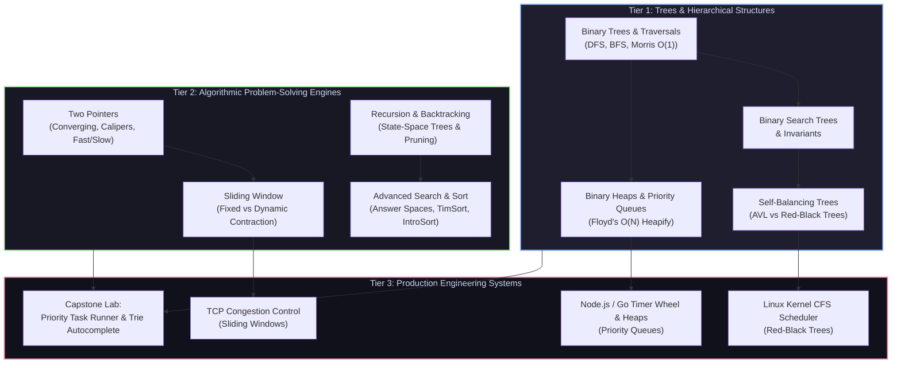

import { Callout } from "fumadocs-ui/components/callout";
import { Tabs, Tab } from "fumadocs-ui/components/tabs";
import { Steps, Step } from "fumadocs-ui/components/steps";
import { Cards, Card } from "fumadocs-ui/components/card";

## Welcome to Track 2

In **Track 1**, we explored linear structures—arrays, linked lists, stacks, and Swiss Table hash maps. While linear memory provides blistering CPU cache performance, it suffers from a fundamental mathematical limitation: **rigid trade-offs between search, insertion, and ordering**. An unsorted array searches in $\mathcal{O}(N)$, a sorted array inserts in $\mathcal{O}(N)$, and a linked list forbids binary search altogether.

**Track 2** shatters these boundaries by introducing **hierarchical branching** and **priority invariants**. Branching factors allow algorithms to halve search spaces in logarithmic time ($\mathcal{O}(\log N)$), while heaps offer instant access to critical elements ($\mathcal{O}(1)$ peek, $\mathcal{O}(\log N)$ push/pop) with near-zero pointer overhead.

Simultaneously, this track arms you with the core algorithmic patterns that form the backbone of both technical interviews at top engineering firms and production-grade kernel subsystems: converging two-pointers, dynamic sliding windows, state-space backtracking, and industrial hybrid sorting algorithms like TimSort and IntroSort.

---

## Architectural Curriculum Map

The knowledge in this track is organized into three interconnected tiers: data structure hierarchies, algorithmic problem-solving paradigms, and real-world system implementations.

---

## Track Modules

<Cards>
  <Card
    title="01. Binary Trees & Traversals"
    href="/docs/dsa/02-trees-heaps-and-core-patterns/01-binary-trees-and-traversals"
    description="Tree anatomy, recursive and explicit-stack DFS, BFS level-order queues, Morris O(1) space traversal, and robust serialization."
  />
  <Card
    title="02. BSTs & Self-Balancing Trees"
    href="/docs/dsa/02-trees-heaps-and-core-patterns/02-binary-search-trees-and-self-balancing"
    description="BST search/insert/delete mechanics, AVL Balance Factor rotations (LL, RR, LR, RL), and Red-Black tree invariants powering Linux CFS."
  />
  <Card
    title="03. Heaps & Priority Queues"
    href="/docs/dsa/02-trees-heaps-and-core-patterns/03-heaps-and-priority-queues"
    description="Array representations of complete binary trees, sift-up/down mechanics, Floyd's O(N) build-heap proof, dual heaps, and top-k streams."
  />
  <Card
    title="04. Two Pointers & Sliding Window"
    href="/docs/dsa/02-trees-heaps-and-core-patterns/04-two-pointers-and-sliding-window"
    description="Converging pointers, greedy calipers, fast/slow runners, fixed vs dynamic sliding windows, and amortized linear bounds."
  />
  <Card
    title="05. Recursion & Backtracking"
    href="/docs/dsa/02-trees-heaps-and-core-patterns/05-recursion-and-backtracking"
    description="State-space trees, the canonical backtracking template, duplicate deduplication, and constraint solvers for N-Queens, Sudoku, and Word Search."
  />
  <Card
    title="06. Searching & Sorting Algorithms"
    href="/docs/dsa/02-trees-heaps-and-core-patterns/06-searching-and-sorting-algorithms"
    description="Binary search on monotonic answer spaces, Dutch National Flag QuickSort, TimSort run detection, IntroSort recursion limits, and Radix Sort."
  />
  <Card
    title="Engineering Lab: Capstone Project"
    href="/docs/dsa/02-trees-heaps-and-core-patterns/capstone-task-scheduler-and-autocomplete"
    description="Build an asynchronous Priority Queue task scheduler with deadline aging alongside a high-throughput Trie prefix autocomplete engine."
  />
  <Card
    title="Quick Reference & Cheat Sheet"
    href="/docs/dsa/02-trees-heaps-and-core-patterns/quick-reference"
    description="At-a-glance heap index formulas, tree traversal invariants, two-pointer decision flowcharts, and master sorting comparison tables."
  />
</Cards>

---

## Core Engineering Principles

### 1. Pointer Indirection vs. Cache Locality

Pointer-based trees (such as traditional AVL or Red-Black trees) allocate individual nodes on the heap. Each pointer traversal dereferences a memory address that may cause an **L1/L2/L3 CPU cache miss**. By contrast, binary heaps pack complete binary trees directly into contiguous arrays, mapping parent-child relationships through simple arithmetic:

$$
\text{left}(i) = 2i + 1, \quad \text{right}(i) = 2i + 2, \quad \text{parent}(i) = \left\lfloor \frac{i - 1}{2} \right\rfloor
$$

Understanding when to pay the indirection penalty for dynamic balance versus when to exploit array contiguousness is the mark of a seasoned systems architect.

### 2. The Power of Invariants

Every efficient algorithm in this track relies on maintaining a strict mathematical invariant throughout execution:

- **Binary Search Tree Invariant**: $\forall x \in \text{left}(u), \text{val}(x) < \text{val}(u)$ and $\forall y \in \text{right}(u), \text{val}(y) > \text{val}(u)$.
- **Heap Invariant**: In a min-heap, $\text{val}(\text{parent}(u)) \le \text{val}(u)$ for every node except the root.
- **Sliding Window Invariant**: The subsegment $[L, R]$ always satisfies the feasibility condition (e.g., at most $K$ distinct elements).

When debugging or proving correctness, never reason about step-by-step code execution in isolation. Always identify the **invariant**, verify that initialization establishes it, and verify that every loop iteration preserves it.

---

## Learning Path

<Steps>
  <Step>
    #### Master Traversal Traps & Recursion Limits Begin with
    **01-binary-trees-and-traversals**. Compare call-stack DFS against
    explicit-stack iterative approaches, and master Morris Traversal to
    understand threaded binary trees operating in strictly $\mathcal{O}(1)$
    auxiliary space.
  </Step>
  <Step>
    #### Understand Self-Balancing and Kernel Schedulers Progress through
    **02-binary-search-trees-and-self-balancing** and
    **03-heaps-and-priority-queues**. Understand why Linux CFS chose Red-Black
    trees over AVL trees, and mathematically prove Floyd's $\mathcal{O}(N)$
    build-heap algorithm.
  </Step>
  <Step>
    #### Forge Algorithmic Problem-Solving Intuition Conquer
    **04-two-pointers-and-sliding-window**, **05-recursion-and-backtracking**,
    and **06-searching-and-sorting-algorithms**. Learn how to identify monotonic
    answer spaces and prune exponential decision trees before they blow up your
    time budget.
  </Step>
  <Step>
    #### Construct the Capstone Systems Lab Synthesize your knowledge in
    **capstone-task-scheduler-and-autocomplete** by designing a production-grade
    asynchronous priority task executor with starvation prevention alongside a
    prefix Trie typeahead engine.
  </Step>
</Steps>
