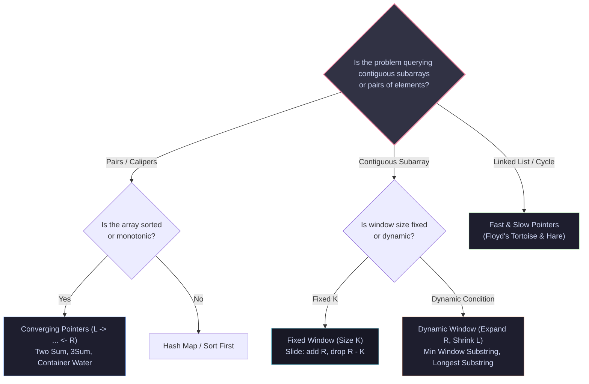

import { Callout } from "fumadocs-ui/components/callout";
import { Tabs, Tab } from "fumadocs-ui/components/tabs";
import { Steps, Step } from "fumadocs-ui/components/steps";
import { Cards, Card } from "fumadocs-ui/components/card";

## 1. Tree Traversals Invariant Cheat Sheet

| Traversal            | Sequence                     | Primary Production Use Cases                                   | Auxiliary Space                   |
| :------------------- | :--------------------------- | :------------------------------------------------------------- | :-------------------------------- |
| **Pre-Order**        | Root $\to$ Left $\to$ Right  | Tree serialization, cloning trees, prefix expressions          | $\mathcal{O}(h)$                  |
| **In-Order**         | Left $\to$ Root $\to$ Right  | BST sorted array extraction, validation                        | $\mathcal{O}(h)$                  |
| **Post-Order**       | Left $\to$ Right $\to$ Root  | Bottom-up deletion, AST evaluation, directory size calculation | $\mathcal{O}(h)$                  |
| **Level-Order**      | Level by Level (FIFO)        | Shortest path in unweighted graphs, serialization              | $\mathcal{O}(W) = \mathcal{O}(N)$ |
| **Morris Traversal** | Threaded links (Predecessor) | Embedded systems with severe memory constraints                | $\mathbf{\mathcal{O}(1)}$         |

```python
# Morris In-Order Invariant Pattern
if not curr.left:
    visit(curr)
    curr = curr.right
else:
    pred = find_inorder_predecessor(curr)
    if not pred.right:
        pred.right = curr  # Make thread
        curr = curr.left
    else:
        pred.right = None  # Dismantle thread
        visit(curr)
        curr = curr.right
```

---

## 2. Binary Heap Index Formulas

For an array-backed complete binary tree:

### Zero-Indexed Arrays (Production Default)

- **Parent of index $i$**: $\left\lfloor \frac{i - 1}{2} \right\rfloor$
- **Left Child of index $i$**: $2i + 1$
- **Right Child of index $i$**: $2i + 2$
- **First Leaf Node Index**: $\left\lfloor \frac{N}{2} \right\rfloor$
- **Last Non-Leaf Node Index**: $\left\lfloor \frac{N}{2} \right\rfloor - 1$
- **Floyd's Heapify Loop Range**: From $\lfloor N/2 \rfloor - 1$ down to $0$

### One-Indexed Arrays

- **Parent of index $i$**: $\lfloor i / 2 \rfloor$ (Bitwise: `i >> 1`)
- **Left Child of index $i$**: $2i$ (Bitwise: `i << 1`)
- **Right Child of index $i$**: $2i + 1$ (Bitwise: `(i << 1) | 1`)

---

## 3. Two Pointers & Sliding Window Decision Matrix



---

## 4. Backtracking Pruning Checklist

Before running any backtracking solution, audit against this checklist:

- [ ] **State Snapshot**: Did you append a deep copy (`res.append(list(path))`) rather than a mutable reference?
- [ ] **Base Case**: Does the base case `return` immediately after recording the solution?
- [ ] **Sibling Deduplication**: For subsets/combinations with duplicates, is the input sorted and guarded by `if i > start and nums[i] == nums[i-1]: continue`?
- [ ] **Permutation Deduplication**: For permutations with duplicates, is it guarded by `if i > 0 and nums[i] == nums[i-1] and not used[i-1]: continue`?
- [ ] **Symmetric Unchoose**: Does every state modification in the "choose" step have an exact counterpart in the "unchoose" step?

---

## 5. Master Sorting Comparison Matrix

| Algorithm             | Best                      | Average                          | Worst                            | Auxiliary Space       | Stable  | Ideal Use Case                                             |
| :-------------------- | :------------------------ | :------------------------------- | :------------------------------- | :-------------------- | :------ | :--------------------------------------------------------- |
| **Insertion Sort**    | $\mathcal{O}(N)$          | $\mathcal{O}(N^2)$               | $\mathcal{O}(N^2)$               | $\mathcal{O}(1)$      | **Yes** | Small ($N \le 20$) or nearly sorted arrays                 |
| **Merge Sort**        | $\mathcal{O}(N \log N)$   | $\mathcal{O}(N \log N)$          | $\mathcal{O}(N \log N)$          | $\mathcal{O}(N)$      | **Yes** | Linked lists, guaranteed $\mathcal{O}(N \log N)$ stability |
| **QuickSort (3-Way)** | $\mathcal{O}(N)$          | $\mathcal{O}(N \log N)$          | $\mathcal{O}(N^2)$               | $\mathcal{O}(\log N)$ | No      | General arrays with duplicate keys                         |
| **Heap Sort**         | $\mathcal{O}(N \log N)$   | $\mathcal{O}(N \log N)$          | $\mathcal{O}(N \log N)$          | $\mathcal{O}(1)$      | No      | Memory-constrained systems without recursion stack         |
| **TimSort**           | $\mathbf{\mathcal{O}(N)}$ | $\mathbf{\mathcal{O}(N \log N)}$ | $\mathbf{\mathcal{O}(N \log N)}$ | $\mathcal{O}(N)$      | **Yes** | Production language standard (Python, Java Objects)        |
| **IntroSort**         | $\mathcal{O}(N \log N)$   | $\mathbf{\mathcal{O}(N \log N)}$ | $\mathbf{\mathcal{O}(N \log N)}$ | $\mathcal{O}(\log N)$ | No      | C++ `std::sort` (QuickSort with HeapSort fallback)         |
| **Radix Sort (LSD)**  | $\mathcal{O}(d \cdot N)$  | $\mathcal{O}(d \cdot N)$         | $\mathcal{O}(d \cdot N)$         | $\mathcal{O}(N + b)$  | **Yes** | Bounded integers, network IPs, GPU sorting                 |

---

## 6. Binary Search: The Zero-Bug Template

### Find Smallest Index Satisfying Condition (First True)

```python
def binary_search_first_true(low: int, high: int, condition) -> int:
    """Finds first index in [low, high] where condition(x) == True."""
    while low < high:
        mid = low + (high - low) // 2
        if condition(mid):
            high = mid      # mid could be answer
        else:
            low = mid + 1   # mid cannot be answer
    return low
```

### Find Largest Index Satisfying Condition (Last True)

```python
def binary_search_last_true(low: int, high: int, condition) -> int:
    """Finds last index in [low, high] where condition(x) == True."""
    while low < high:
        mid = low + (high - low + 1) // 2  # Bias towards right to prevent infinite loop
        if condition(mid):
            low = mid       # mid could be answer
        else:
            high = mid - 1  # mid cannot be answer
    return low
```
