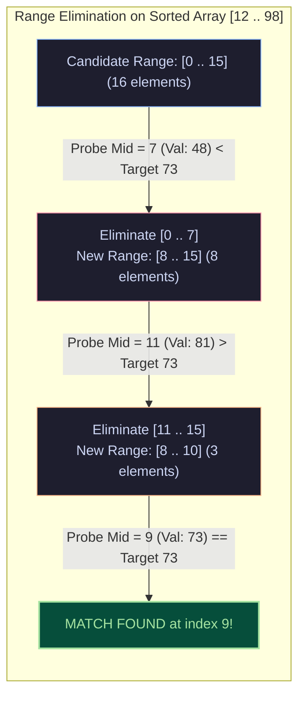
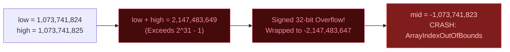
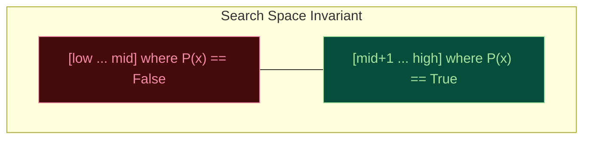

import { Callout } from "fumadocs-ui/components/callout";
import { Tabs, Tab } from "fumadocs-ui/components/tabs";
import { Steps, Step } from "fumadocs-ui/components/steps";
import { Cards, Card } from "fumadocs-ui/components/card";

## The Power of Logarithmic Halving

Binary Search is one of the most powerful algorithms in computer science. Given a sorted collection with random access, it eliminates **half of the remaining search space with a single comparison**.

$$\mathcal{T}(N) = \mathcal{T}\left(\frac{N}{2}\right) + \mathcal{O}(1) \implies \mathcal{O}(\log_2 N)$$

Consider the sheer scale of logarithmic scaling:

- In an array of **1,000** elements: at most **10** comparisons ($\log_2 1000 \approx 9.96$).
- In an array of **1,000,000** elements: at most **20** comparisons.
- In an array of **1,000,000,000** (one billion) elements: at most **30** comparisons.
- In the entire $64$-bit integer address space ($2^{64} \approx 1.84 \times 10^{19}$ elements): at most **64** comparisons.



---

## Interactive Binary Search Simulator

Observe the dynamic pointers (`low`, `mid`, `high`) converge in logarithmic time on the sorted array below:

<BinarySearchSimulator />

---

## The 9-Year Integer Overflow Bug

Binary search was first published by John Mauchly in 1946. Yet, in 2006, Joshua Bloch (author of _Effective Java_ and designer of the Java Collections Framework) revealed that almost every binary search implementation in computer science literature—including `java.util.Arrays.binarySearch`—contained a hidden bug that lay undetected in the Java runtime for over **9 years**.

### The Vulnerability

```java
// Classic textbook implementation
int mid = (low + high) / 2;
```

In 32-bit signed two's complement arithmetic, integers range from $-2,147,483,648$ to $2,147,483,647$ (`Integer.MAX_VALUE` or $2^{31} - 1$).
If an array contains more than $1,073,741,824$ ($2^{30}$) elements and the target lies in the upper half:

1. `low` and `high` might be $1,073,741,824$ and $1,073,741,825$.
2. Their sum `low + high = 2,147,483,649`, which exceeds `Integer.MAX_VALUE`.
3. In 32-bit signed integers, this overflows to **negative** $-2,147,483,647$.
4. Dividing by $2$ produces a negative midpoint: `mid = -1,073,741,823`.
5. Accessing `arr[mid]` instantly crashes with `ArrayIndexOutOfBoundsException`!



### The Solutions

<Tabs items={["Difference Arithmetic (Universal)", "Bitwise Logical Shift"]}>
<Tab value="Difference Arithmetic (Universal)">
```python
# Safe across all programming languages
mid = low + ((high - low) // 2)
```
*Mathematical proof*: $low + \frac{high - low}{2} = \frac{2 \cdot low + high - low}{2} = \frac{low + high}{2}$. Because $high \ge low$, the subtraction $(high - low)$ never overflows!
</Tab>
<Tab value="Bitwise Logical Shift">
```java
// Java / C / C++ (Unsigned right shift)
int mid = (low + high) >>> 1;
```
The unsigned shift operator `>>>` treats the 32 bits as an unsigned integer, shifting in a 0 on the left and avoiding negative signs.
</Tab>
</Tabs>

---

## The Universal Zero-Bug Template

Off-by-one errors plague binary search implementations:

- Should the loop condition be `low < high` or `low <= high`?
- Should the update be `high = mid` or `high = mid - 1`?
- Should you return `low`, `mid`, or `-1`?

To eliminate all off-by-one bugs forever, employ the **Monotonic Invariant Template**:



### The Template Rules

1. Define the search interval $[low, high]$ such that the answer is guaranteed to lie within it.
2. Define a monotonic boolean predicate `P(x)` that evaluates to `False` on the left and `True` on the right:
   $$\underbrace{\text{False}, \quad \text{False}, \quad \text{False}}_{\text{Infeasible}}, \quad \underbrace{\mathbf{\text{True}}, \quad \text{True}, \quad \text{True}}_{\text{Feasible}}$$
3. Maintain the loop:
   ```python
   while low < high:
       mid = low + (high - low) // 2
       if predicate(mid):
           high = mid      # mid could be the first True, keep it!
       else:
           low = mid + 1   # mid is definitely False, discard it!
   return low              # At loop termination, low == high == First True!
   ```

<Callout type="info" title="Why this template NEVER loops infinitely">
  Because integer division rounds down, `mid` can only equal `low` when `high -
  low == 1`. - If `predicate(mid)` is False, `low = mid + 1`, which strictly
  increments `low` and shrinks the window. - If `predicate(mid)` is True, `high
  = mid`, reducing `high` from `low + 1` down to `low`. In all scenarios, the
  search interval $[low, high]$ is guaranteed to shrink by at least 1,
  eliminating infinite loops!
</Callout>

---

## Boundary Search: Lower Bound vs. Upper Bound

When an array contains duplicate elements, an exact-match search might return any arbitrary matching index. In production systems (such as database range queries), we require deterministic boundaries:

```
Array:    [ 10,   20,   20,   20,   30,   40 ]
Index:       0     1     2     3     4     5
                   ▲                 ▲
                   │                 │
             lower_bound(20)   upper_bound(20)
             First element ≥ 20 First element > 20
               (Index 1)         (Index 4)
```

- **`lower_bound(target)`**: Smallest index $i$ where $\text{arr}[i] \ge \text{target}$.
- **`upper_bound(target)`**: Smallest index $i$ where $\text{arr}[i] > \text{target}$.
- **Total Count of Target Elements**: $\text{upper\_bound}(target) - \text{lower\_bound}(target)$.

---

## Production Problem: Optimization on Answer Space

Binary search can solve complex real-world optimization problems that have no pre-existing array!

### The Problem: Koko Eating Bananas (LeetCode 875)

Koko loves eating bananas. There are $n$ piles of bananas, the $i$-th pile has `piles[i]` bananas. The guards will return in $h$ hours.
Koko can decide her banana-eating speed of $k$ bananas-per-hour. Each hour, she chooses a pile and eats up to $k$ bananas from it. If the pile has less than $k$ bananas, she eats all of them and will not eat any more bananas during that hour.

Return the **minimum integer $k$** such that she can eat all the bananas within $h$ hours.

### Monotonicity Proof

Define predicate $P(k)$: _"Can Koko finish all piles within $h$ hours at speed $k$?"_

- If Koko cannot finish at speed $5$ ($P(5) = \text{False}$), she definitely cannot finish at speed $4$ ($P(4) = \text{False}$).
- If Koko can finish at speed $10$ ($P(10) = \text{True}$), she can certainly finish at any faster speed $k > 10$ ($P(k) = \text{True}$).
  The function $P(k)$ is strictly monotonic! Search space for speed $k \in [1, \max(\text{piles})]$.

```python
import math

def min_eating_speed(piles: list[int], h: int) -> int:
    def can_finish(k: int) -> bool:
        hours_needed = sum(math.ceil(pile / k) for pile in piles)
        return hours_needed <= h

    low = 1
    high = max(piles)

    while low < high:
        mid = low + (high - low) // 2
        if can_finish(mid):
            high = mid
        else:
            low = mid + 1

    return low
```

---

## Production Implementations

<Tabs items={["TypeScript", "Python"]}>
<Tab value="TypeScript">
```typescript
/**
 * Binary Search Suite: Exact Match, Lower Bound, Upper Bound, and Monotonic Answer Spaces
 */

export interface BinarySearchResult {
  index: number;
  found: boolean;
  comparisons: number;
}

/\*\*

- Standard Binary Search (Exact Match)
-
- Time: O(log N)
- Space: O(1)
  \*/
  export function binarySearch<T>(
  arr: readonly T[],
  target: T,
  compare: (a: T, b: T) => number = (a, b) => (a < b ? -1 : a > b ? 1 : 0)
  ): BinarySearchResult {
  let low = 0;
  let high = arr.length - 1;
  let comparisons = 0;

while (low <= high) {
// Safe midpoint calculation preventing integer overflow
const mid = low + Math.floor((high - low) / 2);
comparisons++;
const cmp = compare(arr[mid], target);

    if (cmp === 0) {
      return { index: mid, found: true, comparisons };
    } else if (cmp < 0) {
      low = mid + 1;
    } else {
      high = mid - 1;
    }

}

return { index: -1, found: false, comparisons };
}

/\*\*

- Lower Bound: Finds the first index i such that arr[i] >= target.
- Returns arr.length if no such element exists.
  \*/
  export function lowerBound<T>(
  arr: readonly T[],
  target: T,
  compare: (a: T, b: T) => number = (a, b) => (a < b ? -1 : a > b ? 1 : 0)
  ): number {
  let low = 0;
  let high = arr.length;

while (low < high) {
const mid = low + Math.floor((high - low) / 2);
if (compare(arr[mid], target) >= 0) {
high = mid;
} else {
low = mid + 1;
}
}

return low;
}

/\*\*

- Upper Bound: Finds the first index i such that arr[i] > target.
- Returns arr.length if no such element exists.
  \*/
  export function upperBound<T>(
  arr: readonly T[],
  target: T,
  compare: (a: T, b: T) => number = (a, b) => (a < b ? -1 : a > b ? 1 : 0)
  ): number {
  let low = 0;
  let high = arr.length;

while (low < high) {
const mid = low + Math.floor((high - low) / 2);
if (compare(arr[mid], target) > 0) {
high = mid;
} else {
low = mid + 1;
}
}

return low;
}

/\*\*

- Universal Monotonic Answer Space Solver
- Locates the minimal integer in [low, high] that satisfies the predicate.
  \*/
  export function binarySearchAnswerSpace(
  low: number,
  high: number,
  predicate: (candidate: number) => boolean
  ): number {
  while (low < high) {
  const mid = low + Math.floor((high - low) / 2);
  if (predicate(mid)) {
  high = mid;
  } else {
  low = mid + 1;
  }
  }
  return low;
  }

````
</Tab>
<Tab value="Python">
```python
"""
Production Binary Search Module
Contains Exact Match, Lower Bound, Upper Bound, and Universal Monotonic Space Solvers.
"""

from typing import TypeVar, Sequence, Callable, Any
from dataclasses import dataclass

T = TypeVar("T")

@dataclass(frozen=True)
class BinarySearchResult:
    index: int
    found: bool
    comparisons: int

def binary_search(arr: Sequence[T], target: T) -> BinarySearchResult:
    """
    Standard exact match binary search.

    Time: O(log N)
    Space: O(1)
    """
    low = 0
    high = len(arr) - 1
    comparisons = 0

    while low <= high:
        # Overflow-safe midpoint
        mid = low + ((high - low) // 2)
        comparisons += 1

        if arr[mid] == target:
            return BinarySearchResult(index=mid, found=True, comparisons=comparisons)
        elif arr[mid] < target:
            low = mid + 1
        else:
            high = mid - 1

    return BinarySearchResult(index=-1, found=False, comparisons=comparisons)

def lower_bound(arr: Sequence[T], target: T) -> int:
    """
    Returns the first index i where arr[i] >= target.
    If all elements are smaller than target, returns len(arr).
    """
    low = 0
    high = len(arr)

    while low < high:
        mid = low + ((high - low) // 2)
        if arr[mid] >= target:
            high = mid
        else:
            low = mid + 1

    return low

def upper_bound(arr: Sequence[T], target: T) -> int:
    """
    Returns the first index i where arr[i] > target.
    If no element is strictly greater than target, returns len(arr).
    """
    low = 0
    high = len(arr)

    while low < high:
        mid = low + ((high - low) // 2)
        if arr[mid] > target:
            high = mid
        else:
            low = mid + 1

    return low

def count_occurrences(arr: Sequence[T], target: T) -> int:
    """Computes exact occurrence count of target in O(log N) time."""
    return upper_bound(arr, target) - lower_bound(arr, target)

def binary_search_answer_space(
    low: int,
    high: int,
    predicate: Callable[[int], bool]
) -> int:
    """
    Finds the minimum integer x in [low, high] satisfying predicate(x) == True.
    Assumes predicate is monotonic (False ... False, True ... True).
    """
    while low < high:
        mid = low + ((high - low) // 2)
        if predicate(mid):
            high = mid
        else:
            low = mid + 1

    return low
````

</Tab>
</Tabs>

---

## Unit Testing & Boundary Verification

<Tabs items={["TypeScript Tests", "Python Tests"]}>
<Tab value="TypeScript Tests">
```typescript
import { describe, it, expect } from "vitest";
import { binarySearch, lowerBound, upperBound, binarySearchAnswerSpace } from "./binary-search";

describe("Binary Search Suite", () => {
const sorted = [10, 20, 20, 20, 30, 40, 50];

it("finds exact match in sorted array", () => {
const res = binarySearch(sorted, 30);
expect(res.found).toBe(true);
expect(res.index).toBe(4);
});

it("returns -1 for absent elements", () => {
const res = binarySearch(sorted, 25);
expect(res.found).toBe(false);
expect(res.index).toBe(-1);
});

it("correctly identifies lower_bound and upper_bound for duplicate clusters", () => {
// 20 exists from index 1 to 3
const lb = lowerBound(sorted, 20);
const ub = upperBound(sorted, 20);

    expect(lb).toBe(1);
    expect(ub).toBe(4);
    expect(ub - lb).toBe(3); // Exactly 3 copies of 20

});

it("solves monotonic answer space (square root floor)", () => {
// Find largest integer x where x^2 <= 50 -> smallest x+1 where (x+1)^2 > 50
const target = 50;
const firstInvalid = binarySearchAnswerSpace(1, 50, (x) => x \* x > target);
const sqrtFloor = firstInvalid - 1;
expect(sqrtFloor).toBe(7); // 7^2 = 49 <= 50, 8^2 = 64 > 50
});
});

````
</Tab>
<Tab value="Python Tests">
```python
import pytest
from binary_search import binary_search, lower_bound, upper_bound, count_occurrences, binary_search_answer_space

def test_binary_search_exact():
    data = [2, 5, 8, 12, 16, 23, 38, 56, 72, 91]
    res = binary_search(data, 23)
    assert res.found is True
    assert res.index == 5

    res_none = binary_search(data, 24)
    assert res_none.found is False
    assert res_none.index == -1

def test_bounds_with_duplicates():
    data = [1, 3, 3, 3, 3, 6, 8]
    assert lower_bound(data, 3) == 1
    assert upper_bound(data, 3) == 5
    assert count_occurrences(data, 3) == 4

    # Element smaller than all
    assert lower_bound(data, 0) == 0
    # Element larger than all
    assert lower_bound(data, 100) == len(data)

def test_monotonic_answer_space():
    # Find minimum capacity to carry items
    items = [1, 2, 3, 4, 5, 6, 7, 8, 9, 10] # sum = 55
    days = 5

    def feasible(capacity: int) -> bool:
        cur = 0
        d = 1
        for item in items:
            if item > capacity:
                return False
            if cur + item > capacity:
                d += 1
                cur = item
            else:
                cur += item
        return d <= days

    optimal_capacity = binary_search_answer_space(max(items), sum(items), feasible)
    assert optimal_capacity == 15
````

</Tab>
</Tabs>

---

## Next Steps

What if jumping backwards in a data structure is expensive, or what if your data is uniformly distributed?

<Cards>
  <Card
    title="Jump Search"
    href="/docs/dsa/02-trees-heaps-and-core-patterns/searching-algorithms/jump-search"
    icon="FastForward"
    description="Optimal block stepping with step size sqrt(N) for media with asymmetric forward/backward seeking costs."
  />
  <Card
    title="Interpolation Search"
    href="/docs/dsa/02-trees-heaps-and-core-patterns/searching-algorithms/interpolation-search"
    icon="Gauge"
    description="Proportional value probing achieving O(log log N) time on uniformly distributed datasets."
  />
</Cards>
