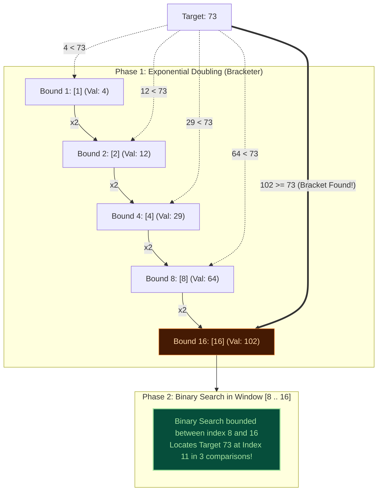
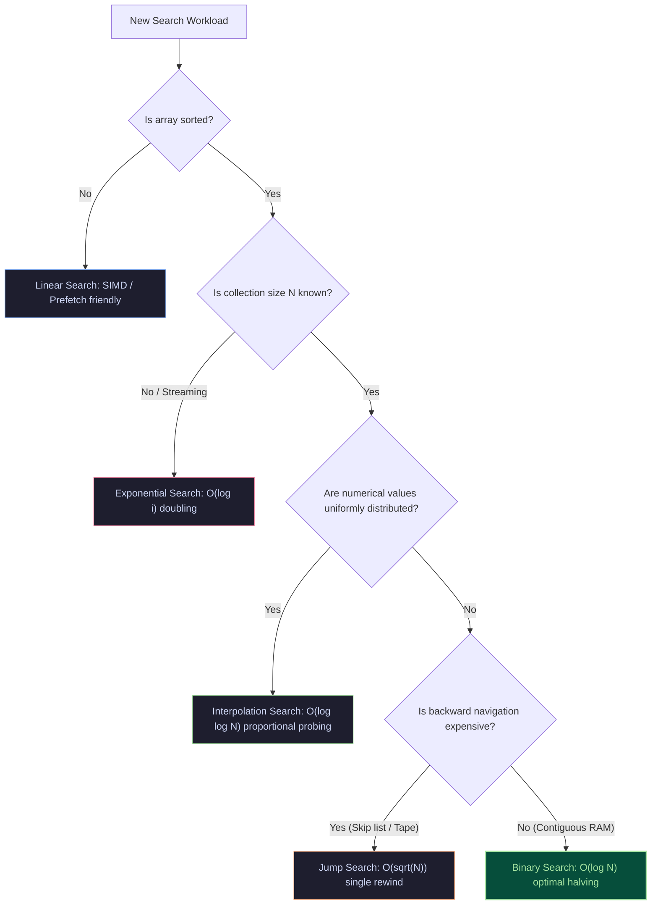

import { Callout } from "fumadocs-ui/components/callout";
import { Tabs, Tab } from "fumadocs-ui/components/tabs";
import { Steps, Step } from "fumadocs-ui/components/steps";
import { Cards, Card } from "fumadocs-ui/components/card";

## Searching Without Boundaries

Standard Binary Search relies on a critical prerequisite: you must know the exact array boundaries (`low = 0`, `high = N - 1`).

What if:

1. **The size $N$ is unknown or unbounded** (e.g., an append-only transaction stream, a database cursor, or an infinite mathematical generator)?
2. **The target is close to the beginning** of a massive array containing billions of elements?

In a collection of $1,000,000,000$ (one billion) items where the target is located at index $4$, Binary Search blindly begins by inspecting index $500,000,000$, wasting dozens of cache misses.

**Exponential Search** (also known as Doubling Search or Galloping Search) solves this by expanding the search boundary geometrically ($1, 2, 4, 8, 16, \dots$) until the target is bracketed, finding items in **$\mathcal{O}(\log i)$ time**, where $i$ is the target's index rather than the total size $N$.



---

## Interactive Exponential Search Simulator

Observe the two-phase execution: the rapid geometric leaps during the doubling phase followed by the binary search resolution:

<ExponentialSearchSimulator />

---

## The Two-Phase Algorithmic Architecture

<Steps>
<Step>
### Check Index 0
Because exponential doubling multiplies indices ($bound = bound \times 2$), starting at $0$ would cause an infinite loop ($0 \times 2 = 0$). We explicitly check index $0$ first:
- If $\text{arr}[0] == \text{target}$, return index $0$ immediately.
</Step>

<Step>
### Phase 1: Exponential Range Doubling
Initialize $bound = 1$. While $bound < N$ and $\text{arr}[bound] < \text{target}$:
$$bound = bound \times 2$$
This probes indices $1, 2, 4, 8, 16, 32, \dots, 2^k$ until an index is reached where $\text{arr}[bound] \ge \text{target}$ or the end of the collection is reached.
</Step>

<Step>
### Phase 2: Bounded Binary Search
The target is guaranteed to reside within the interval:
$$\left[\frac{bound}{2}, \quad \min(bound, N - 1)\right]$$
Execute standard binary search strictly within this bounded window.
</Step>
</Steps>

---

## Mathematical Complexity Proof: $\mathcal{O}(\log i)$

Let $i$ denote the actual 0-based index of the target in the collection.

### 1. Phase 1 (Doubling Steps)

The doubling loop terminates as soon as $2^k \ge i$. The number of steps $k$ required is:
$$2^{k-1} < i \le 2^k \implies k = \lceil \log_2 i \rceil$$

### 2. Phase 2 (Binary Search Window)

The binary search runs on an interval spanning from $\frac{bound}{2} = 2^{k-1}$ to $bound = 2^k$.
The length of this search window $W$ is:
$$W = 2^k - 2^{k-1} = 2^{k-1} \le i$$
Binary search over an interval of size $W \le i$ requires at most $\lceil \log_2 W \rceil \le \lceil \log_2 i \rceil$ comparisons.

### 3. Total Time Complexity

$$\mathcal{T}(i) = \text{Steps}_{\text{Phase 1}} + \text{Steps}_{\text{Phase 2}} \le \lceil \log_2 i \rceil + \lceil \log_2 i \rceil \le 2 \log_2 i = \mathcal{O}(\log i)$$

<Callout type="tip" title="Why O(log i) is a Dramatic Win">
If an array contains $N = 1,000,000,000$ (one billion) items, standard Binary Search always executes $\approx 30$ iterations.

If the target is at index $i = 35$:

- **Binary Search**: 30 comparisons.
- **Exponential Search**: $\lceil \log_2 35 \rceil \times 2 \approx 6 + 6 = \mathbf{12\text{ comparisons}}$ (a 2.5x speedup and vastly fewer cache misses!).
  </Callout>

---

## Production Applications in Modern Infrastructure

### 1. TimSort's Galloping Mode

In standard sorting implementations in **Python (`list.sort()`)** and **Java (`Arrays.sort()`)**, TimSort merges adjacent sorted runs $A$ and $B$.

- Under normal conditions, it compares the head of $A$ and the head of $B$ linearly.
- If run $A$ wins $7$ times consecutively (a heuristic threshold called `MIN_GALLOP`), TimSort infers that run $A$ contains a long stretch of elements smaller than $B[0]$.
- It switches to **Galloping Mode** (Exponential Search): it probes indices $1, 3, 7, 15, 31, \dots, 2^k - 1$ in run $A$ to find the slice where $B[0]$ belongs.
- This compresses an $\mathcal{O}(K)$ sequential scan into $\mathcal{O}(\log K)$, massively accelerating sorting on real-world partially-ordered data!

### 2. Seeking in LSM-Trees (RocksDB / Cassandra)

In Log-Structured Merge-Trees, SSTables (Sorted String Tables) contain block indexes. When iterating through ranges or merging multiple SSTable iterators, keys frequently cluster. RocksDB uses galloping searches to leap across SSTable data blocks without touching unneeded disk pages.

---

## Production Implementations

<Tabs items={["TypeScript", "Python"]}>
<Tab value="TypeScript">
```typescript
/**
 * Production Exponential Search Suite
 * Supports contiguous arrays and unbounded stream interfaces.
 */

export interface ExponentialSearchResult {
  index: number;
  found: boolean;
  doublings: number;
  binaryComparisons: number;
  totalComparisons: number;
}

/\*\*

- Standard Array Exponential Search
-
- Time Complexity: O(log i) where i is target index
- Auxiliary Space: O(1)
  \*/
  export function exponentialSearch<T>(
  arr: readonly T[],
  target: T,
  compare: (a: T, b: T) => number = (a, b) => (a < b ? -1 : a > b ? 1 : 0)
  ): ExponentialSearchResult {
  const n = arr.length;
  if (n === 0) {
  return { index: -1, found: false, doublings: 0, binaryComparisons: 0, totalComparisons: 0 };
  }

let doublings = 0;
let binaryComparisons = 0;

// Step 1: Check index 0
if (compare(arr[0], target) === 0) {
return { index: 0, found: true, doublings: 0, binaryComparisons: 0, totalComparisons: 1 };
}

// Step 2: Exponential doubling to find the range bracket
let bound = 1;
while (bound < n && compare(arr[bound], target) < 0) {
doublings++;
bound \*= 2;
}

if (bound < n) {
doublings++; // Account for the loop exit comparison
}

// Step 3: Binary search within [bound / 2, min(bound, n - 1)]
let low = Math.floor(bound / 2);
let high = Math.min(bound, n - 1);

while (low <= high) {
const mid = low + Math.floor((high - low) / 2);
binaryComparisons++;
const cmp = compare(arr[mid], target);

    if (cmp === 0) {
      return {
        index: mid,
        found: true,
        doublings,
        binaryComparisons,
        totalComparisons: doublings + binaryComparisons + 1, // +1 for index 0 check
      };
    } else if (cmp < 0) {
      low = mid + 1;
    } else {
      high = mid - 1;
    }

}

return {
index: -1,
found: false,
doublings,
binaryComparisons,
totalComparisons: doublings + binaryComparisons + 1,
};
}

/\*\*

- Unbounded Stream Search Interface
- Ideal for search over an infinite sequence or lazy reader where size is unknown.
  \*/
  export interface UnboundedReader<T> {
  get(index: number): T | null; // Returns null if index exceeds stream
  }

export function searchUnboundedStream<T>(
  reader: UnboundedReader<T>,
  target: T,
  compare: (a: T, b: T) => number
): number {
  const first = reader.get(0);
  if (first === null) return -1;
  if (compare(first, target) === 0) return 0;

let bound = 1;
while (true) {
const val = reader.get(bound);
if (val === null || compare(val, target) >= 0) {
break;
}
bound \*= 2;
}

let low = Math.floor(bound / 2);
let high = bound;

while (low <= high) {
const mid = low + Math.floor((high - low) / 2);
const val = reader.get(mid);

    if (val === null || compare(val, target) > 0) {
      high = mid - 1;
    } else if (compare(val, target) < 0) {
      low = mid + 1;
    } else {
      return mid; // Found!
    }

}

return -1;
}

````
</Tab>
<Tab value="Python">
```python
"""
Production Exponential Search Module
Supports both bounded in-memory arrays and unbounded stream interfaces.
"""

from typing import TypeVar, Sequence, Protocol, Optional
from dataclasses import dataclass

T = TypeVar("T")

@dataclass(frozen=True)
class ExponentialSearchResult:
    index: int
    found: bool
    doublings: int
    binary_comparisons: int
    total_comparisons: int

def exponential_search(arr: Sequence[T], target: T) -> ExponentialSearchResult:
    """
    Executes exponential doubling followed by bounded binary search.

    Time: O(log i) where i is target index
    Space: O(1)
    """
    n = len(arr)
    if n == 0:
        return ExponentialSearchResult(index=-1, found=False, doublings=0, binary_comparisons=0, total_comparisons=0)

    # Step 1: Check index 0
    if arr[0] == target:
        return ExponentialSearchResult(index=0, found=True, doublings=0, binary_comparisons=0, total_comparisons=1)

    # Step 2: Exponential range expansion
    bound = 1
    doublings = 0
    while bound < n and arr[bound] < target:
        doublings += 1
        bound *= 2

    if bound < n:
        doublings += 1

    # Step 3: Binary search within [bound // 2, min(bound, n - 1)]
    low = bound // 2
    high = min(bound, n - 1)
    binary_comps = 0

    while low <= high:
        mid = low + ((high - low) // 2)
        binary_comps += 1

        if arr[mid] == target:
            return ExponentialSearchResult(
                index=mid,
                found=True,
                doublings=doublings,
                binary_comparisons=binary_comps,
                total_comparisons=doublings + binary_comps + 1,
            )
        elif arr[mid] < target:
            low = mid + 1
        else:
            high = mid - 1

    return ExponentialSearchResult(
        index=-1,
        found=False,
        doublings=doublings,
        binary_comparisons=binary_comps,
        total_comparisons=doublings + binary_comps + 1,
    )

class UnboundedReader(Protocol[T]):
    def get(self, index: int) -> Optional[T]:
        """Returns element at index, or None if index is out of stream."""
        ...

def search_unbounded_stream(reader: UnboundedReader[T], target: T) -> int:
    """Searches an unbounded stream of unknown size in O(log i) time."""
    val0 = reader.get(0)
    if val0 is None:
        return -1
    if val0 == target:
        return 0

    bound = 1
    while True:
        val = reader.get(bound)
        if val is None or val >= target:
            break
        bound *= 2

    low = bound // 2
    high = bound

    while low <= high:
        mid = low + ((high - low) // 2)
        val = reader.get(mid)

        if val is None or val > target:
            high = mid - 1
        elif val < target:
            low = mid + 1
        else:
            return mid

    return -1
````

</Tab>
</Tabs>

---

## Unit Testing & Verification

<Tabs items={["TypeScript Tests", "Python Tests"]}>
<Tab value="TypeScript Tests">
```typescript
import { describe, it, expect } from "vitest";
import { exponentialSearch, searchUnboundedStream } from "./exponential-search";

describe("Exponential Search Suite", () => {
const sorted = [2, 5, 8, 12, 16, 23, 38, 56, 72, 91, 105, 120, 140, 160, 190, 210];

it("finds target at index 0 immediately", () => {
const res = exponentialSearch(sorted, 2);
expect(res.found).toBe(true);
expect(res.index).toBe(0);
expect(res.doublings).toBe(0);
});

it("locates elements via doubling and binary windowing", () => {
const res = exponentialSearch(sorted, 72); // index 8
expect(res.found).toBe(true);
expect(res.index).toBe(8);
});

it("handles targets beyond collection end", () => {
const res = exponentialSearch(sorted, 999);
expect(res.found).toBe(false);
expect(res.index).toBe(-1);
});

it("successfully searches simulated unbounded stream", () => {
// Stream of even numbers: 0, 2, 4, 6, ...
const stream = {
get: (i: number) => (i < 5000 ? i \* 2 : null),
};

    const targetIndex = searchUnboundedStream(stream, 728, (a, b) => a - b);
    expect(targetIndex).toBe(364); // 364 * 2 = 728

    const absentIndex = searchUnboundedStream(stream, 729, (a, b) => a - b);
    expect(absentIndex).toBe(-1);

});
});

````
</Tab>
<Tab value="Python Tests">
```python
import pytest
from exponential_search import exponential_search, search_unbounded_stream

def test_exponential_search_basic():
    arr = [3, 6, 9, 12, 15, 18, 21, 24, 27, 30]
    res = exponential_search(arr, 18)
    assert res.found is True
    assert res.index == 5

def test_exponential_search_boundaries():
    arr = [10, 20, 30, 40]
    # First item
    assert exponential_search(arr, 10).index == 0
    # Last item
    assert exponential_search(arr, 40).index == 3
    # Smaller than min
    assert exponential_search(arr, 5).found is False
    # Larger than max
    assert exponential_search(arr, 50).found is False

def test_unbounded_stream_reader():
    class InfiniteCubeStream:
        def get(self, index: int):
            if index > 10_000:
                return None
            return index ** 3

    stream = InfiniteCubeStream()
    # 7^3 = 343
    found_idx = search_unbounded_stream(stream, 343)
    assert found_idx == 7

    # 100 is not a perfect cube
    assert search_unbounded_stream(stream, 100) == -1
````

</Tab>
</Tabs>

---

## Conclusion & Architectural Summary

You have explored the complete pantheon of search algorithms:



<Cards>
  <Card
    title="Searching Overview & Decision Matrix"
    href="/docs/dsa/02-trees-heaps-and-core-patterns/searching-algorithms"
    icon="Search"
    description="Review the interactive master simulator, engineering trade-offs, and decision matrix."
  />
  <Card
    title="Foundations of Searching"
    href="/docs/dsa/02-trees-heaps-and-core-patterns/searching-algorithms/searching"
    icon="Compass"
    description="Deep dive into memory cache lines, discrete vs continuous search, and benchmark analysis."
  />
</Cards>
