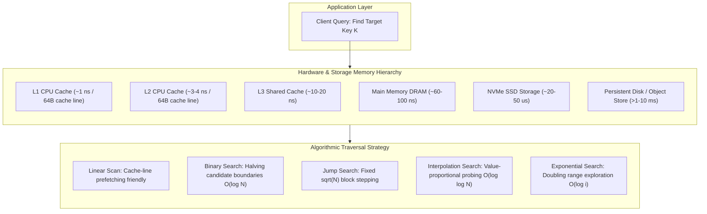
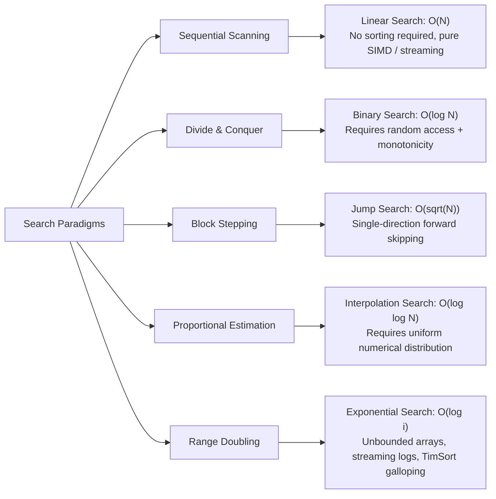

import { Callout } from "fumadocs-ui/components/callout";
import { Tabs, Tab } from "fumadocs-ui/components/tabs";
import { Steps, Step } from "fumadocs-ui/components/steps";
import { Cards, Card } from "fumadocs-ui/components/card";

## The Engine of Computational Retrieval

Every millisecond, modern hyperscale systems execute trillions of search operations. When an operating system translates a virtual address to a physical memory frame, when PostgreSQL traverses a B-Tree index to locate a customer record, when RocksDB queries an SSTable bloom filter and block index, or when Kafka identifies an offset inside a partitioned commit log, the underlying primitive is a **search algorithm**.

Searching is not merely scanning an array for an integer match. In production engineering, searching is the process of **locating a target state or decision boundary within a discrete or continuous search space** while minimizing three finite resources:

1. **CPU Instruction Cycles & Branch Mispredictions**: Minimizing conditional evaluations that stall CPU instruction pipelines.
2. **Memory Hierarchy Latency**: Aligning access patterns with hardware L1/L2/L3 cache lines (64 bytes) to avoid 60–100 ns DRAM stalls.
3. **I/O Bandwidth**: Reducing disk block reads or network round trips when searching over persistent storage or distributed clusters.

---

## Interactive All-in-One Search Simulator

Test and observe how different searching algorithms traverse data structures step by step. Switch between algorithms, step through operations, observe pointer movements, and inspect detailed state transitions.

<SearchSimulator />

---

## Architectural Taxonomy of Searching Paradigms

Algorithms approach the problem of searching with different structural assumptions about the data and the underlying hardware:

---

## The Master Search Decision Matrix

Selecting the optimal search algorithm requires balancing data distribution, collection size, sorting guarantees, and storage mechanics:

| Algorithm                | Best Time        | Average Time               | Worst Time              | Auxiliary Space  | Preconditions                                   | Memory Access Pattern                                          | Key Production Use Cases                                                                 |
| :----------------------- | :--------------- | :------------------------- | :---------------------- | :--------------- | :---------------------------------------------- | :------------------------------------------------------------- | :--------------------------------------------------------------------------------------- |
| **Linear Search**        | $\mathcal{O}(1)$ | $\mathcal{O}(N)$           | $\mathcal{O}(N)$        | $\mathcal{O}(1)$ | None (unsorted data allowed)                    | Pure sequential streaming; optimal L1/L2 prefetch              | Small buffers ($N \le 32$); unsorted event streams; single-pass filtering                |
| **Binary Search**        | $\mathcal{O}(1)$ | $\mathcal{O}(\log N)$      | $\mathcal{O}(\log N)$   | $\mathcal{O}(1)$ | Monotonic / Sorted array; $O(1)$ random access  | Random / hopping probes; cache misses on large $N$             | In-memory sorted arrays; monotonic answer-space optimization; database index pages       |
| **Jump Search**          | $\mathcal{O}(1)$ | $\mathcal{O}(\sqrt{N})$    | $\mathcal{O}(\sqrt{N})$ | $\mathcal{O}(1)$ | Sorted collection; forwards traversal cheap     | Forward block jumps of size $\sqrt{N}$ + local backward scan   | Singly linked skip-lists; magnetic tape / block storage where backward seeks are costly  |
| **Interpolation Search** | $\mathcal{O}(1)$ | $\mathcal{O}(\log \log N)$ | $\mathcal{O}(N)$        | $\mathcal{O}(1)$ | Sorted numerical data; **Uniform distribution** | Dynamic arithmetic jump probe                                  | Telemetry timestamps; contiguous sensor readings; phonebook indices; IP routing tables   |
| **Exponential Search**   | $\mathcal{O}(1)$ | $\mathcal{O}(\log i)$      | $\mathcal{O}(\log i)$   | $\mathcal{O}(1)$ | Sorted collection; unbounded or unknown size    | Geometric doubling ($2^0, 2^1, 2^2, \dots$) then binary search | Galloping mode in Python/Java TimSort; unbounded Kafka/file offsets; SSTable index seeks |

<Callout type="info" title="The Hardware Reality: Why Asymptotics Don't Tell the Whole Story">
While $\mathcal{O}(\log N)$ is asymptotically superior to $\mathcal{O}(N)$, for tiny arrays ($N \le 32$), **Linear Search frequently runs faster than Binary Search on modern x86_64 and ARM CPUs**.

Why? Because linear iteration allows hardware prefetchers to load entire 64-byte cache lines into L1 cache before the CPU needs them, with zero branch predictor penalties. In contrast, Binary Search jumps unpredictably across cache lines, triggering cache misses and branch mispredictions that can cost 20–50 CPU cycles per probe!

</Callout>

---

## Real-World Systems Engineering Applications

### 1. Database Storage Engines (LSM-Trees & RocksDB)

In Log-Structured Merge-trees (LSM-trees) like RocksDB, LevelDB, and Apache Cassandra, data on disk is organized into immutable Sorted String Tables (SSTables). Each SSTable consists of data blocks and a two-level index block.

- **Binary Search** is used across block index entries to find the exact 4KB data block containing the target key.
- Inside the compressed data block, **Linear Search** scans records sequentially due to prefix compression.
- For merges and iterator seeks, **Exponential Search** (galloping) rapidly skips large ranges of non-overlapping keys.

### 2. Standard Library Hybrid Sorters (TimSort Galloping)

Python's built-in `list.sort()` and Java's `Arrays.sort()` use **TimSort**. When merging two sorted runs, if one run consistently wins over the other $7$ times consecutively, TimSort switches from standard linear merging to **Galloping Mode** (Exponential Search). It doubles the probe index ($1, 2, 4, 8, 16, \dots$) to locate where the next element fits in $\mathcal{O}(\log i)$ time rather than $\mathcal{O}(i)$ comparisons.

### 3. High-Throughput In-Memory Lookups (B-Tree vs Array Binary Search)

In modern databases like DuckDB and ClickHouse, binary search is specialized for SIMD vector execution. By unrolling search steps into branchless bitwise conditional moves (`cmov`), database kernels eliminate branch prediction misses entirely.

---

## Explore the Searching Curriculum

Dive deep into the theory, hardware trade-offs, edge cases, mathematical proofs, and industrial implementations across our dedicated guides:

<Cards>
  <Card
    title="Foundations of Searching"
    href="/docs/dsa/02-trees-heaps-and-core-patterns/searching-algorithms/searching"
    icon="Compass"
    description="Core mental models, predicate satisfaction over index spaces, discrete vs continuous search, and CPU memory latency."
  />
  <Card
    title="Linear Search"
    href="/docs/dsa/02-trees-heaps-and-core-patterns/searching-algorithms/linear-search"
    icon="ListOrdered"
    description="Sequential scans, hardware cache prefetching, SIMD vectorization, and sentinel loop boundary elimination."
  />
  <Card
    title="Binary Search"
    href="/docs/dsa/02-trees-heaps-and-core-patterns/searching-algorithms/binary-search"
    icon="Split"
    description="Halving spaces, integer overflow history, universal zero-bug templates, and monotonic answer-space optimization."
  />
  <Card
    title="Jump Search"
    href="/docs/dsa/02-trees-heaps-and-core-patterns/searching-algorithms/jump-search"
    icon="FastForward"
    description="Block stepping by sqrt(N), mathematical calculus proof of optimal jump size, and single-direction hardware media."
  />
  <Card
    title="Interpolation Search"
    href="/docs/dsa/02-trees-heaps-and-core-patterns/searching-algorithms/interpolation-search"
    icon="Gauge"
    description="Proportional value estimation, O(log log N) lookup on uniformly distributed data, and skew vulnerabilities."
  />
  <Card
    title="Exponential Search"
    href="/docs/dsa/02-trees-heaps-and-core-patterns/searching-algorithms/exponential-search"
    icon="Activity"
    description="Range doubling for unbounded streams and infinite collections in O(log i) time, plus TimSort galloping."
  />
</Cards>
