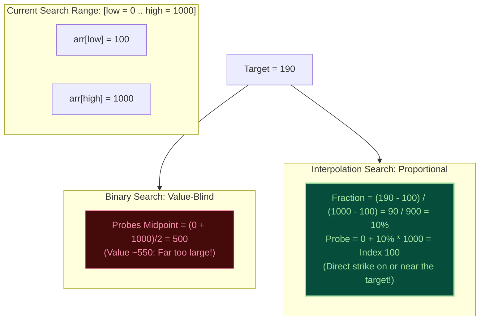
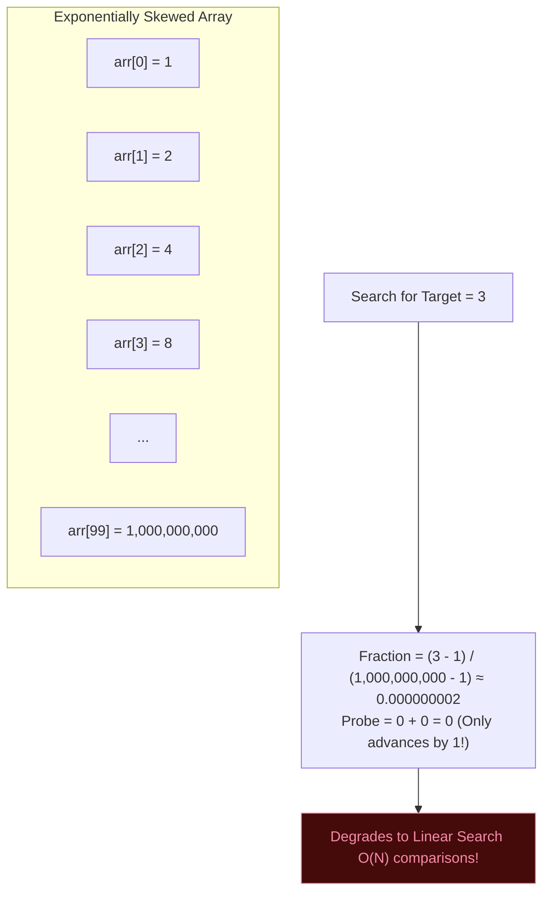

import { Callout } from "fumadocs-ui/components/callout";
import { Tabs, Tab } from "fumadocs-ui/components/tabs";
import { Steps, Step } from "fumadocs-ui/components/steps";
import { Cards, Card } from "fumadocs-ui/components/card";

## The Phonebook Intuition

When you open a 1,000-page telephone directory to look up a person named **"Aaron"**, you do not open the book directly to page 500 (letter 'M') as Binary Search would. You immediately open to page 2 or 3.

Similarly, if searching for **"Zimmerman"**, you flip straight to the final pages.

Binary Search is value-blind: it always probes the middle index $\frac{low + high}{2}$ without considering whether the target value is close to $\text{arr}[low]$ or $\text{arr}[high]$. **Interpolation Search** mimics human intuition: it inspects the numerical value of the target relative to the minimum and maximum values of the current range, calculating a proportional estimate of where the target should reside.



---

## Formula Derivation: Linear Slope Interpolation

To calculate the target probe index, we treat the array indices as $x$-coordinates and the array values as $y$-coordinates:

- Point $A$: $(low, \text{arr}[low])$
- Point $B$: $(high, \text{arr}[high])$
- Target Point: $(probe, target)$

Assuming the values increase linearly across the interval, the slope of the line segment between $A$ and $B$ equals the slope between $A$ and the Target Point:

$$\frac{\text{target} - \text{arr}[low]}{probe - low} \approx \frac{\text{arr}[high] - \text{arr}[low]}{high - low}$$

Cross-multiplying to solve for $probe$:

$$probe - low = \frac{\text{target} - \text{arr}[low]}{\text{arr}[high] - \text{arr}[low]} \times (high - low)$$

$$\mathbf{probe = low + \left\lfloor \frac{\text{target} - \text{arr}[low]}{\text{arr}[high] - \text{arr}[low]} \times (high - low) \right\rfloor}$$

```
Fraction = (target - arr[low]) / (arr[high] - arr[low])
Probe    = low + floor(Fraction * (high - low))
```

---

## Interactive Interpolation Search Simulator

Observe how the probe jumps directly to the proportional location based on numerical magnitude:

<InterpolationSearchSimulator />

---

## The $\mathcal{O}(\log \log N)$ Superpower

If the data is **uniformly distributed** (i.e., every interval $[x, x + \Delta]$ contains roughly the same number of keys):

- Each step reduces the candidate range from $N$ to $\sqrt{N}$.
- The recurrence relation is:
  $$\mathcal{T}(N) = \mathcal{T}(\sqrt{N}) + \mathcal{O}(1) \implies \mathcal{O}(\log_2(\log_2 N))$$

### What Does $\mathcal{O}(\log \log N)$ Feel Like?

| Collection Size ($N$)        | Binary Search ($\log_2 N$) | Interpolation Search ($\log_2 \log_2 N$) | Speedup         |
| :--------------------------- | :------------------------- | :--------------------------------------- | :-------------- |
| **1,024**                    | 10 comparisons             | $\approx 3.3$ comparisons                | **3x faster**   |
| **65,536**                   | 16 comparisons             | $\approx 4.0$ comparisons                | **4x faster**   |
| **1,000,000**                | 20 comparisons             | $\approx 4.3$ comparisons                | **4.6x faster** |
| **4,294,967,296** ($2^{32}$) | 32 comparisons             | **5.0 comparisons**                      | **6.4x faster** |

For 4 billion uniformly distributed records, Interpolation Search locates any key in **just 5 probes**!

---

## The Achilles' Heel: Worst-Case $\mathcal{O}(N)$ Degradation

Interpolation Search relies entirely on the uniformity assumption. If the data distribution is **skewed, clustered, or exponential**, Interpolation Search collapses into a pathetic $\mathcal{O}(N)$ crawl.



Consider searching for $target = 3$ in an array with an extreme outlier at the end:
`[1, 2, 4, 8, 16, 32, ..., 1_000_000_000]`
The formula yields:
$$Fraction = \frac{3 - 1}{1,000,000,000 - 1} \approx 0.000000002 \implies probe = 0 + 0 = 0$$

At every step, the probe advances by only $1$ index. It takes $90$ steps instead of Binary Search's $7$!

<Callout type="warning" title="When NOT to use Interpolation Search">
  Never use Interpolation Search on: 1. Skewed datasets (user IDs following
  Pareto/Power-law distributions). 2. Data with extreme outliers. 3. Strings or
  complex non-numeric keys. Only use Interpolation Search when keys are
  generated by uniform random processes, regular time-series intervals, or
  contiguous physical sensors.
</Callout>

---

## Defensive Engineering: Guarding Against Fatal Bugs

Interpolation Search has two lethal traps that cause crashes if unhandled:

### 1. Division by Zero

If $\text{arr}[low] == \text{arr}[high]$, the denominator $(\text{arr}[high] - \text{arr}[low])$ becomes zero.

- **Defense**: Always guard before computing the probe:
  ```python
  if arr[low] == arr[high]:
      return low if arr[low] == target else -1
  ```

### 2. Out-of-Bounds Probe Calculation

If $target < \text{arr}[low]$ or $target > \text{arr}[high]$, the calculated fraction can be negative ($< 0$) or greater than $1$, causing the probe index to calculate to negative numbers or indices beyond the array bounds ($> n-1$), triggering memory faults!

- **Defense**: The loop condition MUST enforce that the target is strictly bounded:
  ```python
  while low <= high and arr[low] <= target <= arr[high]:
  ```

---

## Production Implementations

<Tabs items={["TypeScript", "Python"]}>
<Tab value="TypeScript">
```typescript
/**
 * Production Interpolation Search Implementation
 */

export interface InterpolationSearchResult {
  index: number;
  found: boolean;
  probes: number;
}

/\*\*

- Searches a sorted, uniformly distributed numerical array.
-
- Best Case: O(1)
- Average Case (Uniform): O(log log N)
- Worst Case (Skewed): O(N)
- Space: O(1)
  \*/
  export function interpolationSearch(
  arr: readonly number[],
  target: number
  ): InterpolationSearchResult {
  let low = 0;
  let high = arr.length - 1;
  let probes = 0;

// Strict boundary invariant prevents out-of-bounds array access
while (low <= high && target >= arr[low] && target <= arr[high]) {
probes++;

    // Guard against division by zero when duplicate values bridge the range
    if (arr[low] === arr[high]) {
      if (arr[low] === target) {
        return { index: low, found: true, probes };
      }
      break;
    }

    // Linear interpolation formula
    const fraction = (target - arr[low]) / (arr[high] - arr[low]);
    const probe = low + Math.floor(fraction * (high - low));

    if (arr[probe] === target) {
      return { index: probe, found: true, probes };
    }

    if (arr[probe] < target) {
      low = probe + 1;
    } else {
      high = probe - 1;
    }

}

return { index: -1, found: false, probes };
}

````
</Tab>
<Tab value="Python">
```python
"""
Production Interpolation Search Module
Includes division-by-zero guards, bounds protections, and comparison counters.
"""

from typing import Sequence
from dataclasses import dataclass

@dataclass(frozen=True)
class InterpolationSearchResult:
    index: int
    found: bool
    probes: int

def interpolation_search(arr: Sequence[int | float], target: int | float) -> InterpolationSearchResult:
    """
    Interpolation search over a sorted, uniformly distributed numerical sequence.

    Time: O(log log N) average on uniform data, O(N) worst case.
    Space: O(1)
    """
    low = 0
    high = len(arr) - 1
    probes = 0

    # Bounds condition is mandatory to prevent probe from falling outside [0, len(arr)-1]
    while low <= high and arr[low] <= target <= arr[high]:
        probes += 1

        # Zero division guard
        if arr[low] == arr[high]:
            if arr[low] == target:
                return InterpolationSearchResult(index=low, found=True, probes=probes)
            break

        # Compute proportional probe index
        fraction = (target - arr[low]) / (arr[high] - arr[low])
        probe = low + int(fraction * (high - low))

        if arr[probe] == target:
            return InterpolationSearchResult(index=probe, found=True, probes=probes)
        elif arr[probe] < target:
            low = probe + 1
        else:
            high = probe - 1

    return InterpolationSearchResult(index=-1, found=False, probes=probes)
````

</Tab>
</Tabs>

---

## Uniform vs. Skewed Benchmark Comparison

<Tabs items={["TypeScript Verification", "Python Verification"]}>
<Tab value="TypeScript Verification">
```typescript
import { describe, it, expect } from "vitest";
import { interpolationSearch } from "./interpolation-search";

describe("Interpolation Search Suite", () => {
it("hits target in minimal probes on perfectly uniform data", () => {
// 10,000 uniformly spaced integers
const uniform = Array.from({ length: 10000 }, (\_, i) => i \* 10);
const target = 75320; // At index 7532

    const result = interpolationSearch(uniform, target);
    expect(result.found).toBe(true);
    expect(result.index).toBe(7532);
    // On perfect uniform data, the formula lands on the exact index in 1 probe!
    expect(result.probes).toBe(1);

});

it("handles absent targets and out-of-bounds guards", () => {
const data = [10, 20, 30, 40, 50];
expect(interpolationSearch(data, 5).found).toBe(false);
expect(interpolationSearch(data, 100).found).toBe(false);
expect(interpolationSearch(data, 25).found).toBe(false);
});

it("handles arrays with identical elements without division by zero", () => {
const allSevens = [7, 7, 7, 7, 7];
expect(interpolationSearch(allSevens, 7).found).toBe(true);
expect(interpolationSearch(allSevens, 9).found).toBe(false);
});
});

````
</Tab>
<Tab value="Python Verification">
```python
import pytest
from interpolation_search import interpolation_search

def test_uniform_distribution_lightning_probe():
    # 1 million integers, step of 2: [0, 2, 4, 6, ..., 1999998]
    data = list(range(0, 2_000_000, 2))
    target = 1_432_896 # Exactly at index 716,448

    res = interpolation_search(data, target)
    assert res.found is True
    assert res.index == 716_448
    # Hits on the very first probe!
    assert res.probes == 1

def test_bounds_guard():
    data = [10, 20, 30, 40, 50]
    # Smaller than lower bound
    assert interpolation_search(data, 1).found is False
    # Greater than upper bound
    assert interpolation_search(data, 999).found is False
    # In-between absent
    assert interpolation_search(data, 25).found is False

def test_identical_elements():
    data = [5, 5, 5, 5]
    assert interpolation_search(data, 5).found is True
    assert interpolation_search(data, 4).found is False
````

</Tab>
</Tabs>

---

## Next Steps

What if the size of the array is unknown, unbounded, or you are streaming through an infinite feed?

<Cards>
  <Card
    title="Exponential Search"
    href="/docs/dsa/02-trees-heaps-and-core-patterns/searching-algorithms/exponential-search"
    icon="Activity"
    description="Range doubling for unbounded streams and infinite collections in O(log i) time, plus TimSort galloping."
  />
  <Card
    title="Foundations of Searching"
    href="/docs/dsa/02-trees-heaps-and-core-patterns/searching-algorithms/searching"
    icon="Compass"
    description="Review hardware memory cache lines, discrete vs continuous boundaries, and search interfaces."
  />
</Cards>
