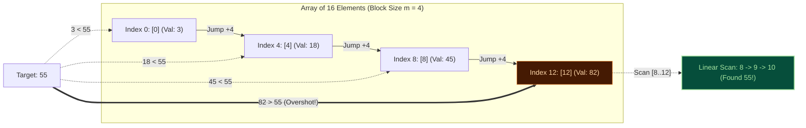
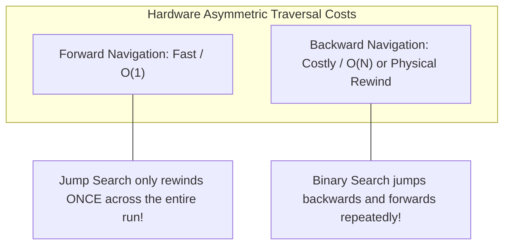

import { Callout } from "fumadocs-ui/components/callout";
import { Tabs, Tab } from "fumadocs-ui/components/tabs";
import { Steps, Step } from "fumadocs-ui/components/steps";
import { Cards, Card } from "fumadocs-ui/components/card";

## The Block Stepping Strategy

While Linear Search checks every single element ($\mathcal{O}(N)$) and Binary Search divides the space in half at each step ($\mathcal{O}(\log N)$), **Jump Search** (also known as Block Search) strikes an elegant middle ground: it checks fewer elements by jumping ahead in fixed-size blocks of size $m$, then falling back to a linear scan once the target has been overshot.



---

## Calculus Proof: Why the Optimal Jump Size is $\sqrt{N}$

Why do we set the step size $m$ to $\sqrt{N}$ rather than $N/4$ or $10$? We can prove mathematically that $m = \sqrt{N}$ minimizes total operations using single-variable differential calculus.

### 1. Formulating the Cost Function

In an array of length $N$ partitioned into blocks of step size $m$:

- The maximum number of forward block jumps is $\frac{N}{m}$.
- Once the algorithm overshoots the target, it performs a backward linear search within that block. The maximum number of comparisons in this linear phase is $m - 1 \approx m$.

The total worst-case comparison count $f(m)$ is:

$$f(m) = \frac{N}{m} + m$$

### 2. Finding the Critical Point via Derivative

To find the step size $m$ that minimizes $f(m)$, take the first derivative with respect to $m$ and set it to $0$:

$$f'(m) = \frac{d}{dm}\left(N \cdot m^{-1} + m\right) = -\frac{N}{m^2} + 1 = 0$$

Solving for $m$:

$$1 = \frac{N}{m^2} \implies m^2 = N \implies m = \sqrt{N}$$

### 3. Second Derivative Verification

To verify that this critical point is indeed a local and global minimum:

$$f''(m) = \frac{d}{dm}\left(-N \cdot m^{-2} + 1\right) = \frac{2N}{m^3}$$

Since $N > 0$ and $m > 0$, $f''(m) > 0$ strictly for all positive values of $m$. The function is convex, confirming that **$m = \sqrt{N}$ is the unique global minimum**.

### 4. Total Complexity

Substituting $m = \sqrt{N}$ back into the cost function:

$$f(\sqrt{N}) = \frac{N}{\sqrt{N}} + \sqrt{N} = \sqrt{N} + \sqrt{N} = 2\sqrt{N} = \mathcal{O}(\sqrt{N})$$

```
N = 10,000 Elements
------------------------------------------------------------
Linear Search Worst Case:   10,000 comparisons
Jump Search Worst Case:     2 * sqrt(10,000) = 200 comparisons
Binary Search Worst Case:   log2(10,000) ≈ 14 comparisons
```

---

## Interactive Jump Search Simulator

Watch the block jumps leap forward across the array in strides of $\sqrt{N}$, followed by the local linear resolution:

<JumpSearchSimulator />

---

## Where Jump Search Wins Over Binary Search

If Binary Search is $\mathcal{O}(\log N)$ and Jump Search is $\mathcal{O}(\sqrt{N})$, why would an engineer ever choose Jump Search?



### 1. Singly-Linked Skip Lists and Forward-Only Streams

In a singly-linked list with skip pointers (or an unindexed forward iterator), moving forward is cheap (`ptr = ptr->next_block`), but moving backward requires either:

- Maintaining a heavy back-pointer stack, or
- Re-traversing all the way from the head of the list!
  Binary search requires jumping backwards and forwards repeatedly. **Jump search only steps backward once across the entire algorithm lifetime**, making it vastly cheaper on forward-only topologies.

### 2. Block-Addressed Storage Media & Magnetic Tape

In mechanical storage systems, spinning disks, and linear tape-open (LTO) archival cartridges:

- Forward seeks are sequential and fast.
- Rewinding or seeking in reverse requires physical head repositioning or motor direction changes.
  Jump Search scans forward across block headers and performs local reads within a single physical block.

---

## Production Implementations

<Tabs items={["TypeScript", "Python"]}>
<Tab value="TypeScript">
```typescript
/**
 * Production Jump Search Implementation
 */

export interface JumpSearchResult {
  index: number;
  found: boolean;
  comparisons: number;
  jumps: number;
}

/\*\*

- Searches a sorted array using Jump Search with optimal step size sqrt(N).
-
- Time Complexity: O(sqrt(N))
- Space Complexity: O(1)
-
- @param arr Sorted array of items
- @param target Value to locate
  \*/
  export function jumpSearch<T>(
  arr: readonly T[],
  target: T,
  compare: (a: T, b: T) => number = (a, b) => (a < b ? -1 : a > b ? 1 : 0)
  ): JumpSearchResult {
  const n = arr.length;
  let comparisons = 0;
  let jumps = 0;

if (n === 0) {
return { index: -1, found: false, comparisons: 0, jumps: 0 };
}

// Edge case: Target smaller than first element
comparisons++;
if (compare(target, arr[0]) < 0) {
return { index: -1, found: false, comparisons, jumps: 0 };
}

// Edge case: Target larger than last element
comparisons++;
if (compare(target, arr[n - 1]) > 0) {
return { index: -1, found: false, comparisons, jumps: 0 };
}

// Optimal jump step size m = floor(sqrt(n))
const step = Math.max(1, Math.floor(Math.sqrt(n)));
let prev = 0;
let curr = step;

// Phase 1: Forward block jumping
while (curr < n && compare(arr[curr], target) < 0) {
comparisons++;
jumps++;
prev = curr;
curr += step;
}

// Account for the loop-exiting comparison if curr < n
if (curr < n) {
comparisons++;
}

// Phase 2: Linear scan within the identified block [prev ... min(curr, n - 1)]
const limit = Math.min(curr, n - 1);
for (let i = prev; i <= limit; i++) {
comparisons++;
const cmp = compare(arr[i], target);
if (cmp === 0) {
return { index: i, found: true, comparisons, jumps };
}
if (cmp > 0) {
// Because array is sorted, we can terminate early
break;
}
}

return { index: -1, found: false, comparisons, jumps };
}

````
</Tab>
<Tab value="Python">
```python
"""
Production Jump Search Module
Implements optimal block jumping with step size sqrt(N).
"""

import math
from typing import TypeVar, Sequence
from dataclasses import dataclass

T = TypeVar("T")

@dataclass(frozen=True)
class JumpSearchResult:
    index: int
    found: bool
    comparisons: int
    jumps: int

def jump_search(arr: Sequence[T], target: T) -> JumpSearchResult:
    """
    Executes Jump Search on a sorted sequence.

    Time: O(sqrt(N))
    Space: O(1)
    """
    n = len(arr)
    if n == 0:
        return JumpSearchResult(index=-1, found=False, comparisons=0, jumps=0)

    comparisons = 0
    jumps = 0

    # Bounds guards
    comparisons += 1
    if target < arr[0]:
        return JumpSearchResult(index=-1, found=False, comparisons=comparisons, jumps=0)

    comparisons += 1
    if target > arr[n - 1]:
        return JumpSearchResult(index=-1, found=False, comparisons=comparisons, jumps=0)

    # Optimal block step
    step = max(1, int(math.isqrt(n)))
    prev = 0
    curr = step

    # Phase 1: Block jumping
    while curr < n and arr[curr] < target:
        comparisons += 1
        jumps += 1
        prev = curr
        curr += step

    if curr < n:
        comparisons += 1

    # Phase 2: Linear backtracking/forward scan within window
    limit = min(curr, n - 1)
    for i in range(prev, limit + 1):
        comparisons += 1
        if arr[i] == target:
            return JumpSearchResult(index=i, found=True, comparisons=comparisons, jumps=jumps)
        if arr[i] > target:
            break

    return JumpSearchResult(index=-1, found=False, comparisons=comparisons, jumps=jumps)
````

</Tab>
</Tabs>

---

## Unit Testing & Verification

<Tabs items={["TypeScript Tests", "Python Tests"]}>
<Tab value="TypeScript Tests">
```typescript
import { describe, it, expect } from "vitest";
import { jumpSearch } from "./jump-search";

describe("Jump Search Suite", () => {
const dataset = [0, 1, 1, 2, 3, 5, 8, 13, 21, 34, 55, 89, 144, 233, 377, 610];

it("finds elements located at jump block boundaries", () => {
// Array length 16 -> step = 4 -> boundaries at indices 0, 4, 8, 12
const res = jumpSearch(dataset, 3); // index 4
expect(res.found).toBe(true);
expect(res.index).toBe(4);
});

it("finds elements inside a block via linear resolution", () => {
const res = jumpSearch(dataset, 55); // index 10
expect(res.found).toBe(true);
expect(res.index).toBe(10);
});

it("handles out of bounds targets gracefully", () => {
expect(jumpSearch(dataset, -5).found).toBe(false);
expect(jumpSearch(dataset, 1000).found).toBe(false);
expect(jumpSearch(dataset, 4).found).toBe(false);
});

it("works on single element and small arrays", () => {
expect(jumpSearch([42], 42).found).toBe(true);
expect(jumpSearch([42], 42).index).toBe(0);
expect(jumpSearch([42], 99).found).toBe(false);
});
});

````
</Tab>
<Tab value="Python Tests">
```python
import pytest
from jump_search import jump_search

def test_jump_search_success():
    arr = [10, 20, 30, 40, 50, 60, 70, 80, 90, 100]
    res = jump_search(arr, 70)
    assert res.found is True
    assert res.index == 6

def test_jump_search_first_and_last():
    arr = [5, 15, 25, 35, 45]
    assert jump_search(arr, 5).index == 0
    assert jump_search(arr, 45).index == 4

def test_jump_search_absent():
    arr = [2, 4, 6, 8, 10, 12, 14, 16]
    assert jump_search(arr, 7).found is False
    assert jump_search(arr, 1).found is False
    assert jump_search(arr, 20).found is False

def test_jump_search_empty():
    assert jump_search([], 10).found is False
````

</Tab>
</Tabs>

---

## Next Steps

What if data is not just sorted, but its numerical values are evenly distributed?

<Cards>
  <Card
    title="Interpolation Search"
    href="/docs/dsa/02-trees-heaps-and-core-patterns/searching-algorithms/interpolation-search"
    icon="Gauge"
    description="Proportional position estimation achieving O(log log N) time on uniformly distributed datasets."
  />
  <Card
    title="Exponential Search"
    href="/docs/dsa/02-trees-heaps-and-core-patterns/searching-algorithms/exponential-search"
    icon="Activity"
    description="Doubling ranges for unbounded or streaming collections of unknown size."
  />
</Cards>
