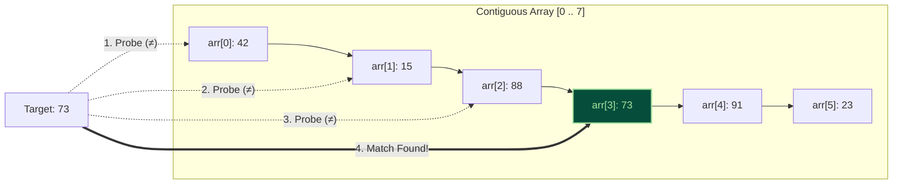
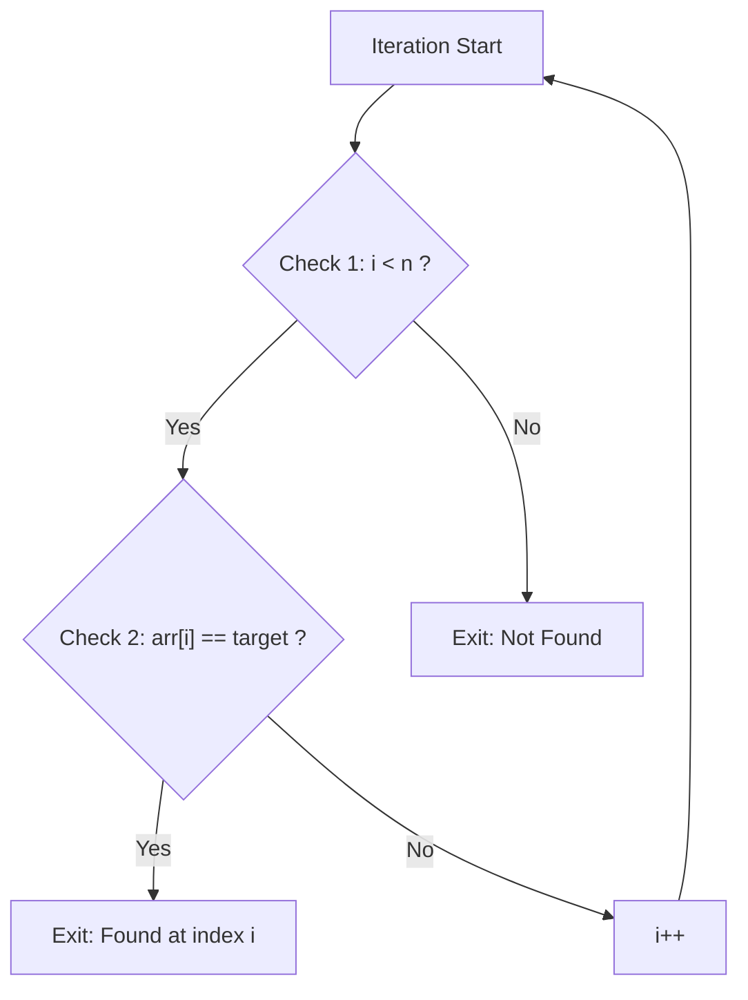
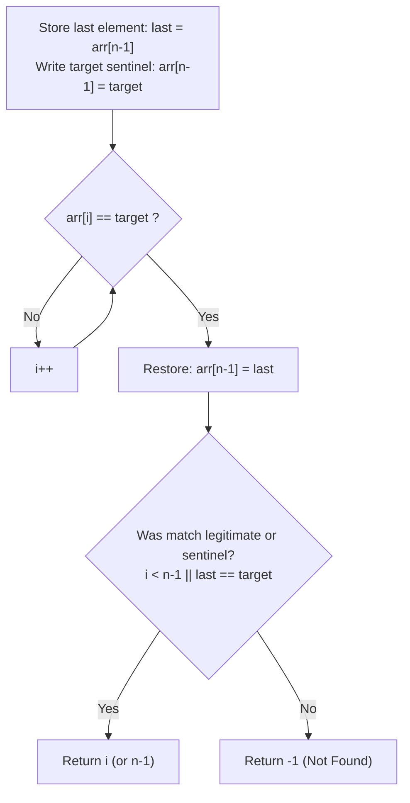

import { Callout } from "fumadocs-ui/components/callout";
import { Tabs, Tab } from "fumadocs-ui/components/tabs";
import { Steps, Step } from "fumadocs-ui/components/steps";
import { Cards, Card } from "fumadocs-ui/components/card";

## The Honest Sequential Scan

Linear Search is the most intuitive search strategy in computing. It makes no assumptions about the order of elements, requires no extra memory, and operates by sequentially inspecting each element from index $0$ to $N-1$ until a match is confirmed or the collection is exhausted.



While computer science courses often dismiss Linear Search as slow due to its $\mathcal{O}(N)$ worst-case time complexity, in real-world high-performance software engineering, **Linear Search is ubiquitous, highly optimized, and frequently faster than logarithmic searches for real-world array sizes**.

---

## Interactive Linear Search Simulator

Step through the linear search visualization below to observe how each element is inspected in sequence, tracking comparisons, index increments, and match verification.

<LinearSearchSimulator />

---

## Formal Complexity Analysis

Let $N$ be the number of elements in the collection:

| Metric                | Complexity       | Mathematical Derivation / Scenario                                                                                 |
| :-------------------- | :--------------- | :----------------------------------------------------------------------------------------------------------------- |
| **Best Case Time**    | $\mathcal{O}(1)$ | Target is located at index $0$. Requires exactly $1$ comparison.                                                   |
| **Average Case Time** | $\mathcal{O}(N)$ | Assuming target is uniformly distributed across indices: $\frac{1}{N} \sum_{i=1}^N i = \frac{N+1}{2}$ comparisons. |
| **Worst Case Time**   | $\mathcal{O}(N)$ | Target is at the very last index ($N-1$) or is absent from the array. Requires $N$ comparisons.                    |
| **Auxiliary Space**   | $\mathcal{O}(1)$ | Requires only a single loop counter index variable in CPU registers.                                               |

---

## Why Linear Search Wins in Production Systems

Why do performance-critical libraries like V8 (Chrome), the Linux Kernel, and LLVM frequently use Linear Search instead of Binary Search or Hash Tables?

### 1. Small Arrays ($N \le 32$ or $N \le 64$)

When an array fits within one or two 64-byte CPU cache lines (e.g., $16$ integers $\times 4$ bytes $= 64$ bytes), all data is loaded into the **L1 Data Cache** in a single DRAM cycle (~1 ns).

- **Linear Search**: Executes a tight loop iterating over contiguous memory. The CPU's hardware stream prefetcher keeps registers saturated, and the loop branch is predictably `False` until the end.
- **Binary Search**: Computes midpoints, incurs division/bit-shifts, and introduces unpredictable conditional branches (`arr[mid] < target`) that cause branch predictor pipeline stalls.

### 2. Unsorted, Write-Heavy Buffers

If a data structure experiences frequent insertions and deletions (such as an event queue, audio ring buffer, or transaction log), keeping the array sorted for Binary Search costs $\mathcal{O}(N)$ per insertion.

- If you perform few searches relative to insertions, keeping the array unsorted and using Linear Search is mathematically superior.

### 3. Non-Seekable Streaming Channels

When reading bytes from a network TCP socket, an operating system pipe, or a Kafka streaming partition, data cannot be randomly accessed by index. Linear single-pass scanning is the only physically possible algorithm.

### 4. SIMD Vectorization (AVX-512 / Neon)

Using hardware Single Instruction Multiple Data (SIMD) vector registers, modern CPUs can compare **16 32-bit integers in a single instruction**:

```c
// Conceptual AVX-512 SIMD search for 16 integers simultaneously:
__m512i target_vec = _mm512_set1_epi32(target);
__m512i data_vec   = _mm512_loadu_si512(&arr[i]);
__mmask16 mask     = _mm512_cmpeq_epi32_mask(target_vec, data_vec);
if (mask != 0) {
    // Match found within this 16-element block!
}
```

A SIMD-vectorized linear search checks 1,024 integers in just 64 CPU cycles!

---

## Loop Optimization: Sentinel Linear Search

In standard linear search, the inner loop executes **two conditional checks** per iteration:

1. `i < n` (Array boundary check to prevent out-of-bounds segfaults)
2. `arr[i] == target` (Element comparison)



### The Sentinel Optimization

By temporarily placing the target at the very end of the array (the "sentinel"), we guarantee that the search will always find the target before running out of bounds. This eliminates the `i < n` boundary check entirely:



For large arrays without SIMD, Sentinel Search cuts the total number of conditional branch instructions in half ($N$ comparisons instead of $2N$).

---

## Production Implementations

<Tabs items={["TypeScript", "Python"]}>
<Tab value="TypeScript">
```typescript
/**
 * Linear Search Implementation Suite
 */

export interface LinearSearchResult {
  index: number;
  found: boolean;
  comparisons: number;
}

/\*\*

- Standard Linear Search
- Finds the first index matching the target.
-
- @param arr Array of elements to search
- @param target Value to search for
- @returns LinearSearchResult with index, found status, and comparison count
  \*/
  export function linearSearch<T>(arr: readonly T[], target: T): LinearSearchResult {
  let comparisons = 0;

for (let i = 0; i < arr.length; i++) {
comparisons++;
if (arr[i] === target) {
return { index: i, found: true, comparisons };
}
}

return { index: -1, found: false, comparisons };
}

/\*\*

- Linear Search with Custom Predicate
- Useful for searching complex objects or lambda conditions.
  \*/
  export function linearSearchBy<T>(
  arr: readonly T[],
  predicate: (item: T, index: number) => boolean
  ): { index: number; found: boolean; value?: T } {
  for (let i = 0; i < arr.length; i++) {
  if (predicate(arr[i], i)) {
  return { index: i, found: true, value: arr[i] };
  }
  }
  return { index: -1, found: false };
  }

/\*\*

- Sentinel Linear Search
- Eliminates loop boundary checks for maximum throughput.
- Requires a mutable array buffer.
  \*/
  export function sentinelLinearSearch<T>(arr: T[], target: T): LinearSearchResult {
  const n = arr.length;
  if (n === 0) {
  return { index: -1, found: false, comparisons: 0 };
  }

const last = arr[n - 1];
let comparisons = 0;

// If the last element is already the target, return immediately
comparisons++;
if (last === target) {
return { index: n - 1, found: true, comparisons };
}

// Plant the sentinel at the end
arr[n - 1] = target;

let i = 0;
while (arr[i] !== target) {
comparisons++;
i++;
}

// Account for the loop terminating comparison
comparisons++;

// Restore the original value
arr[n - 1] = last;

if (i < n - 1) {
return { index: i, found: true, comparisons };
}

return { index: -1, found: false, comparisons };
}

/\*\*

- Find All Occurrences
- Collects all matching indices in a single sequential pass.
  \*/
  export function linearSearchAll<T>(arr: readonly T[], target: T): number[] {
  const indices: number[] = [];
  for (let i = 0; i < arr.length; i++) {
  if (arr[i] === target) {
  indices.push(i);
  }
  }
  return indices;
  }

````
</Tab>
<Tab value="Python">
```python
"""
Production Linear Search Module
Includes Standard, Sentinel, Predicate, and Multi-occurrence variants.
"""

from typing import TypeVar, Sequence, List, Callable, Optional, Tuple
from dataclasses import dataclass

T = TypeVar("T")

@dataclass(frozen=True)
class LinearSearchResult:
    index: int
    found: bool
    comparisons: int

def linear_search(arr: Sequence[T], target: T) -> LinearSearchResult:
    """
    Standard sequential linear search.

    Time: O(N) worst, O(1) best
    Space: O(1)
    """
    comparisons = 0
    for i, item in enumerate(arr):
        comparisons += 1
        if item == target:
            return LinearSearchResult(index=i, found=True, comparisons=comparisons)

    return LinearSearchResult(index=-1, found=False, comparisons=comparisons)

def sentinel_linear_search(arr: List[T], target: T) -> LinearSearchResult:
    """
    Sentinel Linear Search. Eliminates the loop index bounds check.

    NOTE: Requires a mutable list. Temporarily mutates arr[n-1] and restores it.
    """
    n = len(arr)
    if n == 0:
        return LinearSearchResult(index=-1, found=False, comparisons=0)

    last = arr[n - 1]
    comparisons = 1
    if last == target:
        return LinearSearchResult(index=n - 1, found=True, comparisons=comparisons)

    # Place sentinel
    arr[n - 1] = target

    i = 0
    while arr[i] != target:
        comparisons += 1
        i += 1
    comparisons += 1  # For the loop exit comparison

    # Restore original element
    arr[n - 1] = last

    if i < n - 1:
        return LinearSearchResult(index=i, found=True, comparisons=comparisons)
    return LinearSearchResult(index=-1, found=False, comparisons=comparisons)

def linear_search_by(
    arr: Sequence[T],
    predicate: Callable[[T], bool]
) -> Tuple[int, Optional[T]]:
    """Searches using a boolean predicate function."""
    for i, item in enumerate(arr):
        if predicate(item):
            return i, item
    return -1, None

def linear_search_all(arr: Sequence[T], target: T) -> List[int]:
    """Returns all indices where target appears."""
    return [i for i, item in enumerate(arr) if item == target]
````

</Tab>
</Tabs>

---

## Unit Testing & Edge Case Verification

<Tabs items={["TypeScript Tests", "Python Tests"]}>
<Tab value="TypeScript Tests">
```typescript
import { describe, it, expect } from "vitest";
import { linearSearch, sentinelLinearSearch, linearSearchAll } from "./linear-search";

describe("Linear Search Suite", () => {
it("finds target at the beginning (Best Case O(1))", () => {
const data = [10, 20, 30, 40];
const res = linearSearch(data, 10);
expect(res.found).toBe(true);
expect(res.index).toBe(0);
expect(res.comparisons).toBe(1);
});

it("finds target at the end (Worst Case O(N))", () => {
const data = [10, 20, 30, 40];
const res = linearSearch(data, 40);
expect(res.found).toBe(true);
expect(res.index).toBe(3);
expect(res.comparisons).toBe(4);
});

it("returns -1 when target is absent", () => {
const data = [10, 20, 30, 40];
const res = linearSearch(data, 99);
expect(res.found).toBe(false);
expect(res.index).toBe(-1);
expect(res.comparisons).toBe(4);
});

it("handles empty arrays gracefully", () => {
const res = linearSearch([], 42);
expect(res.found).toBe(false);
expect(res.index).toBe(-1);
expect(res.comparisons).toBe(0);
});

it("sentinel search matches standard search behavior exactly", () => {
const data = [5, 3, 8, 1, 9, 2];
const target = 1;
const standard = linearSearch(data, target);
const sentinel = sentinelLinearSearch([...data], target);

    expect(sentinel.found).toBe(standard.found);
    expect(sentinel.index).toBe(standard.index);

});

it("finds all duplicate occurrences", () => {
const duplicates = [7, 2, 7, 5, 7, 9];
expect(linearSearchAll(duplicates, 7)).toEqual([0, 2, 4]);
});
});

````
</Tab>
<Tab value="Python Tests">
```python
import pytest
from linear_search import linear_search, sentinel_linear_search, linear_search_all

def test_linear_search_found():
    data = [12, 45, 7, 89, 34]
    res = linear_search(data, 7)
    assert res.found is True
    assert res.index == 2
    assert res.comparisons == 3

def test_linear_search_not_found():
    data = [12, 45, 7, 89, 34]
    res = linear_search(data, 100)
    assert res.found is False
    assert res.index == -1
    assert res.comparisons == 5

def test_linear_search_empty():
    res = linear_search([], 5)
    assert res.found is False
    assert res.index == -1
    assert res.comparisons == 0

def test_sentinel_search():
    data = [10, 50, 30, 70, 90]
    # Found in middle
    res = sentinel_linear_search(data.copy(), 30)
    assert res.found is True
    assert res.index == 2

    # Found at last
    res_last = sentinel_linear_search(data.copy(), 90)
    assert res_last.found is True
    assert res_last.index == 4

    # Not found
    res_none = sentinel_linear_search(data.copy(), 999)
    assert res_none.found is False
    assert res_none.index == -1

def test_linear_search_all_duplicates():
    arr = [1, 2, 3, 2, 4, 2, 5]
    assert linear_search_all(arr, 2) == [1, 3, 5]
````

</Tab>
</Tabs>

---

## Next Steps

When arrays are sorted and contain more than a few dozen elements, we can exploit ordering to skip elements exponentially:

<Cards>
  <Card
    title="Binary Search"
    href="/docs/dsa/02-trees-heaps-and-core-patterns/searching-algorithms/binary-search"
    icon="Split"
    description="Halving the search space in O(log N) time, boundary conditions, and the historic integer overflow bug."
  />
  <Card
    title="Jump Search"
    href="/docs/dsa/02-trees-heaps-and-core-patterns/searching-algorithms/jump-search"
    icon="FastForward"
    description="Optimal block skipping by sqrt(N) for media where backwards seeks are expensive."
  />
</Cards>
