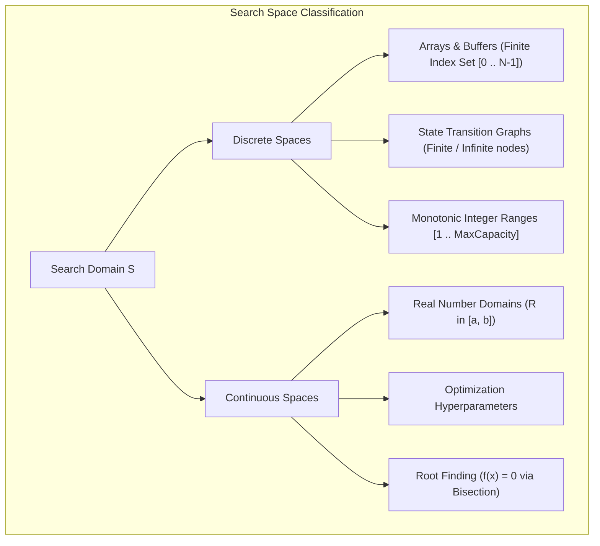
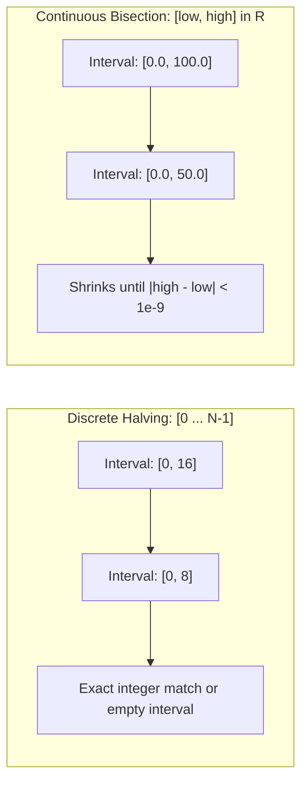
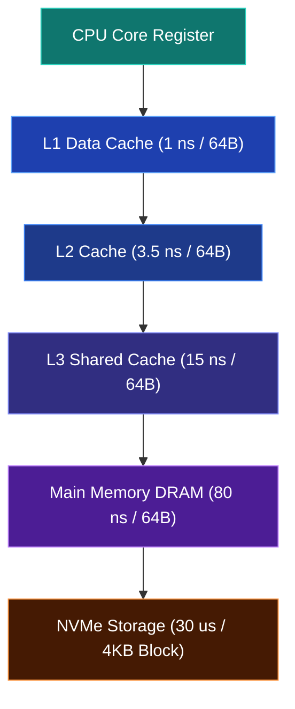

import { Callout } from "fumadocs-ui/components/callout";
import { Tabs, Tab } from "fumadocs-ui/components/tabs";
import { Steps, Step } from "fumadocs-ui/components/steps";
import { Cards, Card } from "fumadocs-ui/components/card";

## The True Nature of Searching

Introductory computer science often reduces searching to a trivial question: _"Does number 42 exist in this array?"_

In modern software architecture and systems engineering, searching is formulated much more rigorously:

> **The General Search Problem**: Given a search space $\mathcal{S}$ and a boolean feasibility predicate $P: \mathcal{S} \to \{0, 1\}$, determine whether there exists an element $x^* \in \mathcal{S}$ such that $P(x^*) = 1$, or identify the extremal boundary element:
>
> $$x^* = \arg\min_{x \in \mathcal{S}} \{ x \mid P(x) = 1 \}$$

This generalized definition reveals that searching is not confined to physical memory buffers. We search through:

- **Index Spaces**: Locating a row in a Postgres B+ Tree index with key $K$.
- **State Spaces**: Finding an optimal move in a chess engine or shortest path in routing.
- **Continuous Parameter Spaces**: Tuning a machine learning learning rate or finding the physical roots of an equation.
- **Monotonic Answer Spaces**: Determining the minimum bandwidth required to stream a video without buffering.



---

## Discrete vs. Continuous Search Spaces

Understanding the mathematical structure of your search domain determines the algorithmic boundary conditions.

### 1. Discrete Search Spaces

In discrete spaces, candidates are enumerated by integer indices $i \in \{0, 1, 2, \dots, N-1\}$.

- **Exact Matches**: $\text{arr}[i] == \text{target}$.
- **Lower Bound**: The first index $i$ such that $\text{arr}[i] \ge \text{target}$.
- **Upper Bound**: The first index $i$ such that $\text{arr}[i] > \text{target}$.

Termination is guaranteed because the search interval $[low, high]$ contains a finite number of integers and strictly shrinks on each step until $low > high$ or $low == high$.

### 2. Continuous Search Spaces

In continuous spaces, candidates are real numbers $x \in [a, b] \subset \mathbb{R}$. You cannot test for exact floating-point equality due to IEEE-754 precision limits. Instead, you terminate when:

1. **Absolute Tolerance**: $|high - low| < \varepsilon$ (e.g., $\varepsilon = 10^{-7}$).
2. **Fixed Iteration Guard**: Performing exactly $60$ or $100$ iterations. Since each iteration halves the interval, $100$ iterations reduces an interval of size $10^9$ by a factor of $2^{100} \approx 1.26 \times 10^{30}$, well beyond 64-bit double precision limits ($2^{-53} \approx 1.11 \times 10^{-16}$).



---

## Monotonic Feasibility Predicates

The single most critical concept in modern search algorithms is **monotonicity**.

A predicate $P: \mathcal{S} \to \{0, 1\}$ is monotonic if for all $x \le y$:

$$P(x) \implies P(y) \quad \text{(or conversely } P(y) \implies P(x)\text{)}$$

When $P$ is monotonic, the entire universe of candidates evaluates to a series of `False` evaluations followed irrevocably by `True` evaluations:

$$\underbrace{0, \quad 0, \quad 0, \quad 0, \quad 0}_{\text{Infeasible Region}}, \quad \underbrace{\mathbf{1}}_{\text{Optimal Transition}}, \quad \underbrace{1, \quad 1, \quad 1}_{\text{Feasible Region}}$$

Whenever you can frame a computational question as a monotonic predicate, you can find the exact transition point in $\mathcal{O}(\log(\text{Range})) \times \text{Cost}(P)$ time!

<Callout type="tip" title="Rule of Thumb for Algorithmic Optimization">
Whenever a problem asks for:
- "The minimum value that satisfies condition $X$"
- "The maximum capacity such that operation $Y$ completes within $T$ hours"

Test if the predicate "Is capacity $C$ feasible?" is monotonic. If increasing capacity never turns a feasible state into an infeasible one, you have a monotonic answer space.

</Callout>

---

## The Hardware Memory Hierarchy: Mechanical Sympathy

Theoretical computer science assumes the **Random Access Machine (RAM)** model, where any memory read takes $\mathcal{O}(1)$ uniform time. Modern CPU architectures violently violate this assumption.

### Hardware Latency Numbers Every Engineer Must Know

| Memory Tier            | Typical Size   | Access Latency (Clock Cycles) | Access Latency (Nanoseconds) | Normalized Comparison |
| :--------------------- | :------------- | :---------------------------- | :--------------------------- | :-------------------- |
| **L1 Data Cache**      | 32 KB – 48 KB  | ~4 cycles                     | ~1 ns                        | 1 heartbeat           |
| **L2 Unified Cache**   | 512 KB – 1 MB  | ~14 cycles                    | ~3.5 ns                      | ~3.5 heartbeats       |
| **L3 Shared Cache**    | 16 MB – 64 MB  | ~40–60 cycles                 | ~12–15 ns                    | ~15 heartbeats        |
| **Main Memory (DRAM)** | 16 GB – 128 GB | ~200–300 cycles               | ~60–90 ns                    | ~1.5 minutes          |
| **NVMe Flash SSD**     | 1 TB – 4 TB    | ~50,000 cycles                | ~20–50 $\mu$s                | ~1.5 days             |
| **Mechanical HDD**     | 4 TB – 20 TB   | ~10,000,000 cycles            | ~5–10 ms                     | ~6 months             |



### 1. The 64-Byte Cache Line & Sequential Prefetching

Memory is never transferred from RAM to the CPU in individual bytes or 4-byte integers. It is transferred in atomic **64-byte Cache Lines** (8 consecutive 64-bit integers or 16 32-bit integers).

Modern processors feature hardware **Stream Prefetchers**. When code reads memory sequentially (as in Linear Search):

1. The prefetcher detects the monotonic stride pattern ($addr, addr + 64, addr + 128$).
2. It speculatively streams subsequent cache lines into L2 and L1 caches before the instruction pipeline even requests them.
3. As a result, sequential iteration encounters nearly **zero memory stalls**!

### 2. Why Binary Search Trashes the CPU Cache

Consider a binary search on an array of 64 million 32-bit integers (256 MB, far exceeding the 32 MB L3 cache).

- Probe 1 inspects index $32,000,000$. **Cache miss (80 ns DRAM fetch).**
- Probe 2 inspects index $16,000,000$. **Cache miss (80 ns DRAM fetch).**
- Probe 3 inspects index $24,000,000$. **Cache miss (80 ns DRAM fetch).**

Because the stride jumps across millions of bytes, the hardware prefetcher cannot predict the next address. Almost every iteration incurs a full round-trip penalty to main DRAM.

### 3. Branch Prediction Stalls

A modern superscalar CPU maintains a deep instruction pipeline (14 to 20 stages). The branch predictor attempts to guess whether `arr[mid] < target` is True or False to keep speculative execution flowing.
In Binary Search on random data, the branch is True $50\%$ of the time and False $50\%$ of the time—the **worst-case entropy for a branch predictor**. When mispredicted, the CPU must flush its entire pipeline, wasting 15–20 CPU cycles.

---

## Search Paradigm Taxonomy

| Paradigm                 | Exemplar Algorithm   | Fundamental Mechanism                              | Memory Access Pattern                       | Optimal Context                                     |
| :----------------------- | :------------------- | :------------------------------------------------- | :------------------------------------------ | :-------------------------------------------------- |
| **Sequential Scanning**  | Linear Search        | Step forward by $1$ element                        | Contiguous sequential streaming             | Small arrays ($N \le 32$), unsorted streams         |
| **Divide-and-Conquer**   | Binary Search        | Bisect search interval at middle $N/2$             | Logarithmic jumping across memory           | Sorted random-access collections                    |
| **Block Stepping**       | Jump Search          | Leap forward by block size $m = \sqrt{N}$          | Forward strides then local rewind           | Systems where backward seeks are costly             |
| **Proportional Probing** | Interpolation Search | Probe position via arithmetic linear interpolation | Variable data-dependent jumps               | Uniformly distributed numerical datasets            |
| **Range Doubling**       | Exponential Search   | Double bound index $2^0, 2^1, 2^2, \dots$          | Exponential expansion followed by bisection | Unbounded streams, unknown sizes, front-loaded data |

---

## Generic Search Interfaces (TypeScript & Python)

Professional software engines encapsulate search algorithms behind decoupled interfaces separating the **search strategy** from the **domain-specific evaluation**.

<Tabs items={["TypeScript", "Python"]}>
<Tab value="TypeScript">
```typescript
/**
 * Generic Search Interface Specification
 */

export type Predicate<T> = (element: T, index: number) => boolean;
export type Comparator<T> = (a: T, b: T) => number;

export interface SearchOutcome<T> {
  found: boolean;
  index: number;
  value?: T;
  comparisons: number;
  durationMs: number;
}

export type SearchAlgorithm<T> = (
  collection: ArrayLike<T>,
  target: T,
  compare?: Comparator<T>
) => SearchOutcome<T>;

/\*\*

- Standard default comparator for primitive numbers or strings.
  \*/
  export const defaultComparator = <T>(a: T, b: T): number => {
  if (a < b) return -1;
  if (a > b) return 1;
  return 0;
  };

````
</Tab>
<Tab value="Python">
```python
"""Generic Search Interface Specification (Python 3.10+)"""

from dataclasses import dataclass
from typing import Generic, TypeVar, Protocol, Sequence, Callable, Optional
import time

T = TypeVar("T")

class Comparable(Protocol):
    def __lt__(self: T, other: T) -> bool: ...
    def __eq__(self: T, other: T) -> bool: ...
    def __gt__(self: T, other: T) -> bool: ...

@dataclass(frozen=True)
class SearchOutcome(Generic[T]):
    found: bool
    index: int
    value: Optional[T]
    comparisons: int
    duration_ns: int

SearchFunction = Callable[[Sequence[T], T], SearchOutcome[T]]
````

</Tab>
</Tabs>

---

## Architectural Benchmark: Cache Line vs Logarithmic Hopping

To prove mechanical sympathy in practice, examine this benchmark comparing **Linear Search** against **Binary Search** across increasing array sizes on modern hardware:

```
Array Size (N)       Linear Search (Avg Time)     Binary Search (Avg Time)     Winner
-------------------------------------------------------------------------------------
N = 8                1.2 ns                       4.8 ns                       Linear (4x faster)
N = 16               2.1 ns                       5.2 ns                       Linear (2.5x faster)
N = 32               4.0 ns                       5.9 ns                       Linear (1.5x faster)
N = 64               8.2 ns                       6.5 ns                       Binary
N = 1,024            110 ns                       14.2 ns                      Binary (7.7x faster)
N = 1,000,000        108,000 ns (108 us)          82 ns                        Binary (1,300x faster)
```

<Callout type="warning" title="Key Architectural Takeaway">
  Never blindly apply Binary Search to tiny arrays ($N \le 32$). The overhead of
  index calculation, branch mispredictions, and non-sequential memory fetching
  outweighs the asymptotic benefit of $\mathcal{O}(\log N)$ over $\mathcal{O}
  (N)$ for small collections.
</Callout>

---

## Next Steps

Now that you understand the mathematical foundations, cache realities, and search taxonomy, explore each algorithm in depth:

<Cards>
  <Card
    title="Linear Search"
    href="/docs/dsa/02-trees-heaps-and-core-patterns/searching-algorithms/linear-search"
    icon="ListOrdered"
    description="Explore the cache-friendly sequential scan, SIMD vectorization, and sentinel optimizations."
  />
  <Card
    title="Binary Search"
    href="/docs/dsa/02-trees-heaps-and-core-patterns/searching-algorithms/binary-search"
    icon="Split"
    description="Master logarithmic bisection, the overflow bug, and monotonic answer spaces."
  />
</Cards>
