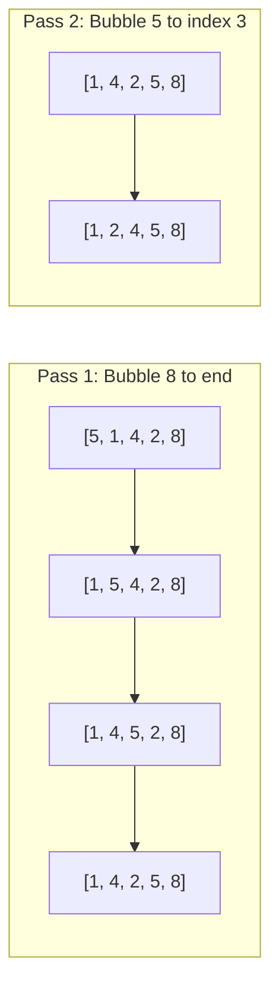

import { Callout } from "fumadocs-ui/components/callout";
import { Tabs, Tab } from "fumadocs-ui/components/tabs";
import { Steps, Step } from "fumadocs-ui/components/steps";
import { Cards, Card } from "fumadocs-ui/components/card";

## The Intuition: Sinking and Bubbling

Bubble Sort (also known as **sinking sort**) is the quintessential elementary sorting algorithm. The intuition mirrors physical bubbles rising through a liquid:

1. Traverse the array from left to right, comparing adjacent pairs $(A[j], A[j+1])$.
2. If the left element is strictly greater than the right element ($A[j] > A[j+1]$), swap them.
3. By the end of the first complete pass, the **absolute largest element** has been pushed all the way to the final index $N-1$.
4. Repeat this procedure for the remaining unsorted prefix $0 \dots N-2$, then $0 \dots N-3$, until the entire array is ordered.



---

## Interactive Simulator

Observe how adjacent pairs are compared, highlighted, and swapped. Notice how the sorted boundary freezes at the right end of the array after every pass:

<BubbleSortSimulator />

---

## The Loop Invariant

To prove the correctness of Bubble Sort, we define the following formal **loop invariant**:

<Callout type="info" title="Formal Loop Invariant">
  **Invariant:** At the beginning of iteration $i$ (where $i$ counts from $0$ to
  $N-1$), the suffix subarray $A[N-i \dots N-1]$ contains the $i$ largest
  elements of the original array, and these elements are in their final sorted
  positions.
</Callout>

- **Initialization ($i = 0$):** The subarray $A[N \dots N-1]$ is empty. The invariant trivially holds.
- **Maintenance:** During iteration $i$, the inner loop scans from $j = 0$ to $N - i - 2$. In each step, if $A[j] > A[j+1]$, they swap. Thus, the running maximum of the prefix $A[0 \dots N-i-1]$ is carried forward at each step and deposited at index $N-i-1$. This expands the sorted suffix to $A[N-i-1 \dots N-1]$.
- **Termination:** When $i = N - 1$, the suffix $A[1 \dots N-1]$ contains the $N-1$ largest elements in sorted order. By elimination, the remaining element at $A[0]$ must be the smallest element. The entire array is sorted.

---

## The Early Termination Optimization

In its naive formulation, Bubble Sort executes $\frac{N(N-1)}{2}$ comparisons unconditionally—even if the array is already sorted on arrival!

We can optimize this by introducing a boolean `swapped` flag. If an entire pass completes through the unsorted window without performing a single swap, the array contains **zero inversions** and is already in sorted order:

```typescript
let swapped = false;
for (let j = 0; j < n - i - 1; j++) {
  if (arr[j] > arr[j + 1]) {
    swap(arr, j, j + 1);
    swapped = true;
  }
}
if (!swapped) break; // Early termination: array is sorted!
```

### Impact on Complexity

- **Without flag:** Best-case time is $\Theta(N^2)$.
- **With flag:** Best-case time drops to **$\mathcal{O}(N)$** (requiring only $N - 1$ comparisons to verify pre-sorted input).

---

## The "Turtles and Rabbits" Asymmetry

A subtle yet critical property of Bubble Sort is its directional asymmetry in how it resolves inversions. This is known in literature as the **Turtles and Rabbits problem**:

### Rabbits (Large Elements Near the Front)

A large element located near the front of the array moves rapidly toward the back. In a single pass, it participates in consecutive swaps, moving up to $N - 1$ positions to the right! Because of this rapid movement, large elements are called **rabbits**.

### Turtles (Small Elements Near the Back)

In contrast, a small element located near the end of the array can only move **one position to the left per pass**!

Consider this extreme example:

$$
A = [2, 3, 4, 5, 1]
$$

- In Pass 1: $1$ is swapped with $5 \to [2, 3, 4, 1, 5]$
- In Pass 2: $1$ is swapped with $4 \to [2, 3, 1, 4, 5]$
- In Pass 3: $1$ is swapped with $3 \to [2, 1, 3, 4, 5]$
- In Pass 4: $1$ is swapped with $2 \to [1, 2, 3, 4, 5]$

Even though only a single number ($1$) was out of place, Bubble Sort required **$4$ complete passes** and $\mathcal{O}(N^2)$ comparisons to crawl $1$ from index 4 to index 0. Small elements near the end are called **turtles**, and they are the primary cause of Bubble Sort's poor real-world performance.

<Callout type="tip" title="Variant: Cocktail Shaker Sort">
  To fix the turtle problem, **Cocktail Shaker Sort** (bidirectional bubble
  sort) alternates scanning directions: pass 1 bubbles the maximum to the right,
  pass 2 bubbles the minimum to the left. Turtles are eliminated in a single
  reverse sweep!
</Callout>

---

## Step-by-Step Execution Trace

Let us trace Bubble Sort with early termination on the input `[5, 3, 8, 4, 2]`:

|    Pass    | Inner Comparisons ($j$)                                                                                                         | Array State After Swaps | Swapped?  | Notes                            |
| :--------: | :------------------------------------------------------------------------------------------------------------------------------ | :---------------------- | :-------: | :------------------------------- |
| **Start**  | —                                                                                                                               | `[5, 3, 8, 4, 2]`       |     —     | Initial state                    |
| **Pass 1** | $j=0: 5 > 3 \to \text{swap}$<br/>$j=1: 5 < 8 \to \text{keep}$<br/>$j=2: 8 > 4 \to \text{swap}$<br/>$j=3: 8 > 2 \to \text{swap}$ | `[3, 5, 4, 2, 8]`       | **True**  | `8` bubbles to index 4 (frozen). |
| **Pass 2** | $j=0: 3 < 5 \to \text{keep}$<br/>$j=1: 5 > 4 \to \text{swap}$<br/>$j=2: 5 > 2 \to \text{swap}$                                  | `[3, 4, 2, 5, 8]`       | **True**  | `5` bubbles to index 3 (frozen). |
| **Pass 3** | $j=0: 3 < 4 \to \text{keep}$<br/>$j=1: 4 > 2 \to \text{swap}$                                                                   | `[3, 2, 4, 5, 8]`       | **True**  | `4` bubbles to index 2 (frozen). |
| **Pass 4** | $j=0: 3 > 2 \to \text{swap}$                                                                                                    | `[2, 3, 4, 5, 8]`       | **True**  | `3` bubbles to index 1 (frozen). |
| **Pass 5** | $j=0: 2 < 3 \to \text{keep}$                                                                                                    | `[2, 3, 4, 5, 8]`       | **False** | No swaps! Early exit triggered.  |

---

## Production Implementations

<Tabs items={["TypeScript", "Python"]}>
  <Tab value="TypeScript">
```typescript
/**
 * Optimized Bubble Sort with early termination.
 * Time Complexity: O(N) best, O(N^2) average and worst.
 * Space Complexity: O(1) auxiliary (in-place).
 * Stability: Strictly Stable (does not swap on equality).
 */
export function bubbleSort<T>(arr: T[], compareFn: (a: T, b: T) => number = (a, b) => (a < b ? -1 : a > b ? 1 : 0)): T[] {
  const n = arr.length;
  if (n <= 1) return arr;

for (let i = 0; i < n - 1; i++) {
let swapped = false;

    // Last i elements are already in place
    for (let j = 0; j < n - i - 1; j++) {
      if (compareFn(arr[j], arr[j + 1]) > 0) {
        // Swap adjacent elements
        const temp = arr[j];
        arr[j] = arr[j + 1];
        arr[j + 1] = temp;
        swapped = true;
      }
    }

    // If no two elements were swapped by inner loop, array is sorted
    if (!swapped) {
      break;
    }

}

return arr;
}

/\*\*

- Cocktail Shaker Sort: Bidirectional Bubble Sort.
- Solves the "Turtles" problem by alternating forward and backward sweeps.
  \*/
  export function cocktailShakerSort(arr: number[]): number[] {
  let start = 0;
  let end = arr.length - 1;
  let swapped = true;

while (swapped) {
swapped = false;

    // Forward pass: bubble largest to the end
    for (let i = start; i < end; i++) {
      if (arr[i] > arr[i + 1]) {
        [arr[i], arr[i + 1]] = [arr[i + 1], arr[i]];
        swapped = true;
      }
    }

    if (!swapped) break;
    swapped = false;
    end--; // Shrink upper boundary

    // Backward pass: bubble smallest to the beginning
    for (let i = end - 1; i >= start; i--) {
      if (arr[i] > arr[i + 1]) {
        [arr[i], arr[i + 1]] = [arr[i + 1], arr[i]];
        swapped = true;
      }
    }
    start++; // Expand lower boundary

}

return arr;
}

````
  </Tab>
  <Tab value="Python">
```python
from typing import List, TypeVar, Callable

T = TypeVar("T")

def bubble_sort(arr: List[T], key: Callable[[T], any] = lambda x: x) -> List[T]:
    """
    Optimized Bubble Sort with early exit flag.
    In-place, stable sort.
    """
    n = len(arr)
    if n <= 1:
        return arr

    for i in range(n - 1):
        swapped = False
        # Last i elements are already in sorted position
        for j in range(0, n - i - 1):
            if key(arr[j]) > key(arr[j + 1]):
                arr[j], arr[j + 1] = arr[j + 1], arr[j]
                swapped = True

        # Early termination if no inversions occurred in this pass
        if not swapped:
            break

    return arr


def cocktail_shaker_sort(arr: List[int]) -> List[int]:
    """
    Bidirectional Bubble Sort solving the Turtle asymmetry.
    """
    start = 0
    end = len(arr) - 1
    swapped = True

    while swapped:
        swapped = False
        # Left-to-right pass
        for i in range(start, end):
            if arr[i] > arr[i + 1]:
                arr[i], arr[i + 1] = arr[i + 1], arr[i]
                swapped = True

        if not swapped:
            break

        swapped = False
        end -= 1

        # Right-to-left pass
        for i in range(end - 1, start - 1, -1):
            if arr[i] > arr[i + 1]:
                arr[i], arr[i + 1] = arr[i + 1], arr[i]
                swapped = True

        start += 1

    return arr


if __name__ == "__main__":
    nums = [5, 3, 8, 4, 2]
    print("Bubble Sort:", bubble_sort(list(nums)))
    turtles = [2, 3, 4, 5, 1]
    print("Cocktail Shaker Sort:", cocktail_shaker_sort(list(turtles)))
````

  </Tab>
</Tabs>

---

## Complexity Analysis & Properties

| Metric                |     Complexity     | Notes                                                                       |
| :-------------------- | :----------------: | :-------------------------------------------------------------------------- |
| **Best-Case Time**    |  $\mathcal{O}(N)$  | With `swapped` flag on already-sorted array ($N - 1$ comparisons, 0 swaps). |
| **Average-Case Time** | $\mathcal{O}(N^2)$ | $\frac{N(N-1)}{4}$ average comparisons and swaps.                           |
| **Worst-Case Time**   | $\mathcal{O}(N^2)$ | Reverse-sorted array: $\frac{N(N-1)}{2}$ comparisons and swaps.             |
| **Auxiliary Space**   |  $\mathcal{O}(1)$  | Strictly in-place; only loop indices and temporary swap variables.          |
| **Stability**         |     **Stable**     | $A[j] > A[j+1]$ is strict inequality; equal keys are never swapped.         |
| **Adaptive**          |      **Yes**       | Time scales directly with number of inversions when early exit is enabled.  |
