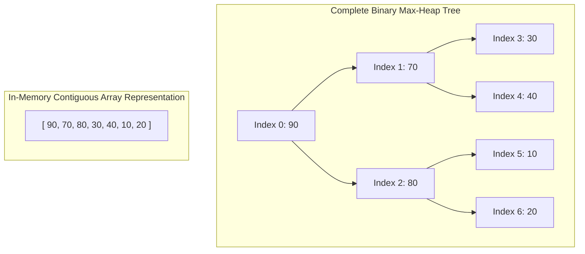
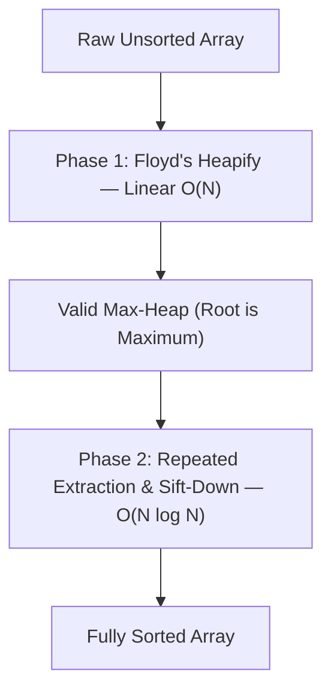
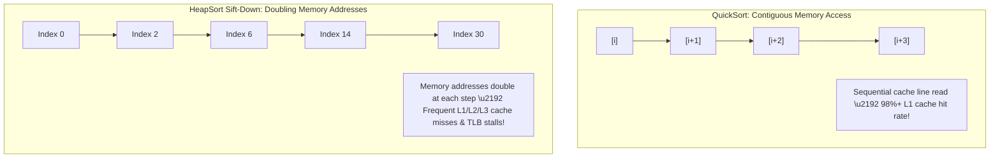

import { Callout } from "fumadocs-ui/components/callout";
import { Tabs, Tab } from "fumadocs-ui/components/tabs";
import { Steps, Step } from "fumadocs-ui/components/steps";
import { Cards, Card } from "fumadocs-ui/components/card";

## The In-Place Priority Tree Sort

Invented by J. W. J. Williams in 1964 and refined by Robert W. Floyd, **HeapSort** combines the best theoretical guarantees of both worlds:

1. **Time Guarantee:** Strictly $\mathcal{O}(N \log N)$ worst-case running time (like Merge Sort).
2. **Space Guarantee:** Strictly $\mathcal{O}(1)$ auxiliary memory (like Selection Sort).

HeapSort conceptualizes the flat array as an **implicit complete binary tree**, where parent-child relationships are calculated using fast integer arithmetic:

$$
\text{Parent}(i) = \left\lfloor \frac{i - 1}{2} \right\rfloor, \quad \text{Left}(i) = 2i + 1, \quad \text{Right}(i) = 2i + 2
$$



---

## Interactive Simulator

Observe how the array is first transformed into a Max-Heap (heapification), followed by repeated root-extraction and sift-down cycles:

<HeapSortSimulator />

---

## The Two Distinct Phases

HeapSort executes in two consecutive, mathematically distinct phases:



### Phase 1: Floyd's Linear $\mathcal{O}(N)$ Heapify

A common misconception is that building a heap of $N$ elements takes $\mathcal{O}(N \log N)$ time (as if inserting elements one by one with `sift_up`).

Floyd observed that we can build a heap **bottom-up**:

1. All leaf nodes (nodes from index $\lfloor N/2 \rfloor$ to $N - 1$) already satisfy the heap property because they have no children.
2. We iterate backwards from the last non-leaf node, $\lfloor N/2 \rfloor - 1$, down to the root index $0$.
3. At each node, we execute `sift_down`, bubbling smaller values down the tree.

#### The Mathematical Proof of $\mathcal{O}(N)$ Heap Construction

In a complete binary tree of height $H \approx \log_2 N$:

- Level $0$ (leaves) has $\approx \frac{N}{2}$ nodes, each doing $0$ sift-down steps.
- Level $1$ has $\approx \frac{N}{4}$ nodes, each doing at most $1$ sift-down step.
- Level $h$ has $\approx \frac{N}{2^{h+1}}$ nodes, each doing at most $h$ sift-down steps.

The total number of operations $S$ is:

$$
S = \sum_{h=0}^{\lfloor \log_2 N \rfloor} \frac{N}{2^{h+1}} \cdot h = \frac{N}{2} \sum_{h=0}^\infty \frac{h}{2^h}
$$

The infinite arithmetico-geometric series $\sum_{h=0}^\infty \frac{h}{2^h}$ converges exactly to:

$$
\sum_{h=0}^\infty \frac{h}{2^h} = \frac{1/2}{(1 - 1/2)^2} = \frac{1/2}{1/4} = 2
$$

Substituting back:

$$
S = \frac{N}{2} \times 2 = N = \Theta(N)
$$

<Callout type="info" title="Takeaway">
  Building an entire Max-Heap of any size takes strictly **linear $\mathcal{O}
  (N)$ time**.
</Callout>

---

### Phase 2: Extraction & In-Place Sifting

Once the array is a valid Max-Heap:

1. The largest element resides at index $0$ (`root`).
2. Swap $A[0]$ with the last element of the active heap window $A[\text{size}-1]$.
3. Decrement the active heap window size by 1. The element at $A[\text{size}-1]$ is now permanently sorted!
4. The new root violates the max-heap invariant. Call `sift_down(0)` on the reduced heap window of size $N - 1$, taking $\mathcal{O}(\log N)$ time.
5. Repeat until the heap window shrinks to size $1$.

Total time for Phase 2:

$$
\sum_{i=1}^{N-1} \mathcal{O}(\log i) = \mathcal{O}(\log(N!)) = \Theta(N \log N)
$$

---

## Why HeapSort Guarantees Absolute Reliability

HeapSort is the sorting algorithm of choice when system constraints forbid failure:

<Callout type="tip" title="Production Champion: Linux Kernel sort.c">
  The Linux kernel implements HeapSort for its universal in-kernel `sort()`
  function (`lib/sort.c`): - **Zero Stack Recursion:** It executes using
  iterative loops, requiring zero function call frames. In kernel space where
  thread stack limits are strictly $8\text{KB}$ or $16\text{KB}$, QuickSort's
  recursive call stack poses a critical risk of kernel stack overflow. - **Zero
  Dynamic Allocation:** It runs in $\mathcal{O}(1)$ auxiliary space without
  calling `kmalloc`. It can sort successfully even when the system is completely
  out of memory. - **Strictly Worst-Case Bounded:** Worst-case execution time is
  strictly $\mathcal{O}(N \log N)$. Adversarial attackers cannot supply an
  anti-quicksort degenerate array to trigger quadratic CPU hangs.
</Callout>

---

## The Modern Hardware Paradox: Why QuickSort Outperforms HeapSort

If HeapSort has guaranteed $\mathcal{O}(N \log N)$ worst-case and $\mathcal{O}(1)$ auxiliary memory, why do general-purpose user-space runtimes (C++, Python, Java) default to QuickSort or TimSort?

The reason is **memory access patterns and CPU cache locality**:



### The Sift-Down Memory Penalty

When sifting down a node at index $i$:

1. The left child is at $2i + 1$.
2. The next child is at $2(2i + 1) + 1 \approx 4i$.
3. The next child is at $\approx 8i$.

At each step down the tree, the memory address **doubles**! As soon as the heap size exceeds the L1/L2 cache size (a few megabytes), almost every single child inspection requires fetching a completely new cache line from DRAM ($60\text{--}100\text{ ns}$ delay).

QuickSort, by contrast, scans sequentially through contiguous memory blocks. Hardware prefetchers effortlessly anticipate the sequential access pattern, making QuickSort **$2\times$ to $4\times$ faster in actual wall-clock execution time** on modern 64-bit multi-core processors.

---

## Production Implementations

<Tabs items={["TypeScript", "Python"]}>
  <Tab value="TypeScript">
```typescript
/**
 * In-Place HeapSort with zero auxiliary memory.
 * Time Complexity: O(N log N) guaranteed in best, average, worst.
 * Auxiliary Space: O(1) in-place.
 * Stability: Unstable.
 */
export function heapSort<T>(
  arr: T[],
  compareFn: (a: T, b: T) => number = (a, b) => (a < b ? -1 : a > b ? 1 : 0)
): T[] {
  const n = arr.length;
  if (n <= 1) return arr;

function swap(i: number, j: number): void {
const temp = arr[i];
arr[i] = arr[j];
arr[j] = temp;
}

// Sifts down element at index 'root' within active heap window of size 'heapSize'
function siftDown(root: number, heapSize: number): void {
let curr = root;

    while (true) {
      const left = 2 * curr + 1;
      const right = 2 * curr + 2;
      let largest = curr;

      if (left < heapSize && compareFn(arr[left], arr[largest]) > 0) {
        largest = left;
      }
      if (right < heapSize && compareFn(arr[right], arr[largest]) > 0) {
        largest = right;
      }

      if (largest === curr) {
        break; // Max-heap property satisfied
      }

      swap(curr, largest);
      curr = largest;
    }

}

// Phase 1: Build Max-Heap using Floyd's bottom-up linear heapify: O(N)
// Last non-leaf node is at index Math.floor(n / 2) - 1
for (let i = Math.floor(n / 2) - 1; i >= 0; i--) {
siftDown(i, n);
}

// Phase 2: Extract maximum one-by-one: O(N log N)
for (let activeSize = n - 1; activeSize > 0; activeSize--) {
// Swap root (maximum) to end of active heap window
swap(0, activeSize);

    // Sift down new root within the reduced heap window
    siftDown(0, activeSize);

}

return arr;
}

````
  </Tab>
  <Tab value="Python">
```python
from typing import List, TypeVar, Callable

T = TypeVar("T")

def heap_sort(arr: List[T], key: Callable[[T], any] = lambda x: x) -> List[T]:
    """
    In-place HeapSort with strictly O(1) auxiliary space and O(N log N) guaranteed time.
    """
    n = len(arr)
    if n <= 1:
        return arr

    def sift_down(root: int, heap_size: int):
        curr = root
        while True:
            left = 2 * curr + 1
            right = 2 * curr + 2
            largest = curr

            if left < heap_size and key(arr[left]) > key(arr[largest]):
                largest = left
            if right < heap_size and key(arr[right]) > key(arr[largest]):
                largest = right

            if largest == curr:
                break

            arr[curr], arr[largest] = arr[largest], arr[curr]
            curr = largest

    # Phase 1: Floyd's Linear Bottom-Up Heapify O(N)
    for i in range(n // 2 - 1, -1, -1):
        sift_down(i, n)

    # Phase 2: Successive Extraction and Sift-Down O(N log N)
    for active_size in range(n - 1, 0, -1):
        arr[0], arr[active_size] = arr[active_size], arr[0]
        sift_down(0, active_size)

    return arr


if __name__ == "__main__":
    nums = [12, 11, 13, 5, 6, 7]
    print("Heap Sorted:", heap_sort(list(nums)))
````

  </Tab>
</Tabs>

---

## Technical Summary

| Dimension                  |   Specification    | Notes                                                              |
| :------------------------- | :----------------: | :----------------------------------------------------------------- |
| **Phase 1 Time (Heapify)** |    $\Theta(N)$     | Floyd's bottom-up finite series convergence.                       |
| **Phase 2 Time (Extract)** | $\Theta(N \log N)$ | $N - 1$ extractions with logarithmic sift-downs.                   |
| **Total Worst-Case Time**  | $\Theta(N \log N)$ | Immune to degenerate data or malicious anti-quicksort payloads.    |
| **Auxiliary Space**        |  $\mathcal{O}(1)$  | Pure in-place index manipulation; zero recursion stack.            |
| **Stability**              |    **Unstable**    | Swapping root to end destroys relative ordering of equal keys.     |
| **Cache Friendliness**     |        Low         | Address-doubling during child lookups causes frequent DRAM stalls. |
