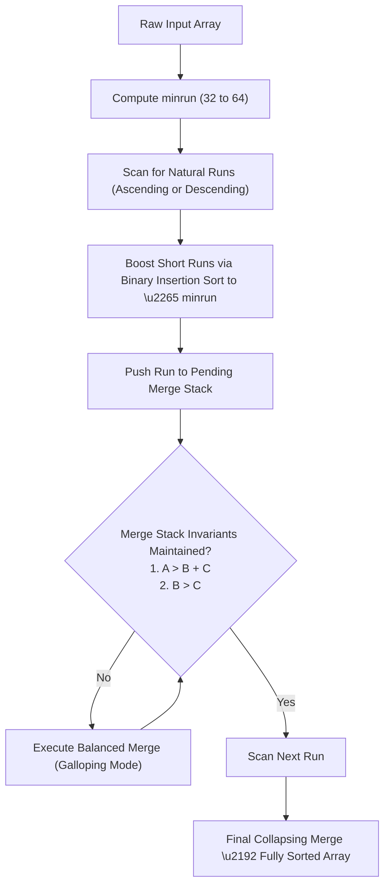
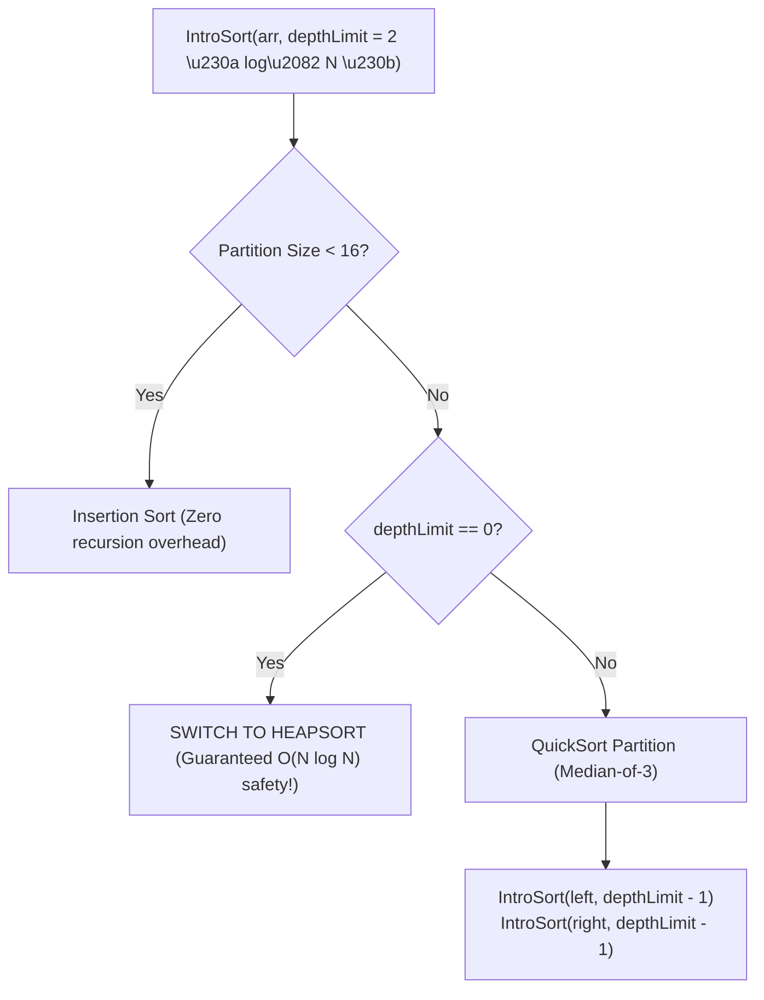
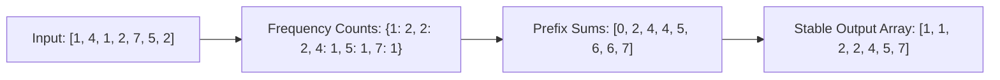

import { Callout } from "fumadocs-ui/components/callout";
import { Tabs, Tab } from "fumadocs-ui/components/tabs";
import { Steps, Step } from "fumadocs-ui/components/steps";
import { Cards, Card } from "fumadocs-ui/components/card";

## Beyond Textbook Algorithms

Textbook algorithms like QuickSort, MergeSort, and HeapSort provide theoretical clarity, but none of them are used in their pure, unadulterated form inside modern software runtime engines. Real-world systems run on two specialized paradigms:

1. **Industrial Hybrids (Adaptive Comparison Sorts):** Combine the best aspects of QuickSort, MergeSort, HeapSort, and InsertionSort to achieve maximum hardware speed, strict stability, and guaranteed worst-case bounds.
2. **Linear Non-Comparison Sorts:** Bypass the $\Omega(N \log N)$ lower bound entirely by interpreting keys as numeric digits or raw byte streams, running in $\mathcal{O}(N)$ time.

---

## TimSort: The Engine of Python, Java, and V8

Engineered by Tim Peters in 2002 for CPython, **TimSort** is an adaptive, stable hybrid derived from Merge Sort and Insertion Sort. It powers Python's `list.sort()`, Java's `Arrays.sort(Object[])`, Android, and the Google V8 JavaScript engine.



### Core TimSort Concepts

#### 1. Natural Runs

Real data frequently contains pre-existing sorted subsequences:

- An **ascending run** satisfies $A[0] \le A[1] \le A[2] \le \dots$
- A **strictly descending run** satisfies $A[0] > A[1] > A[2] > \dots$
  TimSort detects these runs in linear time. Descending runs are reversed in-place in $\mathcal{O}(\text{run length})$ time to convert them into ascending runs without losing stability!

#### 2. Minrun Calculation

If the array has long natural runs, TimSort leverages them directly. If runs are short, merging them becomes inefficient. TimSort computes a threshold parameter, `minrun`, chosen from the range $[32, 64]$ such that:

$$
\frac{N}{\text{minrun}} \approx 2^k \quad \text{or slightly less than a power of 2}
$$

This ensures that the pending merges in the recursion tree will be as balanced as an ideal power-of-two tournament tree. Any natural run shorter than `minrun` is boosted to length `minrun` using **Binary Insertion Sort**.

#### 3. Merge Stack Invariants

Pending runs are pushed onto a call stack. Let the lengths of the top three runs on the stack be $A$, $B$, and $C$ (where $A$ is the oldest and $C$ is the newest). TimSort strictly enforces two invariants:

1. $A > B + C$
2. $B > C$

These invariants ensure that run lengths grow roughly like the Fibonacci sequence, guaranteeing that the stack depth never exceeds $\mathcal{O}(\log N)$ and that merges always pair runs of roughly equal size.

#### 4. Galloping Mode

When merging two runs $R_1$ and $R_2$, if one run wins comparisons consistently $7$ times in a row, standard element-by-element merging is too slow. TimSort switches to **galloping mode**:

- It searches for the cutoff point using **exponential search** (inspecting index $1, 2, 4, 8, 16, \dots, 2^k$), cutting down comparisons from $\mathcal{O}(K)$ to $\mathcal{O}(\log K)$.
- It copies entire contiguous blocks of elements using hardware `memcpy` / `memmove`.

---

## IntroSort: The Safe Engine of C++ `std::sort`

Designed by David Musser in 1997, **IntroSort** (Introspective Sort) solves the catastrophic Algorithmic Denial of Service (DoS) vulnerability inherent to QuickSort:

<Callout type="warn" title="The Algorithmic Denial of Service (DoS) Problem">
  If a public web service uses QuickSort to sort incoming user payloads, a
  malicious attacker can craft an "anti-quicksort" array that triggers
  worst-case pivot selections at every level, forcing the server into $\mathcal
  {O}(N^2)$ execution and freezing the CPU.
</Callout>

IntroSort neutralizes this vulnerability by dynamically monitoring its own recursion stack depth:



### The Three-Phase Pipeline:

1. **QuickSort Phase (Fast Path):** Executes standard QuickSort with Median-of-Three pivot selection for maximum CPU cache hit rate and lowest constant factor.
2. **HeapSort Fallback (Safety Valve):** Each recursive call decrements `depthLimit`. If `depthLimit == 0` (meaning recursion has reached $2 \lfloor \log_2 N \rfloor$), IntroSort immediately switches the partition to **HeapSort**. This strictly guarantees an asymptotic worst-case of **$\mathcal{O}(N \log N)$** under all circumstances.
3. **InsertionSort Cleanup (Small Partitions):** Whenever any sub-partition drops below a threshold of $16$ elements, recursion stops. The nearly-sorted array is then polished in a single, ultra-fast pass of InsertionSort.

---

## Non-Comparison Linear Sorts

When sorting elements that can be broken down into discrete integer keys or byte slices, we can completely bypass the decision tree lower bound of $\Omega(N \log N)$ to achieve **$\mathcal{O}(N)$ linear time**.

### 1. Counting Sort: $\mathcal{O}(N + K)$

Counting Sort assumes all keys are integers in the bounded range $[0, K]$.

1. Count the frequency of each key in a count array of size $K + 1$.
2. Compute the prefix sums of the count array to determine the exact starting and ending indices for each key.
3. Iterate backwards through the original array and place elements into an output array, decrementing prefix sums to preserve **strict stability**.



- **Time Complexity:** $\mathcal{O}(N + K)$
- **Space Complexity:** $\mathcal{O}(N + K)$
- **Constraint:** Impractical if $K \gg N$ (e.g., sorting 100 integers spread across the range $0$ to $10^{12}$).

---

### 2. Radix Sort LSD: $\mathcal{O}(d \cdot (N + b))$

Radix Sort breaks multi-digit numbers or byte sequences into $d$ individual digits or chunks of base $b$.

In **LSD (Least Significant Digit)** Radix Sort:

1. Sort numbers by their least significant digit using a **stable** sort (like Counting Sort).
2. Move one digit leftward to the next significant place value and sort again.
3. Repeat through all $d$ digits. Because the inner sorting routine is stable, the ordering from previous digits is preserved as ties are broken!

<Callout type="tip" title="Production Radix Sort with Bitwise Shifts">
  When sorting 32-bit signed/unsigned integers in systems engineering: - We
  treat each 32-bit number as $4$ consecutive bytes (base $b = 256 = 2^8$). -
  Number of passes: exactly $d = 4$ passes! - Inner Counting Sort uses a tiny
  count array of size $256$, fitting entirely inside L1 CPU cache! - Total
  runtime: strictly linear $4 \times (N + 256) = \mathcal{O}(N)$.
</Callout>

---

### 3. Bucket Sort: $\mathcal{O}(N + K)$

Bucket Sort distributes numbers uniformly across an array of $K$ buckets:

1. Map each element to bucket index $\lfloor K \times A[i] \rfloor$ (for floats in $[0, 1)$).
2. Sort each individual bucket using Insertion Sort.
3. Concatenate all buckets sequentially.

- **Average Time:** $\mathcal{O}(N)$ for uniformly distributed input.
- **Worst-Case Time:** $\mathcal{O}(N^2)$ if all elements hash to the same bucket.

---

## Production Implementations

<Tabs items={["TypeScript (Counting Sort)", "TypeScript (Radix Sort 32-Bit)", "TypeScript (IntroSort Mini)", "Python"]}>
  <Tab value="TypeScript (Counting Sort)">
```typescript
/**
 * Stable Counting Sort supporting negative and positive integers.
 * Time Complexity: O(N + K) where K = max - min + 1.
 * Space Complexity: O(N + K).
 * Stability: Strictly Stable.
 */
export function countingSort(arr: number[]): number[] {
  const n = arr.length;
  if (n <= 1) return [...arr];

let min = arr[0];
let max = arr[0];
for (let i = 1; i < n; i++) {
if (arr[i] < min) min = arr[i];
if (arr[i] > max) max = arr[i];
}

const range = max - min + 1;
const count = new Array<number>(range).fill(0);
const output = new Array<number>(n);

// 1. Frequency count
for (let i = 0; i < n; i++) {
count[arr[i] - min]++;
}

// 2. Prefix sums (cumulative counts)
for (let i = 1; i < range; i++) {
count[i] += count[i - 1];
}

// 3. Backward placement to preserve stability
for (let i = n - 1; i >= 0; i--) {
const val = arr[i];
const targetIdx = --count[val - min];
output[targetIdx] = val;
}

return output;
}

````
  </Tab>
  <Tab value="TypeScript (Radix Sort 32-Bit)">
```typescript
/**
 * Fast 32-Bit Unsigned Integer Radix Sort (LSD).
 * Uses 8-bit bytes (radix 256), requiring exactly 4 passes.
 * Time Complexity: O(4 * (N + 256)) = O(N).
 * Space Complexity: O(N) auxiliary output buffer.
 */
export function radixSort32Bit(arr: number[]): number[] {
  const n = arr.length;
  if (n <= 1) return [...arr];

  let src = [...arr];
  let dst = new Array<number>(n);

  const BITS = 8;
  const RADIX = 1 << BITS; // 256
  const MASK = RADIX - 1;   // 0xFF

  // 4 passes for 32-bit integers
  for (let shift = 0; shift < 32; shift += BITS) {
    const count = new Array<number>(RADIX).fill(0);

    // Frequency count for current byte
    for (let i = 0; i < n; i++) {
      const byteVal = (src[i] >>> shift) & MASK;
      count[byteVal]++;
    }

    // Prefix sums
    for (let i = 1; i < RADIX; i++) {
      count[i] += count[i - 1];
    }

    // Stable placement from right to left
    for (let i = n - 1; i >= 0; i--) {
      const byteVal = (src[i] >>> shift) & MASK;
      dst[--count[byteVal]] = src[i];
    }

    // Swap src and dst buffers
    const temp = src;
    src = dst;
    dst = temp;
  }

  return src;
}
````

  </Tab>
  <Tab value="TypeScript (IntroSort Mini)">
```typescript
/**
 * Fully functional miniature IntroSort engine:
 * Combines QuickSort + HeapSort fallback + InsertionSort cutoff.
 */
export function introSort(arr: number[]): number[] {
  const n = arr.length;
  if (n <= 1) return arr;

const maxDepth = 2 \* Math.floor(Math.log2(n));

function swap(i: number, j: number) {
const t = arr[i];
arr[i] = arr[j];
arr[j] = t;
}

function heapify(low: number, high: number) {
const len = high - low + 1;
function siftDown(root: number, size: number) {
let curr = root;
while (true) {
const left = 2 _ curr + 1;
const right = 2 _ curr + 2;
let largest = curr;
if (left < size && arr[low + left] > arr[low + largest]) largest = left;
if (right < size && arr[low + right] > arr[low + largest]) largest = right;
if (largest === curr) break;
swap(low + curr, low + largest);
curr = largest;
}
}

    for (let i = Math.floor(len / 2) - 1; i >= 0; i--) siftDown(i, len);
    for (let i = len - 1; i > 0; i--) {
      swap(low, low + i);
      siftDown(0, i);
    }

}

function insertionSortSlice(low: number, high: number) {
for (let i = low + 1; i <= high; i++) {
const key = arr[i];
let j = i - 1;
while (j >= low && arr[j] > key) {
arr[j + 1] = arr[j];
j--;
}
arr[j + 1] = key;
}
}

function partition(low: number, high: number): number {
const mid = low + Math.floor((high - low) / 2);
if (arr[low] > arr[mid]) swap(low, mid);
if (arr[low] > arr[high]) swap(low, high);
if (arr[mid] > arr[high]) swap(mid, high);
swap(mid, high - 1);
const pivot = arr[high - 1];

    let i = low;
    let j = high - 1;
    while (true) {
      while (arr[++i] < pivot) {}
      while (arr[--j] > pivot) {}
      if (i >= j) break;
      swap(i, j);
    }
    swap(i, high - 1);
    return i;

}

function sort(low: number, high: number, depthLimit: number) {
while (high - low > 16) {
if (depthLimit === 0) {
// Fallback to HeapSort when recursion depth limit exceeded
heapify(low, high);
return;
}
depthLimit--;
const p = partition(low, high);
sort(p + 1, high, depthLimit);
high = p - 1; // Tail recursion
}
insertionSortSlice(low, high);
}

sort(0, n - 1, maxDepth);
return arr;
}

````
  </Tab>
  <Tab value="Python">
```python
from typing import List
import math

def counting_sort(arr: List[int]) -> List[int]:
    """
    Stable Counting Sort supporting negative numbers.
    Time Complexity: O(N + K), Space Complexity: O(N + K).
    """
    if not arr:
        return []

    min_val, max_val = min(arr), max(arr)
    range_val = max_val - min_val + 1
    count = [0] * range_val
    output = [0] * len(arr)

    for num in arr:
        count[num - min_val] += 1

    for i in range(1, range_val):
        count[i] += count[i - 1]

    for num in reversed(arr):
        idx = count[num - min_val] - 1
        output[idx] = num
        count[num - min_val] -= 1

    return output


def radix_sort_lsd(arr: List[int]) -> List[int]:
    """
    Base-10 LSD Radix Sort for non-negative integers.
    Time Complexity: O(d * (N + 10))
    """
    if not arr:
        return []

    max_val = max(arr)
    exp = 1  # 10^0, 10^1, 10^2...
    result = list(arr)
    n = len(result)

    while max_val // exp > 0:
        count = [0] * 10
        output = [0] * n

        for num in result:
            digit = (num // exp) % 10
            count[digit] += 1

        for i in range(1, 10):
            count[i] += count[i - 1]

        for num in reversed(result):
            digit = (num // exp) % 10
            output[count[digit] - 1] = num
            count[digit] -= 1

        result = output
        exp *= 10

    return result


if __name__ == "__main__":
    nums = [170, 45, 75, 90, 802, 24, 2, 66]
    print("Counting Sort:", counting_sort(list(nums)))
    print("Radix Sort:   ", radix_sort_lsd(list(nums)))
````

  </Tab>
</Tabs>

---

## Comparison of Production Engine Architectures

| Characteristic       | TimSort                             | IntroSort                                                 | Radix Sort (32-Bit)                                      |
| :------------------- | :---------------------------------- | :-------------------------------------------------------- | :------------------------------------------------------- |
| **Primary Base**     | Merge Sort + Binary Insertion       | QuickSort + HeapSort + Insertion                          | Byte-Level Counting Sort                                 |
| **Worst-Case Time**  | $\mathcal{O}(N \log N)$             | $\mathcal{O}(N \log N)$ (guaranteed by HeapSort fallback) | $\mathcal{O}(N)$ ($4$ passes)                            |
| **Best-Case Time**   | $\mathcal{O}(N)$ (natural runs)     | $\mathcal{O}(N \log N)$                                   | $\mathcal{O}(N)$                                         |
| **Auxiliary Memory** | $\mathcal{O}(N)$                    | $\mathcal{O}(\log N)$                                     | $\mathcal{O}(N)$                                         |
| **Stability**        | **Strictly Stable**                 | **Unstable**                                              | **Strictly Stable**                                      |
| **Adopted By**       | Python, Java `Objects`, V8, Android | C++ STL `std::sort`, Rust `slice::sort_unstable`          | GPU sorting (NVIDIA CUDA Thrust, Apache Arrow)           |
| **Primary Strength** | Exploits natural order; stable      | Zero memory allocations; maximum CPU cache throughput     | Breaks comparison lower bound for fixed-width primitives |
