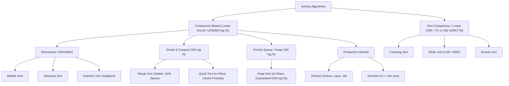

import { Callout } from "fumadocs-ui/components/callout";
import { Tabs, Tab } from "fumadocs-ui/components/tabs";
import { Steps, Step } from "fumadocs-ui/components/steps";
import { Cards, Card } from "fumadocs-ui/components/card";

## The Engine of Computational Infrastructure

Sorting is among the most deeply studied domains in computer science. Across hyperscale datacenters, distributed database engines, and operating system kernels, sorting operations account for an estimated **$25\%$ to $30\%$ of all CPU compute cycles**.

Whenever an engineer issues a SQL query with `ORDER BY`, builds a B-Tree index, compresses inverted index postings in Elasticsearch, schedules network packets with Fair Queuing, or renders a paginated UI table, a sorting algorithm is executing at bare-metal speed.

<Callout type="info" title="The Complexity Landscape">
  No single sorting algorithm is universally optimal. A sort that wins in pure
  asymptotic theory may lose by a factor of $3\times$ in wall-clock time due to
  CPU cache eviction, branch mispredictions, or memory allocation overhead. The
  choice of algorithm is an engineering trade-off between **time complexity**,
  **space overhead**, **stability**, and **hardware cache friendliness**.
</Callout>

---

## Interactive All-in-One Sorting Simulator

Experiment with array transformations, compare pairwise operations, track swap counts, and watch the mechanics of different sorting families in real time:

<SortingSimulator />

---

## Master Taxonomy of Sorting Algorithms

Sorting algorithms are systematically classified along four critical architectural dimensions:

### 1. Stability

A sorting algorithm is **stable** if and only if two items with identical comparison keys appear in the sorted output in the **exact same relative order** as they appeared in the input.

Formally, given an array $A$ and a comparison key projection $K(x)$:

$$
\text{If } i < j \text{ and } K(A[i]) = K(A[j]), \text{ then in sorted array } A', \text{ original } A[i] \text{ precedes original } A[j].
$$

<Callout type="warn" title="Why Stability Matters in Production">
Consider a multi-column database sort:
1. Sort employees by `hire_date` ascending.
2. Sort employees by `department_id` ascending.

If the second sort is **stable**, employees within each department remain strictly ordered by their `hire_date`. If the sort is **unstable**, the initial `hire_date` ordering is scrambled!

- **Stable Sorts:** Insertion Sort, Merge Sort, TimSort, Counting Sort, Radix Sort.
- **Unstable Sorts:** Selection Sort, QuickSort, HeapSort, IntroSort.
  </Callout>

### 2. In-Place vs. Out-of-Place

- **In-Place ($\mathcal{O}(1)$ Auxiliary Space):** The algorithm transforms the array by swapping elements within the existing buffer, requiring only a constant number of scalar pointer and index variables. Examples: Selection Sort, Insertion Sort, HeapSort. (QuickSort requires $\mathcal{O}(\log N)$ auxiliary stack frames).
- **Out-of-Place ($\mathcal{O}(N)$ Auxiliary Space):** The algorithm allocates a temporary secondary buffer to merge or collect elements. Examples: Merge Sort, Counting Sort.

### 3. Adaptive vs. Non-Adaptive

- **Adaptive:** The algorithm detects pre-existing order in the input, reducing its time complexity toward $\mathcal{O}(N)$ on sorted or nearly-sorted data. Examples: Insertion Sort ($\mathcal{O}(N)$ best case), TimSort ($\mathcal{O}(N)$ best case), Bubble Sort with early termination.
- **Non-Adaptive:** The algorithm performs the exact same sequence of comparisons and operations regardless of input ordering. Examples: Selection Sort ($\Theta(N^2)$ always), HeapSort ($\Theta(N \log N)$ always), Merge Sort ($\Theta(N \log N)$ standard).

### 4. Comparison vs. Non-Comparison Lower Bounds

- **Comparison Sorts:** Rely exclusively on relative pairwise comparisons ($A[i] \le A[j]$). They cannot break the fundamental information-theoretic barrier of **$\Omega(N \log N)$** comparisons in the worst case.
- **Non-Comparison Sorts (Linear Sorts):** Leverage direct mathematical properties of integer or byte keys (e.g., bitwise shifts, digit indexing) to achieve $\mathcal{O}(N)$ or $\mathcal{O}(d \cdot N)$ runtime by bypassing the decision tree lower bound.

---

## Comprehensive Comparison Matrix

| Algorithm            |           Best Time            |          Average Time          |           Worst Time           |    Auxiliary Space    | Stable? |    Adaptive?    | Optimal Real-World Use Case                                                                                       |
| :------------------- | :----------------------------: | :----------------------------: | :----------------------------: | :-------------------: | :-----: | :-------------: | :---------------------------------------------------------------------------------------------------------------- |
| **Bubble Sort**      |        $\mathcal{O}(N)$        |       $\mathcal{O}(N^2)$       |       $\mathcal{O}(N^2)$       |   $\mathcal{O}(1)$    |   Yes   | Yes (with flag) | Educational visualizations; tiny arrays ($\le 5$).                                                                |
| **Selection Sort**   |       $\mathcal{O}(N^2)$       |       $\mathcal{O}(N^2)$       |       $\mathcal{O}(N^2)$       |   $\mathcal{O}(1)$    |   No    |       No        | Systems where memory **writes** degrade hardware (EEPROM, NOR flash). Minimizes swaps ($\le N - 1$).              |
| **Insertion Sort**   |        $\mathcal{O}(N)$        |       $\mathcal{O}(N^2)$       |       $\mathcal{O}(N^2)$       |   $\mathcal{O}(1)$    |   Yes   |       Yes       | Small arrays ($N \le 32$); nearly-sorted streams; inner engine of TimSort & IntroSort.                            |
| **Merge Sort**       |    $\mathcal{O}(N \log N)$     |    $\mathcal{O}(N \log N)$     |    $\mathcal{O}(N \log N)$     |   $\mathcal{O}(N)$    |   Yes   |       No        | Guaranteed predictable latency; linked list sorting; external disk merge sorts for multi-gigabyte files.          |
| **QuickSort**        |    $\mathcal{O}(N \log N)$     |    $\mathcal{O}(N \log N)$     |       $\mathcal{O}(N^2)$       | $\mathcal{O}(\log N)$ |   No    |       No        | General in-memory sorting; unmatched CPU L1/L2 cache locality; minimal constant factors.                          |
| **HeapSort**         |    $\mathcal{O}(N \log N)$     |    $\mathcal{O}(N \log N)$     |    $\mathcal{O}(N \log N)$     |   $\mathcal{O}(1)$    |   No    |       No        | Safety-critical kernels (Linux kernel `sort.c`); strict $\mathcal{O}(1)$ RAM limits without recursion stack risk. |
| **TimSort**          |        $\mathcal{O}(N)$        |    $\mathcal{O}(N \log N)$     |    $\mathcal{O}(N \log N)$     |   $\mathcal{O}(N)$    |   Yes   |       Yes       | High-level language standard libraries (Python `sort()`, Java `Arrays.sort()`, V8 JavaScript engine).             |
| **IntroSort**        |    $\mathcal{O}(N \log N)$     |    $\mathcal{O}(N \log N)$     |    $\mathcal{O}(N \log N)$     | $\mathcal{O}(\log N)$ |   No    |       No        | Systems programming libraries (C++ `std::sort`); QuickSort speed with HeapSort fallback against DoS.              |
| **Counting Sort**    |      $\mathcal{O}(N + K)$      |      $\mathcal{O}(N + K)$      |      $\mathcal{O}(N + K)$      | $\mathcal{O}(N + K)$  |   Yes   |       No        | Discrete integer keys with dense range $K \le 10^6$ (e.g., student grades, age groups).                           |
| **Radix Sort (LSD)** | $\mathcal{O}(d \cdot (N + b))$ | $\mathcal{O}(d \cdot (N + b))$ | $\mathcal{O}(d \cdot (N + b))$ | $\mathcal{O}(N + b)$  |   Yes   |       No        | Fixed-width keys: 32/64-bit integers, UUIDs, IP addresses, fixed-length string codes.                             |

---

## Explore the Modules

<Cards>
  <Card
    title="Foundations of Sorting"
    href="/docs/dsa/02-trees-heaps-and-core-patterns/sorting-algorithms/sorting"
    description="Permutations, inversions, decision tree lower bound proof, cache locality, and real-world engine sorting choices."
  />
  <Card
    title="Bubble Sort"
    href="/docs/dsa/02-trees-heaps-and-core-patterns/sorting-algorithms/bubble-sort"
    description="Sinking sort & adjacent swaps: pairwise comparison, loop invariants, early exit, and turtles vs. rabbits."
  />
  <Card
    title="Selection Sort"
    href="/docs/dsa/02-trees-heaps-and-core-patterns/sorting-algorithms/selection-sort"
    description="Extremum extraction: the minimum-swap sort optimized for write-sensitive storage hardware and EEPROM."
  />
  <Card
    title="Insertion Sort"
    href="/docs/dsa/02-trees-heaps-and-core-patterns/sorting-algorithms/insertion-sort"
    description="Adaptive card-hand insertion: the secret engine powering small array sorting in TimSort and IntroSort."
  />
  <Card
    title="Merge Sort"
    href="/docs/dsa/02-trees-heaps-and-core-patterns/sorting-algorithms/merge-sort"
    description="Divide-and-conquer masterclass: guaranteed O(N log N) time, stability, and external multi-gigabyte disk sorting."
  />
  <Card
    title="Quick Sort"
    href="/docs/dsa/02-trees-heaps-and-core-patterns/sorting-algorithms/quick-sort"
    description="In-place pivot partitioning: Lomuto, Hoare, Dutch National Flag 3-way, and stack recursion limits."
  />
  <Card
    title="Heap Sort"
    href="/docs/dsa/02-trees-heaps-and-core-patterns/sorting-algorithms/heap-sort"
    description="In-place priority tree sort: Floyd's O(N) heapify, zero extra memory, and guaranteed O(N log N) runtime."
  />
  <Card
    title="Industrial Hybrid & Linear Sorts"
    href="/docs/dsa/02-trees-heaps-and-core-patterns/sorting-algorithms/hybrid-and-linear-sorts"
    description="TimSort, IntroSort, Radix Sort, and Counting Sort: how production standard libraries actually sort."
  />
</Cards>
