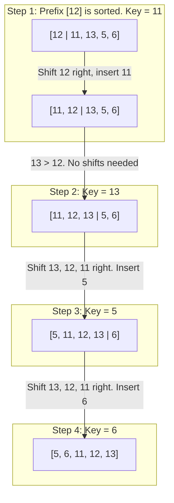
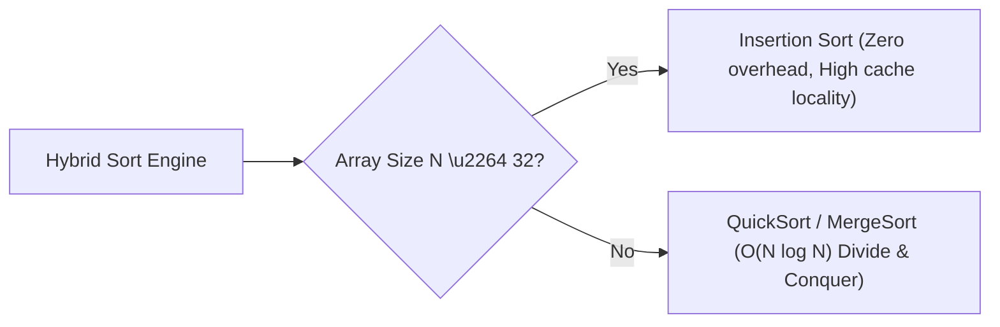

import { Callout } from "fumadocs-ui/components/callout";
import { Tabs, Tab } from "fumadocs-ui/components/tabs";
import { Steps, Step } from "fumadocs-ui/components/steps";
import { Cards, Card } from "fumadocs-ui/components/card";

## The Intuition: Sorting a Hand of Cards

Imagine playing a card game: you are dealt cards one by one into your hand. How do you keep your hand sorted?

1. You hold the cards already sorted in your left hand.
2. You pick up a new card from the table with your right hand.
3. You scan from right to left through your hand, sliding larger cards one slot to the right.
4. As soon as you find a card smaller than or equal to the new card, you drop the new card into the vacated opening.

This is precisely how **Insertion Sort** operates on an in-memory array.



---

## Interactive Simulator

Watch how elements slide rightward to create space for `currentVal`, and note how the sorted prefix expands seamlessly from left to right:

<InsertionSortSimulator />

---

## Adaptivity & Complexity Analysis

Insertion Sort is an **adaptive algorithm**: its execution speed scales directly with the pre-existing sortedness of the input array.

### Mathematical Inversion Bound

Recall that $I(A)$ represents the total number of inversions in array $A$. In Insertion Sort, the inner `while` loop shifts an element rightward if and only if that element forms an inversion with the current `key`.

Therefore:

- **Total inner loop shifts:** Exactly equal to $I(A)$.
- **Total comparisons:** At most $I(A) + N - 1$.
- **Total running time:**

$$
T(N) = \Theta(N + I(A))
$$

### The $k$-Sorted Array Phenomenon

An array is called **$k$-sorted** (or $k$-nearly-sorted) if every element is at most $k$ positions away from its target sorted index.

For a $k$-sorted array:

- Each of the $N$ elements shifts at most $k$ times.
- Total time complexity: **$\mathcal{O}(N \cdot k)$**.
- If $k = \mathcal{O}(1)$ (constant distance), Insertion Sort runs in **strictly linear $\mathcal{O}(N)$ time**, outperforming even QuickSort and MergeSort!

| Scenario                         |  Inversion Count $I(A)$  |     Time Complexity      | Real-World Context                                          |
| :------------------------------- | :----------------------: | :----------------------: | :---------------------------------------------------------- |
| **Best Case (Already Sorted)**   |           $0$            |     $\mathcal{O}(N)$     | Only $N - 1$ comparisons, 0 shifts.                         |
| **Nearly Sorted ($k$-distance)** | $\mathcal{O}(N \cdot k)$ | $\mathcal{O}(N \cdot k)$ | Appending new records to an already ordered database table. |
| **Average Case (Random)**        | $\approx \frac{N^2}{4}$  |    $\mathcal{O}(N^2)$    | General unordered permutations.                             |
| **Worst Case (Reverse Sorted)**  |    $\frac{N(N-1)}{2}$    |    $\mathcal{O}(N^2)$    | Elements shift through the entire prefix on every step.     |

---

## Why Modern Standard Libraries Rely on Insertion Sort

Despite having $\mathcal{O}(N^2)$ worst-case asymptotic complexity, Insertion Sort is **the secret workhorse embedded inside almost every industrial sorting engine**:

- **Python (TimSort):** Slices of size $\le 64$ are sorted via Insertion Sort.
- **Java (`Arrays.sort`):** Falls back to Dual-Pivot Insertion Sort for primitives below threshold $47$.
- **C++ (`std::sort` / IntroSort):** Partitions with fewer than $16$ elements are delegated to Insertion Sort.
- **V8 JavaScript Engine:** TimSort sub-arrays below length $32$ run on Insertion Sort.



### The Architectural Reasons:

1. **Low Constant Factors:** QuickSort and MergeSort have non-trivial algorithmic overhead (recursion stack frame allocation, midpoint calculations, pivot logic, auxiliary buffers). For $N \le 32$, this constant factor overhead dwarfs the simple pointer shifts of Insertion Sort.
2. **CPU Cache Line Saturation:** Modern CPUs fetch memory in $64$-byte cache lines (capable of holding $16$ standard 32-bit integers or $8$ 64-bit pointers). Sifting through an array of $16$ to $32$ elements touches at most $1$ or $2$ cache lines already resident in L1 cache ($1\text{ ns}$ access latency).
3. **Branch Prediction Simplicity:** The inner loop comparison `arr[j] > key` exhibits highly predictable branch patterns for small arrays, eliminating pipeline stalls.

---

## Online Sorting: Real-Time Stream Ingestion

An algorithm is termed **online** if it can process and sort an incoming stream of data one piece at a time without needing the entire dataset upfront.

Insertion Sort is naturally online:

- If you have an existing sorted array of $K$ items, inserting a newly arrived data point takes $\mathcal{O}(K)$ time and $\mathcal{O}(1)$ additional memory.
- QuickSort and standard MergeSort are **offline**: they require the full dataset present in advance before recursion can begin.

---

## Binary Insertion Sort

Notice that in each iteration, the prefix $A[0 \dots i-1]$ is already strictly sorted. Instead of performing a linear scan from right to left to find where `key` belongs, we can use **Binary Search** to pinpoint the insertion index in $\mathcal{O}(\log i)$ time!

<Callout type="info" title="Comparison vs. Shift Trade-Off">
  - **Comparisons:** Reduced from $\mathcal{O}(N^2)$ to $\sum_{(i = 1)}^{N - 1}{" "}
  \lceil \log_2 i \rceil = \mathcal{O}(N \log N)$. - **Shifts:** Still requires
  shifting elements in contiguous memory: $\mathcal{O}(N^2)$ writes. - **When is
  Binary Insertion Sort ideal?** When the comparison operator is computationally
  expensive (e.g., comparing large database rows, deep JSON objects, or long
  strings), but shifting bytes in memory is accelerated by hardware `memmove`!
</Callout>

---

## Production Implementations

<Tabs items={["TypeScript", "Python"]}>
  <Tab value="TypeScript">
```typescript
/**
 * Standard In-Place Insertion Sort.
 * Time Complexity: O(N) best, O(N^2) average/worst.
 * Auxiliary Space: O(1).
 * Stability: Strictly Stable.
 */
export function insertionSort<T>(
  arr: T[],
  compareFn: (a: T, b: T) => number = (a, b) => (a < b ? -1 : a > b ? 1 : 0)
): T[] {
  const n = arr.length;
  if (n <= 1) return arr;

for (let i = 1; i < n; i++) {
const key = arr[i];
let j = i - 1;

    // Shift elements of arr[0..i-1] that are greater than key to one position ahead
    while (j >= 0 && compareFn(arr[j], key) > 0) {
      arr[j + 1] = arr[j];
      j--;
    }
    arr[j + 1] = key;

}

return arr;
}

/\*\*

- Binary Insertion Sort: Uses binary search to minimize comparison count.
- Reduces comparisons to O(N log N). Shifts remain O(N^2).
  \*/
  export function binaryInsertionSort<T>(
  arr: T[],
  compareFn: (a: T, b: T) => number = (a, b) => (a < b ? -1 : a > b ? 1 : 0)
  ): T[] {
  const n = arr.length;

for (let i = 1; i < n; i++) {
const key = arr[i];

    // Find insertion index in sorted subarray arr[0..i-1] using binary search
    let low = 0;
    let high = i - 1;

    while (low <= high) {
      const mid = Math.floor(low + (high - low) / 2);
      if (compareFn(key, arr[mid]) < 0) {
        high = mid - 1;
      } else {
        low = mid + 1; // Preserves stability by inserting after duplicate keys
      }
    }

    // Shift elements rightward from low to i-1
    for (let j = i - 1; j >= low; j--) {
      arr[j + 1] = arr[j];
    }
    arr[low] = key;

}

return arr;
}

````
  </Tab>
  <Tab value="Python">
```python
from typing import List, TypeVar, Callable

T = TypeVar("T")

def insertion_sort(arr: List[T], key: Callable[[T], any] = lambda x: x) -> List[T]:
    """
    Standard in-place Insertion Sort.
    Adaptive: O(N) when arr is nearly sorted.
    """
    n = len(arr)
    if n <= 1:
        return arr

    for i in range(1, n):
        current = arr[i]
        curr_val = key(current)
        j = i - 1

        # Shift elements rightward
        while j >= 0 and key(arr[j]) > curr_val:
            arr[j + 1] = arr[j]
            j -= 1

        arr[j + 1] = current

    return arr


def binary_insertion_sort(arr: List[T], key: Callable[[T], any] = lambda x: x) -> List[T]:
    """
    Binary Insertion Sort: Uses bisect to locate insertion slot in O(log N) comparisons.
    """
    n = len(arr)
    for i in range(1, n):
        current = arr[i]
        curr_val = key(current)

        # Binary search in arr[0..i-1]
        low = 0
        high = i - 1
        while low <= high:
            mid = (low + high) // 2
            if curr_val < key(arr[mid]):
                high = mid - 1
            else:
                low = mid + 1

        # Shift elements to make room
        for j in range(i - 1, low - 1, -1):
            arr[j + 1] = arr[j]
        arr[low] = current

    return arr


if __name__ == "__main__":
    data = [12, 11, 13, 5, 6]
    print("Standard Insertion Sort:", insertion_sort(list(data)))
    print("Binary Insertion Sort:  ", binary_insertion_sort(list(data)))
````

  </Tab>
</Tabs>

---

## Complexity & Invariant Summary

| Metric                |         Standard Insertion Sort          |                Binary Insertion Sort                 |
| :-------------------- | :--------------------------------------: | :--------------------------------------------------: |
| **Best-Case Time**    | $\mathcal{O}(N)$ (1 comp/item, 0 shifts) |     $\mathcal{O}(N \log N)$ (binary search runs)     |
| **Average-Case Time** |            $\mathcal{O}(N^2)$            |         $\mathcal{O}(N^2)$ (shifts dominate)         |
| **Worst-Case Time**   |            $\mathcal{O}(N^2)$            |                  $\mathcal{O}(N^2)$                  |
| **Comparisons**       |         $\mathcal{O}(N + I(A))$          |               $\mathcal{O}(N \log N)$                |
| **Shifts / Writes**   |         $\mathcal{O}(N + I(A))$          |               $\mathcal{O}(N + I(A))$                |
| **Auxiliary Memory**  |             $\mathcal{O}(1)$             |                   $\mathcal{O}(1)$                   |
| **Stability**         |           **Strictly Stable**            | **Strictly Stable** (with upper-bound binary search) |
| **Online Capability** | **Yes** ($\mathcal{O}(K)$ per new item)  |                       **Yes**                        |
