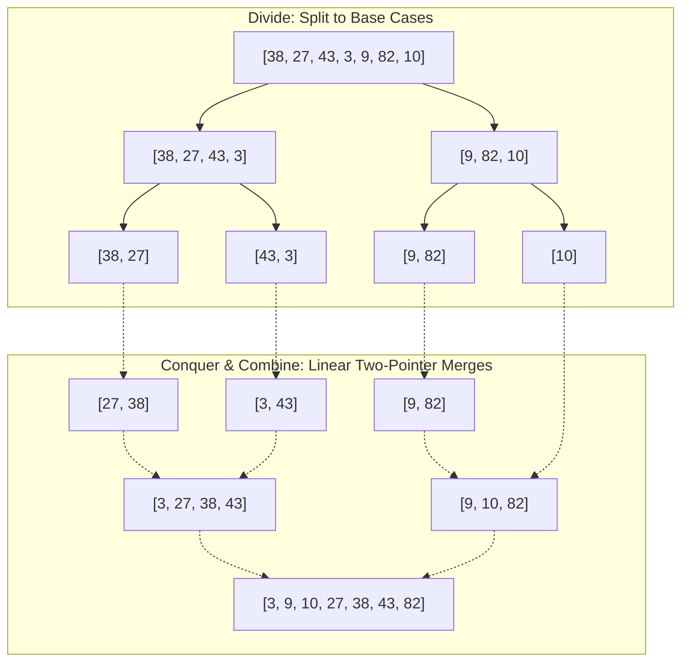
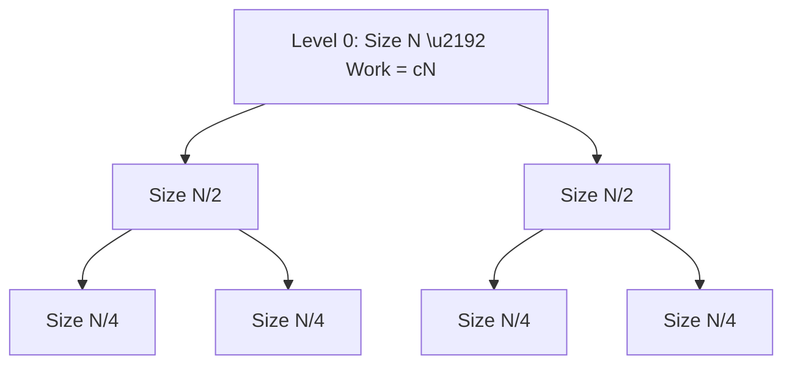
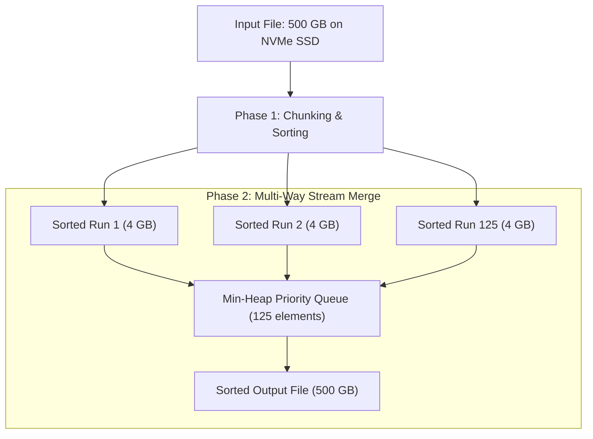

import { Callout } from "fumadocs-ui/components/callout";
import { Tabs, Tab } from "fumadocs-ui/components/tabs";
import { Steps, Step } from "fumadocs-ui/components/steps";
import { Cards, Card } from "fumadocs-ui/components/card";

## The Divide-and-Conquer Paradigm

Invented by John von Neumann in 1945, **Merge Sort** is the gold standard of the divide-and-conquer algorithmic paradigm. It solves sorting by recursively breaking the problem down into trivial subproblems:

<Steps>
<Step>
### 1. Divide
Compute the midpoint $M = L + \lfloor (R - L) / 2 \rfloor$ and partition the array of size $N$ into two equal halves of size $\approx N/2$.
</Step>

<Step>
  ### 2. Conquer Recursively invoke Merge Sort on the left half $A[L \dots M]$
  and the right half $A[M+1 \dots R]$. The base case occurs when a subarray has
  length $\le 1$, which is sorted by definition.
</Step>

<Step>
### 3. Combine (The Merge Step)
Merge the two already-sorted subarrays into a single contiguous sorted sequence in linear $\mathcal{O}(N)$ time using two pointers.
</Step>
</Steps>



---

## Interactive Simulator

Observe the recursive subdivision down to single elements and the subsequent two-pointer merge operations stitching sorted subarrays together:

<MergeSortSimulator />

---

## Recurrence Relation & The Master Theorem

The running time $T(N)$ of Merge Sort is expressed by the classic recurrence relation:

$$
T(N) = 2T\left(\frac{N}{2}\right) + cN
$$

where:

- $2T(N/2)$ represents the recursive sorting of the two sub-arrays.
- $cN = \Theta(N)$ represents the linear time spent merging the two sub-arrays.

### Proof by Recursion Tree



1. **Height of Tree:** At each level, problem size is halved. The tree reaches leaves when $\frac{N}{2^k} = 1 \implies k = \log_2 N$. Height is $\log_2 N + 1$.
2. **Work per Level:**
   - Level 0: $1$ problem of size $N \implies 1 \times cN = cN$
   - Level 1: $2$ problems of size $N/2 \implies 2 \times c(N/2) = cN$
   - Level 2: $4$ problems of size $N/4 \implies 4 \times c(N/4) = cN$
   - Level $k$: $2^k$ problems of size $N/2^k \implies 2^k \times c(N/2^k) = cN$
3. **Total Work:** Sum across all $\log_2 N + 1$ levels:

$$
T(N) = \sum_{k=0}^{\log_2 N} cN = cN (\log_2 N + 1) = \Theta(N \log N)
$$

<Callout type="info" title="Guaranteed Upper Bound">
  Unlike QuickSort, which degrades to $\mathcal{O}(N^2)$ when pivots degenerate,
  Merge Sort's divide step splits the array strictly in half. Therefore, its
  time complexity is **strictly $\Theta(N \log N)$ in best, average, and worst
  cases**.
</Callout>

---

## Stability Guarantee & Multi-Column Sorting

Merge Sort is **strictly stable**.

During the merge phase, when the current elements in the left and right sub-arrays are equal ($A[\text{left}] = A[\text{right}]$), the two-pointer merge algorithm is intentionally written to **always favor the left element**:

```typescript
if (leftSubarray[i] <= rightSubarray[j]) {
  merged[k++] = leftSubarray[i++];
} else {
  merged[k++] = rightSubarray[j++];
}
```

Because elements in `leftSubarray` originally appeared before those in `rightSubarray`, taking the left element on equality guarantees that their relative sequence is preserved intact.

### Multi-Column Sorting Use Case

Suppose an analytics engine processes a dataset of customer transactions:

1. First, sort by `TransactionTimestamp` descending.
2. Next, sort by `CustomerID` ascending using Merge Sort.

Because Merge Sort is stable, all transactions for any specific `CustomerID` will **remain perfectly sorted by `TransactionTimestamp`**. Unstable sorts (like standard QuickSort or HeapSort) scramble the timestamp ordering, requiring a costly composite key comparator.

---

## The Space Trade-Off: $\mathcal{O}(N)$ Auxiliary Buffer

The primary Achilles' heel of Merge Sort on contiguous arrays is its **auxiliary memory overhead**:

- To merge two sorted segments within an array, you cannot simply write elements back into the same memory locations without overwriting elements that have not yet been compared.
- Therefore, Merge Sort requires an auxiliary buffer of size $N$.

<Callout type="warn" title="Memory Allocation Anti-Pattern">
  A common beginner mistake is creating new arrays inside the recursive call:
  `const left = mergeSort(arr.slice(0, mid));` This causes $\mathcal{O}(N \log
  N)$ allocations and triggers heavy Garbage Collection pauses! **Production
  Rule:** Allocate a single scratch buffer of size $N$ once at the root call,
  and pass that buffer down through all recursion levels.
</Callout>

### Linked Lists: The Merge Sort Paradise

When sorting a singly or doubly **Linked List**, Merge Sort requires **$\mathcal{O}(1)$ auxiliary space**!

- Splitting a linked list takes $\mathcal{O}(1)$ by breaking a pointer (`slow.next = null`).
- Merging two sorted linked lists requires only splicing pointer links (`curr.next = l1`).
- Therefore, Merge Sort is the undisputed king of linked list sorting.

---

## External Merge Sort: Sorting Terabytes with Megabytes of RAM

What happens when you need to sort a **$500\text{ GB}$ database table** on a server with only **$8\text{ GB}$ of RAM**?
In-memory sorts like QuickSort fail immediately with Out-Of-Memory (OOM) crashes. The database engine employs **External Merge Sort**:



<Steps>
<Step>
### Phase 1: Run Generation
1. Read $4\text{ GB}$ chunks of raw data into RAM.
2. Sort each chunk in-memory using an ultra-fast algorithm (QuickSort or IntroSort).
3. Write the sorted chunk (called a **Run**) back to disk as a temporary file. Repeat until the entire $500\text{ GB}$ file is decomposed into $125$ sorted runs.
</Step>

<Step>
### Phase 2: $K$-Way Merge
1. Open a read buffer for each of the $125$ temporary sorted run files.
2. Initialize a Min-Heap of size $K = 125$, inserting the first element of each run.
3. Pop the minimum element from the heap and append it to the sequential output write buffer.
4. Read the next element from the corresponding run file into the heap.
5. Stream until all $125$ runs are completely consumed. Total I/O passes: only $\mathcal{O}(\log_K(N / M))$ disk passes!
</Step>
</Steps>

---

## Production Implementations

<Tabs items={["TypeScript (Top-Down)", "TypeScript (Bottom-Up Iterative)", "Python"]}>
  <Tab value="TypeScript (Top-Down)">
```typescript
/**
 * Top-Down Recursive Merge Sort with single-buffer allocation.
 * Time Complexity: O(N log N) strictly across best, average, worst.
 * Space Complexity: O(N) auxiliary scratchpad (single allocation).
 * Stability: Strictly Stable.
 */
export function mergeSort<T>(
  arr: T[],
  compareFn: (a: T, b: T) => number = (a, b) => (a < b ? -1 : a > b ? 1 : 0)
): T[] {
  const n = arr.length;
  if (n <= 1) return arr;

// Single auxiliary buffer reused across all recursive frames
const aux = new Array<T>(n);

function merge(low: number, mid: number, high: number): void {
// Copy active segment into aux
for (let k = low; k <= high; k++) {
aux[k] = arr[k];
}

    let i = low;     // Pointer into left sorted half
    let j = mid + 1; // Pointer into right sorted half
    let k = low;     // Destination pointer in arr

    while (i <= mid && j <= high) {
      // <= preserves stability!
      if (compareFn(aux[i], aux[j]) <= 0) {
        arr[k++] = aux[i++];
      } else {
        arr[k++] = aux[j++];
      }
    }

    // Drain remaining elements from left half (right half is already in place)
    while (i <= mid) {
      arr[k++] = aux[i++];
    }

}

function sort(low: number, high: number): void {
if (low >= high) return;
const mid = Math.floor(low + (high - low) / 2);
sort(low, mid);
sort(mid + 1, high);

    // Minor optimization: If already ordered, skip merge step!
    if (compareFn(arr[mid], arr[mid + 1]) <= 0) {
      return;
    }

    merge(low, mid, high);

}

sort(0, n - 1);
return arr;
}

````
  </Tab>
  <Tab value="TypeScript (Bottom-Up Iterative)">
```typescript
/**
 * Bottom-Up Iterative Merge Sort.
 * Eliminates all recursive call stack overhead.
 * Ideal for systems without deep recursion limits.
 */
export function iterativeMergeSort<T>(
  arr: T[],
  compareFn: (a: T, b: T) => number = (a, b) => (a < b ? -1 : a > b ? 1 : 0)
): T[] {
  const n = arr.length;
  if (n <= 1) return arr;

  const aux = new Array<T>(n);

  // Subarray sizes: 1, 2, 4, 8, 16...
  for (let width = 1; width < n; width *= 2) {
    for (let i = 0; i < n; i += 2 * width) {
      const low = i;
      const mid = Math.min(i + width - 1, n - 1);
      const high = Math.min(i + 2 * width - 1, n - 1);

      if (mid < high) {
        // Merge subarray arr[low..mid] with arr[mid+1..high]
        for (let k = low; k <= high; k++) aux[k] = arr[k];

        let p1 = low;
        let p2 = mid + 1;
        let dst = low;

        while (p1 <= mid && p2 <= high) {
          if (compareFn(aux[p1], aux[p2]) <= 0) {
            arr[dst++] = aux[p1++];
          } else {
            arr[dst++] = aux[p2++];
          }
        }
        while (p1 <= mid) arr[dst++] = aux[p1++];
      }
    }
  }

  return arr;
}
````

  </Tab>
  <Tab value="Python">
```python
from typing import List, TypeVar, Callable

T = TypeVar("T")

def merge_sort(arr: List[T], key: Callable[[T], any] = lambda x: x) -> List[T]:
"""
In-place recursive Merge Sort utilizing a single auxiliary buffer.
Guaranteed O(N log N) worst-case time, Stable.
"""
n = len(arr)
if n <= 1:
return arr

    aux = [None] * n

    def merge(low: int, mid: int, high: int):
        for idx in range(low, high + 1):
            aux[idx] = arr[idx]

        i = low
        j = mid + 1
        k = low

        while i <= mid and j <= high:
            if key(aux[i]) <= key(aux[j]):
                arr[k] = aux[i]
                i += 1
            else:
                arr[k] = aux[j]
                j += 1
            k += 1

        while i <= mid:
            arr[k] = aux[i]
            i += 1
            k += 1

    def sort_recursive(low: int, high: int):
        if low >= high:
            return
        mid = (low + high) // 2
        sort_recursive(low, mid)
        sort_recursive(mid + 1, high)

        # Optimization: already sorted
        if key(arr[mid]) <= key(arr[mid + 1]):
            return

        merge(low, mid, high)

    sort_recursive(0, n - 1)
    return arr

if **name** == "**main**":
nums = [38, 27, 43, 3, 9, 82, 10]
print("Sorted:", merge_sort(list(nums)))

```
  </Tab>
</Tabs>

---

## Complexity & Characteristics

| Metric | Complexity | Rationale |
| :--- | :---: | :--- |
| **Best-Case Time** | $\mathcal{O}(N \log N)$ | $\mathcal{O}(N)$ when optimized with adjacent check `arr[mid] <= arr[mid+1]`. |
| **Average-Case Time** | $\mathcal{O}(N \log N)$ | Uniform recursion tree depth $\log_2 N$. |
| **Worst-Case Time** | $\mathcal{O}(N \log N)$ | Guaranteed by Master Theorem; no pathological inputs exist. |
| **Auxiliary Memory** | $\mathcal{O}(N)$ | Required temporary merge scratch buffer. |
| **Stability** | **Strictly Stable** | Subarrays retain relative ordering via $\le$ tie-breaking. |
| **Ideal Context** | Linked Lists & Disk Files | Zero-copy pointer manipulation & sequential external block I/O. |
```
