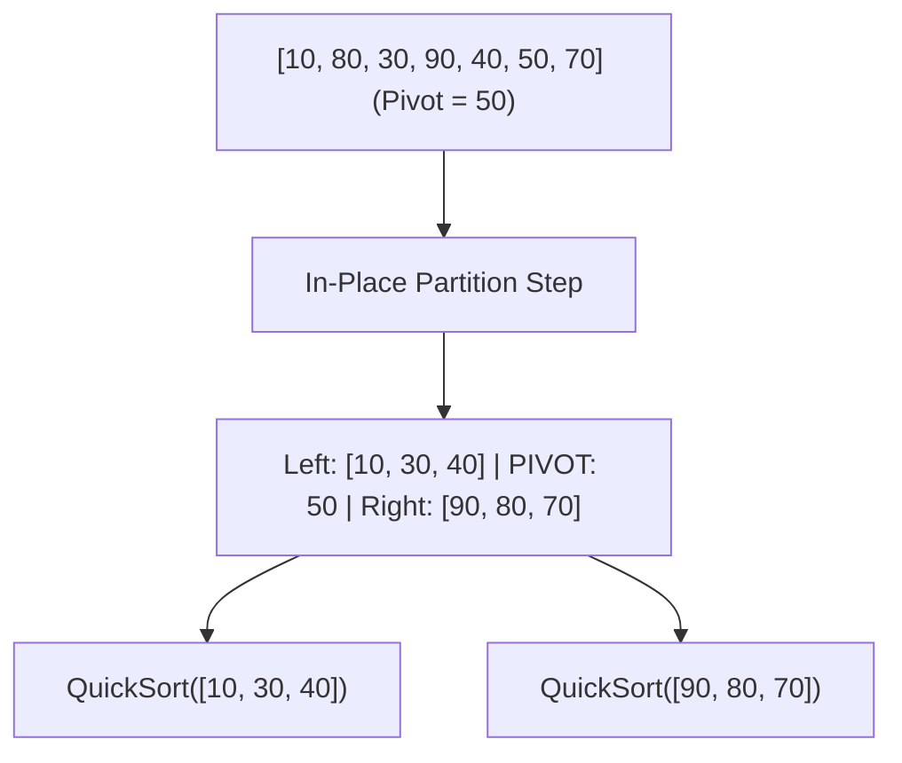
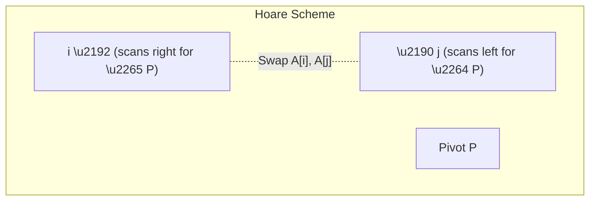

import { Callout } from "fumadocs-ui/components/callout";
import { Tabs, Tab } from "fumadocs-ui/components/tabs";
import { Steps, Step } from "fumadocs-ui/components/steps";
import { Cards, Card } from "fumadocs-ui/components/card";

## The In-Place Partitioning Intuition

Developed by Sir Tony Hoare in 1959, **QuickSort** is the most widely adopted general-purpose in-memory sorting algorithm in computing history.

Unlike Merge Sort, which divides the array blindly into two halves and does all its work during the **combine** step, QuickSort does all its work upfront during the **divide (partition)** step:

1. **Select a Pivot:** Pick an element $P$ from the array.
2. **Partition:** Rearrange the array in-place such that:
   - All elements strictly less than $P$ are placed to the left of the pivot.
   - All elements strictly greater than $P$ are placed to the right of the pivot.
   - The pivot $P$ is now locked into its **final, permanent sorted index**!
3. **Recurse:** Recursively apply QuickSort to the left sub-array and right sub-array.



---

## Interactive Simulator

Observe how the pivot is selected, how scanning pointers converge from the edges, and how elements swap across the partition boundary:

<QuickSortSimulator />

---

## Partitioning Schemes: Lomuto vs. Hoare vs. Dutch Flag

The efficiency of QuickSort depends almost entirely on the partitioning subroutine. Three major schemes exist:

### 1. Lomuto Partitioning

- **Mechanism:** Selects the last element $A[R]$ as the pivot. Uses a slow pointer $i$ (boundary of elements smaller than pivot) and a fast scanner $j$ advancing from $L$ to $R-1$.
- **Downside 1:** Performs **$\sim 3\times$ more swaps** on average than Hoare's scheme.
- **Downside 2 (The Duplicate Trap):** If all elements in the array are identical (e.g., `[5, 5, 5, 5, 5]`), Lomuto's condition $A[j] \le \text{pivot}$ places every element on the left, failing to divide the array! The problem size shrinks by only 1 each step, degrading time to **$\Theta(N^2)$**.

### 2. Hoare Partitioning

- **Mechanism:** Uses two pointers starting at opposite ends: $i$ moves rightward until $A[i] \ge \text{pivot}$, and $j$ moves leftward until $A[j] \le \text{pivot}$. When both stop, $A[i]$ and $A[j]$ are swapped.
- **Efficiency:** Performs roughly $\frac{N}{6}$ swaps on average—three times fewer than Lomuto!
- **Handles Duplicates Gracefully:** Both pointers stop on elements equal to the pivot, causing equal elements to be distributed evenly between the two partitions and preventing quadratic degradation on repeated values.



### 3. Dutch National Flag (3-Way Partitioning)

When sorting arrays with a high frequency of duplicate keys (e.g., sorting billions of records by gender, status enum, or zip code), traditional 2-way partitioning continues to recurse on duplicate elements.

Dijkstra's **Dutch National Flag (3-Way) Partitioning** segments the array into **three distinct zones**:

1. Elements strictly less than pivot: $A[L \dots lt - 1] < P$
2. Elements equal to pivot: $A[lt \dots gt] = P$
3. Elements strictly greater than pivot: $A[gt + 1 \dots R] > P$

<Callout type="tip" title="Linear Time on Few Distinct Keys">
  Because the entire middle zone $[lt \dots gt]$ contains elements identical to
  the pivot, **they are already in their final sorted positions and never
  recursed on**! If an array of size $N$ contains only $K$ distinct keys, 3-Way
  QuickSort runs in **$\mathcal{O}(N \log K)$** time—and strictly **$\mathcal{O}
  (N)$** time when $K = \mathcal{O}(1)$!
</Callout>

---

## Mitigating Worst-Case $\mathcal{O}(N^2)$ Complexity

If the pivot is always the smallest or largest element, the recurrence becomes:

$$
T(N) = T(N - 1) + \Theta(N) = \Theta(N^2)
$$

This quadratic degradation occurs in naive QuickSort on already-sorted arrays, reverse-sorted arrays, or adversarial anti-quicksort inputs.

### 1. Randomized Pivot Selection

Randomly pick an index $k \in [L, R]$ and swap $A[k]$ with the pivot position before partitioning.

- The probability of consistently choosing a pathological pivot across all $\log N$ levels is vanishingly small ($\le \frac{1}{2^{\log N}}$).
- Expected time complexity: $\mathcal{O}(N \log N)$ for **any** input permutation.

### 2. Median-of-Three Pivot Selection

Inspect three candidates: the first element $A[L]$, the middle element $A[\lfloor(L+R)/2\rfloor]$, and the last element $A[R]$. Sort these three items and use the median value as the pivot.

- Completely neutralizes already-sorted and reverse-sorted worst cases.
- Reduces comparisons by $\sim 14\%$ compared to random pivots on general data.

---

## Call Stack Bounding: $\mathcal{O}(\log N)$ Guaranteed Space

Standard recursive QuickSort can consume up to $\mathcal{O}(N)$ stack frames during degenerate partitions, triggering a fatal `StackOverflowError`.

We can guarantee strictly **$\mathcal{O}(\log N)$ call stack depth** by applying **Tail-Call Elimination**:

<Steps>
<Step>
### The Rule of the Smaller Subproblem
After partitioning, compare the sizes of the left and right sub-arrays:
- **Left Size:** $p - L$
- **Right Size:** $R - p$
</Step>

<Step>
  ### Recurse on the Smaller; Loop on the Larger Always issue a recursive
  function call on the **smaller** sub-array. Then, update the loop boundaries
  ($L$ or $R$) and **loop** iteratively over the larger sub-array.
</Step>

<Step>
### Mathematical Guarantee
Because the smaller sub-array can have size at most $\frac{N}{2}$, the maximum possible depth of the call stack before hitting a base case is bounded by:

$$
\text{Max Stack Depth} \le \lfloor \log_2 N \rfloor
$$

</Step>
</Steps>

---

## Production Implementations

<Tabs items={["TypeScript (Hoare + Median-of-3)", "TypeScript (3-Way Partitioning)", "Python"]}>
  <Tab value="TypeScript (Hoare + Median-of-3)">
```typescript
/**
 * Industrial-grade QuickSort featuring:
 * 1. Hoare partitioning (fewer swaps).
 * 2. Median-of-Three pivot selection.
 * 3. Tail-call optimization bounding stack depth to O(log N).
 */
export function quickSort<T>(
  arr: T[],
  compareFn: (a: T, b: T) => number = (a, b) => (a < b ? -1 : a > b ? 1 : 0)
): T[] {
  function swap(i: number, j: number): void {
    const temp = arr[i];
    arr[i] = arr[j];
    arr[j] = temp;
  }

// Median-of-Three: Sorts low, mid, high and returns median at high - 1
function medianOfThree(low: number, high: number): T {
const mid = low + Math.floor((high - low) / 2);
if (compareFn(arr[low], arr[mid]) > 0) swap(low, mid);
if (compareFn(arr[low], arr[high]) > 0) swap(low, high);
if (compareFn(arr[mid], arr[high]) > 0) swap(mid, high);

    // Place pivot at high - 1
    swap(mid, high - 1);
    return arr[high - 1];

}

function partitionHoare(low: number, high: number): number {
const pivot = medianOfThree(low, high);
let i = low;
let j = high - 1;

    while (true) {
      while (compareFn(arr[++i], pivot) < 0) {}
      while (compareFn(arr[--j], pivot) > 0) {}

      if (i >= j) break;
      swap(i, j);
    }

    // Restore pivot to its partition boundary
    swap(i, high - 1);
    return i;

}

function sort(low: number, high: number): void {
while (low < high) {
// Small arrays cutoff: can be delegated to insertionSort for maximum speed
if (high - low < 10) {
// Insertion sort on small slice
for (let i = low + 1; i <= high; i++) {
const key = arr[i];
let j = i - 1;
while (j >= low && compareFn(arr[j], key) > 0) {
arr[j + 1] = arr[j];
j--;
}
arr[j + 1] = key;
}
return;
}

      const p = partitionHoare(low, high);

      // Tail-call optimization: Recurse on smaller half, loop on larger half
      if (p - low < high - p) {
        sort(low, p - 1);
        low = p + 1; // Loop on right partition
      } else {
        sort(p + 1, high);
        high = p - 1; // Loop on left partition
      }
    }

}

sort(0, arr.length - 1);
return arr;
}

````
  </Tab>
  <Tab value="TypeScript (3-Way Partitioning)">
```typescript
/**
 * Dutch National Flag 3-Way QuickSort.
 * Optimal for inputs with extensive duplicate keys: runs in O(N) when keys are few.
 */
export function quickSort3Way<T>(
  arr: T[],
  compareFn: (a: T, b: T) => number = (a, b) => (a < b ? -1 : a > b ? 1 : 0)
): T[] {
  function swap(i: number, j: number): void {
    const temp = arr[i];
    arr[i] = arr[j];
    arr[j] = temp;
  }

  function sort(low: number, high: number): void {
    if (low >= high) return;

    // Random pivot selection
    const randIdx = low + Math.floor(Math.random() * (high - low + 1));
    swap(low, randIdx);

    const pivot = arr[low];
    let lt = low;      // arr[low..lt-1] < pivot
    let gt = high;     // arr[gt+1..high] > pivot
    let i = low + 1;   // arr[lt..i-1] == pivot

    while (i <= gt) {
      const cmp = compareFn(arr[i], pivot);
      if (cmp < 0) {
        swap(lt++, i++);
      } else if (cmp > 0) {
        swap(i, gt--);
      } else {
        i++;
      }
    }

    // Recurse on left and right partitions (elements equal to pivot are skipped!)
    sort(low, lt - 1);
    sort(gt + 1, high);
  }

  sort(0, arr.length - 1);
  return arr;
}
````

  </Tab>
  <Tab value="Python">
```python
import random
from typing import List, TypeVar, Callable

T = TypeVar("T")

def quick_sort_3way(arr: List[T], key: Callable[[T], any] = lambda x: x) -> List[T]:
"""
Dutch National Flag 3-Way QuickSort with tail-call stack bounding.
"""
def sort(low: int, high: int):
while low < high: # Random pivot
rand_idx = random.randint(low, high)
arr[low], arr[rand_idx] = arr[rand_idx], arr[low]

            pivot_val = key(arr[low])
            lt = low
            gt = high
            i = low + 1

            while i <= gt:
                curr_val = key(arr[i])
                if curr_val < pivot_val:
                    arr[lt], arr[i] = arr[i], arr[lt]
                    lt += 1
                    i += 1
                elif curr_val > pivot_val:
                    arr[i], arr[gt] = arr[gt], arr[i]
                    gt -= 1
                else:
                    i += 1

            # arr[low..lt-1] < pivot, arr[lt..gt] == pivot, arr[gt+1..high] > pivot
            # Recurse on smaller partition to guarantee O(log N) stack depth
            if (lt - 1 - low) < (high - (gt + 1)):
                sort(low, lt - 1)
                low = gt + 1
            else:
                sort(gt + 1, high)
                high = lt - 1

    sort(0, len(arr) - 1)
    return arr

if **name** == "**main**":
nums = [10, 80, 30, 90, 40, 50, 70, 40, 40, 30]
print("3-Way Sorted:", quick_sort_3way(list(nums)))

```
  </Tab>
</Tabs>

---

## Complexity & Architecture Summary

| Property | Complexity / Rating | Engineering Notes |
| :--- | :---: | :--- |
| **Best-Case Time** | $\mathcal{O}(N \log N)$ | Balanced partitions at every recursive level. |
| **Average-Case Time** | $\mathcal{O}(N \log N)$ | $\approx 1.39 N \log_2 N$ comparisons; constant factor is exceptionally low. |
| **Worst-Case Time** | $\mathcal{O}(N^2)$ | Completely mitigated via Median-of-3 / Randomization / IntroSort fallback. |
| **Few Unique Keys** | $\mathcal{O}(N)$ | With 3-Way Dutch National Flag partitioning. |
| **Auxiliary Memory** | $\mathcal{O}(\log N)$ | Strictly bounded by recursing on smaller subproblem first. |
| **Stability** | **Unstable** | Long-distance partition swaps disrupt identical key positions. |
| **Cache Locality** | **Unmatched** | Contiguous linear scans saturate CPU L1/L2 data cache lines. |
```
