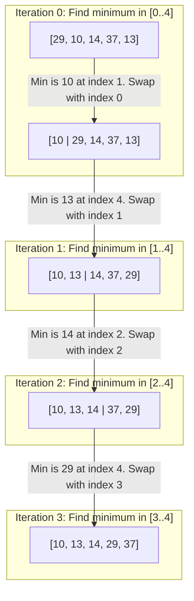
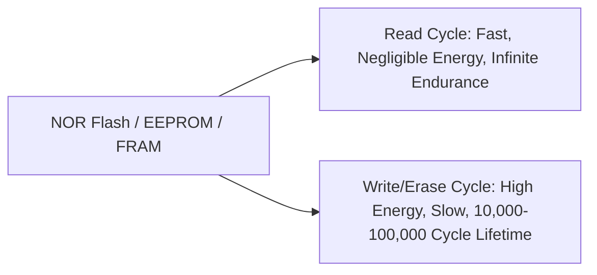

import { Callout } from "fumadocs-ui/components/callout";
import { Tabs, Tab } from "fumadocs-ui/components/tabs";
import { Steps, Step } from "fumadocs-ui/components/steps";
import { Cards, Card } from "fumadocs-ui/components/card";

## The Intuition: Extremum Extraction

Selection Sort divides the input array into two distinct logical partitions:

1. **Sorted Prefix** (left side): Initially empty, grows by one element per iteration.
2. **Unsorted Suffix** (right side): Initially covers the entire array.

In each iteration, the algorithm scans the unsorted suffix to locate the **global minimum element**. Once located, it performs a single swap, exchanging that minimum element with the first element of the unsorted suffix. The boundary between the sorted and unsorted regions moves one position to the right.



---

## Interactive Simulator

Observe how the algorithm scans across the unsorted window to identify `minIndex`, then executes exactly one swap per pass to lock the minimum into place:

<SelectionSortSimulator />

---

## The Minimum Swap Property: $\le N - 1$ Swaps

The most mathematically distinguishing characteristic of Selection Sort is its swap efficiency.

In an array of $N$ elements:

- **Comparisons:** Selection Sort scans the remaining elements regardless of their values:
  $$
  C(N) = \sum_{i=0}^{N-2} (N - 1 - i) = \frac{N(N-1)}{2} = \Theta(N^2)
  $$
- **Swaps:** At each outer iteration $i$, exactly **one swap** (or zero if the minimum is already at index $i$) is executed:
  $$
  S(N) \le N - 1 = \mathcal{O}(N)
  $$

Compare this to other elementary sorting algorithms:

- **Bubble Sort:** Up to $\frac{N(N-1)}{2} = \mathcal{O}(N^2)$ swaps.
- **Insertion Sort:** Up to $\frac{N(N-1)}{2} = \mathcal{O}(N^2)$ write/shift operations.
- **Selection Sort:** Strictly at most $N - 1$ swaps.

---

## Production Applications: Write-Sensitive Hardware

Why would any engineer choose an $\mathcal{O}(N^2)$ comparison sort over $\mathcal{O}(N \log N)$ alternatives? The answer lies in **hardware physics and memory durability**.



### 1. Flash Memory & EEPROM Wear-Leveling

In embedded microcontrollers, automotive sensors, smart electricity meters, aerospace avionics, and medical pacemakers, memory is stored on **EEPROM**, **NOR Flash**, or non-volatile **FRAM**:

- **Write Endurance Limits:** Flash cells can only withstand $10^4$ to $10^5$ program/erase cycles before physical dielectric breakdown permanently corrupts the block.
- **Selection Sort Advantage:** By performing at most $N - 1$ writes, Selection Sort minimizes flash cell wear by orders of magnitude compared to Insertion Sort or QuickSort.

### 2. Battery Consumption in Low-Power IoT Devices

In energy-harvesting IoT edge nodes running on coin-cell batteries or solar micro-cells:

- Writing a byte of flash memory requires charge pumps that draw up to **$50\times$ more current** than a CPU register read or arithmetic comparison.
- Selection Sort trades cheap read cycles (comparisons) for expensive write cycles (memory mutations), making it the optimal algorithmic choice when write operations dominate the energy budget.

---

## Stability Analysis: Why Selection Sort is Unstable

<Callout type="error" title="Fundamental Property: Unstable">
  Basic Selection Sort is **inherently unstable**. The long-distance swap of the
  minimum element can leapfrog over duplicate keys, reversing their original
  order.
</Callout>

### Concrete Counterexample

Consider the following array of student test records, where two students share the same grade `4`:

$$
A = [4_a, 4_b, 2, 1]
$$

Let us trace the very first iteration ($i = 0$):

1. The unsorted region is $[4_a, 4_b, 2, 1]$.
2. The minimum element is $1$ at index $3$.
3. The algorithm swaps $A[0]$ ($4_a$) with $A[3]$ ($1$).
4. The array becomes:

$$
A' = [1, 4_b, 2, 4_a]
$$

Notice the catastrophic failure of stability: **$4_b$ now appears before $4_a$**! The long-range swap of $4_a$ past $4_b$ irreversibly inverted the relative ordering of identical keys.

<Callout type="info" title="Can Selection Sort Be Made Stable?">
  Yes, by **shifting** all intervening elements rightward instead of swapping:
  `[4_a, 4_b, 2, 1]` $\to$ remove `1`, shift `[4_a, 4_b, 2]` right, insert `1`
  at index 0 $\to$ `[1, 4_a, 4_b, 2]`. **However**, doing this increases memory
  writes from $\mathcal{O}(N)$ to $\mathcal{O}(N^2)$, completely destroying
  Selection Sort's sole hardware advantage!
</Callout>

---

## Step-by-Step Execution Trace

Trace of Selection Sort on `[64, 25, 12, 22, 11]`:

| Iteration ($i$) | Unsorted Search Window | Minimum Found | Swap Target ($i$) | Array State After Step                     |
| :-------------: | :--------------------- | :-----------: | :---------------: | :----------------------------------------- |
|    **Start**    | —                      |       —       |         —         | `[64, 25, 12, 22, 11]`                     |
|      **0**      | `[64, 25, 12, 22, 11]` | `11` (idx 4)  |   `64` (idx 0)    | `[11, 25, 12, 22, 64]`                     |
|      **1**      | `[25, 12, 22, 64]`     | `12` (idx 2)  |   `25` (idx 1)    | `[11, 12, 25, 22, 64]`                     |
|      **2**      | `[25, 22, 64]`         | `22` (idx 3)  |   `25` (idx 2)    | `[11, 12, 22, 25, 64]`                     |
|      **3**      | `[25, 64]`             | `25` (idx 3)  |   `25` (idx 3)    | `[11, 12, 22, 25, 64]` (Self-swap skipped) |
|     **End**     | Single element remains |       —       |         —         | `[11, 12, 22, 25, 64]`                     |

Total swaps performed: **3** (out of a theoretical maximum of 4).

---

## Production Implementations

<Tabs items={["TypeScript", "Python"]}>
  <Tab value="TypeScript">
```typescript
/**
 * Selection Sort: Minimizes memory write/swap operations.
 * Time Complexity: O(N^2) comparisons across all inputs.
 * Space Complexity: O(1) auxiliary space (in-place).
 * Stability: Unstable.
 * Total Swaps: At most N - 1 writes.
 */
export function selectionSort<T>(
  arr: T[],
  compareFn: (a: T, b: T) => number = (a, b) => (a < b ? -1 : a > b ? 1 : 0)
): T[] {
  const n = arr.length;
  if (n <= 1) return arr;

for (let i = 0; i < n - 1; i++) {
// Assume the first element of unsorted subarray is the minimum
let minIndex = i;

    // Scan the rest of the unsorted subarray to find true minimum
    for (let j = i + 1; j < n; j++) {
      if (compareFn(arr[j], arr[minIndex]) < 0) {
        minIndex = j;
      }
    }

    // Only swap if minimum is not already in correct position
    if (minIndex !== i) {
      const temp = arr[i];
      arr[i] = arr[minIndex];
      arr[minIndex] = temp;
    }

}

return arr;
}

/\*\*

- Stable Selection Sort variant.
- Replaces swapping with right-shifting to preserve relative order of duplicates.
- Trade-off: Increases memory writes from O(N) to O(N^2).
  \*/
  export function stableSelectionSort<T>(
  arr: T[],
  compareFn: (a: T, b: T) => number = (a, b) => (a < b ? -1 : a > b ? 1 : 0)
  ): T[] {
  const n = arr.length;

for (let i = 0; i < n - 1; i++) {
let minIndex = i;
for (let j = i + 1; j < n; j++) {
if (compareFn(arr[j], arr[minIndex]) < 0) {
minIndex = j;
}
}

    // Shift elements between i and minIndex right by 1, then place min at i
    const key = arr[minIndex];
    while (minIndex > i) {
      arr[minIndex] = arr[minIndex - 1];
      minIndex--;
    }
    arr[i] = key;

}

return arr;
}

````
  </Tab>
  <Tab value="Python">
```python
from typing import List, TypeVar, Callable

T = TypeVar("T")

def selection_sort(arr: List[T], key: Callable[[T], any] = lambda x: x) -> List[T]:
    """
    Selection sort implementation minimizing array writes.
    Performs exactly <= N - 1 swaps.
    """
    n = len(arr)
    if n <= 1:
        return arr

    for i in range(n - 1):
        min_idx = i
        # Find index of minimum element in unsorted partition
        for j in range(i + 1, n):
            if key(arr[j]) < key(arr[min_idx]):
                min_idx = j

        # Swap only if a strictly smaller element was discovered
        if min_idx != i:
            arr[i], arr[min_idx] = arr[min_idx], arr[i]

    return arr


def stable_selection_sort(arr: List[T], key: Callable[[T], any] = lambda x: x) -> List[T]:
    """
    Stable variant using shift instead of swap.
    """
    n = len(arr)
    for i in range(n - 1):
        min_idx = i
        for j in range(i + 1, n):
            if key(arr[j]) < key(arr[min_idx]):
                min_idx = j

        # Shift elements rightward
        val = arr[min_idx]
        while min_idx > i:
            arr[min_idx] = arr[min_idx - 1]
            min_idx -= 1
        arr[i] = val

    return arr


if __name__ == "__main__":
    records = [64, 25, 12, 22, 11]
    print("Standard Selection Sort:", selection_sort(list(records)))
````

  </Tab>
</Tabs>

---

## Complexity & Performance Profile

| Attribute                    |          Complexity          | Analysis                                                      |
| :--------------------------- | :--------------------------: | :------------------------------------------------------------ |
| **Best-Case Comparisons**    |        $\Theta(N^2)$         | Always performs $\frac{N(N-1)}{2}$ comparisons; non-adaptive. |
| **Average-Case Comparisons** |        $\Theta(N^2)$         | Uniform $\frac{N(N-1)}{2}$ comparisons.                       |
| **Worst-Case Comparisons**   |        $\Theta(N^2)$         | Identical for all distributions.                              |
| **Swaps (Writes)**           | $\le N - 1 = \mathcal{O}(N)$ | The primary architectural selling point.                      |
| **Auxiliary Memory**         |       $\mathcal{O}(1)$       | In-place scalar indexing.                                     |
| **Stability**                |         **Unstable**         | Long-distance swaps bypass identical keys.                    |
