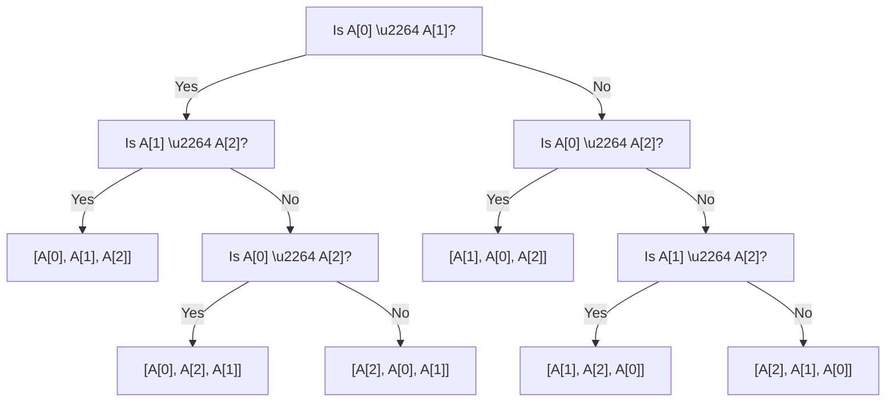
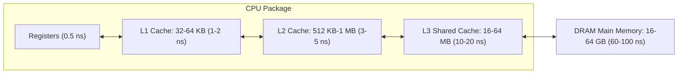

import { Callout } from "fumadocs-ui/components/callout";
import { Tabs, Tab } from "fumadocs-ui/components/tabs";
import { Steps, Step } from "fumadocs-ui/components/steps";
import { Cards, Card } from "fumadocs-ui/components/card";

## The Mathematical Essence of Sorting

At its fundamental mathematical level, sorting an array of $N$ elements is equivalent to finding a permutation $\pi$ of the indices $\{0, 1, \dots, N-1\}$ such that:

$$
A[\pi(0)] \le A[\pi(1)] \le A[\pi(2)] \le \dots \le A[\pi(N-1)]
$$

To understand why some algorithms take $\mathcal{O}(N^2)$ while others achieve $\mathcal{O}(N \log N)$ or $\mathcal{O}(N)$, we must examine two cornerstone mathematical concepts: **Inversions** and the **Decision Tree Lower Bound**.

---

## Inversions and the Cost of Adjacent Swapping

### What Is an Inversion?

Given an array $A$ of $N$ elements, an **inversion** is an ordered pair of indices $(i, j)$ such that:

$$
i < j \quad \text{and} \quad A[i] > A[j]
$$

The total number of inversions in an array, denoted as $I(A)$, measures its degree of "unsortedness":

- **Sorted array:** $I(A) = 0$ (e.g., `[1, 2, 3, 4, 5]`).
- **Reverse-sorted array:** $I(A) = \frac{N(N-1)}{2} = \binom{N}{2}$ (every pair is inverted, e.g., `[5, 4, 3, 2, 1]`).
- **Random uniform permutation:** The expected number of inversions is:

$$
\mathbb{E}[I(A)] = \frac{1}{2} \binom{N}{2} = \frac{N(N-1)}{4} = \Theta(N^2)
$$

### The Fundamental Swap Theorem

<Callout type="info" title="Theorem: Single Inversion Elimination">
Swapping two **adjacent** out-of-order elements $A[i]$ and $A[i+1]$ (where $A[i] > A[i+1]$) decreases the total inversion count $I(A)$ by **exactly $1$**, and leaves all other pairs in the array completely unaffected.
</Callout>

**Proof:**
Consider any other element $A[k]$ where $k \neq i$ and $k \neq i+1$:

1. If $k < i$, both $(k, i)$ and $(k, i+1)$ maintain their relative order because both elements were to the right of $k$.
2. If $k > i+1$, both $(i, k)$ and $(i+1, k)$ maintain their relative order because both elements were to the left of $k$.
3. The only pair whose relative order changed is $(i, i+1)$. Since $A[i] > A[i+1]$ prior to the swap, the inversion is resolved. $\blacksquare$

### The $\Omega(N^2)$ Adjacent-Swap Barrier

Because every adjacent swap can eliminate at most $1$ inversion, any sorting algorithm that restricts itself to swapping adjacent elements—such as Bubble Sort, standard Selection Sort, or adjacent Insertion Sort—**must perform at least $I(A)$ swap operations**.

Since an average random array has $\frac{N(N-1)}{4}$ inversions:

$$
T_{\text{avg}}(N) \ge \frac{N(N-1)}{4} = \Omega(N^2)
$$

To break past this $\Omega(N^2)$ barrier, advanced sorting algorithms (QuickSort, MergeSort, ShellSort) **must swap elements over long distances**, canceling many inversions with a single operation!

---

## The Information-Theoretic Lower Bound: $\Omega(N \log N)$

Why can't a comparison-based sorting algorithm run in $\mathcal{O}(N)$ or $\mathcal{O}(N \log \log N)$? The answer is dictated by information theory and decision trees.

### The Decision Tree Model

In any comparison-based sort, the algorithm gathers information about the input solely by asking binary questions: _"Is $A[i] \le A[j]$?"_

We can model every comparison algorithm as an abstract **binary decision tree**:

1. **Internal nodes:** Represent a comparison between two elements $A[i]$ and $A[j]$.
2. **Left / Right edges:** Represent the two possible outcomes: $\text{True}$ ($A[i] \le A[j]$) or $\text{False}$ ($A[i] > A[j]$).
3. **Leaves:** Represent the final output permutation $\pi$ that places all elements in sorted order.



### The Mathematical Derivation

<Steps>
<Step>
### Count the Minimum Number of Leaves

An array of $N$ distinct elements has $N!$ (factorial) possible initial permutations. For the sorting algorithm to be correct on every possible input, each permutation must lead to a distinct leaf in the decision tree. Therefore, the number of leaves $L$ must satisfy:

$$
L \ge N!
$$

</Step>

<Step>
### Relate Tree Height to Leaf Count

A binary tree of height $h$ (where $h$ is the maximum number of comparisons performed along any root-to-leaf path) can have at most $2^h$ leaves:

$$
2^h \ge L \ge N!
$$

Taking the base-2 logarithm on both sides:

$$
h \ge \log_2(N!)
$$

</Step>

<Step>
### Expand Using Stirling's Approximation

By Stirling's approximation for large factorials:

$$
\ln(N!) = N \ln N - N + \mathcal{O}(\ln N)
$$

Converting to base 2:

$$
\log_2(N!) = N \log_2 N - N \log_2 e + \mathcal{O}(\log_2 N) \approx N \log_2 N - 1.44269 N
$$

Alternatively, by simple summation:

$$
\log_2(N!) = \sum_{k=1}^N \log_2 k \ge \sum_{k=\lceil N/2 \rceil}^N \log_2(N/2) = \frac{N}{2} \log_2\left(\frac{N}{2}\right) = \frac{N}{2}(\log_2 N - 1) = \Omega(N \log N)
$$

</Step>
</Steps>

<Callout type="error" title="Fundamental Law">
  Any comparison-based algorithm must perform at least $\lceil \log_2(N!) \rceil
  \approx N \log_2 N - 1.44 N$ comparisons in the worst case. **No comparison
  sort can asymptotically beat $\Omega(N \log N)$.**
</Callout>

---

## Hardware Architecture & Modern Cache Locality

In textbook algorithm analysis, Merge Sort and QuickSort are both classified as $\mathcal{O}(N \log N)$. However, on modern CPU hardware (x86-64, ARM Neoverse, Apple Silicon), **QuickSort routinely executes $2\times$ to $3\times$ faster than Merge Sort**. Why?

The explanation lies in the memory hierarchy and cache architectures:



### 1. Spatial Locality & Hardware Prefetchers

- **QuickSort Partitioning:** The Hoare or Lomuto partitioning routine increments and decrements pointers linearly through adjacent array indices (`i++`, `j--`).
- Hardware prefetchers detect this linear sequential stream and pull entire $64$-byte cache lines from DRAM into L1 before the CPU instruction even requests them. Cache hit rates frequently exceed **$98\%$**.

### 2. Memory Allocation & Auxiliary Buffers

- **Merge Sort:** Standard Merge Sort requires an auxiliary buffer of size $N$.
- Dynamic allocation (`malloc` / `new`) incurs kernel allocator locks and virtual memory page mapping overhead.
- Writing to and reading from an auxiliary buffer doubles the total memory bus traffic: elements are read into CPU registers, written to scratch memory, and read back to original memory.
- When $N$ exceeds the size of L3 cache (e.g., $10^8$ items = 800 MB), Merge Sort thrashes main memory with cache eviction, whereas QuickSort's recursive partitions rapidly shrink until they fit entirely into ultra-fast L2/L1 cache!

---

## Production Engine Survey: What Real Systems Use

Standard libraries do not use pure textbook QuickSort or pure MergeSort. They use highly tuned hybrids engineered for safety, stability, and speed:

<Tabs items={["Python (CPython)", "JavaScript (V8 / Node.js)", "C++ (libstdc++ / libc++)", "Linux Kernel"]}>
  <Tab value="Python (CPython)">
    ### Python: TimSort & Powersort
    - **Engine:** TimSort (authored by Tim Peters in 2002), enhanced with Powersort heuristics (CPython 3.11+).
    - **Design:** Adaptive merge sort. Exploits natural ascending or descending runs already existing in the data.
    - **Small array threshold:** Sorts slices of size $< 64$ using Binary Insertion Sort.
    - **Guarantees:** Strictly $\mathcal{O}(N \log N)$ worst-case, $\mathcal{O}(N)$ best-case for sorted or reverse-sorted data, and **strictly stable**.
  </Tab>
  <Tab value="JavaScript (V8 / Node.js)">
    ### JavaScript: Dual-Pivot QuickSort $\to$ TimSort
    - **History:** V8 previously used an in-place Dual-Pivot QuickSort for large arrays and Insertion Sort for arrays with $\le 10$ elements.
    - **The Breaking Change:** ECMAScript 2019 (ES10) mandated that `Array.prototype.sort()` **must be stable**.
    - **Current Implementation:** V8 shifted completely to an optimized implementation of **TimSort**, guaranteeing stability across all modern browsers and Node.js runtimes.
  </Tab>
  <Tab value="C++ (libstdc++ / libc++)">
    ### C++ STL: IntroSort
    - **Engine:** IntroSort (David Musser, 1997) implemented in `std::sort`.
    - **Design:**
      1. Begins with standard QuickSort (using Median-of-Three pivot).
      2. Tracks recursion stack depth. If depth exceeds $2 \lfloor \log_2 N \rfloor$, it **immediately switches to HeapSort**. This eliminates QuickSort's $\mathcal{O}(N^2)$ worst-case Algorithmic Denial-of-Service (DoS) vulnerability!
      3. For partitions with $< 16$ elements, leaves them unsorted and finishes with a single fast pass of Insertion Sort.
    - **Stability:** Unstable. For stability, C++ provides `std::stable_sort` (which uses MergeSort/TimSort).
  </Tab>
  <Tab value="Linux Kernel">
    ### Linux Kernel: HeapSort (`lib/sort.c`)
    - **Engine:** In-place non-recursive HeapSort.
    - **Why not QuickSort?** The Linux kernel has a strict, tiny stack frame limit (typically $8\text{ KB}$ or $16\text{ KB}$ per thread in kernel space). QuickSort recursion risks catastrophic kernel stack overflow panic.
    - **Why not MergeSort?** Dynamic memory allocations (`kmalloc`) inside the kernel can fail under low-memory conditions or sleep the kernel.
    - **Verdict:** HeapSort guarantees strictly $\mathcal{O}(1)$ auxiliary memory and strictly $\mathcal{O}(N \log N)$ worst-case execution time under all memory pressure conditions.
  </Tab>
</Tabs>

---

## Measuring Inversions in $\mathcal{O}(N \log N)$ Time

Counting inversions using brute-force pairwise comparisons takes $\mathcal{O}(N^2)$. However, we can compute the exact inversion count in $\mathcal{O}(N \log N)$ by instrumenting the merge step of Merge Sort:

<Tabs items={["TypeScript", "Python"]}>
  <Tab value="TypeScript">
```typescript
/**
 * Computes the total number of inversions in an array using an enhanced Merge Sort.
 * Time Complexity: O(N log N)
 * Space Complexity: O(N) auxiliary buffer
 */
export function countInversions(arr: number[]): { sorted: number[]; inversions: number } {
  const temp = new Array<number>(arr.length);
  const copy = [...arr];

function mergeAndCount(left: number, mid: number, right: number): number {
let i = left; // Pointer for left sub-array
let j = mid + 1; // Pointer for right sub-array
let k = left; // Pointer for merged temp buffer
let invCount = 0;

    while (i <= mid && j <= right) {
      if (copy[i] <= copy[j]) {
        temp[k++] = copy[i++];
      } else {
        // copy[i] > copy[j] -> inversion detected!
        // All elements from copy[i] through copy[mid] are greater than copy[j]
        invCount += (mid - i + 1);
        temp[k++] = copy[j++];
      }
    }

    while (i <= mid) temp[k++] = copy[i++];
    while (j <= right) temp[k++] = copy[j++];
    for (let idx = left; idx <= right; idx++) copy[idx] = temp[idx];

    return invCount;

}

function sortAndCount(left: number, right: number): number {
let invCount = 0;
if (left < right) {
const mid = Math.floor(left + (right - left) / 2);
invCount += sortAndCount(left, mid);
invCount += sortAndCount(mid + 1, right);
invCount += mergeAndCount(left, mid, right);
}
return invCount;
}

const totalInversions = sortAndCount(0, copy.length - 1);
return { sorted: copy, inversions: totalInversions };
}

// Example usage:
const input = [8, 4, 2, 1];
const result = countInversions(input);
console.log(`Original: [${input}]`);
console.log(`Sorted:   [${result.sorted}]`);
console.log(`Inversions: ${result.inversions}`); // Output: 6

````
  </Tab>
  <Tab value="Python">
```python
from typing import List, Tuple

def count_inversions(arr: List[int]) -> Tuple[List[int], int]:
    """
    Computes the total number of inversions in arr using Divide-and-Conquer.
    Time Complexity: O(N log N)
    Space Complexity: O(N) auxiliary
    """
    elements = list(arr)
    temp = [0] * len(elements)

    def merge_and_count(left: int, mid: int, right: int) -> int:
        i = left
        j = mid + 1
        k = left
        inv_count = 0

        while i <= mid and j <= right:
            if elements[i] <= elements[j]:
                temp[k] = elements[i]
                i += 1
            else:
                # elements[i] > elements[j]
                # Because elements[i..mid] is sorted, all elements from i to mid form inversions with elements[j]
                inv_count += (mid - i + 1)
                temp[k] = elements[j]
                j += 1
            k += 1

        while i <= mid:
            temp[k] = elements[i]
            i += 1
            k += 1

        while j <= right:
            temp[k] = elements[j]
            j += 1
            k += 1

        for idx in range(left, right + 1):
            elements[idx] = temp[idx]

        return inv_count

    def sort_and_count(left: int, right: int) -> int:
        inv_count = 0
        if left < right:
            mid = (left + right) // 2
            inv_count += sort_and_count(left, mid)
            inv_count += sort_and_count(mid + 1, right)
            inv_count += merge_and_count(left, mid, right)
        return inv_count

    total = sort_and_count(0, len(elements) - 1)
    return elements, total


if __name__ == "__main__":
    test_arr = [8, 4, 2, 1]
    sorted_arr, invs = count_inversions(test_arr)
    print(f"Original: {test_arr}")
    print(f"Sorted:   {sorted_arr}")
    print(f"Inversions: {invs}")  # 6 -> (8,4), (8,2), (8,1), (4,2), (4,1), (2,1)
````

  </Tab>
</Tabs>
