import { Callout } from "fumadocs-ui/components/callout";
import { Tabs, Tab } from "fumadocs-ui/components/tabs";
import { Steps, Step } from "fumadocs-ui/components/steps";
import { Cards, Card } from "fumadocs-ui/components/card";

When a problem involves tracking which subset of a universe of elements $\{0, 1, \dots, N-1\}$ has been chosen, visited, or covered, we can represent each subset as an integer **bitmask**:

$$\text{mask} = \sum_{i \in S} 2^i$$

- If bit $i$ is $1$, element $i$ is present in the subset.
- If bit $i$ is $0$, element $i$ is absent.

For $N \le 20$, the number of subsets $2^N \le 1{,}048{,}576$, fitting comfortably into modern RAM cache hierarchies.

---

## 1. Bitwise Manipulation Primitives

| Operation                        | Bitwise Syntax           | Complexity                       |
| :------------------------------- | :----------------------- | :------------------------------- |
| **Check if $i$ is in mask**      | `(mask >> i) & 1`        | $\mathcal{O}(1)$                 |
| **Add $i$ to mask**              | `mask \| (1 << i)`       | $\mathcal{O}(1)$                 |
| **Remove $i$ from mask**         | `mask & ~(1 << i)`       | $\mathcal{O}(1)$                 |
| **Toggle $i$ in mask**           | `mask ^ (1 << i)`        | $\mathcal{O}(1)$                 |
| **Iterate all submasks of mask** | `sub = (sub - 1) & mask` | $\mathcal{O}(3^N)$ for all masks |

### The Submask Iteration Proof ($\mathcal{O}(3^N)$)

To iterate over all submasks of every mask:

```cpp
for (int mask = 0; mask < (1 << n); ++mask) {
    for (int sub = mask; sub > 0; sub = (sub - 1) & mask) {
        // process submask
    }
}
```

The total iterations across all masks is $\sum_{k=0}^N \binom{N}{k} 2^k = (1 + 2)^N = 3^N$, vastly faster than naive checking of all pairs ($4^N$).

---

## 2. Canonical Problem: Traveling Salesperson Problem (TSP)

Given $N$ cities and a distance matrix $dist[u][v]$, find the minimum cost tour visiting every city exactly once and returning to the start city 0.

- Naive brute-force permutation search: $\mathcal{O}(N!)$ (for $N = 20$, $20! \approx 2.4 \times 10^{18}$, impossible).
- **Held-Karp Bitmask DP**: $\mathcal{O}(N^2 2^N)$ (for $N = 20$, $20^2 \times 2^{20} \approx 4 \times 10^8$ operations, solvable in ~1 second).

### Recurrence

Let $dp[mask][u]$ be the minimum distance to visit all cities represented in $mask$, currently ending at city $u$:

$$dp[mask \mid 2^v][v] = \min_{u \in mask, \; v \notin mask} \big( dp[mask][u] + dist[u][v] \big)$$

```mermaid
flowchart LR
    S1["mask: 0011 (visited 0, 1)<br/>curr: city 1"] -->|"travel 1 -> 2 (cost: dist[1][2])"| S2["mask: 0111 (visited 0, 1, 2)<br/>curr: city 2"]

    style S1 fill:#0f172a,stroke:#38bdf8,stroke-width:2px
    style S2 fill:#064e3b,stroke:#34d399,stroke-width:2px
```



---

## 3. Implementation

<Tabs items={["Python", "TypeScript", "C++"]}>
<Tab value="Python">
```python
def tsp_held_karp(num_cities: int, dist: list[list[float]]) -> float:
    """Computes minimum TSP tour in O(N^2 * 2^N) time."""
    num_states = 1 << num_cities
    dp = [[float('inf')] * num_cities for _ in range(num_states)]
    
    # Base case: start at city 0
    dp[1][0] = 0
    
    for mask in range(1, num_states):
        for u in range(num_cities):
            if dp[mask][u] == float('inf'):
                continue
            # Try moving to unvisited city v
            for v in range(num_cities):
                if not (mask & (1 << v)):
                    next_mask = mask | (1 << v)
                    cost = dp[mask][u] + dist[u][v]
                    if cost < dp[next_mask][v]:
                        dp[next_mask][v] = cost
                        
    # Return to city 0 from full mask
    full_mask = num_states - 1
    return min(dp[full_mask][u] + dist[u][0] for u in range(num_cities))
```
</Tab>
<Tab value="TypeScript">
```typescript
export function tspHeldKarp(numCities: number, dist: number[][]): number {
  const numStates = 1 << numCities;
  const dp: Float64Array[] = Array.from(
    { length: numStates },
    () => new Float64Array(numCities).fill(Infinity)
  );

dp[1][0] = 0;

for (let mask = 1; mask < numStates; mask++) {
for (let u = 0; u < numCities; u++) {
if (dp[mask][u] === Infinity) continue;

      for (let v = 0; v < numCities; v++) {
        if (!(mask & (1 << v))) {
          const nextMask = mask | (1 << v);
          const cost = dp[mask][u] + dist[u][v];
          if (cost < dp[nextMask][v]) {
            dp[nextMask][v] = cost;
          }
        }
      }
    }

}

const fullMask = numStates - 1;
let minTour = Infinity;
for (let u = 0; u < numCities; u++) {
const cost = dp[fullMask][u] + dist[u][0];
if (cost < minTour) minTour = cost;
}
return minTour;
}

````
</Tab>
<Tab value="C++">
```cpp
#include <vector>
#include <algorithm>
#include <limits>

const long long INF = 1e18;

long long tspHeldKarp(int numCities, const std::vector<std::vector<long long>>& dist) {
    int numStates = 1 << numCities;
    std::vector<std::vector<long long>> dp(numStates, std::vector<long long>(numCities, INF));

    dp[1][0] = 0;

    for (int mask = 1; mask < numStates; ++mask) {
        for (int u = 0; u < numCities; ++u) {
            if (dp[mask][u] == INF) continue;

            for (int v = 0; v < numCities; ++v) {
                if (!(mask & (1 << v))) {
                    int nextMask = mask | (1 << v);
                    dp[nextMask][v] = std::min(dp[nextMask][v], dp[mask][u] + dist[u][v]);
                }
            }
        }
    }

    int fullMask = numStates - 1;
    long long minTour = INF;
    for (int u = 0; u < numCities; ++u) {
        minTour = std::min(minTour, dp[fullMask][u] + dist[u][0]);
    }
    return minTour;
}
````

</Tab>
</Tabs>
