import { Callout } from "fumadocs-ui/components/callout";
import { Tabs, Tab } from "fumadocs-ui/components/tabs";
import { Steps, Step } from "fumadocs-ui/components/steps";
import { Cards, Card } from "fumadocs-ui/components/card";

**Digit Dynamic Programming** solves counting and optimization problems over integers in a range $[A, B]$ where $B$ can be as large as $10^{18}$.

Instead of iterating through billions of numbers (which would take years), Digit DP builds numbers digit-by-digit from most-significant to least-significant in **$\mathcal{O}(\log_{10} B \cdot \text{states})$ time** (typically fewer than $10^5$ operations).

Any query on $[A, B]$ is decomposed via prefix subtraction:

$$\text{count}(A, B) = f(B) - f(A - 1)$$

---

## 1. The Core State Tuple

A typical Digit DP memoization state consists of:

1. `idx`: The current digit position from left to right ($0 \dots L-1$).
2. `tight`: A boolean flag indicating whether the prefix placed so far matches the upper bound prefix of $N$.
   - If `tight == True`: the current digit can only range from $0$ up to $N[idx]$.
   - If `tight == False`: the prefix is strictly smaller than $N$, so the current digit can freely be any digit from $0$ to $9$.
3. `leading_zeros`: A boolean flag indicating whether all preceding digits were $0$ (so numbers like $007$ are treated as $7$, not having duplicate zeros).
4. `mask` / `condition`: Problem-specific state (e.g., bitmask of seen digits, sum of digits mod $K$).

```mermaid
flowchart TD
    State["State: (idx, tight, leading_zeros, mask)"]
    State --> CheckTight{"tight == True?"}
    CheckTight -- "Yes" --> BoundLimit["Limit digit: d in [0 .. N[idx]]"]
    CheckTight -- "No" --> FreeLimit["Free digit: d in [0 .. 9]"]

    BoundLimit --> NextTight["next_tight = (d == N[idx])"]
    FreeLimit --> NextTightFalse["next_tight = False"]

    style State fill:#0f172a,stroke:#38bdf8,stroke-width:2px
    style BoundLimit fill:#1e293b,stroke:#f59e0b,stroke-width:1px
    style FreeLimit fill:#1e293b,stroke:#10b981,stroke-width:1px
```



---

## 2. Implementation: Count Numbers with Unique Digits in $[1, N]$

<Tabs items={["Python", "TypeScript", "C++"]}>
<Tab value="Python">
```python
from functools import lru_cache

def count_unique_digit_numbers(n: int) -> int:
"""Counts numbers in [1, n] with all distinct digits in O(L \* 2^10)."""
s = str(n)
length = len(s)

    @lru_cache(maxsize=None)
    def dp(idx: int, tight: bool, leading_zeros: bool, mask: int) -> int:
        if idx == length:
            return 0 if leading_zeros else 1  # exclude 0

        limit = int(s[idx]) if tight else 9
        res = 0

        for d in range(limit + 1):
            next_tight = tight and (d == limit)
            if leading_zeros and d == 0:
                # Still in leading zeros
                res += dp(idx + 1, next_tight, True, mask)
            else:
                # Check if digit d already used
                if not (mask & (1 << d)):
                    res += dp(idx + 1, next_tight, False, mask | (1 << d))

        return res

    return dp(0, True, True, 0)

````
</Tab>
<Tab value="TypeScript">
```typescript
export function countUniqueDigitNumbers(n: number): number {
  const s = n.toString();
  const len = s.length;
  // memo[idx][tight ? 1 : 0][leading_zeros ? 1 : 0][mask]
  const memo = new Map<string, number>();

  function dp(idx: number, tight: boolean, leadingZeros: boolean, mask: number): number {
    if (idx === len) {
      return leadingZeros ? 0 : 1;
    }

    const key = `${idx},${tight ? 1 : 0},${leadingZeros ? 1 : 0},${mask}`;
    if (memo.has(key)) return memo.get(key)!;

    const limit = tight ? parseInt(s[idx], 10) : 9;
    let res = 0;

    for (let d = 0; d <= limit; d++) {
      const nextTight = tight && d === limit;
      if (leadingZeros && d === 0) {
        res += dp(idx + 1, nextTight, true, mask);
      } else {
        if (!(mask & (1 << d))) {
          res += dp(idx + 1, nextTight, false, mask | (1 << d));
        }
      }
    }

    memo.set(key, res);
    return res;
  }

  return dp(0, true, true, 0);
}
````

</Tab>
<Tab value="C++">
```cpp
#include <string>
#include <vector>
#include <cstring>

long long memo[20][2][2][1024];

long long digitDP(int idx, bool tight, bool leadingZeros, int mask, const std::string& s) {
if (idx == static_cast<int>(s.size())) {
return leadingZeros ? 0 : 1;
}

    if (memo[idx][tight][leadingZeros][mask] != -1) {
        return memo[idx][tight][leadingZeros][mask];
    }

    int limit = tight ? (s[idx] - '0') : 9;
    long long res = 0;

    for (int d = 0; d <= limit; ++d) {
        bool nextTight = tight && (d == limit);
        if (leadingZeros && d == 0) {
            res += digitDP(idx + 1, nextTight, true, mask, s);
        } else {
            if (!(mask & (1 << d))) {
                res += digitDP(idx + 1, nextTight, false, mask | (1 << d), s);
            }
        }
    }

    return memo[idx][tight][leadingZeros][mask] = res;

}

long long countUniqueDigitNumbers(long long n) {
std::string s = std::to_string(n);
std::memset(memo, -1, sizeof(memo));
return digitDP(0, true, true, 0, s);
}

```
</Tab>
</Tabs>
```
