import { Callout } from "fumadocs-ui/components/callout";
import { Tabs, Tab } from "fumadocs-ui/components/tabs";
import { Steps, Step } from "fumadocs-ui/components/steps";
import { Cards, Card } from "fumadocs-ui/components/card";

When optimization problems exceed linear sequences and two-dimensional grids, Dynamic Programming and state-space search scale into higher-dimensional structural topologies:

1. **Bitmask DP**: Compacting combinatorial subsets of items or vertices into machine integers, unlocking exact polynomial algorithms for exponential problems like the Traveling Salesperson Problem (TSP) in $\mathcal{O}(N^2 2^N)$ rather than $\mathcal{O}(N!)$.
2. **Range & Interval DP**: Synthesizing answers over sub-intervals $[i, j]$ by partitioning intervals at optimal split points $k$, iterating strictly over interval lengths.
3. **Digit DP**: Counting numbers in massive numerical intervals $[A, B]$ ($10^{18}$) by constructing digits from left to right with tight prefix bounding.
4. **Meet in the Middle**: Dividing intractable search spaces of size $2^N$ into two halves of size $2^{N/2}$ ($N = 40 \implies 2^{20} \approx 10^6$), recombining them via sorting and two pointers or binary search.

```mermaid
flowchart TD
    subgraph AdvDPCategories["Advanced DP & Search Topologies"]
        direction TB
        Bitmask["Bitmask DP<br/>State: (mask, last_node)<br/>Subset Iteration O(3^N) / TSP O(N² 2^N)"]
        Interval["Interval DP<br/>State: dp[i][j]<br/>Length-based iteration O(N³)"]
        Digit["Digit DP<br/>State: (idx, tight, lead_zero, mask)<br/>Bounded numbers up to 10¹⁸ in O(log N)"]
        MIM["Meet in the Middle<br/>Search Space: 2^N -> 2 · 2^(N/2)<br/>Subset sum & 4-sum optimization"]
    end

    Bitmask --> Interval
    Interval --> Digit
    Digit --> MIM

    style AdvDPCategories fill:#0f172a,stroke:#38bdf8,stroke-width:2px
    style Bitmask fill:#1e293b,stroke:#10b981,stroke-width:1px
    style Interval fill:#1e293b,stroke:#f59e0b,stroke-width:1px
    style Digit fill:#1e293b,stroke:#8b5cf6,stroke-width:1px
    style MIM fill:#1e293b,stroke:#ec4899,stroke-width:1px
```

---

## Paradigm Comparison

| Paradigm               | State Dimension                     | Typical Time Complexity              | State Space Bounds | Canonical Problems                          |
| :--------------------- | :---------------------------------- | :----------------------------------- | :----------------- | :------------------------------------------ |
| **Bitmask DP**         | $(\text{mask}, \text{curr})$        | $\mathcal{O}(N^2 2^N)$               | $N \le 20$         | Traveling Salesperson, Min Cost Matching    |
| **Interval DP**        | $[i, j]$ range                      | $\mathcal{O}(N^3)$                   | $N \le 500$        | Matrix Chain Multiplication, Burst Balloons |
| **Digit DP**           | $(\text{idx}, \text{tight}, \dots)$ | $\mathcal{O}(D \cdot 10 \cdot S)$    | $N \le 10^{18}$    | Count Numbers with Unique Digits            |
| **Meet in the Middle** | $2^{N/2}$ sorted arrays             | $\mathcal{O}(2^{N/2} \log(2^{N/2}))$ | $N \le 40$         | Subset Sum with large $N$, Knapsack split   |

---

## Section Topics

<Cards>
  <Card
    title="Bitmask Dynamic Programming"
    href="./advanced-dynamic-programming-and-search/bitmask-dp"
    icon="Binary"
  >
    Compress subset states into integers and solve TSP and matching problems.
  </Card>
  <Card
    title="Range & Interval DP"
    href="./advanced-dynamic-programming-and-search/range-and-interval-dp"
    icon="Maximize2"
  >
    Synthesize answers from shorter to longer intervals via optimal partition
    points.
  </Card>
  <Card
    title="Digit Dynamic Programming"
    href="./advanced-dynamic-programming-and-search/digit-dp"
    icon="Calculator"
  >
    Count valid integers in ranges up to 10^18 using tight boundary transitions.
  </Card>
  <Card
    title="Meet in the Middle"
    href="./advanced-dynamic-programming-and-search/meet-in-the-middle"
    icon="Split"
  >
    Halve exponential exponents from 2^N to 2^(N/2) using two-phase search and
    merge.
  </Card>
</Cards>
