import { Callout } from "fumadocs-ui/components/callout";
import { Tabs, Tab } from "fumadocs-ui/components/tabs";
import { Steps, Step } from "fumadocs-ui/components/steps";
import { Cards, Card } from "fumadocs-ui/components/card";

**Meet in the Middle** is an algorithmic technique designed to solve subset search problems where $N$ is too large for exhaustive brute-force ($N \approx 40$), but too small for polynomial approximations.

- Full search space of size $2^{40} \approx 1.1 \times 10^{12}$ evaluations (will time out on any machine).
- By splitting the elements into two equal halves of size $N/2 = 20$:
  $$2^{20} \approx 1{,}048{,}576 \text{ operations}$$
- We generate all subset sums of both halves, sort the second half, and use **binary search** or **two pointers** to recombine them in:
  $$\mathcal{O}\big(2^{N/2} \cdot \log(2^{N/2})\big) = \mathcal{O}\big(N \cdot 2^{N/2}\big)$$

```mermaid
flowchart TD
    Input["Input Array of size N = 40"]
    LeftHalf["Left Half (size 20)<br/>Generate 2²⁰ subset sums"]
    RightHalf["Right Half (size 20)<br/>Generate 2²⁰ subset sums<br/>SORT array"]

    Input --> LeftHalf
    Input --> RightHalf

    LeftHalf --> Merge["For each sum S in Left:<br/>Binary search / Two pointers in Right for target - S"]
    RightHalf --> Merge

    style Input fill:#0f172a,stroke:#38bdf8,stroke-width:2px
    style Merge fill:#064e3b,stroke:#34d399,stroke-width:2px
```



---

## 1. Canonical Problem: Exact Subset Sum

Given an array of $N \le 40$ integers and a target sum $T$, determine if any subset sums to exactly $T$.

---

## 2. Implementation

<Tabs items={["Python", "TypeScript", "C++"]}>
<Tab value="Python">
```python
import bisect

def subset_sum_meet_in_middle(arr: list[int], target: int) -> bool:
"""Determines if a subset sums to target for N <= 40 in O(N \* 2^(N/2))."""
n = len(arr)
mid = n // 2
left_part, right_part = arr[:mid], arr[mid:]

    def get_subset_sums(sub: list[int]) -> list[int]:
        sums = [0]
        for num in sub:
            sums += [s + num for s in sums]
        return sums

    left_sums = get_subset_sums(left_part)
    right_sums = sorted(get_subset_sums(right_part))

    for s in left_sums:
        needed = target - s
        idx = bisect.bisect_left(right_sums, needed)
        if idx < len(right_sums) and right_sums[idx] == needed:
            return True

    return False

````
</Tab>
<Tab value="TypeScript">
```typescript
export function subsetSumMeetInMiddle(arr: number[], target: number): boolean {
  const n = arr.length;
  const mid = Math.floor(n / 2);
  const left = arr.slice(0, mid);
  const right = arr.slice(mid);

  function getSubsetSums(sub: number[]): number[] {
    const sums: number[] = [0];
    for (const num of sub) {
      const len = sums.length;
      for (let i = 0; i < len; i++) {
        sums.push(sums[i] + num);
      }
    }
    return sums;
  }

  const leftSums = getSubsetSums(left);
  const rightSums = getSubsetSums(right).sort((a, b) => a - b);

  for (const s of leftSums) {
    const needed = target - s;
    let low = 0, high = rightSums.length - 1;
    while (low <= high) {
      const m = (low + high) >> 1;
      if (rightSums[m] === needed) return true;
      if (rightSums[m] < needed) low = m + 1;
      else high = m - 1;
    }
  }

  return false;
}
````

</Tab>
<Tab value="C++">
```cpp
#include <vector>
#include <algorithm>

std::vector<long long> getSubsetSums(const std::vector<long long>& sub) {
std::vector<long long> sums = {0};
for (long long num : sub) {
int sz = static_cast<int>(sums.size());
for (int i = 0; i < sz; ++i) {
sums.push_back(sums[i] + num);
}
}
return sums;
}

bool subsetSumMeetInMiddle(const std::vector<long long>& arr, long long target) {
int n = static_cast<int>(arr.size());
int mid = n / 2;

    std::vector<long long> left(arr.begin(), arr.begin() + mid);
    std::vector<long long> right(arr.begin() + mid, arr.end());

    std::vector<long long> leftSums = getSubsetSums(left);
    std::vector<long long> rightSums = getSubsetSums(right);

    std::sort(rightSums.begin(), rightSums.end());

    for (long long s : leftSums) {
        long long needed = target - s;
        if (std::binary_search(rightSums.begin(), rightSums.end(), needed)) {
            return true;
        }
    }

    return false;

}

```
</Tab>
</Tabs>
```
