import { Callout } from "fumadocs-ui/components/callout";
import { Tabs, Tab } from "fumadocs-ui/components/tabs";
import { Steps, Step } from "fumadocs-ui/components/steps";
import { Cards, Card } from "fumadocs-ui/components/card";

In **Interval Dynamic Programming**, the state $dp[i][j]$ represents the optimal solution for the contiguous subarray or interval $[i, j]$.

The optimal solution for range $[i, j]$ is synthesized by evaluating an optimal partition point or last action $k$ ($i \le k < j$):

$$dp[i][j] = \min_{i \le k < j} \Big( dp[i][k] + dp[k+1][j] + \text{merge\_cost}(i, k, j) \Big)$$

---

## 1. Loop Order Invariant

<Callout type="warn" title="Why Standard Row/Column Iteration Fails">
  You **cannot** iterate $i$ from $0$ to $N$ and $j$ from $0$ to $N$. Computing
  $dp[i][j]$ requires that all shorter sub-intervals $[i, k]$ and $[k+1, j]$ are
  already computed and finalized! The **outermost loop must always be the
  interval length $L$** (from $1$ or $2$ up to $N$).

```mermaid
flowchart TD
    subgraph LengthOrder["Iterating by Interval Length L"]
        L1["L = 1: Single elements (Base cases)"]
        L2["L = 2: Adjacent pairs [i .. i+1]"]
        L3["L = 3: Triples [i .. i+2]"]
        LN["L = N: Complete array [0 .. N-1]"]
        L1 --> L2 --> L3 --> LN
    end

    style LengthOrder fill:#0f172a,stroke:#38bdf8,stroke-width:2px
    style LN fill:#064e3b,stroke:#34d399,stroke-width:2px
```

</Callout>



---

## 2. Canonical Problem: Matrix Chain Multiplication

Given matrices $A_1, A_2, \dots, A_n$ where matrix $A_i$ has dimension $p_{i-1} \times p_i$, find the optimal parenthesization minimizing total scalar multiplications:

$$dp[i][j] = \min_{i \le k < j} \Big( dp[i][k] + dp[k+1][j] + p_{i-1} \cdot p_k \cdot p_j \Big)$$

---

## 3. Implementation

<Tabs items={["Python", "TypeScript", "C++"]}>
<Tab value="Python">
```python
def matrix_chain_multiplication(dims: list[int]) -> int:
    """Computes minimum scalar multiplications in O(N^3) time."""
    n = len(dims) - 1  # number of matrices
    dp = [[0] * n for _ in range(n)]
    
    # Outer loop: interval length L from 2 to n
    for length in range(2, n + 1):
        for i in range(n - length + 1):
            j = i + length - 1
            dp[i][j] = float('inf')
            for k in range(i, j):
                cost = dp[i][k] + dp[k + 1][j] + dims[i] * dims[k + 1] * dims[j + 1]
                if cost < dp[i][j]:
                    dp[i][j] = cost
                    
    return dp[0][n - 1]
```
</Tab>
<Tab value="TypeScript">
```typescript
export function matrixChainMultiplication(dims: number[]): number {
  const n = dims.length - 1;
  const dp: Float64Array[] = Array.from({ length: n }, () => new Float64Array(n));

for (let len = 2; len <= n; len++) {
for (let i = 0; i <= n - len; i++) {
const j = i + len - 1;
dp[i][j] = Infinity;
for (let k = i; k < j; k++) {
const cost = dp[i][k] + dp[k + 1][j] + dims[i] _ dims[k + 1] _ dims[j + 1];
if (cost < dp[i][j]) {
dp[i][j] = cost;
}
}
}
}

return dp[0][n - 1];
}

````
</Tab>
<Tab value="C++">
```cpp
#include <vector>
#include <algorithm>
#include <limits>

long long matrixChainMultiplication(const std::vector<int>& dims) {
    int n = static_cast<int>(dims.size()) - 1;
    std::vector<std::vector<long long>> dp(n, std::vector<long long>(n, 0));

    for (int len = 2; len <= n; ++len) {
        for (int i = 0; i <= n - len; ++i) {
            int j = i + len - 1;
            dp[i][j] = std::numeric_limits<long long>::max();
            for (int k = i; k < j; ++k) {
                long long cost = dp[i][k] + dp[k + 1][j] +
                                 1LL * dims[i] * dims[k + 1] * dims[j + 1];
                dp[i][j] = std::min(dp[i][j], cost);
            }
        }
    }

    return dp[0][n - 1];
}
````

</Tab>
</Tabs>
