import { Callout } from "fumadocs-ui/components/callout";
import { Tabs, Tab } from "fumadocs-ui/components/tabs";
import { Steps, Step } from "fumadocs-ui/components/steps";
import { Cards, Card } from "fumadocs-ui/components/card";

The **Bellman-Ford algorithm** solves the Single-Source Shortest Path (SSSP) problem on arbitrary directed graphs with **negative edge weights**.

It also serves as the principal detection algorithm for **negative-weight cycles** (cycles whose sum of edge weights is strictly negative, allowing paths to achieve $-\infty$ cost).

---

## 1. Relaxation Invariant & Cycle Detection

In any simple shortest path with $V$ vertices, there can be at most $V - 1$ edges. Therefore, after relaxing all edges $V - 1$ times, every shortest path must have stabilized.

If on the **$V$-th pass**, any edge $(u, v)$ can still be relaxed:

$$\text{dist}[u] + w < \text{dist}[v]$$

Then vertex $v$ belongs to, or is reachable from, a **negative-weight cycle**.

```mermaid
flowchart TD
    Start["dist[source] = 0, all others INF"] --> PassLoop["Pass 1 to V - 1: Relax all E edges"]
    PassLoop --> PassV["Pass V: Check if ANY edge can still be relaxed"]
    PassV -- "Yes (relaxation possible)" --> NegCycle["NEGATIVE CYCLE DETECTED!<br/>Distances decrease infinitely to -INF"]
    PassV -- "No (no changes)" --> Optimal["All Shortest Distances Optimal"]

    style Start fill:#0f172a,stroke:#38bdf8,stroke-width:2px
    style NegCycle fill:#7f1d1d,stroke:#ef4444,stroke-width:2px
    style Optimal fill:#064e3b,stroke:#34d399,stroke-width:2px
```



---

## 2. Implementation

<Tabs items={["Python", "TypeScript", "C++"]}>
<Tab value="Python">
```python
def bellman_ford(num_nodes: int, edges: list[tuple[int, int, int]], source: int):
    """Computes SSSP with negative weights and detects negative cycles in O(V * E)."""
    dist = [float('inf')] * num_nodes
    dist[source] = 0
    
    # Relax all edges V - 1 times
    for _ in range(num_nodes - 1):
        updated = False
        for u, v, w in edges:
            if dist[u] != float('inf') and dist[u] + w < dist[v]:
                dist[v] = dist[u] + w
                updated = True
        if not updated:
            break  # Early termination
            
    # Check for negative cycle on V-th pass
    has_negative_cycle = False
    for u, v, w in edges:
        if dist[u] != float('inf') and dist[u] + w < dist[v]:
            has_negative_cycle = True
            break
            
    return dist, has_negative_cycle
```
</Tab>
<Tab value="TypeScript">
```typescript
export function bellmanFord(
  numNodes: number,
  edges: [number, number, number][],
  source: number
): { dist: Float64Array; hasNegativeCycle: boolean } {
  const dist = new Float64Array(numNodes).fill(Infinity);
  dist[source] = 0;

for (let i = 0; i < numNodes - 1; i++) {
let updated = false;
for (const [u, v, w] of edges) {
if (dist[u] !== Infinity && dist[u] + w < dist[v]) {
dist[v] = dist[u] + w;
updated = true;
}
}
if (!updated) break;
}

let hasNegativeCycle = false;
for (const [u, v, w] of edges) {
if (dist[u] !== Infinity && dist[u] + w < dist[v]) {
hasNegativeCycle = true;
break;
}
}

return { dist, hasNegativeCycle };
}

````
</Tab>
<Tab value="C++">
```cpp
#include <vector>
#include <tuple>
#include <limits>

const long long INF = std::numeric_limits<long long>::max();

std::pair<std::vector<long long>, bool> bellmanFord(
    int numNodes,
    const std::vector<std::tuple<int, int, long long>>& edges,
    int source
) {
    std::vector<long long> dist(numNodes, INF);
    dist[source] = 0;

    for (int i = 0; i < numNodes - 1; ++i) {
        bool updated = false;
        for (const auto& [u, v, w] : edges) {
            if (dist[u] != INF && dist[u] + w < dist[v]) {
                dist[v] = dist[u] + w;
                updated = true;
            }
        }
        if (!updated) break;
    }

    bool hasNegativeCycle = false;
    for (const auto& [u, v, w] : edges) {
        if (dist[u] != INF && dist[u] + w < dist[v]) {
            hasNegativeCycle = true;
            break;
        }
    }

    return {dist, hasNegativeCycle};
}
````

</Tab>
</Tabs>
