import { Callout } from "fumadocs-ui/components/callout";
import { Tabs, Tab } from "fumadocs-ui/components/tabs";
import { Steps, Step } from "fumadocs-ui/components/steps";
import { Cards, Card } from "fumadocs-ui/components/card";

Dijkstra's algorithm is the gold standard for Single-Source Shortest Paths (SSSP) on graphs with **strictly non-negative edge weights** ($w \ge 0$).

It maintains an expanding frontier of visited vertices whose exact shortest distances have been finalized, extracting the minimum distance node using a priority queue (min-heap).

---

## 1. Algorithm Mechanics & The Non-Negative Weight Invariant

At every step, Dijkstra extracts node $u$ with the minimum tentative distance $d[u]$ from the Priority Queue:

$$\text{Relax}(u, v, w): \quad \text{if } \text{dist}[u] + w < \text{dist}[v] \implies \text{dist}[v] = \text{dist}[u] + w$$

```mermaid
flowchart TD
    Extract["Pop (d, u) with minimum d from Min-Heap"] --> StaleCheck{"Is d > dist[u]?"}
    StaleCheck -- "Yes" --> Drop["Drop Stale Entry"]
    StaleCheck -- "No" --> RelaxLoop["For each neighbor v of u:"]
    RelaxLoop --> Cond{"dist[u] + w < dist[v]"}
    Cond -- "True" --> Push["dist[v] = dist[u] + w<br/>Push (dist[v], v) to Min-Heap"]
    Cond -- "False" --> Skip["Continue"]

    style Extract fill:#0f172a,stroke:#38bdf8,stroke-width:2px
    style Push fill:#064e3b,stroke:#34d399,stroke-width:2px
```



<Callout type="warn" title="Why Dijkstra Fails on Negative Weights">
  Dijkstra's greedy choice assumes that once a vertex $u$ is extracted with
  minimum distance from the heap, no future path can ever reach $u$ with a
  smaller cost. If negative edge weights exist, a longer hop sequence could
  subsequently reduce $u$'s cost, violating the invariant and producing
  incorrect distances or infinite loops.
</Callout>

---

## 2. Implementation

<Tabs items={["Python", "TypeScript", "C++"]}>
<Tab value="Python">
```python
import heapq

def dijkstra(num_nodes: int, adj: list[list[tuple[int, int]]], source: int) -> list[float]:
"""Computes SSSP using min-heap in O((V + E) log V)."""
dist = [float('inf')] \* num_nodes
dist[source] = 0
pq = [(0, source)] # (distance, node)

    while pq:
        d, u = heapq.heappop(pq)

        # Stale entry check
        if d > dist[u]:
            continue

        for v, weight in adj[u]:
            if dist[u] + weight < dist[v]:
                dist[v] = dist[u] + weight
                heapq.heappush(pq, (dist[v], v))

    return dist

````
</Tab>
<Tab value="TypeScript">
```typescript
export function dijkstra(
  numNodes: number,
  adj: [number, number][][],
  source: number
): Float64Array {
  const dist = new Float64Array(numNodes).fill(Infinity);
  dist[source] = 0;

  // Simple min-heap simulation or binary heap
  const pq: [number, number][] = [[0, source]];

  while (pq.length > 0) {
    // Extract min
    let minIdx = 0;
    for (let i = 1; i < pq.length; i++) {
      if (pq[i][0] < pq[minIdx][0]) minIdx = i;
    }
    const [d, u] = pq.splice(minIdx, 1)[0];

    if (d > dist[u]) continue;

    for (const [v, w] of adj[u]) {
      if (dist[u] + w < dist[v]) {
        dist[v] = dist[u] + w;
        pq.push([dist[v], v]);
      }
    }
  }

  return dist;
}
````

</Tab>
<Tab value="C++">
```cpp
#include <vector>
#include <queue>
#include <limits>

const long long INF = std::numeric_limits<long long>::max();

std::vector<long long> dijkstra(
int numNodes,
const std::vector<std::vector<std::pair<int, long long>>>& adj,
int source
) {
std::vector<long long> dist(numNodes, INF);
dist[source] = 0;

    // Min-heap storing pairs of (distance, vertex)
    std::priority_queue<
        std::pair<long long, int>,
        std::vector<std::pair<long long, int>>,
        std::greater<>
    > pq;

    pq.emplace(0, source);

    while (!pq.empty()) {
        auto [d, u] = pq.top();
        pq.pop();

        if (d > dist[u]) continue;

        for (const auto& [v, w] : adj[u]) {
            if (dist[u] + w < dist[v]) {
                dist[v] = dist[u] + w;
                pq.emplace(dist[v], v);
            }
        }
    }

    return dist;

}

```
</Tab>
</Tabs>
```
