import { Callout } from "fumadocs-ui/components/callout";
import { Tabs, Tab } from "fumadocs-ui/components/tabs";
import { Steps, Step } from "fumadocs-ui/components/steps";
import { Cards, Card } from "fumadocs-ui/components/card";

Because Directed Acyclic Graphs guarantee the absence of directed cycles, they possess an inherent causal ordering. Any function defined recursively on the graph can be evaluated efficiently without infinite loops by processing vertices in **topological order**.

This technique solves:

1. **Longest Path in a DAG** (which is NP-hard on general graphs, but $\mathcal{O}(V + E)$ on DAGs).
2. **Shortest Path in a DAG** (even with arbitrary negative edge weights, in linear $\mathcal{O}(V + E)$ time without Dijkstra or Bellman-Ford).
3. **Number of Distinct Paths** between source $s$ and destination $t$.

---

## 1. Mathematical Formulation

Let $u_1, u_2, \dots, u_V$ be a topological ordering of $G$.

For the **Longest Path** ending at vertex $v$:

$$dp[v] = \max_{(u, v) \in E} \{ dp[u] + \text{weight}(u, v) \}$$

```mermaid
flowchart LR
    A["Node A<br/>dp[A] finalized"] -->|"w1"| V["Node V<br/>dp[V] = max(dp[u] + w)"]
    B["Node B<br/>dp[B] finalized"] -->|"w2"| V
    C["Node C<br/>dp[C] finalized"] -->|"w3"| V

    style V fill:#0f172a,stroke:#38bdf8,stroke-width:2px
    style A fill:#1e293b,stroke:#10b981,stroke-width:1px
    style B fill:#1e293b,stroke:#10b981,stroke-width:1px
    style C fill:#1e293b,stroke:#10b981,stroke-width:1px
```



Because all prerequisites $u$ appear earlier in the topological ordering than $v$, $dp[u]$ is guaranteed to be fully resolved before $dp[v]$ is evaluated.

---

## 2. Implementation: Longest Path in a Weighted DAG

<Tabs items={["Python", "TypeScript", "C++"]}>
<Tab value="Python">
```python
from collections import deque

def longest*path_dag(num_nodes: int, edges: list[tuple[int, int, int]]) -> tuple[int, list[int]]:
"""Computes longest path in a DAG with arbitrary edge weights in O(V + E)."""
adj = [[] for * in range(num_nodes)]
in_degree = [0] \* num_nodes

    for u, v, w in edges:
        adj[u].append((v, w))
        in_degree[v] += 1

    q = deque([i for i in range(num_nodes) if in_degree[i] == 0])
    topo = []
    while q:
        u = q.popleft()
        topo.append(u)
        for v, _ in adj[u]:
            in_degree[v] -= 1
            if in_degree[v] == 0:
                q.append(v)

    dp = [0] * num_nodes
    parent = [-1] * num_nodes

    for u in topo:
        for v, w in adj[u]:
            if dp[u] + w > dp[v]:
                dp[v] = dp[u] + w
                parent[v] = u

    max_dist = max(dp)
    end_node = dp.index(max_dist)

    # Reconstruct path
    path = []
    curr = end_node
    while curr != -1 and dp[curr] > 0:
        path.append(curr)
        curr = parent[curr]
    if curr != -1 and not path:
        path.append(curr)
    path.reverse()

    return max_dist, path

````
</Tab>
<Tab value="TypeScript">
```typescript
export function longestPathDag(
  numNodes: number,
  edges: [number, number, number][]
): { maxDist: number; path: number[] } {
  const adj: [number, number][][] = Array.from({ length: numNodes }, () => []);
  const inDegree = new Int32Array(numNodes);

  for (const [u, v, w] of edges) {
    adj[u].push([v, w]);
    inDegree[v]++;
  }

  const q: number[] = [];
  for (let i = 0; i < numNodes; i++) {
    if (inDegree[i] === 0) q.push(i);
  }

  const topo: number[] = [];
  let head = 0;
  while (head < q.length) {
    const u = q[head++];
    topo.push(u);
    for (const [v] of adj[u]) {
      if (--inDegree[v] === 0) q.push(v);
    }
  }

  const dp = new Float64Array(numNodes).fill(0);
  const parent = new Int32Array(numNodes).fill(-1);

  for (const u of topo) {
    for (const [v, w] of adj[u]) {
      if (dp[u] + w > dp[v]) {
        dp[v] = dp[u] + w;
        parent[v] = u;
      }
    }
  }

  let maxDist = 0;
  let endNode = 0;
  for (let i = 0; i < numNodes; i++) {
    if (dp[i] > maxDist) {
      maxDist = dp[i];
      endNode = i;
    }
  }

  const path: number[] = [];
  let curr = endNode;
  while (curr !== -1 && dp[curr] > 0) {
    path.push(curr);
    curr = parent[curr];
  }
  path.reverse();

  return { maxDist, path };
}
````

</Tab>
<Tab value="C++">
```cpp
#include <vector>
#include <queue>
#include <algorithm>

std::pair<long long, std::vector<int>> longestPathDag(
int numNodes,
const std::vector<std::tuple<int, int, long long>>& edges
) {
std::vector<std::vector<std::pair<int, long long>>> adj(numNodes);
std::vector<int> inDegree(numNodes, 0);

    for (const auto& [u, v, w] : edges) {
        adj[u].emplace_back(v, w);
        ++inDegree[v];
    }

    std::queue<int> q;
    for (int i = 0; i < numNodes; ++i) {
        if (inDegree[i] == 0) q.push(i);
    }

    std::vector<int> topo;
    while (!q.empty()) {
        int u = q.front();
        q.pop();
        topo.push_back(u);
        for (const auto& [v, w] : adj[u]) {
            if (--inDegree[v] == 0) q.push(v);
        }
    }

    std::vector<long long> dp(numNodes, 0);
    std::vector<int> parent(numNodes, -1);

    for (int u : topo) {
        for (const auto& [v, w] : adj[u]) {
            if (dp[u] + w > dp[v]) {
                dp[v] = dp[u] + w;
                parent[v] = u;
            }
        }
    }

    auto maxIt = std::max_element(dp.begin(), dp.end());
    long long maxDist = *maxIt;
    int endNode = std::distance(dp.begin(), maxIt);

    std::vector<int> path;
    int curr = endNode;
    while (curr != -1 && dp[curr] > 0) {
        path.push_back(curr);
        curr = parent[curr];
    }
    std::reverse(path.begin(), path.end());

    return {maxDist, path};

}

```
</Tab>
</Tabs>
```
