import { Callout } from "fumadocs-ui/components/callout";
import { Tabs, Tab } from "fumadocs-ui/components/tabs";
import { Steps, Step } from "fumadocs-ui/components/steps";
import { Cards, Card } from "fumadocs-ui/components/card";

The **Floyd-Warshall algorithm** is a Dynamic Programming algorithm that computes shortest path distances between **every pair of vertices** $(u, v)$ in a weighted directed graph in $\mathcal{O}(V^3)$ time and $\mathcal{O}(V^2)$ space.

It natively supports negative edge weights and can detect negative cycles anywhere in the graph by checking whether any diagonal entry satisfies $dist[i][i] < 0$.

---

## 1. Dynamic Programming Formulation

Let $dist[k][i][j]$ be the shortest path distance from vertex $i$ to vertex $j$ using only intermediate vertices from the prefix set $\{0, 1, \dots, k\}$.

The transition tests whether routing through intermediate vertex $k$ yields a shorter path:

$$dist[k][i][j] = \min\big( dist[k-1][i][j], \; dist[k-1][i][k] + dist[k-1][k][j] \big)$$

```mermaid
flowchart LR
    I["Vertex i"] -->|"direct path: dist[i][j]"| J["Vertex j"]
    I -->|"dist[i][k]"| K["Intermediate Pivot k"]
    K -->|"dist[k][j]"| J

    style K fill:#0f172a,stroke:#38bdf8,stroke-width:2px
```



<Callout type="warn" title="Crucial Loop Ordering">
  The intermediate pivot $k$ **MUST be the outermost loop**! Iterating $i$ or
  $j$ on the outside violates the DP recurrence by attempting to use
  intermediate nodes before their sub-paths are finalized.
</Callout>

---

## 2. Implementation

<Tabs items={["Python", "TypeScript", "C++"]}>
<Tab value="Python">
```python
def floyd_warshall(num_nodes: int, adj_matrix: list[list[float]]):
    """Computes APSP in O(V^3) time."""
    dist = [row[:] for row in adj_matrix]
    
    for k in range(num_nodes):
        for i in range(num_nodes):
            for j in range(num_nodes):
                if dist[i][k] != float('inf') and dist[k][j] != float('inf'):
                    if dist[i][k] + dist[k][j] < dist[i][j]:
                        dist[i][j] = dist[i][k] + dist[k][j]
                        
    # Detect negative cycle: if dist[i][i] < 0
    has_negative_cycle = any(dist[i][i] < 0 for i in range(num_nodes))
    return dist, has_negative_cycle
```
</Tab>
<Tab value="TypeScript">
```typescript
export function floydWarshall(
  numNodes: number,
  matrix: number[][]
): { dist: Float64Array[]; hasNegativeCycle: boolean } {
  const dist: Float64Array[] = Array.from(
    { length: numNodes },
    (_, i) => Float64Array.from(matrix[i])
  );

for (let k = 0; k < numNodes; k++) {
for (let i = 0; i < numNodes; i++) {
for (let j = 0; j < numNodes; j++) {
if (dist[i][k] !== Infinity && dist[k][j] !== Infinity) {
if (dist[i][k] + dist[k][j] < dist[i][j]) {
dist[i][j] = dist[i][k] + dist[k][j];
}
}
}
}
}

let hasNegativeCycle = false;
for (let i = 0; i < numNodes; i++) {
if (dist[i][i] < 0) {
hasNegativeCycle = true;
break;
}
}

return { dist, hasNegativeCycle };
}

````
</Tab>
<Tab value="C++">
```cpp
#include <vector>
#include <limits>
#include <algorithm>

const long long INF = std::numeric_limits<long long>::max();

std::pair<std::vector<std::vector<long long>>, bool> floydWarshall(
    int numNodes,
    const std::vector<std::vector<long long>>& matrix
) {
    auto dist = matrix;

    for (int k = 0; k < numNodes; ++k) {
        for (int i = 0; i < numNodes; ++i) {
            for (int j = 0; j < numNodes; ++j) {
                if (dist[i][k] != INF && dist[k][j] != INF) {
                    dist[i][j] = std::min(dist[i][j], dist[i][k] + dist[k][j]);
                }
            }
        }
    }

    bool hasNegativeCycle = false;
    for (int i = 0; i < numNodes; ++i) {
        if (dist[i][i] < 0) {
            hasNegativeCycle = true;
            break;
        }
    }

    return {dist, hasNegativeCycle};
}
````

</Tab>
</Tabs>
