import { Callout } from "fumadocs-ui/components/callout";
import { Tabs, Tab } from "fumadocs-ui/components/tabs";
import { Steps, Step } from "fumadocs-ui/components/steps";
import { Cards, Card } from "fumadocs-ui/components/card";

A **Functional Graph** (also known as a **Successor Graph**) is a directed graph in which the **out-degree of every vertex is exactly 1**.

Because each vertex $u$ has a single deterministic successor $\text{succ}(u) = f(u)$, the structure of such a graph is strictly constrained:

- Every connected component consists of exactly **one directed cycle** with zero or more directed trees rooted on the cycle pointing toward it (a $\rho$-shaped "rho" component).
- Applications include pseudorandom number generators, Pollard's Rho integer factorization, permutation cycles, and simulation games.

```mermaid
flowchart TD
    subgraph TreeBranches["Tree Branches (Entering Cycle)"]
        N5["Node 5"] --> N4["Node 4"]
        N6["Node 6"] --> N4
        N4 --> N1["Cycle Node 1"]
    end

    subgraph DirectedCycle["Core Directed Cycle"]
        N1 --> N2["Cycle Node 2"]
        N2 --> N3["Cycle Node 3"]
        N3 --> N1
    end

    style DirectedCycle fill:#0f172a,stroke:#38bdf8,stroke-width:2px
    style TreeBranches fill:#1e293b,stroke:#8b5cf6,stroke-width:1px
```



---

## 1. Binary Lifting on Successor Graphs

To answer queries of the form: _"Which node do we reach starting from $u$ after making $K$ steps?"_ in $\mathcal{O}(\log K)$ time:

We precompute jump table $up[v][j]$, representing the node reached from $v$ after $2^j$ steps:

$$up[v][0] = \text{succ}(v)$$
$$up[v][j] = up\big[ up[v][j-1] \big][j-1]$$

---

## 2. Implementation

<Tabs items={["Python", "TypeScript", "C++"]}>
<Tab value="Python">
```python
class SuccessorGraph:
    def __init__(self, succ: list[int], max_k: int = 10**9):
        self.n = len(succ)
        self.k_bits = max_k.bit_length()
        # up[j][v] = node reached from v after 2^j steps
        self.up = [[0] * self.n for _ in range(self.k_bits)]
        self.up[0] = list(succ)
        
        for j in range(1, self.k_bits):
            for v in range(self.n):
                self.up[j][v] = self.up[j - 1][self.up[j - 1][v]]

    def query(self, start: int, steps: int) -> int:
        """Finds node reached after steps jumps in O(log K) time."""
        curr = start
        for j in range(self.k_bits):
            if (steps >> j) & 1:
                curr = self.up[j][curr]
        return curr

````
</Tab>
<Tab value="TypeScript">
```typescript
export class SuccessorGraph {
  private n: number;
  private kBits: number;
  private up: Int32Array[];

  constructor(succ: number[], maxK: number = 1e9) {
    this.n = succ.length;
    this.kBits = Math.floor(Math.log2(maxK)) + 1;
    this.up = Array.from({ length: this.kBits }, () => new Int32Array(this.n));

    for (let i = 0; i < this.n; i++) {
      this.up[0][i] = succ[i];
    }

    for (let j = 1; j < this.kBits; j++) {
      for (let i = 0; i < this.n; i++) {
        this.up[j][i] = this.up[j - 1][this.up[j - 1][i]];
      }
    }
  }

  query(start: number, steps: number): number {
    let curr = start;
    for (let j = 0; j < this.kBits; j++) {
      if ((steps >> j) & 1) {
        curr = this.up[j][curr];
      }
    }
    return curr;
  }
}
````

</Tab>
<Tab value="C++">
```cpp
#include <vector>
#include <bit>

class SuccessorGraph {
private:
int n;
int kBits;
std::vector<std::vector<int>> up;

public:
SuccessorGraph(const std::vector<int>& succ, long long maxK = 1e9) {
n = static_cast<int>(succ.size());
kBits = std::\_\_lg(maxK) + 1;
up.assign(kBits, std::vector<int>(n));

        for (int i = 0; i < n; ++i) {
            up[0][i] = succ[i];
        }

        for (int j = 1; j < kBits; ++j) {
            for (int i = 0; i < n; ++i) {
                up[j][i] = up[j - 1][up[j - 1][i]];
            }
        }
    }

    int query(int start, long long steps) const {
        int curr = start;
        for (int j = 0; j < kBits; ++j) {
            if ((steps >> j) & 1) {
                curr = up[j][curr];
            }
        }
        return curr;
    }

};

```
</Tab>
</Tabs>
```
