import { Callout } from "fumadocs-ui/components/callout";
import { Tabs, Tab } from "fumadocs-ui/components/tabs";
import { Steps, Step } from "fumadocs-ui/components/steps";
import { Cards, Card } from "fumadocs-ui/components/card";

Graphs model arbitrary relationships across computing: dependency compilation, packet routing, logistics, garbage collection, and social topologies. While basic traversals (BFS, DFS) explore reachable states, **advanced graph algorithms** solve structural optimization problems:

1. **Topological Orderings & DAG DP**: Scheduling workflows without deadlocks and optimizing paths over directed acyclic structures.
2. **Shortest Path Optimization**: Finding lowest-cost routes across non-negative, binary, and negative edge weight profiles.
3. **Minimum Spanning Trees**: Connecting all nodes at minimum total wiring cost.
4. **Specialized Graph Topologies**: Exploring functional graphs with out-degree 1 and finding Eulerian circuits that traverse every edge exactly once.

```mermaid
flowchart TD
    subgraph GraphCategories["Advanced Graph Algorithm Families"]
        direction TB
        DAG["DAG Processing<br/>Kahn's Topo Sort & DAG DP<br/>O(V + E)"]
        ShortestPath["Shortest Paths<br/>0-1 BFS, Dijkstra, Bellman-Ford, Floyd-Warshall<br/>O(V+E) to O(V³)"]
        MST["Minimum Spanning Trees<br/>Kruskal's (DSU) & Prim's (Heap)<br/>O(E log V)"]
        Special["Special Topologies<br/>Functional Successor Graphs & Eulerian Trails<br/>Binary Lifting & Hierholzer"]
    end

    DAG --> ShortestPath
    ShortestPath --> MST
    MST --> Special

    style GraphCategories fill:#0f172a,stroke:#38bdf8,stroke-width:2px
    style DAG fill:#1e293b,stroke:#10b981,stroke-width:1px
    style ShortestPath fill:#1e293b,stroke:#f59e0b,stroke-width:1px
    style MST fill:#1e293b,stroke:#8b5cf6,stroke-width:1px
    style Special fill:#1e293b,stroke:#ec4899,stroke-width:1px
```

---

## Algorithm Decision Matrix

| Problem / Algorithm       | Graph Type            | Time Complexity                                    | Auxiliary Space         | Handles Negative Weights?        |
| :------------------------ | :-------------------- | :------------------------------------------------- | :---------------------- | :------------------------------- |
| **Topological Sort**      | DAG (Directed)        | $\mathcal{O}(V + E)$                               | $\mathcal{O}(V)$        | N/A                              |
| **DP on DAGs**            | DAG (Directed)        | $\mathcal{O}(V + E)$                               | $\mathcal{O}(V)$        | ✅ Yes (Acyclic)                 |
| **0-1 BFS**               | Weighted $\{0, 1\}$   | $\mathcal{O}(V + E)$                               | $\mathcal{O}(V)$        | N/A (Weights $\ge 0$)            |
| **Dijkstra**              | Non-negative weights  | $\mathcal{O}((V + E) \log V)$                      | $\mathcal{O}(V)$        | ❌ No                            |
| **Bellman-Ford / SPFA**   | General directed      | $\mathcal{O}(V \cdot E)$                           | $\mathcal{O}(V)$        | ✅ Yes (Detects negative cycles) |
| **Floyd-Warshall**        | All-Pairs (Dense)     | $\mathcal{O}(V^3)$                                 | $\mathcal{O}(V^2)$      | ✅ Yes (Detects negative cycles) |
| **Kruskal's MST**         | Undirected            | $\mathcal{O}(E \log E)$                            | $\mathcal{O}(V)$        | ✅ Yes                           |
| **Prim's MST**            | Undirected            | $\mathcal{O}((V + E) \log V)$                      | $\mathcal{O}(V)$        | ✅ Yes                           |
| **Functional Graphs**     | Out-degree = 1        | $\mathcal{O}(V)$ build, $\mathcal{O}(\log K)$ step | $\mathcal{O}(V \log K)$ | N/A                              |
| **Hierholzer's Eulerian** | Directed / Undirected | $\mathcal{O}(V + E)$                               | $\mathcal{O}(V + E)$    | N/A                              |

---

## Section Topics

<Cards>
  <Card
    title="Topological Sorting"
    href="./advanced-graph-algorithms/topological-sorting"
    icon="Workflow"
  >
    Kahn's in-degree queue and DFS post-order reversal for dependency
    resolution.
  </Card>
  <Card
    title="Dynamic Programming on DAGs"
    href="./advanced-graph-algorithms/dp-on-dags"
    icon="ArrowDownRight"
  >
    Evaluate linearizing recurrences over topological vertex orders.
  </Card>
  <Card
    title="Zero-One BFS"
    href="./advanced-graph-algorithms/zero-one-bfs"
    icon="Zap"
  >
    Shortest paths on 0-1 weighted graphs using double-ended queues in linear
    time.
  </Card>
  <Card
    title="Dijkstra's Algorithm"
    href="./advanced-graph-algorithms/dijkstras-algorithm"
    icon="Compass"
  >
    Single-source shortest paths on non-negative weighted graphs with min-heaps.
  </Card>
  <Card
    title="Bellman-Ford & SPFA"
    href="./advanced-graph-algorithms/bellman-ford-algorithm"
    icon="RefreshCw"
  >
    Negative edge weight relaxation and negative cycle detection.
  </Card>
  <Card
    title="Floyd-Warshall Algorithm"
    href="./advanced-graph-algorithms/floyd-warshall-algorithm"
    icon="Grid"
  >
    Dynamic programming all-pairs shortest paths and transitive closure.
  </Card>
  <Card
    title="Kruskal's Algorithm"
    href="./advanced-graph-algorithms/kruskals-algorithm"
    icon="GitMerge"
  >
    Greedy edge sorting and cycle prevention via Disjoint Set Union.
  </Card>
  <Card
    title="Prim's Algorithm"
    href="./advanced-graph-algorithms/prims-algorithm"
    icon="GitBranch"
  >
    Growing minimum cut trees using priority queues.
  </Card>
  <Card
    title="Functional & Successor Graphs"
    href="./advanced-graph-algorithms/functional-graphs-and-successor-graphs"
    icon="Repeat"
  >
    Graphs where out-degree equals 1, binary lifting, and rho cycle detection.
  </Card>
  <Card
    title="Eulerian Paths & Circuits"
    href="./advanced-graph-algorithms/eulerian-paths-and-circuits"
    icon="CircleDot"
  >
    Hierholzer's linear algorithm traversing every edge exactly once.
  </Card>
</Cards>
