import { Callout } from "fumadocs-ui/components/callout";
import { Tabs, Tab } from "fumadocs-ui/components/tabs";
import { Steps, Step } from "fumadocs-ui/components/steps";
import { Cards, Card } from "fumadocs-ui/components/card";

A **Topological Sort** of a directed graph $G = (V, E)$ is a linear ordering of its vertices such that for every directed edge $(u, v) \in E$, vertex $u$ appears before vertex $v$ in the ordering.

A graph possesses a topological ordering if and only if it is a **Directed Acyclic Graph (DAG)**. If a directed graph contains even a single cycle, no topological sort can exist, as circular prerequisites cannot be satisfied sequentially.

---

## 1. Algorithmic Approaches

```mermaid
flowchart TD
    subgraph KahnMethod["Kahn's Algorithm (BFS In-Degree Queue)"]
        direction TB
        K1["Count in-degrees for all V"]
        K2["Push in-degree 0 nodes to Queue"]
        K3["Pop node u, decrement neighbor in-degrees"]
        K4["If neighbor in-degree reaches 0, enqueue"]
        K1 --> K2 --> K3 --> K4
    end

    subgraph DfsMethod["DFS Post-Order Reversal"]
        direction TB
        D1["Visit node (Mark VISITING / Gray)"]
        D2["DFS all unvisited neighbors"]
        D3["Detect cycle if neighbor is VISITING"]
        D4["Mark VISITED / Black, append to Stack"]
        D5["Reverse finished list"]
        D1 --> D2 --> D3 --> D4 --> D5
    end

    style KahnMethod fill:#0f172a,stroke:#38bdf8,stroke-width:2px
    style DfsMethod fill:#1e293b,stroke:#10b981,stroke-width:2px
```



### Kahn's Algorithm

1. Compute the in-degree of all vertices.
2. Initialize a queue with all vertices having in-degree 0.
3. While the queue is non-empty:
   - Pop vertex $u$ and append to result.
   - For each outgoing edge $(u, v)$, decrement $\text{in-degree}[v]$.
   - If $\text{in-degree}[v] = 0$, push $v$ to queue.
4. **Cycle Invariant**: If the number of processed vertices is strictly less than $|V|$, a directed cycle exists.

---

## 2. Implementation

<Tabs items={["Python", "TypeScript", "C++"]}>
<Tab value="Python">
```python
from collections import deque

def topological*sort_kahn(num_nodes: int, edges: list[tuple[int, int]]) -> list[int]:
"""Returns a valid topological ordering or empty list if a cycle exists."""
adj = [[] for * in range(num_nodes)]
in_degree = [0] \* num_nodes

    for u, v in edges:
        adj[u].append(v)
        in_degree[v] += 1

    queue = deque([i for i in range(num_nodes) if in_degree[i] == 0])
    order = []

    while queue:
        u = queue.popleft()
        order.append(u)

        for v in adj[u]:
            in_degree[v] -= 1
            if in_degree[v] == 0:
                queue.append(v)

    if len(order) != num_nodes:
        return []  # Directed cycle detected
    return order

````
</Tab>
<Tab value="TypeScript">
```typescript
export function topologicalSortKahn(numNodes: number, edges: [number, number][]): number[] {
  const adj: number[][] = Array.from({ length: numNodes }, () => []);
  const inDegree = new Int32Array(numNodes);

  for (const [u, v] of edges) {
    adj[u].push(v);
    inDegree[v]++;
  }

  const queue: number[] = [];
  for (let i = 0; i < numNodes; i++) {
    if (inDegree[i] === 0) queue.push(i);
  }

  const order: number[] = [];
  let head = 0;

  while (head < queue.length) {
    const u = queue[head++];
    order.push(u);

    for (const v of adj[u]) {
      inDegree[v]--;
      if (inDegree[v] === 0) {
        queue.push(v);
      }
    }
  }

  return order.length === numNodes ? order : [];
}
````

</Tab>
<Tab value="C++">
```cpp
#include <vector>
#include <queue>

std::vector<int> topologicalSortKahn(int numNodes, const std::vector<std::pair<int, int>>& edges) {
std::vector<std::vector<int>> adj(numNodes);
std::vector<int> inDegree(numNodes, 0);

    for (const auto& [u, v] : edges) {
        adj[u].push_back(v);
        ++inDegree[v];
    }

    std::queue<int> q;
    for (int i = 0; i < numNodes; ++i) {
        if (inDegree[i] == 0) q.push(i);
    }

    std::vector<int> order;
    order.reserve(numNodes);

    while (!q.empty()) {
        int u = q.front();
        q.pop();
        order.push_back(u);

        for (int v : adj[u]) {
            if (--inDegree[v] == 0) {
                q.push(v);
            }
        }
    }

    if (static_cast<int>(order.size()) != numNodes) {
        return {}; // Directed cycle detected
    }
    return order;

}

```
</Tab>
</Tabs>

---

## 3. Complexity

- **Time Complexity**: $\mathcal{O}(V + E)$ where $V$ is vertices and $E$ is edges. Every vertex is enqueued once and every edge traversed once.
- **Auxiliary Space**: $\mathcal{O}(V + E)$ to maintain adjacency lists and in-degree tracking array.
```
