import { Callout } from "fumadocs-ui/components/callout";
import { Tabs, Tab } from "fumadocs-ui/components/tabs";
import { Steps, Step } from "fumadocs-ui/components/steps";
import { Cards, Card } from "fumadocs-ui/components/card";

Standard Breadth-First Search (BFS) computes single-source shortest paths in $\mathcal{O}(V + E)$ on unweighted graphs because the queue always contains nodes at distance $d$ followed by nodes at distance $d+1$.

When edge weights can be either **$0$ or $1$**, Dijkstra's algorithm solves the problem in $\mathcal{O}((V + E) \log V)$. However, by replacing the priority queue with a **Double-Ended Queue (Deque)**, **0-1 BFS** solves the problem in strictly **linear $\mathcal{O}(V + E)$ time**.

---

## 1. The Monotonic Deque Invariant

At any point during 0-1 BFS, the Deque contains vertices whose tentative distances differ by at most 1:

$$\text{deque} = [\dots, d, d, \dots, d+1, d+1, \dots]$$

When relaxing an edge $(u, v)$ with weight $w \in \{0, 1\}$:

- If $w = 0$: $dist[v] = dist[u]$. We **push $v$ to the FRONT** of the deque.
- If $w = 1$: $dist[v] = dist[u] + 1$. We **push $v$ to the BACK** of the deque.

```mermaid
flowchart LR
    Pop["Pop u from FRONT (dist[u] = d)"] --> Relax{"Relax edge (u, v, w)"}
    Relax -- "w = 0 (dist[v] = d)" --> PushFront["push_front(v)"]
    Relax -- "w = 1 (dist[v] = d + 1)" --> PushBack["push_back(v)"]

    style Pop fill:#0f172a,stroke:#38bdf8,stroke-width:2px
    style PushFront fill:#064e3b,stroke:#34d399,stroke-width:2px
    style PushBack fill:#1e1b4b,stroke:#818cf8,stroke-width:2px
```



---

## 2. Implementation

<Tabs items={["Python", "TypeScript", "C++"]}>
<Tab value="Python">
```python
from collections import deque

def zero_one_bfs(num_nodes: int, adj: list[list[tuple[int, int]]], source: int) -> list[float]:
"""Single-source shortest path for edge weights in {0, 1} in O(V + E) time."""
dist = [float('inf')] \* num_nodes
dist[source] = 0

    dq = deque([source])

    while dq:
        u = dq.popleft()

        for v, weight in adj[u]:
            if dist[u] + weight < dist[v]:
                dist[v] = dist[u] + weight
                if weight == 0:
                    dq.appendleft(v)  # Zero-weight: process with current distance level
                else:
                    dq.append(v)      # One-weight: process with next distance level

    return dist

````
</Tab>
<Tab value="TypeScript">
```typescript
export function zeroOneBfs(
  numNodes: number,
  adj: [number, number][][],
  source: number
): Float64Array {
  const dist = new Float64Array(numNodes).fill(Infinity);
  dist[source] = 0;

  // Simple deque backed by array and pointer offsets
  const deque: number[] = [source];
  let head = 0;

  while (head < deque.length) {
    const u = deque[head++];

    for (const [v, w] of adj[u]) {
      if (dist[u] + w < dist[v]) {
        dist[v] = dist[u] + w;
        if (w === 0) {
          // Push to front
          deque.splice(head, 0, v);
        } else {
          // Push to back
          deque.push(v);
        }
      }
    }
  }

  return dist;
}
````

</Tab>
<Tab value="C++">
```cpp
#include <vector>
#include <deque>
#include <limits>

const long long INF = std::numeric_limits<long long>::max();

std::vector<long long> zeroOneBfs(
int numNodes,
const std::vector<std::vector<std::pair<int, int>>>& adj,
int source
) {
std::vector<long long> dist(numNodes, INF);
dist[source] = 0;

    std::deque<int> dq;
    dq.push_back(source);

    while (!dq.empty()) {
        int u = dq.front();
        dq.pop_front();

        for (const auto& [v, w] : adj[u]) {
            if (dist[u] + w < dist[v]) {
                dist[v] = dist[u] + w;
                if (w == 0) {
                    dq.push_front(v);
                } else {
                    dq.push_back(v);
                }
            }
        }
    }

    return dist;

}

```
</Tab>
</Tabs>
```
