import { Callout } from "fumadocs-ui/components/callout";
import { Tabs, Tab } from "fumadocs-ui/components/tabs";
import { Steps, Step } from "fumadocs-ui/components/steps";
import { Cards, Card } from "fumadocs-ui/components/card";

**Binary Lifting** is a power-of-two jump pointer technique that answers ancestor queries on trees in **$\mathcal{O}(\log N)$ time** after an initial $\mathcal{O}(N \log N)$ precomputation step.

Instead of following parent pointers step-by-step (which degrades to $\mathcal{O}(N)$ on linear chain trees), every node stores pointers to its $2^0, 2^1, 2^2, \dots, 2^{\lfloor \log_2 N \rfloor}$-th ancestors.

---

## 1. Table Construction Recurrence

Let $up[u][j]$ denote the $2^j$-th ancestor of vertex $u$:

- $up[u][0] = \text{parent}[u]$ ($2^0 = 1$-st ancestor).
- To jump $2^j$ steps, take two jumps of size $2^{j-1}$:
  $$up[u][j] = up\big[ up[u][j-1] \big][j-1]$$

```mermaid
flowchart TD
    N["Node u"] -->|"up[u][0] (1 step)"| A1["Ancestor at +1"]
    N -->|"up[u][1] (2 steps)"| A2["Ancestor at +2"]
    N -->|"up[u][2] (4 steps)"| A4["Ancestor at +4"]
    N -->|"up[u][3] (8 steps)"| A8["Ancestor at +8"]

    style N fill:#0f172a,stroke:#38bdf8,stroke-width:2px
    style A8 fill:#064e3b,stroke:#34d399,stroke-width:1px
```



---

## 2. Implementation: $K$-th Ancestor Query

<Tabs items={["Python", "TypeScript", "C++"]}>
<Tab value="Python">
```python
class TreeBinaryLifting:
    def __init__(self, num_nodes: int, adj: list[list[int]], root: int = 0):
        self.n = num_nodes
        self.k_bits = self.n.bit_length()
        # up[j][u] = 2^j ancestor of u (-1 if out of bounds)
        self.up = [[-1] * self.n for _ in range(self.k_bits)]
        self.depth = [0] * self.n

        def dfs(u: int, p: int, d: int):
            self.depth[u] = d
            self.up[0][u] = p
            for v in adj[u]:
                if v != p:
                    dfs(v, u, d + 1)

        dfs(root, -1, 0)

        for j in range(1, self.k_bits):
            for u in range(self.n):
                anc = self.up[j - 1][u]
                if anc != -1:
                    self.up[j][u] = self.up[j - 1][anc]

    def get_kth_ancestor(self, node: int, k: int) -> int:
        """Returns the k-th ancestor of node in O(log N) time."""
        curr = node
        for j in range(self.k_bits):
            if (k >> j) & 1:
                curr = self.up[j][curr]
                if curr == -1:
                    break
        return curr

````
</Tab>
<Tab value="TypeScript">
```typescript
export class TreeBinaryLifting {
  private n: number;
  private kBits: number;
  private up: Int32Array[];
  public depth: Int32Array;

  constructor(numNodes: number, adj: number[][], root: number = 0) {
    this.n = numNodes;
    this.kBits = Math.floor(Math.log2(Math.max(1, numNodes))) + 1;
    this.up = Array.from({ length: this.kBits }, () => new Int32Array(this.n).fill(-1));
    this.depth = new Int32Array(numNodes);

    const dfs = (u: number, p: number, d: number) => {
      this.depth[u] = d;
      this.up[0][u] = p;
      for (const v of adj[u]) {
        if (v !== p) dfs(v, u, d + 1);
      }
    };

    dfs(root, -1, 0);

    for (let j = 1; j < this.kBits; j++) {
      for (let u = 0; u < this.n; u++) {
        const anc = this.up[j - 1][u];
        if (anc !== -1) {
          this.up[j][u] = this.up[j - 1][anc];
        }
      }
    }
  }

  getKthAncestor(node: number, k: number): number {
    let curr = node;
    for (let j = 0; j < this.kBits; j++) {
      if ((k >> j) & 1) {
        curr = this.up[j][curr];
        if (curr === -1) break;
      }
    }
    return curr;
  }
}
````

</Tab>
<Tab value="C++">
```cpp
#include <vector>
#include <bit>

class TreeBinaryLifting {
private:
int n;
int kBits;
std::vector<std::vector<int>> up;
std::vector<int> depth;

    void dfs(int u, int p, int d, const std::vector<std::vector<int>>& adj) {
        depth[u] = d;
        up[0][u] = p;
        for (int v : adj[u]) {
            if (v != p) dfs(v, u, d + 1, adj);
        }
    }

public:
TreeBinaryLifting(int numNodes, const std::vector<std::vector<int>>& adj, int root = 0)
: n(numNodes), depth(numNodes, 0) {
kBits = std::\_\_lg(n) + 1;
up.assign(kBits, std::vector<int>(n, -1));

        dfs(root, -1, 0, adj);

        for (int j = 1; j < kBits; ++j) {
            for (int u = 0; u < n; ++u) {
                int anc = up[j - 1][u];
                if (anc != -1) {
                    up[j][u] = up[j - 1][anc];
                }
            }
        }
    }

    int getKthAncestor(int node, int k) const {
        int curr = node;
        for (int j = 0; j < kBits; ++j) {
            if ((k >> j) & 1) {
                curr = up[j][curr];
                if (curr == -1) break;
            }
        }
        return curr;
    }

};

```
</Tab>
</Tabs>
```
