import { Callout } from "fumadocs-ui/components/callout";
import { Tabs, Tab } from "fumadocs-ui/components/tabs";
import { Steps, Step } from "fumadocs-ui/components/steps";
import { Cards, Card } from "fumadocs-ui/components/card";

The **Euler Tour Technique** (tree flattening) is a foundational method that maps tree nodes onto linear array intervals using entry ($tin$) and exit ($tout$) DFS traversal timestamps.

Under this mapping:

- Every node $u$ is assigned entry time $tin[u]$ and exit time $tout[u]$.
- The **entire subtree rooted at $u$** corresponds exactly to the contiguous array interval:
  $$[tin[u], \; tout[u]]$$

This fundamentally bridges trees with 1D range query structures: **any subtree query or subtree update becomes a contiguous Range Query or Range Update on a Segment Tree or Fenwick Tree!**

---

## 1. Timestamp Interval Invariant

```mermaid
flowchart TD
    N1["Node 1 (tin: 0, tout: 5)"]
    N2["Node 2 (tin: 1, tout: 2)"]
    N3["Node 3 (tin: 3, tout: 4)"]
    N4["Node 4 (tin: 2, tout: 2)"]
    N5["Node 5 (tin: 4, tout: 4)"]

    N1 --> N2
    N1 --> N3
    N2 --> N4
    N3 --> N5

    style N1 fill:#0f172a,stroke:#38bdf8,stroke-width:2px
    style N2 fill:#1e293b,stroke:#10b981,stroke-width:1px
    style N3 fill:#1e293b,stroke:#f59e0b,stroke-width:1px
```



- **Subtree containment property**: Node $v$ is inside the subtree of node $u$ if and only if:
  $$tin[u] \le tin[v] \le tout[v] \le tout[u]$$

---

## 2. Implementation

<Tabs items={["Python", "TypeScript", "C++"]}>
<Tab value="Python">
```python
class EulerTourTree:
    def __init__(self, num_nodes: int, adj: list[list[int]], root: int = 0):
        self.tin = [0] * num_nodes
        self.tout = [0] * num_nodes
        self.timer = 0
        self.flat_order = []
        
        def dfs(u: int, p: int):
            self.tin[u] = self.timer
            self.flat_order.append(u)
            self.timer += 1
            
            for v in adj[u]:
                if v != p:
                    dfs(v, u)
                    
            self.tout[u] = self.timer - 1
            
        dfs(root, -1)

    def is_ancestor(self, u: int, v: int) -> bool:
        """Returns True if u is an ancestor of v in O(1)."""
        return self.tin[u] <= self.tin[v] and self.tout[v] <= self.tout[u]

    def get_subtree_range(self, u: int) -> tuple[int, int]:
        """Returns 0-based contiguous interval [L, R] for subtree of u."""
        return self.tin[u], self.tout[u]

````
</Tab>
<Tab value="TypeScript">
```typescript
export class EulerTourTree {
  public tin: Int32Array;
  public tout: Int32Array;
  public flatOrder: number[];
  private timer: number = 0;

  constructor(numNodes: number, adj: number[][], root: number = 0) {
    this.tin = new Int32Array(numNodes);
    this.tout = new Int32Array(numNodes);
    this.flatOrder = [];

    const dfs = (u: number, p: number) => {
      this.tin[u] = this.timer;
      this.flatOrder.push(u);
      this.timer++;

      for (const v of adj[u]) {
        if (v !== p) dfs(v, u);
      }

      this.tout[u] = this.timer - 1;
    };

    dfs(root, -1);
  }

  isAncestor(u: number, v: number): boolean {
    return this.tin[u] <= this.tin[v] && this.tout[v] <= this.tout[u];
  }

  getSubtreeRange(u: number): [number, number] {
    return [this.tin[u], this.tout[u]];
  }
}
````

</Tab>
<Tab value="C++">
```cpp
#include <vector>

class EulerTourTree {
public:
std::vector<int> tin;
std::vector<int> tout;
std::vector<int> flatOrder;
int timer = 0;

    void dfs(int u, int p, const std::vector<std::vector<int>>& adj) {
        tin[u] = timer;
        flatOrder.push_back(u);
        ++timer;

        for (int v : adj[u]) {
            if (v != p) dfs(v, u, adj);
        }

        tout[u] = timer - 1;
    }

    EulerTourTree(int numNodes, const std::vector<std::vector<int>>& adj, int root = 0)
        : tin(numNodes), tout(numNodes) {
        dfs(root, -1, adj);
    }

    bool isAncestor(int u, int v) const {
        return tin[u] <= tin[v] && tout[v] <= tout[u];
    }

    std::pair<int, int> getSubtreeRange(int u) const {
        return {tin[u], tout[u]};
    }

};

```
</Tab>
</Tabs>
```
