import { Callout } from "fumadocs-ui/components/callout";
import { Tabs, Tab } from "fumadocs-ui/components/tabs";
import { Steps, Step } from "fumadocs-ui/components/steps";
import { Cards, Card } from "fumadocs-ui/components/card";

Trees represent hierarchical acyclic graphs with exactly $V - 1$ edges. In competitive programming and distributed systems, queries on tree paths, subtrees, and ancestor relationships frequently arise under strict real-time constraints.

Advanced tree techniques leverage tree geometry to transform complex queries into flattened array ranges, binary jump tables, or localized merges:

```mermaid
flowchart TD
    subgraph TreeTechniques["Advanced Tree Paradigms"]
        direction TB
        DP["Tree Dynamic Programming<br/>Subtree Post-order DP & In-and-Out Rerooting DP<br/>O(N) total time"]
        Flatten["Euler Tour Technique<br/>Tree Flattening via tin / tout timestamps<br/>Subtree queries -> Contiguous Range Queries"]
        Lifting["Binary Lifting & LCA<br/>O(log N) Ancestor Jumps & O(1) RMQ LCA<br/>Jump Tables & Sparse Tables"]
        Sack["Small-to-Large Merging (DSU on Tree)<br/>Heavy-child preservation & fast set merging<br/>O(N log N) or O(N log² N)"]
    end

    DP --> Flatten
    Flatten --> Lifting
    Lifting --> Sack

    style TreeTechniques fill:#0f172a,stroke:#38bdf8,stroke-width:2px
    style DP fill:#1e293b,stroke:#10b981,stroke-width:1px
    style Flatten fill:#1e293b,stroke:#f59e0b,stroke-width:1px
    style Lifting fill:#1e293b,stroke:#8b5cf6,stroke-width:1px
    style Sack fill:#1e293b,stroke:#ec4899,stroke-width:1px
```

---

## Complexity & Paradigm Comparison

| Technique                 | Primary Operation                          | Precomputation          | Query Time                         | Space Complexity        |
| :------------------------ | :----------------------------------------- | :---------------------- | :--------------------------------- | :---------------------- |
| **Subtree DP**            | Optimal subtree metrics (e.g., MIS)        | None                    | $\mathcal{O}(N)$ single pass       | $\mathcal{O}(N)$        |
| **Rerooting DP**          | Metric for EVERY node as root              | $\mathcal{O}(N)$ 2-pass | $\mathcal{O}(1)$ per node          | $\mathcal{O}(N)$        |
| **Euler Tour**            | Maps subtrees to range $[tin[u], tout[u]]$ | $\mathcal{O}(N)$ DFS    | $\mathcal{O}(\log N)$ with SegTree | $\mathcal{O}(N)$        |
| **Binary Lifting**        | $K$-th ancestor query                      | $\mathcal{O}(N \log N)$ | $\mathcal{O}(\log N)$              | $\mathcal{O}(N \log N)$ |
| **LCA (Binary Lifting)**  | Lowest Common Ancestor                     | $\mathcal{O}(N \log N)$ | $\mathcal{O}(\log N)$              | $\mathcal{O}(N \log N)$ |
| **LCA (Euler Tour RMQ)**  | Static LCA via Sparse Table                | $\mathcal{O}(N \log N)$ | $\mathcal{O}(1)$                   | $\mathcal{O}(N \log N)$ |
| **Small-to-Large (Sack)** | Subtree frequency & distinct counts        | $\mathcal{O}(N)$ DFS    | $\mathcal{O}(N \log N)$ offline    | $\mathcal{O}(N)$        |

---

## Section Topics

<Cards>
  <Card
    title="Subtree Dynamic Programming"
    href="./advanced-tree-algorithms/subtree-dp"
    icon="Layers"
  >
    Compute optimal states over child subtrees via bottom-up post-order DFS.
  </Card>
  <Card
    title="Rerooting DP (In-and-Out DP)"
    href="./advanced-tree-algorithms/rerooting-dp"
    icon="RotateCw"
  >
    Two-pass tree traversal technique computing answers for every node as root
    in O(N).
  </Card>
  <Card
    title="Euler Tour Technique"
    href="./advanced-tree-algorithms/euler-tour-technique"
    icon="Route"
  >
    Flatten trees into linear arrays using entry and exit timestamps.
  </Card>
  <Card
    title="Binary Lifting"
    href="./advanced-tree-algorithms/binary-lifting"
    icon="ArrowUpCircle"
  >
    Precompute jump pointer tables to answer ancestor queries in O(log N).
  </Card>
  <Card
    title="LCA via Binary Lifting"
    href="./advanced-tree-algorithms/lca-binary-lifting"
    icon="GitFork"
  >
    Equalize depths and binary-step upward to find Lowest Common Ancestors.
  </Card>
  <Card
    title="LCA via Euler Tour & RMQ"
    href="./advanced-tree-algorithms/lca-euler-tour-rmq"
    icon="Binary"
  >
    Reduce Lowest Common Ancestor queries to static O(1) Range Minimum Queries.
  </Card>
  <Card
    title="Small-to-Large Merging"
    href="./advanced-tree-algorithms/small-to-large-merging"
    icon="Boxes"
  >
    DSU on Tree / Sack technique merging subtree structures in O(N log N).
  </Card>
</Cards>
