import { Callout } from "fumadocs-ui/components/callout";
import { Tabs, Tab } from "fumadocs-ui/components/tabs";
import { Steps, Step } from "fumadocs-ui/components/steps";
import { Cards, Card } from "fumadocs-ui/components/card";

The **Lowest Common Ancestor (LCA)** of two nodes $u$ and $v$ in a rooted tree is the deepest node that is an ancestor of both $u$ and $v$.

Using Binary Lifting, an LCA query executes in **$\mathcal{O}(\log N)$ time** through a two-phase protocol:

1. **Equalize Depths**: Lift the deeper node upwards so both nodes reside at identical depth.
2. **Simultaneous Binary Stepping**: Jump both nodes upward together in powers of two, staying strictly below their common ancestor until they converge directly beneath the LCA.

---

## 1. Algorithmic Protocol

```mermaid
flowchart TD
    Start["Query LCA(u, v)"] --> CheckDepth{"depth[u] != depth[v]?"}
    CheckDepth -- "Yes" --> LiftDeeper["Lift deeper node upward<br/>depth difference Δ = |depth[u] - depth[v]|"]
    LiftDeeper --> CheckEqual{"u == v?"}
    CheckDepth -- "No" --> CheckEqual
    CheckEqual -- "Yes" --> ReturnU["Return u (LCA)"]
    CheckEqual -- "No" --> StepLoop["For j from log(N) down to 0:<br/>If up[u][j] != up[v][j]:<br/>u = up[u][j], v = up[v][j]"]
    StepLoop --> Finish["Return parent: up[u][0]"]

    style Start fill:#0f172a,stroke:#38bdf8,stroke-width:2px
    style ReturnU fill:#064e3b,stroke:#34d399,stroke-width:2px
    style Finish fill:#064e3b,stroke:#34d399,stroke-width:2px
```



---

## 2. Implementation

<Tabs items={["Python", "TypeScript", "C++"]}>
<Tab value="Python">
```python
class LCAFinder:
    def __init__(self, num_nodes: int, adj: list[list[int]], root: int = 0):
        self.n = num_nodes
        self.k_bits = self.n.bit_length()
        self.up = [[-1] * self.n for _ in range(self.k_bits)]
        self.depth = [0] * self.n

        def dfs(u: int, p: int, d: int):
            self.depth[u] = d
            self.up[0][u] = p
            for v in adj[u]:
                if v != p:
                    dfs(v, u, d + 1)

        dfs(root, -1, 0)

        for j in range(1, self.k_bits):
            for u in range(self.n):
                anc = self.up[j - 1][u]
                if anc != -1:
                    self.up[j][u] = self.up[j - 1][anc]

    def get_lca(self, u: int, v: int) -> int:
        if self.depth[u] < self.depth[v]:
            u, v = v, u

        # Phase 1: Equalize depth
        diff = self.depth[u] - self.depth[v]
        for j in range(self.k_bits):
            if (diff >> j) & 1:
                u = self.up[j][u]

        if u == v:
            return u

        # Phase 2: Simultaneous jump
        for j in range(self.k_bits - 1, -1, -1):
            if self.up[j][u] != self.up[j][v]:
                u = self.up[j][u]
                v = self.up[j][v]

        return self.up[0][u]

    def get_distance(self, u: int, v: int) -> int:
        """Returns number of edges on path between u and v in O(log N)."""
        lca = self.get_lca(u, v)
        return self.depth[u] + self.depth[v] - 2 * self.depth[lca]

````
</Tab>
<Tab value="TypeScript">
```typescript
export class LCAFinder {
  private n: number;
  private kBits: number;
  private up: Int32Array[];
  private depth: Int32Array;

  constructor(numNodes: number, adj: number[][], root: number = 0) {
    this.n = numNodes;
    this.kBits = Math.floor(Math.log2(Math.max(1, numNodes))) + 1;
    this.up = Array.from({ length: this.kBits }, () => new Int32Array(this.n).fill(-1));
    this.depth = new Int32Array(numNodes);

    const dfs = (u: number, p: number, d: number) => {
      this.depth[u] = d;
      this.up[0][u] = p;
      for (const v of adj[u]) {
        if (v !== p) dfs(v, u, d + 1);
      }
    };

    dfs(root, -1, 0);

    for (let j = 1; j < this.kBits; j++) {
      for (let u = 0; u < this.n; u++) {
        const anc = this.up[j - 1][u];
        if (anc !== -1) {
          this.up[j][u] = this.up[j - 1][anc];
        }
      }
    }
  }

  getLCA(u: number, v: number): number {
    if (this.depth[u] < this.depth[v]) {
      const temp = u;
      u = v;
      v = temp;
    }

    const diff = this.depth[u] - this.depth[v];
    for (let j = 0; j < this.kBits; j++) {
      if ((diff >> j) & 1) {
        u = this.up[j][u];
      }
    }

    if (u === v) return u;

    for (let j = this.kBits - 1; j >= 0; j--) {
      if (this.up[j][u] !== this.up[j][v]) {
        u = this.up[j][u];
        v = this.up[j][v];
      }
    }

    return this.up[0][u];
  }
}
````

</Tab>
<Tab value="C++">
```cpp
#include <vector>
#include <bit>
#include <algorithm>

class LCAFinder {
private:
int n;
int kBits;
std::vector<std::vector<int>> up;
std::vector<int> depth;

    void dfs(int u, int p, int d, const std::vector<std::vector<int>>& adj) {
        depth[u] = d;
        up[0][u] = p;
        for (int v : adj[u]) {
            if (v != p) dfs(v, u, d + 1, adj);
        }
    }

public:
LCAFinder(int numNodes, const std::vector<std::vector<int>>& adj, int root = 0)
: n(numNodes), depth(numNodes, 0) {
kBits = std::\_\_lg(n) + 1;
up.assign(kBits, std::vector<int>(n, -1));

        dfs(root, -1, 0, adj);

        for (int j = 1; j < kBits; ++j) {
            for (int u = 0; u < n; ++u) {
                int anc = up[j - 1][u];
                if (anc != -1) {
                    up[j][u] = up[j - 1][anc];
                }
            }
        }
    }

    int getLCA(int u, int v) const {
        if (depth[u] < depth[v]) std::swap(u, v);

        int diff = depth[u] - depth[v];
        for (int j = 0; j < kBits; ++j) {
            if ((diff >> j) & 1) {
                u = up[j][u];
            }
        }

        if (u == v) return u;

        for (int j = kBits - 1; j >= 0; --j) {
            if (up[j][u] != up[j][v]) {
                u = up[j][u];
                v = up[j][v];
            }
        }

        return up[0][u];
    }

};

```
</Tab>
</Tabs>
```
