import { Callout } from "fumadocs-ui/components/callout";
import { Tabs, Tab } from "fumadocs-ui/components/tabs";
import { Steps, Step } from "fumadocs-ui/components/steps";
import { Cards, Card } from "fumadocs-ui/components/card";

Many problems require computing a function $f(u)$ for **every single vertex $u$** as if $u$ were the root of the tree:

- Sum of distances from vertex $u$ to all other nodes.
- Maximum tree depth when rooted at $u$.
- Number of reachable nodes within distance $K$ from $u$.

A naive approach would run an $\mathcal{O}(N)$ DFS rooted at each node, requiring $\mathcal{O}(N^2)$ time. **Rerooting DP** computes the answer for all $N$ vertices simultaneously in **$\mathcal{O}(N)$ total time** using two DFS passes.

---

## 1. The Two-Pass Framework

```mermaid
flowchart LR
    Pass1["Pass 1: Bottom-Up Post-Order DFS<br/>Compute in_dp[u] for all u<br/>(Subtree metrics rooted at arbitary node 0)"]
    Pass2["Pass 2: Top-Down Pre-Order DFS<br/>Reroot parent to child v<br/>Compute out_dp[v] and total ans[v]"]

    Pass1 --> Pass2

    style Pass1 fill:#0f172a,stroke:#38bdf8,stroke-width:2px
    style Pass2 fill:#064e3b,stroke:#34d399,stroke-width:2px
```



### Pass 1: Bottom-Up (Subtree aggregation)

Pick an arbitrary root (e.g., node 0). Compute $in\_dp[u]$ and $subtree\_size[u]$ for all nodes:
$$subtree\_size[u] = 1 + \sum_{v \in children(u)} subtree\_size[v]$$
$$in\_dp[u] = \sum_{v \in children(u)} (in\_dp[v] + subtree\_size[v])$$

### Pass 2: Top-Down (Transitioning the Root)

When we move the root from node $u$ to child $v$:

- The $subtree\_size[v]$ nodes in $v$'s subtree move **1 step closer** to the new root.
- All remaining $(N - subtree\_size[v])$ nodes move **1 step further away** from the new root.

$$ans[v] = ans[u] - subtree\_size[v] + (N - subtree\_size[v])$$

---

## 2. Implementation: Sum of Distances in Tree

<Tabs items={["Python", "TypeScript", "C++"]}>
<Tab value="Python">
```python
def sum_of_distances_in_tree(num_nodes: int, edges: list[tuple[int, int]]) -> list[int]:
    """Computes sum of distances to all other nodes for each vertex in O(N)."""
    adj = [[] for _ in range(num_nodes)]
    for u, v in edges:
        adj[u].append(v)
        adj[v].append(u)
        
    subtree_size = [1] * num_nodes
    ans = [0] * num_nodes
    
    # Pass 1: Bottom-up postorder DFS
    def dfs1(u: int, p: int):
        for v in adj[u]:
            if v == p:
                continue
            dfs1(v, u)
            subtree_size[u] += subtree_size[v]
            ans[u] += ans[v] + subtree_size[v]
            
    dfs1(0, -1)
    
    # Pass 2: Top-down preorder DFS
    def dfs2(u: int, p: int):
        for v in adj[u]:
            if v == p:
                continue
            ans[v] = ans[u] - subtree_size[v] + (num_nodes - subtree_size[v])
            dfs2(v, u)
            
    dfs2(0, -1)
    return ans
```
</Tab>
<Tab value="TypeScript">
```typescript
export function sumOfDistancesInTree(
  numNodes: number,
  edges: [number, number][]
): Float64Array {
  const adj: number[][] = Array.from({ length: numNodes }, () => []);
  for (const [u, v] of edges) {
    adj[u].push(v);
    adj[v].push(u);
  }

const subtreeSize = new Int32Array(numNodes).fill(1);
const ans = new Float64Array(numNodes);

function dfs1(u: number, p: number): void {
for (const v of adj[u]) {
if (v === p) continue;
dfs1(v, u);
subtreeSize[u] += subtreeSize[v];
ans[u] += ans[v] + subtreeSize[v];
}
}

dfs1(0, -1);

function dfs2(u: number, p: number): void {
for (const v of adj[u]) {
if (v === p) continue;
ans[v] = ans[u] - subtreeSize[v] + (numNodes - subtreeSize[v]);
dfs2(v, u);
}
}

dfs2(0, -1);
return ans;
}

````
</Tab>
<Tab value="C++">
```cpp
#include <vector>

void dfs1(int u, int p, const std::vector<std::vector<int>>& adj,
          std::vector<int>& size, std::vector<long long>& ans) {
    size[u] = 1;
    for (int v : adj[u]) {
        if (v == p) continue;
        dfs1(v, u, adj, size, ans);
        size[u] += size[v];
        ans[u] += ans[v] + size[v];
    }
}

void dfs2(int u, int p, int n, const std::vector<std::vector<int>>& adj,
          const std::vector<int>& size, std::vector<long long>& ans) {
    for (int v : adj[u]) {
        if (v == p) continue;
        ans[v] = ans[u] - size[v] + (n - size[v]);
        dfs2(v, u, n, adj, size, ans);
    }
}

std::vector<long long> sumOfDistancesInTree(int n, const std::vector<std::pair<int, int>>& edges) {
    std::vector<std::vector<int>> adj(n);
    for (const auto& [u, v] : edges) {
        adj[u].push_back(v);
        adj[v].push_back(u);
    }

    std::vector<int> size(n, 1);
    std::vector<long long> ans(n, 0);

    dfs1(0, -1, adj, size, ans);
    dfs2(0, -1, n, adj, size, ans);

    return ans;
}
````

</Tab>
</Tabs>
