import { Callout } from "fumadocs-ui/components/callout";
import { Tabs, Tab } from "fumadocs-ui/components/tabs";
import { Steps, Step } from "fumadocs-ui/components/steps";
import { Cards, Card } from "fumadocs-ui/components/card";

**Small-to-Large Merging** (also known as the **Sack technique** or **DSU on Tree**) answers offline subtree queries (such as counting distinct colors, calculating element frequencies, or computing modes) without allocating separate hash sets for each of the $N$ nodes.

By always preserving the data structure of the **heavy child** (the child with the largest subtree size) and merging smaller child subtrees into it, each vertex is moved into a larger container at most $\log_2 N$ times. This reduces the total running time from $\mathcal{O}(N^2)$ to **$\mathcal{O}(N \log N)$**.

---

## 1. Algorithmic Protocol

```mermaid
flowchart TD
    DFS["DFS(u, keep=True)"] --> HeavyFind["1. Identify Heavy Child (largest subtree size)"]
    HeavyFind --> LightDFS["2. For each Light Child v:<br/>DFS(v, keep=False)<br/>(Compute answer and CLEAR data structures)"]
    LightDFS --> HeavyDFS["3. DFS(heavy_child, keep=True)<br/>(Compute answer and KEEP data structure)"]
    HeavyDFS --> MergeLight["4. Re-traverse and merge Light Children into Heavy Child structure"]
    MergeLight --> AnswerU["5. Record query answer for node u"]
    AnswerU --> ClearCheck{"keep == False?"}
    ClearCheck -- "Yes" --> Clear["Clear data structure"]
    ClearCheck -- "No" --> Retain["Retain for parent"]

    style DFS fill:#0f172a,stroke:#38bdf8,stroke-width:2px
    style HeavyDFS fill:#064e3b,stroke:#34d399,stroke-width:2px
    style MergeLight fill:#1e1b4b,stroke:#818cf8,stroke-width:2px
```



---

## 2. Implementation: Count Distinct Colors in Subtrees

<Tabs items={["Python", "TypeScript", "C++"]}>
<Tab value="Python">
```python
def count_distinct_colors_subtrees(num_nodes: int, adj: list[list[int]], colors: list[int]) -> list[int]:
    """Computes distinct color counts in each subtree in O(N log N) using Sack."""
    subtree_size = [1] * num_nodes
    heavy_child = [-1] * num_nodes

    def get_sizes(u: int, p: int):
        for v in adj[u]:
            if v != p:
                get_sizes(v, u)
                subtree_size[u] += subtree_size[v]
                if heavy_child[u] == -1 or subtree_size[v] > subtree_size[heavy_child[u]]:
                    heavy_child[u] = v

    get_sizes(0, -1)

    color_freq = [0] * (max(colors) + 1)
    distinct_count = 0
    ans = [0] * num_nodes

    def add_node(u: int, p: int, val: int):
        nonlocal distinct_count
        c = colors[u]
        if val == 1:
            if color_freq[c] == 0:
                distinct_count += 1
            color_freq[c] += 1
        else:
            color_freq[c] -= 1
            if color_freq[c] == 0:
                distinct_count -= 1

        for v in adj[u]:
            if v != p:
                add_node(v, u, val)

    def dfs(u: int, p: int, keep: bool):
        # 1. Process light children
        for v in adj[u]:
            if v != p and v != heavy_child[u]:
                dfs(v, u, False)

        # 2. Process heavy child
        if heavy_child[u] != -1:
            dfs(heavy_child[u], u, True)

        # 3. Add light children and current node
        c = colors[u]
        nonlocal distinct_count
        if color_freq[c] == 0:
            distinct_count += 1
        color_freq[c] += 1

        for v in adj[u]:
            if v != p and v != heavy_child[u]:
                add_node(v, u, 1)

        ans[u] = distinct_count

        # 4. Clean up if not keeping
        if not keep:
            color_freq[c] -= 1
            if color_freq[c] == 0:
                distinct_count -= 1
            for v in adj[u]:
                if v != p:
                    add_node(v, u, -1)

    dfs(0, -1, True)
    return ans

````
</Tab>
<Tab value="TypeScript">
```typescript
export function countDistinctColorsSubtrees(
  numNodes: number,
  adj: number[][],
  colors: number[]
): Int32Array {
  const subtreeSize = new Int32Array(numNodes).fill(1);
  const heavyChild = new Int32Array(numNodes).fill(-1);

  const getSizes = (u: number, p: number) => {
    for (const v of adj[u]) {
      if (v !== p) {
        getSizes(v, u);
        subtreeSize[u] += subtreeSize[v];
        if (heavyChild[u] === -1 || subtreeSize[v] > subtreeSize[heavyChild[u]]) {
          heavyChild[u] = v;
        }
      }
    }
  };

  getSizes(0, -1);

  let maxColor = 0;
  for (const c of colors) if (c > maxColor) maxColor = c;

  const colorFreq = new Int32Array(maxColor + 1);
  let distinctCount = 0;
  const ans = new Int32Array(numNodes);

  const addNode = (u: number, p: number, val: number) => {
    const c = colors[u];
    if (val === 1) {
      if (colorFreq[c] === 0) distinctCount++;
      colorFreq[c]++;
    } else {
      colorFreq[c]--;
      if (colorFreq[c] === 0) distinctCount--;
    }

    for (const v of adj[u]) {
      if (v !== p) addNode(v, u, val);
    }
  };

  const dfs = (u: number, p: number, keep: boolean) => {
    for (const v of adj[u]) {
      if (v !== p && v !== heavyChild[u]) {
        dfs(v, u, false);
      }
    }

    if (heavyChild[u] !== -1) {
      dfs(heavyChild[u], u, true);
    }

    const c = colors[u];
    if (colorFreq[c] === 0) distinctCount++;
    colorFreq[c]++;

    for (const v of adj[u]) {
      if (v !== p && v !== heavyChild[u]) {
        addNode(v, u, 1);
      }
    }

    ans[u] = distinctCount;

    if (!keep) {
      colorFreq[c]--;
      if (colorFreq[c] === 0) distinctCount--;
      for (const v of adj[u]) {
        if (v !== p) addNode(v, u, -1);
      }
    }
  };

  dfs(0, -1, true);
  return ans;
}
````

</Tab>
<Tab value="C++">
```cpp
#include <vector>
#include <algorithm>

void getSizes(int u, int p, const std::vector<std::vector<int>>& adj,
std::vector<int>& sz, std::vector<int>& heavy) {
sz[u] = 1;
for (int v : adj[u]) {
if (v != p) {
getSizes(v, u, adj, sz, heavy);
sz[u] += sz[v];
if (heavy[u] == -1 || sz[v] > sz[heavy[u]]) {
heavy[u] = v;
}
}
}
}

void addSubtree(int u, int p, int val, const std::vector<std::vector<int>>& adj,
const std::vector<int>& colors, std::vector<int>& freq, int& distinct) {
int c = colors[u];
if (val == 1) {
if (freq[c] == 0) ++distinct;
++freq[c];
} else {
--freq[c];
if (freq[c] == 0) --distinct;
}
for (int v : adj[u]) {
if (v != p) addSubtree(v, u, val, adj, colors, freq, distinct);
}
}

void dfsSack(int u, int p, bool keep, const std::vector<std::vector<int>>& adj,
const std::vector<int>& colors, const std::vector<int>& heavy,
std::vector<int>& freq, int& distinct, std::vector<int>& ans) {
for (int v : adj[u]) {
if (v != p && v != heavy[u]) {
dfsSack(v, u, false, adj, colors, heavy, freq, distinct, ans);
}
}

    if (heavy[u] != -1) {
        dfsSack(heavy[u], u, true, adj, colors, heavy, freq, distinct, ans);
    }

    int c = colors[u];
    if (freq[c] == 0) ++distinct;
    ++freq[c];

    for (int v : adj[u]) {
        if (v != p && v != heavy[u]) {
            addSubtree(v, u, 1, adj, colors, freq, distinct);
        }
    }

    ans[u] = distinct;

    if (!keep) {
        --freq[c];
        if (freq[c] == 0) --distinct;
        for (int v : adj[u]) {
            if (v != p) addSubtree(v, u, -1, adj, colors, freq, distinct);
        }
    }

}

std::vector<int> countDistinctColorsSubtrees(
int numNodes,
const std::vector<std::vector<int>>& adj,
const std::vector<int>& colors
) {
std::vector<int> sz(numNodes, 1), heavy(numNodes, -1);
getSizes(0, -1, adj, sz, heavy);

    int maxColor = *std::max_element(colors.begin(), colors.end());
    std::vector<int> freq(maxColor + 1, 0);
    int distinct = 0;
    std::vector<int> ans(numNodes, 0);

    dfsSack(0, -1, true, adj, colors, heavy, freq, distinct, ans);
    return ans;

}

```
</Tab>
</Tabs>
```
