import { Callout } from "fumadocs-ui/components/callout";
import { Tabs, Tab } from "fumadocs-ui/components/tabs";
import { Steps, Step } from "fumadocs-ui/components/steps";
import { Cards, Card } from "fumadocs-ui/components/card";

**Tree Dynamic Programming** exploits the inductive recursive structure of trees: every subtree rooted at child $v$ is completely disjoint from the subtrees of $v$'s siblings.

By computing DP values in a bottom-up **post-order traversal** (evaluating children before their parent), each node synthesizes the optimal solutions of its subtrees in total linear $\mathcal{O}(N)$ time.

---

## 1. Canonical Problem: Maximum Independent Set on Trees

An **Independent Set** is a subset of vertices such that no two vertices share an edge. In general graphs, Maximum Independent Set (MIS) is NP-hard. On trees, it is solvable in linear $\mathcal{O}(N)$ time.

For each node $u$:

- $dp[u][0]$: Maximum weight of an independent set in subtree $u$ when $u$ is **NOT included**.
- $dp[u][1]$: Maximum weight of an independent set in subtree $u$ when $u$ is **INCLUDED**.

### Recurrences

1. If $u$ is included, none of its immediate children $v$ can be included:
   $$dp[u][1] = \text{weight}[u] + \sum_{v \in \text{children}(u)} dp[v][0]$$
2. If $u$ is not included, each child $v$ may be either included or excluded, so we take the best choice for each child independently:
   $$dp[u][0] = \sum_{v \in \text{children}(u)} \max(dp[v][0], \; dp[v][1])$$

```mermaid
flowchart TD
    subgraph Decision["Node u State Decision"]
        IncludeU["Include u: sum(dp[v][0]) + weight[u]"]
        ExcludeU["Exclude u: sum(max(dp[v][0], dp[v][1]))"]
    end

    style Decision fill:#0f172a,stroke:#38bdf8,stroke-width:2px
    style IncludeU fill:#064e3b,stroke:#34d399,stroke-width:1px
    style ExcludeU fill:#1e1b4b,stroke:#818cf8,stroke-width:1px
```



---

## 2. Implementation

<Tabs items={["Python", "TypeScript", "C++"]}>
<Tab value="Python">
```python
def max_independent_set_tree(num_nodes: int, adj: list[list[int]], weights: list[int]) -> int:
    """Computes Maximum Independent Set on a tree in O(N) time."""
    dp0 = [0] * num_nodes  # exclude node
    dp1 = [0] * num_nodes  # include node

    def dfs(u: int, p: int):
        dp1[u] = weights[u]
        dp0[u] = 0

        for v in adj[u]:
            if v == p:
                continue
            dfs(v, u)
            dp0[u] += max(dp0[v], dp1[v])
            dp1[u] += dp0[v]

    dfs(0, -1)
    return max(dp0[0], dp1[0])

````
</Tab>
<Tab value="TypeScript">
```typescript
export function maxIndependentSetTree(
  numNodes: number,
  adj: number[][],
  weights: number[]
): number {
  const dp0 = new Float64Array(numNodes);
  const dp1 = new Float64Array(numNodes);

  function dfs(u: number, p: number): void {
    dp1[u] = weights[u];
    dp0[u] = 0;

    for (const v of adj[u]) {
      if (v === p) continue;
      dfs(v, u);
      dp0[u] += Math.max(dp0[v], dp1[v]);
      dp1[u] += dp0[v];
    }
  }

  dfs(0, -1);
  return Math.max(dp0[0], dp1[0]);
}
````

</Tab>
<Tab value="C++">
```cpp
#include <vector>
#include <algorithm>

std::pair<long long, long long> dfsMIS(
int u, int p,
const std::vector<std::vector<int>>& adj,
const std::vector<long long>& weights,
std::vector<long long>& dp0,
std::vector<long long>& dp1
) {
dp1[u] = weights[u];
dp0[u] = 0;

    for (int v : adj[u]) {
        if (v == p) continue;
        dfsMIS(v, u, adj, weights, dp0, dp1);
        dp0[u] += std::max(dp0[v], dp1[v]);
        dp1[u] += dp0[v];
    }
    return {dp0[u], dp1[u]};

}

long long maxIndependentSetTree(
int numNodes,
const std::vector<std::vector<int>>& adj,
const std::vector<long long>& weights
) {
std::vector<long long> dp0(numNodes, 0), dp1(numNodes, 0);
dfsMIS(0, -1, adj, weights, dp0, dp1);
return std::max(dp0[0], dp1[0]);
}

```
</Tab>
</Tabs>
```
